# 📦 Pack 1 Flow: Codebase → Evidence-Grounded Requirements

> **Pack ID:** `codebase-requirements`  
> **Source Manifest:** `codebase-requirement-skills/pack.yaml`  
> **Master Skill:** `codebase-to-requirements-reverse-engineering`  
> **Primary Input:** Raw Codebase directory or `.zip` archive (36+ languages)  
> **Primary Output:** Evidence-grounded Business Requirements Document (BRD) where every functional capability, business rule, and acceptance criterion traces back to real, implemented, externally reachable code.

---

## 📑 Table of Contents

1. [Executive Overview & Core Invariants](#1-executive-overview--core-invariants)
2. [Complete End-to-End Mermaid Architecture Flowchart](#2-complete-end-to-end-mermaid-architecture-flowchart)
3. [Master Step-by-Step Execution Matrix (26 Nodes)](#3-master-step-by-step-execution-matrix-26-nodes)
4. [Phase-by-Phase Deep Dive](#4-phase-by-phase-deep-dive)
   - [Phase 0 — Run Preparation & Security Sandboxing](#phase-0--run-preparation--security-sandboxing)
   - [Phase 1 — Ingestion & Repository Inventory](#phase-1--ingestion--repository-inventory)
   - [Phase 2 — Structural Extraction (Multi-Language Tree-Sitter)](#phase-2--structural-extraction-multi-language-tree-sitter)
   - [Phase 3 — Interaction Boundary Discovery & Classification](#phase-3--interaction-boundary-discovery--classification)
   - [Phase 4 — Gate 1: Graph Validation](#phase-4--gate-1-graph-validation)
   - [Phase 5 — Synthesis (Parallel Fan-Out & Top-Tier Elevation)](#phase-5--synthesis-parallel-fan-out--top-tier-elevation)
   - [Phase 6 — Consolidation & Resolution Pipeline](#phase-6--consolidation--resolution-pipeline)
   - [Phase 7 — Gate 2: Requirements Validation & Bounded Repair Loop](#phase-7--gate-2-requirements-validation--bounded-repair-loop)
   - [Phase 8 — Deliverables Rendering](#phase-8--deliverables-rendering)
5. [State, Reducer & Checkpointing Flow](#5-state-reducer--checkpointing-flow)
6. [Determinism vs. LLM Breakdown](#6-determinism-vs-llm-breakdown)

---

## 1. Executive Overview & Core Invariants

Pack 1 compiles a declarative YAML specification (`pack.yaml`) into an executable **LangGraph `StateGraph`**. The engine reverse-engineers software systems into verifiable business requirements while enforcing three inviolable rules:

1. **Deterministic Graph Routing:** The next step in the pipeline is **never** decided by an LLM. Routing decisions (Gates, fan-outs, repairs, halts) are pure Python functions executed over validated Pydantic state.
2. **Strict Evidence Grounding:** Every generated requirement cites exact source files, line ranges (`L12-L45`), and symbols (`class/func`). Guesses or ungrounded statements are rejected by validation gates and quarantined.
3. **Bounded Cost & Memory:** The model never ingests raw source code in bulk. Instead:
   - Code is parsed locally via AST/Tree-sitter into an in-memory `KnowledgeGraph`.
   - The graph is partitioned around **Interaction Boundaries** (external entry points).
   - Parallel LLM workers analyze **isolated 6-hop, ≤250 node subgraphs** independently.
   - The global LLM call (`elevate`) reads **only requirement titles and area digests**, keeping prompt tokens O(1) relative to repository size.

---

## 2. Complete End-to-End Mermaid Architecture Flowchart

```mermaid
flowchart TD
    %% Styling Classes
    classDef determin fill:#1e293b,stroke:#38bdf8,stroke-width:2px,color:#f8fafc;
    classDef llm fill:#311b92,stroke:#a855f7,stroke-width:2px,color:#f8fafc;
    classDef gate fill:#064e3b,stroke:#10b981,stroke-width:2px,color:#f8fafc;
    classDef halt fill:#7f1d1d,stroke:#ef4444,stroke-width:2px,color:#f8fafc;
    classDef artifact fill:#134e4a,stroke:#14b8a6,stroke-width:2px,color:#f8fafc;
    classDef fanout fill:#431407,stroke:#f97316,stroke-width:2px,color:#f8fafc;

    %% PHASE 0: PREPARATION
    subgraph P0 ["Phase 0: Run Preparation (src/agentic/runtime.py)"]
        INPUT(["User Input: Folder / ZIP"]) --> PREP["prepare_run()<br>• ZIP Security Sanitization<br>• Copy to runs/&lt;run_id&gt;/<br>• Init ArtifactStore<br>• Preflight Settings Check"]:::determin
        PREP --> COMPILE["Graph Builder<br>pack.yaml ➔ StateGraph.compile()"]:::determin
    end

    %% PHASE 1: INGESTION & INVENTORY
    subgraph P1 ["Phase 1: Ingestion & Inventory"]
        COMPILE --> S1["1. ingest<br>• Walk directory tree<br>• Filter ignore lists (.git, etc.)<br>• Compute SHA-256 hashes<br>• Classify 36+ languages"]:::determin
        S1 --> S1_CHECK{"Analysable Source<br>Found?"}:::gate
        S1_CHECK -- No --> H1(["HALT: NO_ANALYSABLE_SOURCE"]):::halt
        S1_CHECK -- Yes --> A_INV[("Artifact: inventory.json")]:::artifact
    end

    %% PHASE 2: STRUCTURAL EXTRACTION
    subgraph P2 ["Phase 2: Structural Extraction (AST / Tree-Sitter)"]
        A_INV --> S2["2. graphify_extract<br>• Execute local graphifyy binary<br>• Tree-sitter AST extraction<br>• Extract symbols, calls, imports"]:::determin
        S2 --> S3["3. adapt_graph<br>• Canonicalize into KnowledgeGraph<br>• Reconstruct end line numbers<br>• Resolve intra-repo calls"]:::determin
        S3 --> A_RAW_GRAPH[("Artifact: graph.json (raw)")]:::artifact
    end

    %% PHASE 3: BOUNDARY DISCOVERY
    subgraph P3 ["Phase 3: Boundary Discovery & Classification"]
        A_RAW_GRAPH --> S4["4. propose_boundaries<br>• Structural topology analysis<br>• Find uncalled functions & handlers"]:::determin
        S4 --> S5["5. classify_boundaries<br>• LLM Model Call<br>• Classify: ENDPOINT, CLI, UI,<br>JOB, EVENT_CONSUMER, NONE"]:::llm
        S5 --> S6["6. discover_entry_points<br>• Merge framework adapters<br>• Stamp boundaries on graph<br>• Produce coverage report"]:::determin
        S6 --> A_FULL_GRAPH[("Artifact: graph.json (annotated)")]:::artifact
    end

    %% PHASE 4: GATE 1 (GRAPH GATE)
    subgraph P4 ["Phase 4: Gate 1 (Graph Validation)"]
        A_FULL_GRAPH --> G1{"7. gate_graph<br>• Structural integrity<br>• Dangling edge check<br>• Boundary check"}:::gate
        G1 -- Failed --> H2(["HALT: INVALID_GRAPH"]):::halt
        G1 -- Passed --> S8["8. plan_clusters<br>• Partition graph by boundaries<br>• Bounded subgraphs: 6 hops, ≤250 nodes"]:::determin
    end

    %% PHASE 5: SYNTHESIS (FAN-OUT)
    subgraph P5 ["Phase 5: Synthesis (Parallel Fan-Out & Elevation)"]
        S8 --> FAN_DISPATCH{{"LangGraph Send()<br>Fan-Out to Workers"}}:::fanout
        
        FAN_DISPATCH -.-> W1["9. synthesize [Cluster 1]<br>• LLM Worker 1<br>• Extract Functional Reqs,<br>Rules, Constraints, Criteria"]:::llm
        FAN_DISPATCH -.-> W2["9. synthesize [Cluster 2]<br>• LLM Worker 2"]:::llm
        FAN_DISPATCH -.-> WN["9. synthesize [Cluster N]<br>• LLM Worker N"]:::llm

        W1 --> REDUCE_CHAN[("State Channel: fragments[]<br>(operator.add reducer)")]:::fanout
        W2 --> REDUCE_CHAN
        WN --> REDUCE_CHAN

        REDUCE_CHAN --> S10["10. cluster_candidates<br>• Group candidates by capability<br>• Semantic similarity grouping"]:::determin
        REDUCE_CHAN --> S11["11. digest_areas<br>• Extract business area summaries<br>• Compile area digest for elevate"]:::determin

        S10 --> S12["12. elevate<br>• Single LLM Call (Titles Only!)<br>• Synthesize Product Purpose<br>• Business Requirements & Bindings"]:::llm
        S11 --> S12

        S12 --> S13["13. assemble<br>• Deterministic Assembly<br>• Merge all fragments + Top Tier<br>• Zero token truncation"]:::determin
        A_FULL_GRAPH -.-> S13
        REDUCE_CHAN -.-> S13
        S13 --> A_RAW_BRD[("Artifact: brd.json (assembled)")]:::artifact
    end

    %% PHASE 6: CONSOLIDATION & RESOLUTION
    subgraph P6 ["Phase 6: Consolidation & Resolution Pipeline (13 Passes)"]
        A_RAW_BRD --> S14["14. consolidate<br>• Stratification & Level Assignment<br>• Parameterized Collapse<br>• Deduplicate identical behaviors"]:::determin
        S14 --> S15["15. check_correspondence<br>• Match claims against actual source code<br>• Validate AST symbol reality"]:::determin
        S15 --> S16["16. score_confidence<br>• Compute evidence grounding score<br>• Recalibrate from structural metrics"]:::determin
        S16 --> S17["17. strip_implementation<br>• Remove leaky tech jargon<br>• Relocate to traceability metadata"]:::determin
        S17 --> S18["18. resolve<br>• Candidate dispositioning (Keep/Reject)<br>• Move rejects to unresolved_candidates"]:::determin
        S18 --> S19["19. derive_criteria<br>• Derive acceptance criteria<br>• Extract assumptions & open questions"]:::determin
        S19 --> S20["20. prepare_claims<br>• Stamp stable IDs (BR-001, FR-INT-01)<br>• Format citation anchors"]:::determin
    end

    %% PHASE 7: GATE 2 & BOUNDED REPAIR
    subgraph P7 ["Phase 7: Gate 2 (Evidence Validation & Bounded Repair Loop)"]
        S20 --> G2{"21. gate_requirements<br>• Real filesystem citation check<br>• Line range verification<br>• Business vocabulary check<br>• Parent-child relationship check"}:::gate

        G2 -- "Pass (0 Errors)" --> S25["25. final_check<br>• Cycle detection<br>• Dangling relation repair<br>• Global consistency check"]:::determin

        G2 -- "Fail (Repairs < 3)" --> S22["22. repair<br>• Bounded LLM Repair Call<br>• Sees ONLY rejected items (~2KB)<br>• Rewords jargon, fixes criteria"]:::llm
        S22 --> S23["23. apply_repairs<br>• Deterministic merge by ID<br>• Preserves unrejected items exactly"]:::determin
        S23 --> S20

        G2 -- "Fail (Repairs Exceeded = 3)" --> S24["24. quarantine<br>• Deterministic Quarantine<br>• Drops ungrounded claims<br>• Moves to quarantine.md"]:::determin
        S24 --> S25
    end

    %% PHASE 8: DELIVERABLES RENDERING
    subgraph P8 ["Phase 8: Deliverables Generation"]
        S25 --> S26["26. render<br>• Deterministic Markdown/JSON Renderer<br>• Generates 7 published artifacts"]:::determin
        
        S26 --> D1[("📄 requirements.md")]:::artifact
        S26 --> D2[("📊 requirements.json")]:::artifact
        S26 --> D3[("🔗 traceability_matrix.csv")]:::artifact
        S26 --> D4[("⚠️ quarantine.md")]:::artifact
        S26 --> D5[("❓ open_questions.md")]:::artifact
        S26 --> D6[("📈 coverage_report.json")]:::artifact
        S26 --> D7[("🗺️ graph.json")]:::artifact
    end
```



---

## 3. Master Step-by-Step Execution Matrix (26 Nodes)

The table below catalogs every step in the `codebase-requirements` graph:

| Step # | Step ID | Mode | Skill / Responsibility | Capability Function | Consumes | Produces | Error / Edge Policy |
|:---:|---|:---:|---|---|---|---|---|
| **1** | `ingest` | `deterministic` | `codebase-to-requirements` | `ingest_repository` | `source_root` | `inventory` | `on_fail: halt` (Stops on empty repo) |
| **2** | `graphify_extract` | `deterministic` | `graphify-extraction` | `graphify_extract` | `inventory` | `graphify_raw` | `on_fail: halt` (Requires graphifyy binary) |
| **3** | `adapt_graph` | `deterministic` | `graphify-extraction` | `adapt_graphify_graph` | `inventory`, `graphify_raw` | `graph` | `on_fail: halt` |
| **4** | `propose_boundaries` | `deterministic` | `graphify-extraction` | `propose_boundary_candidates` | `graph` | `boundary_candidates` | `on_fail: halt` |
| **5** | `classify_boundaries` | `llm` | `graphify-extraction` | *LLM Prompt* (`BoundaryAssignments`) | `boundary_candidates` | `boundary_assignments` | Fallback to `NONE` on uncertainty |
| **6** | `discover_entry_points`| `deterministic` | `graphify-extraction` | `discover_entry_points` | `inventory`, `graph`, `boundary_assignments` | `graph`, `entry_point_coverage` | `on_fail: warn_and_continue` |
| **7** | `gate_graph` | `gate` | `validation-gates` | `validate_graph` | `graph` | `graph_gate` | `on_fail: halt` (Structural Gate 1) |
| **8** | `plan_clusters` | `deterministic` | `requirement-synthesis` | `build_boundary_clusters` | `graph` | `clusters` | `on_fail: halt` (Partitions 6 hops / 250 nodes) |
| **9** | `synthesize` | `llm` *(fan-out)* | `requirement-synthesis` | *LLM Worker* (`BRDFragment`) | `clusters` (1 per worker) | `fragments[]` | Parallel async workers (writes to state channel) |
| **10** | `cluster_candidates` | `deterministic` | `consolidation-resolution` | `cluster_capabilities` | `fragments` | `capability_clusters` | `on_fail: warn_and_continue` |
| **11** | `digest_areas` | `deterministic` | `requirement-synthesis` | `digest_areas` | `fragments`, `capability_clusters` | `area_digest` | `on_fail: halt` |
| **12** | `elevate` | `llm` | `requirement-synthesis` | *LLM Prompt* (`TopTier`) | `area_digest`, `graph` | `top_tier` | Synthesizes product purpose & outcomes |
| **13** | `assemble` | `deterministic` | `requirement-synthesis` | `assemble_requirements` | `fragments`, `top_tier`, `capability_clusters` | `brd` | `on_fail: halt` (Zero token loss merge) |
| **14** | `consolidate` | `deterministic` | `consolidation-resolution` | `consolidate_requirements` | `brd`, `graph` | `brd` | `on_fail: halt` (13 heuristic passes) |
| **15** | `check_correspondence`| `deterministic` | `consolidation-resolution` | `validate_correspondence` | `brd`, `graph` | `brd` | `on_fail: warn_and_continue` |
| **16** | `score_confidence` | `deterministic` | `consolidation-resolution` | `recalibrate_confidence` | `brd`, `graph` | `brd` | `on_fail: warn_and_continue` |
| **17** | `strip_implementation`| `deterministic` | `consolidation-resolution` | `review_implementation_leakage` | `brd`, `graph` | `brd` | `on_fail: warn_and_continue` |
| **18** | `resolve` | `deterministic` | `consolidation-resolution` | `resolve_candidates` | `brd`, `graph` | `brd`, `unresolved_candidates` | `on_fail: warn_and_continue` |
| **19** | `derive_criteria` | `deterministic` | `consolidation-resolution` | `hedge_requirements` | `brd`, `graph` | `brd` | `on_fail: warn_and_continue` |
| **20** | `prepare_claims` | `deterministic` | `requirement-synthesis` | `prepare_claims` | `brd`, `graph` | `brd` | `on_fail: halt` (Stamps stable IDs & citations) |
| **21** | `gate_requirements` | `gate` | `validation-gates` | `validate_requirements` | `brd`, `graph` | `requirement_gate` | `next: final_check` \| `repair` (≤3) \| `quarantine` |
| **22** | `repair` | `llm` | `requirement-synthesis` | *LLM Prompt* (`RepairedItems`) | `brd`, `requirement_gate` | `repairs` | `next: apply_repairs` (Sees only rejected items) |
| **23** | `apply_repairs` | `deterministic` | `requirement-synthesis` | `apply_repairs` | `brd`, `repairs`, `requirement_gate` | `brd` | `next: prepare_claims` (Re-enters gate loop) |
| **24** | `quarantine` | `deterministic` | `validation-gates` | `quarantine_requirements` | `brd`, `requirement_gate` | `brd` | `next: final_check` (Drops unrepairable items) |
| **25** | `final_check` | `deterministic` | `consolidation-resolution` | `validate_synthesis` | `brd` | `brd`, `synthesis_findings` | `on_fail: warn_and_continue` |
| **26** | `render` | `deterministic` | `traceable-deliverables` | `render_deliverables` | `brd`, `graph`, `inventory`, `gates...` | `deliverables` | `on_fail: warn_and_continue` (Produces 7 files) |

---

## 4. Phase-by-Phase Deep Dive

```
                                    PACK 1 TIMELINE
┌─────────┬─────────┬─────────┬─────────┬─────────┬─────────┬─────────┬─────────┬─────────┐
│ Phase 0 │ Phase 1 │ Phase 2 │ Phase 3 │ Phase 4 │ Phase 5 │ Phase 6 │ Phase 7 │ Phase 8 │
│ Runtime │ Ingest  │ Struct. │ Bound.  │ Gate 1  │ Synth.  │ Consol. │ Gate 2  │ Render  │
│ Sandbox │ Invent. │ Extract │ Class.  │ Graph   │ Fan-Out │ Resolv. │ Repair  │ Publish │
└─────────┴─────────┴─────────┴─────────┴─────────┴─────────┴─────────┴─────────┴─────────┘
```

---

### Phase 0 — Run Preparation & Security Sandboxing
* **Primary Source:** `src/agentic/runtime.py` → `prepare_run()`
* **Mechanism:**
  1. Creates an isolated run directory under `runs/<timestamp>_<repo_name>/`.
  2. If the input is a `.zip` archive, runs `extract_zip_safely()` to enforce security bounds:
     - Rejects directory traversal attacks (`../` paths).
     - Rejects absolute/drive-qualified paths (`/etc/passwd`, `C:\Windows`).
     - Detects and rejects malicious symlinks and hard links.
     - Enforces compression ratio thresholds to prevent ZIP-bomb denial of service.
  3. Copies the source tree to `runs/<run_id>/source/`.
  4. Initializes SQLite checkpoint database (`runs/<run_id>/checkpoints.db`) and `ArtifactStore` (`runs/<run_id>/artifacts/`).
  5. Performs preflight validation on Azure OpenAI environment configuration (`AZURE_OPENAI_ENDPOINT`, `AZURE_OPENAI_API_KEY`).

---

### Phase 1 — Ingestion & Repository Inventory
* **Step:** `ingest`
* **Capability:** `src/agentic/capabilities/ingest.py` → `ingest_repository()`
* **Mechanism:**
  - Recursively walks `source_root`, automatically excluding non-code assets (`.git/`, `node_modules/`, `.venv/`, `dist/`, `__pycache__/`, binaries, images, lockfiles).
  - Classifies every source file across **36+ programming languages** (Python, TypeScript, JavaScript, Go, Rust, Java, C#, C++, SQL, Ruby, PHP, Kotlin, Swift, etc.).
  - Calculates SHA-256 digests and line counts for tamper-proof provenance.
  - **Fail-Closed Gate:** If 0 parseable code files exist, the run halts immediately with `NO_ANALYSABLE_SOURCE`.

---

### Phase 2 — Structural Extraction (Multi-Language Tree-Sitter)
* **Steps:** `graphify_extract` → `adapt_graph`
* **Capabilities:** `src/agentic/capabilities/graphify.py`
* **Mechanism:**
  - Calls the local `graphifyy` binary to parse ASTs via Tree-sitter without making any network calls.
  - Extracts structural code entities (`MODULE`, `CLASS`, `FUNCTION`, `METHOD`, `STRUCT`, `INTERFACE`, `TABLE`) and relationships (`CONTAINS`, `IMPORTS`, `CALLS`, `EXTENDS`, `IMPLEMENTS`, `REGISTERS`).
  - `adapt_graph` canonicalizes the raw output into a strongly-typed Pydantic `KnowledgeGraph` ([src/agentic/schemas/core.py](file:///c:/Users/ayush/Downloads/TraceBackAnalysis/src/agentic/schemas/core.py)) and accurately reconstructs multi-line AST span end-lines.

---

### Phase 3 — Interaction Boundary Discovery & Classification
* **Steps:** `propose_boundaries` → `classify_boundaries` → `discover_entry_points`
* **Capabilities:** `src/agentic/capabilities/boundaries.py`, `entry_points.py`
* **Mechanism:**
  1. **Structural Candidate Proposal (`propose_boundaries`):** Graph topology heuristics identify uncalled functions, route handler signatures, CLI argument parsers, and event listeners.
  2. **Boundary Classification (`classify_boundaries` - LLM):** A targeted LLM call inspects candidate signatures and assigns semantic boundary classes:
     - `ENDPOINT` (HTTP REST, GraphQL, gRPC)
     - `CLI_ENTRY` / `CLI_COMMAND` (Click, Typer, Argparse, Cobra)
     - `SCRIPT_ENTRY` (`__main__`, entrypoint scripts)
     - `UI_ACTION` (Streamlit buttons, React event handlers)
     - `SCHEDULED_JOB` (Cron, Celery beat)
     - `EVENT_CONSUMER` (Kafka, RabbitMQ, SQS)
     - `REGISTERED_ENTRY` (Plugin hooks)
     - `NONE` (Internal helper / dead code)
  3. **Adapter Merging (`discover_entry_points`):** Registered framework-specific adapters inject explicit entry-point bindings and produce an `entry_point_coverage` diagnostic report.

---

### Phase 4 — Gate 1: Graph Validation
* **Step:** `gate_graph`
* **Capability:** `src/agentic/capabilities/gates.py` → `validate_graph()`
* **Mechanism:**
  - A deterministic quality gate that verifies the graph's structural soundness before any expensive synthesis is launched:
    - Verifies entity ID uniqueness and non-empty symbol names.
    - Ensures 0 dangling relationship pointers.
    - Confirms that at least 1 valid interaction boundary was discovered.
  - **Halts immediately** if structural extraction failed.

---

### Phase 5 — Synthesis (Parallel Fan-Out & Top-Tier Elevation)
* **Steps:** `plan_clusters` → `synthesize` *(fan-out)* → `cluster_candidates` → `digest_areas` → `elevate` → `assemble`
* **Capabilities:** `src/agentic/capabilities/clustering.py`, `claims.py`, `assemble.py`
* **Mechanism:**

```
                                  FAN-OUT ARCHITECTURE
                                ┌─────────────────────┐
                                │    KnowledgeGraph   │
                                └──────────┬──────────┘
                                           │
                                           ▼
                                ┌─────────────────────┐
                                │    plan_clusters    │
                                └──────────┬──────────┘
                                           │
                   ┌───────────────────────┼───────────────────────┐
                   ▼                       ▼                       ▼
         ┌──────────────────┐    ┌──────────────────┐    ┌──────────────────┐
         │ Cluster Packet 1 │    │ Cluster Packet 2 │    │ Cluster Packet N │
         │ (Boundary + 6hop)│    │ (Boundary + 6hop)│    │ (Boundary + 6hop)│
         └─────────┬────────┘    └─────────┬────────┘    └─────────┬────────┘
                   │                       │                       │
                   ▼                       ▼                       ▼
         ┌──────────────────┐    ┌──────────────────┐    ┌──────────────────┐
         │ LLM Worker 1     │    │ LLM Worker 2     │    │ LLM Worker N     │
         │ (BRDFragment)    │    │ (BRDFragment)    │    │ (BRDFragment)    │
         └─────────┬────────┘    └─────────┬────────┘    └─────────┬────────┘
                   └───────────────────────┼───────────────────────┘
                                           ▼
                                ┌─────────────────────┐
                                │ fragments[] Channel │
                                └──────────┬──────────┘
                                           │
                        ┌──────────────────┴──────────────────┐
                        ▼                                     ▼
             ┌─────────────────────┐               ┌─────────────────────┐
             │ cluster_candidates  │               │    digest_areas     │
             └──────────┬──────────┘               └──────────┬──────────┘
                        └──────────────────┬──────────────────┘
                                           ▼
                                ┌─────────────────────┐
                                │       elevate       │
                                │  (LLM - Titles Only)│
                                └──────────┬──────────┘
                                           ▼
                                ┌─────────────────────┐
                                │      assemble       │
                                │ (Deterministic Merge│
                                └─────────────────────┘
```

1. **Neighborhood Partitioning (`plan_clusters`):** Extracts 6-hop subgraphs (capped at ≤250 nodes) centered on each interaction boundary.
2. **Parallel LLM Fan-Out (`synthesize`):** LangGraph's `Send()` dispatches independent worker calls concurrently. Each worker produces a structured `BRDFragment` containing:
   - Functional Requirements (`FR`) with 3–8 acceptance criteria.
   - Business Rules (`BR`) with trigger conditions and consequences.
   - Technical Constraints (`TC`) and System Requirements (`SR`).
   - Exact citations (`file`, `start_line`, `end_line`, `symbol`).
3. **Candidate Clustering (`cluster_candidates`):** Groups candidates by semantic meaning across workers.
4. **Top-Tier Elevation (`elevate` - LLM):** A single LLM call receives **only the area digest and requirement titles**. It writes the top-level **Product Purpose**, **Business Problem**, and **Business Requirements**, and binds the lower-tier capabilities to them.
5. **Deterministic Assembly (`assemble`):** Merges all fragments and top-tier bindings into a unified `ProductBRD` with zero token truncation.

---

### Phase 6 — Consolidation & Resolution Pipeline
* **Steps:** `consolidate` → `check_correspondence` → `score_confidence` → `strip_implementation` → `resolve` → `derive_criteria` → `prepare_claims`
* **Capabilities:** `src/agentic/capabilities/consolidate.py`, `correspondence.py`, `confidence.py`, `leakage.py`, `resolution.py`, `hedging.py`
* **Mechanism:**
  - Executes **13 deterministic heuristic passes** to refine raw candidate claims into an authoritative requirements model:
    1. **Level Assignment:** Enforces strict 3-tier hierarchy (Business Requirement → Functional Capability → Business Rule).
    2. **Parameterized Collapse:** Merges repetitive CRUD/parameter permutations into unified parameter tables.
    3. **Deduplication:** Merges identical capabilities surfaced by multiple entry points.
    4. **Correspondence Check (`check_correspondence`):** Compares statement text directly against the AST evidence in `graph.json` to verify factual truth.
    5. **Confidence Recalibration (`score_confidence`):** Recalculates confidence scores based on structural call depth and citation density rather than LLM self-assessment.
    6. **Implementation Leakage Stripping (`strip_implementation`):** Strips leaky technical jargon (`"calls handle_auth() via SQL query"`) out of requirement statements and relocates it into the traceability metadata.
    7. **Resolution (`resolve`):** Assigns final dispositions (`KEEP`, `MERGE`, `RECLASSIFY`, `REJECT`). Rejected items move to `unresolved_candidates` with full diagnostic justifications.
    8. **Hedging & Assumptions (`derive_criteria`):** Identifies domain ambiguities and populates `assumptions` and `open_questions`.
    9. **Claim Preparation (`prepare_claims`):** Stamps immutable, structured IDs (`BR-001`, `FR-AUTH-01`, `RULE-004`).

---

### Phase 7 — Gate 2: Requirements Validation & Bounded Repair Loop
* **Steps:** `gate_requirements` ⇄ `repair` ➔ `apply_repairs` ➔ `prepare_claims` (or ➔ `quarantine` ➔ `final_check`)
* **Capabilities:** `src/agentic/capabilities/gates.py`, `quarantine.py`, `verify.py`
* **Mechanism:**

```
                            THE BOUNDED REPAIR LOOP
                        ┌──────────────────────────────┐
                        │       brd (prepared)         │
                        └──────────────┬───────────────┘
                                       │
                                       ▼
                        ┌──────────────────────────────┐
              ┌─────────┤      gate_requirements       │◄─────────┐
              │         └──────┬────────────────┬──────┘          │
              │                │                │                 │
              │ Pass           │ Fail (≤3)      │ Exhausted (>3)  │
              ▼                ▼                ▼                 │
     ┌─────────────────┐ ┌───────────┐   ┌───────────────┐        │
     │   final_check   │ │  repair   │   │  quarantine   │        │
     │ (Deterministic) │ │   (LLM)   │   │(Deterministic)│        │
     └────────┬────────┘ └─────┬─────┘   └───────┬───────┘        │
              │                │                 │                │
              ▼                ▼                 │                │
          [Phase 8]      ┌───────────┐           │                │
                         │apply_reps │           │                │
                         └─────┬─────┘           │                │
                               │                 │                │
                               ▼                 │                │
                         prepare_claims ─────────┴────────────────┘
```

1. **Gate 2 Verification (`gate_requirements`):**
   - Verifies that every cited file path exists in `source_root`.
   - Checks that cited line ranges point to valid AST node definitions.
   - Enforces business language constraints (fails on blacklisted technical terms).
   - Validates parent-child link consistency.
2. **Bounded LLM Repair (`repair`):**
   - Activated only when validation errors are present and `repair_count < 3`.
   - **Context Isolation:** The repair LLM is fed **only the rejected claims and the specific gate issue list (~2KB payload)**. It never sees or rewrites passing requirements.
3. **Deterministic Application (`apply_repairs`):** Merges repaired items back into `brd` by ID and routes back through `prepare_claims` to `gate_requirements`.
4. **Quarantine (`quarantine`):** If repairs are exhausted after 3 attempts, unresolvable claims are stripped from `brd` and preserved in `quarantine.md`.
5. **Final Synthesis Audit (`final_check`):** Verifies graph acyclicity, cleans up dangling references, and checks document completeness.

---

### Phase 8 — Deliverables Rendering
* **Step:** `render`
* **Capability:** `src/agentic/capabilities/render.py` → `render_deliverables()`
* **Mechanism:**
  - Deterministically compiles the finalized `ProductBRD` into 7 standardized deliverable files in `runs/<run_id>/artifacts/`:

| Artifact File | Format | Contents & Description |
|---|:---:|---|
| `requirements.md` | Markdown | Comprehensive, stakeholder-facing Business Requirements Document formatted with executive summaries, scope, numbered requirements, acceptance criteria, and business rules. |
| `requirements.json` (or `brd.json`) | JSON | Machine-readable, strongly-typed JSON representation of the entire requirements hierarchy and metadata. Published artifact consumed by Pack 2. |
| `traceability_matrix.csv` | CSV | Full tabular mapping: `Requirement ID` ➔ `Requirement Title` ➔ `Source File` ➔ `Line Range` ➔ `AST Symbol` ➔ `Confidence Score`. |
| `quarantine.md` | Markdown | Catalog of claims that failed grounding validation or were rejected during repair, complete with failure reasons. |
| `open_questions.md` | Markdown | Explicit ambiguities, unhandled edge cases, and unresolved business assumptions surfaced from the code. |
| `coverage_report.json` | JSON | Statistical breakdown of entry points, boundary coverage, language distribution, and entity analysis. |
| `graph.json` | JSON | Serialized structural code knowledge graph (entities, relationships, and entry-point annotations). |

---

## 5. State, Reducer & Checkpointing Flow

Pack 1 manages runtime state through `AgentState` ([src/agentic/state.py](file:///c:/Users/ayush/Downloads/TraceBackAnalysis/src/agentic/state.py)):

```python
class AgentState(TypedDict):
    run_id: str
    run_dir: str
    source_root: str
    repository_name: str
    inventory_path: str
    graph_path: str
    brd_path: str
    fragments: Annotated[list[BRDFragment], operator.add]  # Reducer for parallel workers
    repair_count: int
    gate_history: Annotated[list[GateResult], operator.add]
    deliverables: dict[str, str]
```

### Key State Invariants:
1. **Thin State, Fat Store:** Large datasets (`graph.json`, `brd.json`, `inventory.json`) are persisted to disk via `ArtifactStore`. State keys store file paths, ensuring SQLite checkpoint writes remain lightweight (<1ms).
2. **Parallel Fan-Out Reducer:** The `fragments` channel uses `operator.add` as its LangGraph reducer. When 50 parallel `synthesize` workers complete, their outputs are concatenated into a single list without race conditions or locks.
3. **SQLite Resumability:** Every step boundary persists a checkpoint in `runs/<run_id>/checkpoints.db`. If a run is interrupted or fails, the Streamlit UI or CLI can resume from the exact last successful node.

---

## 6. Determinism vs. LLM Breakdown

| Characteristic | Count | Steps |
|---|:---:|---|
| **Total Graph Steps** | **26** | All steps from `ingest` to `render` |
| **Deterministic Steps** | **21 (81%)** | `ingest`, `graphify_extract`, `adapt_graph`, `propose_boundaries`, `discover_entry_points`, `gate_graph`, `plan_clusters`, `cluster_candidates`, `digest_areas`, `assemble`, `consolidate`, `check_correspondence`, `score_confidence`, `strip_implementation`, `resolve`, `derive_criteria`, `prepare_claims`, `apply_repairs`, `quarantine`, `final_check`, `render` |
| **LLM-Powered Steps** | **3 (11%)** | `classify_boundaries` (classification only), `synthesize` (parallel boundary analysis), `elevate` (top-tier synthesis from titles only), `repair` (conditional on gate failure) |
| **Validation Gates** | **2 (8%)** | `gate_graph` (Gate 1 - structural), `gate_requirements` (Gate 2 - grounding & language) |

---

> 💡 **Summary Takeaway:**  
> Pack 1 is an **81% deterministic, gate-controlled compiler** for codebases. It uses LLMs strictly for semantic interpretation of bounded subgraphs, while relying entirely on deterministic algorithms for graph construction, routing, quality control, assembly, and repair.
