# 🧪 Pack 2 Flow: Requirements → Technology-Independent Test Specifications

> **Pack ID:** `testcase-generation`  
> **Source Manifest:** `test-generation-skills/pack.yaml`  
> **Master Skill:** `requirements-to-test-derivation`  
> **Consumes Pack:** `codebase-requirements`  
> **Consumes Artifact:** `requirements.json` (published output of Pack 1)  
> **Primary Output:** Traceable, risk-aware, technology-independent test specifications across 6 published deliverables.

---

## 📑 Table of Contents

1. [Executive Overview & Design Philosophy](#1-executive-overview--design-philosophy)
2. [Complete End-to-End Mermaid Architecture Flowchart](#2-complete-end-to-end-mermaid-architecture-flowchart)
3. [Master Step-by-Step Execution Matrix](#3-master-step-by-step-execution-matrix)
4. [Phase-by-Phase Deep Dive: Inputs, Operations & Outputs](#4-phase-by-phase-deep-dive-inputs-operations--outputs)
   - [Phase 1 — Input Qualification](#phase-1--input-qualification)
     - [Step 1: `ingest_requirements`](#step-1-ingest_requirements)
     - [Step 2: `qualify`](#step-2-qualify)
     - [Step 3: `gate_input`](#step-3-gate_input)
   - [Phase 2 — Test Design (Fan-Out)](#phase-2--test-design-fan-out)
     - [Step 4: `analyse_signals`](#step-4-analyse_signals)
     - [Step 5: `plan_batches`](#step-5-plan_batches)
     - [Step 6: `design_tests` (LLM Fan-Out)](#step-6-design_tests-llm-fan-out)
     - [Step 7: `assemble_tests`](#step-7-assemble_tests)
   - [Phase 3 — Quality Gate & Bounded Repair Loop](#phase-3--quality-gate--bounded-repair-loop)
     - [Step 8: `dedupe`](#step-8-dedupe)
     - [Step 9: `analyse_coverage`](#step-9-analyse_coverage)
     - [Step 10: `gate_tests`](#step-10-gate_tests)
     - [Steps 11–13: The Repair Loop (`repair_tests`, `apply_test_repairs`, `prune_tests`)](#steps-1113-the-repair-loop-repair_tests-apply_test_repairs-prune_tests)
     - [Step 14: `final_check`](#step-14-final_check)
   - [Phase 4 — Test Deliverables Generation](#phase-4--test-deliverables-generation)
     - [Step 15: `render_tests`](#step-15-render_tests)
5. [Data Models & Schema Contracts](#5-data-models--schema-contracts)
6. [Determinism vs. LLM Breakdown](#6-determinism-vs-llm-breakdown)

---

## 1. Executive Overview & Design Philosophy

Pack 2 consumes the published requirements artifact (`requirements.json`) produced by Pack 1 and designs an actionable, traceable, risk-weighted test specification suite.

### 🛡️ Core Architectural Principles:

1. **Strict Technology Independence:**  
   The generated test specifications **never** mention test frameworks, protocol verbs, clients, or programming languages (e.g. no `playwright`, `cypress`, `selenium`, `pytest`, `POST /api`, `click button #id`).  
   - *Why?* A specification stating *"submit a removal request for that identifier"* can be translated downstream into unit tests, API tests, UI tests, or manual exploratory scripts. A specification that already decided it is an HTTP `DELETE` request is locked forever.
2. **Deterministic Anti-Explosion & Budgeting:**  
   Before a single LLM model call is made, deterministic algorithms determine:
   - Which requirements are actually testable (**Banding**).
   - Which risk dimensions are activated (**Signals**).
   - How many test cases each requirement is worth (**Case Budget Ceiling**).  
   *Result:* The LLM works inside a pre-calculated budget plan it did not invent, preventing prompt bloat and test case explosions.
3. **Defensive Ingestion:**  
   Pack 2 does **not** import internal models from Pack 1 (`schemas/brd.py`). It treats `requirements.json` as an external contract. Only `id` and `statement` are mandatory; all other fields are optional with defaults, and unknown keys are preserved.
4. **Bounded Corrective Repair Loop:**  
   The validation gate checks every test case for vagueness, framework leakage, and missing preconditions. If rejected, the repair LLM sees **only the rejected cases (~2KB)**, leaving all passing cases completely untouched.

---

## 2. Complete End-to-End Mermaid Architecture Flowchart

```mermaid
flowchart TD
    %% Styling Classes
    classDef determin fill:#1e293b,stroke:#38bdf8,stroke-width:2px,color:#f8fafc;
    classDef llm fill:#311b92,stroke:#a855f7,stroke-width:2px,color:#f8fafc;
    classDef gate fill:#064e3b,stroke:#10b981,stroke-width:2px,color:#f8fafc;
    classDef halt fill:#7f1d1d,stroke:#ef4444,stroke-width:2px,color:#f8fafc;
    classDef artifact fill:#134e4a,stroke:#14b8a6,stroke-width:2px,color:#f8fafc;
    classDef fanout fill:#431407,stroke:#f97316,stroke-width:2px,color:#f8fafc;

    %% PHASE 1: INPUT QUALIFICATION
    subgraph P1 ["Phase 1: Input Qualification (Deterministic & Gate)"]
        INPUT_ARTIFACT[("📄 Artifact from Pack 1:<br>requirements.json")]:::artifact --> S1["1. ingest_requirements<br>• Defensive contract reading<br>• Extract id, statement, criteria<br>• Record read issues"]:::determin
        S1 --> A_REQSET[("State: requirement_set")]:::artifact
        
        A_REQSET --> S2["2. qualify<br>• Categorize into 4 Bands:<br>  ELIGIBLE, WITH_ASSUMPTIONS,<br>  NEEDS_CLARIFICATION, EXCLUDED<br>• Discard self-generated boilerplate criteria"]:::determin
        S2 --> A_QUAL[("State: qualified_set<br>+ qualification_report")]:::artifact

        A_QUAL --> G1{"3. gate_input<br>• Is anything testable?<br>• Check eligible ratio"}:::gate
        G1 -- "0 Testable Reqs" --> H1(["HALT: NO_TESTABLE_INPUT"]):::halt
        G1 -- "Valid Input" --> A_GATE1[("State: input_gate")]:::artifact
    end

    %% PHASE 2: TEST DESIGN (FAN-OUT)
    subgraph P2 ["Phase 2: Test Design (Fan-Out & Assembly)"]
        A_GATE1 --> S4["4. analyse_signals<br>• Detect dimensions (positive, negative, auth, etc.)<br>• Calculate risk level (high, med, low)<br>• Allocate case budget (ceiling)"]:::determin
        S4 --> A_SIGNALS[("State: test_signals")]:::artifact

        A_SIGNALS --> S5["5. plan_batches<br>• Partition requirements by business area<br>• Packets sized for LLM context window"]:::determin
        S5 --> A_BATCHES[("State: test_batches")]:::artifact

        A_BATCHES --> FAN_DISPATCH{{"LangGraph Send()<br>Fan-Out to Workers"}}:::fanout

        FAN_DISPATCH -.-> W1["6. design_tests [Batch 1]<br>• LLM Worker 1<br>• Generate TestScenarios<br>• Author falsifiable TestCases"]:::llm
        FAN_DISPATCH -.-> W2["6. design_tests [Batch 2]<br>• LLM Worker 2"]:::llm
        FAN_DISPATCH -.-> WN["6. design_tests [Batch N]<br>• LLM Worker N"]:::llm

        W1 & W2 & WN --> REDUCE_CHAN[("State Channel: fragments[]<br>(operator.add reducer)")]:::fanout

        REDUCE_CHAN --> S7["7. assemble_tests<br>• Stamp TC-001 / SCEN-001 IDs<br>• Compute automation readiness<br>• Bind CoverageLinks<br>• Drop untraced cases"]:::determin
        A_QUAL -.-> S7
        A_SIGNALS -.-> S7
        S7 --> A_RAW_SUITE[("State: test_suite (raw)")]:::artifact
    end

    %% PHASE 3: QUALITY GATE & REPAIR
    subgraph P3 ["Phase 3: Quality Gate & Bounded Repair Loop"]
        A_RAW_SUITE --> S8["8. dedupe<br>• Structural fingerprinting<br>• Fold identical cases<br>• Preserve absorbed IDs"]:::determin
        S8 --> S9["9. analyse_coverage<br>• Measure req-level coverage<br>• Measure criterion-level coverage"]:::determin
        S9 --> G2{"10. gate_tests<br>• Vague assertions check<br>• Framework leaks filter<br>• Missing preconditions<br>• Restated requirement check"}:::gate

        G2 -- "Pass (0 Errors)" --> S14["14. final_check<br>• Suite consistency audit<br>• Validate orphan cases"]:::determin

        G2 -- "Fail (Repairs < 4)" --> S11["11. repair_tests<br>• LLM Repair Worker<br>• Sees ONLY rejected cases (~2KB)<br>• Fixes assertions & removes leaks"]:::llm
        S11 --> S12["12. apply_test_repairs<br>• Deterministic merge by ID<br>• Keeps passing cases untouched"]:::determin
        S12 --> S8

        G2 -- "Fail (Repairs Exceeded = 4)" --> S13["13. prune_tests<br>• Deterministic Prune<br>• Drops unrepairable cases<br>• Records as uncovered gap"]:::determin
        S13 --> S14
    end

    %% PHASE 4: DELIVERABLES
    subgraph P4 ["Phase 4: Deliverables Generation"]
        S14 --> S15["15. render_tests<br>• Deterministic template compiler<br>• Produces 6 published artifacts"]:::determin

        S15 --> D1[("📄 test_plan.md<br>(Full Test Plan)")]:::artifact
        S15 --> D2[("📊 test_specs.json<br>(Machine-Readable Suite)")]:::artifact
        S15 --> D3[("🔗 traceability.csv<br>(Test ↔ Req Matrix)")]:::artifact
        S15 --> D4[("📈 coverage.csv<br>(Req Coverage Metrics)")]:::artifact
        S15 --> D5[("🚫 excluded.md<br>(Untestable Reqs Log)")]:::artifact
        S15 --> D6[("❓ clarifications.md<br>(Blocking Ambiguities)")]:::artifact
    end
```



---

## 3. Master Step-by-Step Execution Matrix

Pack 2 executes **13 core pipeline nodes** (plus 2 conditional repair/prune sub-nodes):

| Step # | Step ID | Phase | Mode | Capability Function | Consumes (Inputs) | Produces (Outputs) | Edge / Error Policy |
|:---:|---|:---:|:---:|---|---|---|---|
| **1** | `ingest_requirements` | Phase 1a | `deterministic` | `ingest_requirement_set` | `source_root` (`requirements.json`) | `requirement_set` | `on_fail: halt` (Fails if missing/corrupt) |
| **2** | `qualify` | Phase 1b | `deterministic` | `qualify_requirements` | `requirement_set` | `qualified_set`, `qualification_report` | `on_fail: halt` |
| **3** | `gate_input` | Phase 1c | `gate` | `validate_requirement_input` | `requirement_set`, `qualified_set` | `input_gate` | `on_fail: halt` (Halt if 0 eligible reqs) |
| **4** | `analyse_signals` | Phase 2a | `deterministic` | `analyse_test_signals` | `qualified_set` | `test_signals` | `on_fail: halt` |
| **5** | `plan_batches` | Phase 2b | `deterministic` | `build_test_batches` | `qualified_set`, `test_signals` | `test_batches` | `on_fail: halt` |
| **6** | `design_tests` | Phase 2c | `llm` *(fan-out)* | *LLM Worker* (`TestDesignFragment`) | `test_batches` (1 batch per worker) | `fragments[]` | Parallel async workers |
| **7** | `assemble_tests` | Phase 2d | `deterministic` | `assemble_test_specs` | `qualified_set`, `test_signals`, `fragments` | `test_suite` | `on_fail: halt` |
| **8** | `dedupe` | Phase 3a | `deterministic` | `deduplicate_test_cases` | `test_suite` | `test_suite` | `on_fail: warn_and_continue` |
| **9** | `analyse_coverage` | Phase 3b | `deterministic` | `analyse_test_coverage` | `qualified_set`, `test_signals`, `test_suite` | `coverage` | `on_fail: warn_and_continue` |
| **10** | `gate_tests` | Phase 3c | `gate` | `validate_test_specs` | `qualified_set`, `test_suite`, `coverage` | `test_gate` | `next: final_check` \| `repair` (≤4) \| `prune_tests` |
| **11** | `repair_tests` | Phase 3c | `llm` | *LLM Repair* (`RepairedTestCases`) | `test_suite`, `test_gate` | `test_repairs` | `next: apply_test_repairs` (Sees only rejects) |
| **12** | `apply_test_repairs` | Phase 3c | `deterministic` | `apply_test_repairs` | `test_suite`, `test_repairs`, `test_gate` | `test_suite` | `next: dedupe` (Re-enters gate pipeline) |
| **13** | `prune_tests` | Phase 3c | `deterministic` | `prune_test_cases` | `test_suite`, `test_gate` | `test_suite` | `next: final_check` (Exhaustion fallback) |
| **14** | `final_check` | Phase 3d | `deterministic` | `validate_test_suite` | `test_suite`, `coverage` | `test_suite`, `test_findings` | `on_fail: warn_and_continue` |
| **15** | `render_tests` | Phase 4 | `deterministic` | `render_test_deliverables` | `qualified_set`, `test_suite`, `coverage`, `test_gate` | `deliverables` | `on_fail: warn_and_continue` (Produces 6 files) |

---

## 4. Phase-by-Phase Deep Dive: Inputs, Operations & Outputs

---

### Phase 1 — Input Qualification

This phase ingests the published requirements artifact and evaluates whether the codebase requirements are testable.

```
┌─────────────────────┐      ┌─────────────────────┐      ┌─────────────────────┐
│ ingest_requirements │ ──►  │       qualify       │ ──►  │     gate_input      │
│   (deterministic)   │      │   (deterministic)   │      │     (gate mode)     │
└─────────────────────┘      └─────────────────────┘      └─────────────────────┘
```

#### Step 1: `ingest_requirements`
* **Mode:** `deterministic`
* **Capability:** `src/agentic/capabilities/testgen/ingest.py` → `ingest_requirement_set()`
* **Inputs:**
  - `source_root`: Path to the directory holding `requirements.json` (or `brd.json`).
* **What it does:**
  - Reads `requirements.json` defensively without assuming a brittle schema.
  - Requires only `id` and `statement` as load-bearing fields.
  - Automatically coerces data types where safe and records any anomalies as non-fatal `ReadIssue` entries.
  - Preserves unknown extension keys in an `extras` dictionary so future upstream changes do not break ingestion.
* **Outputs:**
  - `requirement_set` (`RequirementSet` model containing `items: list[IngestedRequirement]`, `read_issues: list[ReadIssue]`).

#### Step 2: `qualify`
* **Mode:** `deterministic`
* **Capability:** `src/agentic/capabilities/testgen/qualify.py` → `qualify_requirements()`
* **Inputs:**
  - `requirement_set`
* **What it does:**
  - Evaluates each requirement and assigns it to one of **4 Qualification Bands**:
    1. **`eligible`:** Contains clear, falsifiable acceptance criteria. Ready for direct test derivation.
    2. **`eligible_with_assumptions`:** Can be tested, but requires stated assumptions (e.g. default parameter values supplied by the system).
    3. **`needs_clarification`:** Carries genuine blocking ambiguities or open questions that must be answered by stakeholders.
    4. **`excluded`:** Untestable items (e.g. vague statements, internal scaffolding, observations).
  - **Boilerplate Criteria Stripping:** Detects and discards generic criteria that Pack 1 synthesized for itself (e.g. *"Exercising the declared condition still holds"*), preventing the model from designing no-op tests.
* **Outputs:**
  - `qualified_set` (`QualifiedRequirementSet`)
  - `qualification_report` (`QualificationReport`)

#### Step 3: `gate_input`
* **Mode:** `gate` (deterministic)
* **Capability:** `src/agentic/capabilities/testgen/gates.py` → `validate_requirement_input()`
* **Inputs:**
  - `requirement_set`, `qualified_set`
* **What it does:**
  - Validates that the input is not empty and contains at least one testable requirement (`eligible` or `eligible_with_assumptions`).
  - Emits warnings if eligibility ratios are low, but allows thin suites to proceed.
  - **Fail-Closed:** Halts execution with `NO_TESTABLE_INPUT` if 0 requirements qualify.
* **Outputs:**
  - `input_gate` (`GateReport`)

---

### Phase 2 — Test Design (Fan-Out)

This phase performs deterministic risk signal analysis, batches requirements by product area, dispatches parallel LLM test designers, and deterministically assembles the resulting test suite.

```
┌─────────────────────┐      ┌─────────────────────┐      ┌─────────────────────┐
│   analyse_signals   │ ──►  │    plan_batches     │ ──►  │    design_tests     │
│   (deterministic)   │      │   (deterministic)   │      │   (LLM Fan-Out)     │
└─────────────────────┘      └─────────────────────┘      └──────────┬──────────┘
                                                                     │
                                                                     ▼
                                                          ┌─────────────────────┐
                                                          │   assemble_tests    │
                                                          │   (deterministic)   │
                                                          └─────────────────────┘
```

#### Step 4: `analyse_signals`
* **Mode:** `deterministic`
* **Capability:** `src/agentic/capabilities/testgen/signals.py` → `analyse_test_signals()`
* **Inputs:**
  - `qualified_set`
* **What it does:**
  - Analyzes the semantic text and structure of each qualified requirement to compute:
    1. **Activated Dimensions:** Selects from 11 risk dimensions: `positive`, `negative`, `validation`, `error_handling`, `boundary`, `state_transition`, `authorization`, `business_rule`, `data_integrity`, `integration`, `exceptional`.
    2. **Risk Rating:** Assesses failure consequence (`critical`, `high`, `medium`, `low`).
    3. **Case Budget:** Calculates a deterministic maximum cap on test cases for this requirement (e.g., budget = 3 cases).
    4. **Routing Disposition:** `GENERATE` (design standalone cases), `ATTACH` (fold as extra assertion into parent capability), or `DEFER` (record gap).
* **Outputs:**
  - `test_signals` (`TestSignalSet`)

#### Step 5: `plan_batches`
* **Mode:** `deterministic`
* **Capability:** `src/agentic/capabilities/testgen/batching.py` → `build_test_batches()`
* **Inputs:**
  - `qualified_set`, `test_signals`
* **What it does:**
  - Groups requirements by functional business `area` (e.g. `AUTH`, `PAYMENT`, `EXPORT`).
  - Packages requirements, their activated dimensions, usable criteria, and case budgets into isolated `TestBatch` payloads sized to comfortably fit within LLM context windows.
* **Outputs:**
  - `test_batches` (`list[TestBatch]`)

#### Step 6: `design_tests` (Parallel LLM Fan-Out)
* **Mode:** `llm` (Fan-Out: one worker per `TestBatch`)
* **Prompt & Schema:** `test-generation-skills/skills/risk-based-test-design/SKILL.md` → `TestDesignFragment`
* **Inputs:**
  - One `TestBatch` per worker. *(Worker sees only its own batch; never the whole repo or source code).*
* **What it does:**
  - Designs **`TestScenario`** objects (grouping cases sharing setup preconditions).
  - Authors **`TestCase`** objects with:
    - `objective`: The specific risk being retired.
    - `inputs`: Semantic input definitions (`value_kind`: `valid`, `invalid`, `boundary`, `malformed`, `absent`, `unauthorised`).
    - `steps`: Concrete, sequential actor actions (technology-agnostic).
    - `expected_results`: Falsifiable, observable post-conditions.
    - `covers_criterion`: Index link back to the requirement's acceptance criterion.
* **Outputs:**
  - `fragments[]` (LangGraph state channel using `operator.add` reducer to gather all `TestDesignFragment` instances).

#### Step 7: `assemble_tests`
* **Mode:** `deterministic`
* **Capability:** `src/agentic/capabilities/testgen/assemble.py` → `assemble_test_specs()`
* **Inputs:**
  - `qualified_set`, `test_signals`, `fragments[]`
* **What it does:**
  - Combines all fragments into a unified `TestSuite`.
  - Stamps immutable IDs: Scenario IDs (`SCEN-AUTH-001`) and Case IDs (`TC-AUTH-001`, `TC-AUTH-002`).
  - Computes advisory metadata: `automation_readiness` (`ready`, `needs_data`, `needs_environment`, `manual_only`) and `interface_hint` (`http_endpoint`, `command_line`, `ui_action`, `scheduled`, `internal`).
  - Drops hallucinated cases that cannot be traced to a real requirement.
* **Outputs:**
  - `test_suite` (`TestSuite`)

---

### Phase 3 — Quality Gate & Bounded Repair Loop

This phase eliminates duplication, measures requirement coverage, validates test quality, and repairs defects.

```
┌─────────────────────┐      ┌─────────────────────┐      ┌─────────────────────┐
│       dedupe        │ ──►  │  analyse_coverage   │ ──►  │     gate_tests      │
│   (deterministic)   │      │   (deterministic)   │      │     (gate mode)     │
└─────────────────────┘      └─────────────────────┘      └──────────┬──────────┘
                                                                     │
                         ┌───────────────────────────────────────────┼────────────────────────┐
                         ▼ (Pass)                                    ▼ (Fail < 4)             ▼ (Fail = 4)
              ┌─────────────────────┐                     ┌─────────────────────┐  ┌─────────────────────┐
              │     final_check     │                     │    repair_tests     │  │     prune_tests     │
              │   (deterministic)   │                     │        (LLM)        │  │   (deterministic)   │
              └─────────────────────┘                     └──────────┬──────────┘  └──────────┬──────────┘
                                                                     │                        │
                                                                     ▼                        │
                                                          ┌─────────────────────┐             │
                                                          │ apply_test_repairs  │             │
                                                          │   (deterministic)   │             │
                                                          └──────────┬──────────┘             │
                                                                     │                        │
                                                                     ▼                        │
                                                                  dedupe ◄────────────────────┘
```

#### Step 8: `dedupe`
* **Mode:** `deterministic`
* **Capability:** `src/agentic/capabilities/testgen/dedupe.py` → `deduplicate_test_cases()`
* **Inputs:**
  - `test_suite`
* **What it does:**
  - Computes structural fingerprints across test steps, preconditions, and expected outcomes.
  - Folds duplicate cases across batches.
  - **No Silent Loss:** Absorbed case IDs are stored on the survivor case (`absorbed_cases: list[str]`), maintaining full traceability.
* **Outputs:**
  - `test_suite` (`TestSuite` with folded duplicates)

#### Step 9: `analyse_coverage`
* **Mode:** `deterministic`
* **Capability:** `src/agentic/capabilities/testgen/coverage.py` → `analyse_test_coverage()`
* **Inputs:**
  - `qualified_set`, `test_signals`, `test_suite`
* **What it does:**
  - Measures coverage across every requirement:
    - `sufficient`: Covers positive + negative/boundary dimensions.
    - `positive_only`: Only happy-path covered.
    - `thin`: Budget was not fully retired.
    - `none`: 0 test cases linked.
  - Measures per-criterion coverage to pinpoint untested edge cases.
* **Outputs:**
  - `coverage` (`CoverageReport`)

#### Step 10: `gate_tests`
* **Mode:** `gate` (deterministic)
* **Capability:** `src/agentic/capabilities/testgen/validate.py` → `validate_test_specs()`
* **Inputs:**
  - `qualified_set`, `test_suite`, `coverage`
* **What it does:**
  - Evaluates test cases against strict quality heuristics:
    1. **Vague Expected Results:** Rejects `"works correctly"`, `"returns successfully"`, `"no errors occur"`, `"behaves as expected"`.
    2. **Framework Leakage:** Rejects keywords like `playwright`, `cypress`, `selenium`, `pytest`, `http`, `click`, `css selector`.
    3. **Restated Requirement:** Rejects assertions that merely repeat the requirement text without describing how to observe it.
    4. **Missing Preconditions / Inputs:** Catches missing test fixtures.
* **Routing Decision:**
  - **Pass (0 Errors):** Routes to `final_check`.
  - **Fail (`repair_count < 4`):** Routes to `repair_tests`.
  - **Fail (`repair_count == 4`):** Routes to `prune_tests`.
* **Outputs:**
  - `test_gate` (`GateReport` containing `rejected_items`, `errors`, `warnings`)

#### Steps 11–13: The Repair Loop (`repair_tests`, `apply_test_repairs`, `prune_tests`)
* **Step 11 (`repair_tests` - LLM):**  
  Receives **only the rejected test cases and specific gate error messages (~2KB)**. Rewords assertions, removes framework leaks, and fixes preconditions without touching passing tests. Produces `test_repairs`.
* **Step 12 (`apply_test_repairs` - Deterministic):**  
  Merges repaired cases back into `test_suite` by matching IDs, and routes back to `dedupe` ➔ `analyse_coverage` ➔ `gate_tests`.
* **Step 13 (`prune_tests` - Deterministic):**  
  If the repair budget (4 tries) is exhausted, drops unfixable cases from `test_suite` and logs them as uncovered gaps, allowing an honest, valid suite to proceed.

#### Step 14: `final_check`
* **Mode:** `deterministic`
* **Capability:** `src/agentic/capabilities/testgen/validate.py` → `validate_test_suite()`
* **Inputs:**
  - `test_suite`, `coverage`
* **What it does:**
  - Performs final suite-wide integrity validation (verifies no orphan cases, duplicate IDs, or missing scenario parent links).
* **Outputs:**
  - `test_suite` (Finalized), `test_findings` (`list[Finding]`)

---

### Phase 4 — Test Deliverables Generation

Compiles the finalized test suite and coverage reports into 6 standardized published deliverables.

```
┌────────────────────────────────────────────────────────┐
│                      render_tests                      │
│                    (deterministic)                     │
└───────────────────────────┬────────────────────────────┘
                            │
       ┌──────────────┬─────┴────────┬──────────────┬──────────────┐
       ▼              ▼              ▼              ▼              ▼
┌──────────────┐┌──────────────┐┌──────────────┐┌──────────────┐┌──────────────┐
│ test_plan.md ││test_specs.   ││traceability. ││ coverage.csv ││ excluded.md  │
│              ││json          ││csv           ││              ││              │
└──────────────┘└──────────────┘└──────────────┘└──────────────┘└──────────────┘
```

#### Step 15: `render_tests`
* **Mode:** `deterministic`
* **Capability:** `src/agentic/capabilities/testgen/render.py` → `render_test_deliverables()`
* **Inputs:**
  - `qualified_set`, `test_suite`, `coverage`, `test_gate`
* **What it does:**
  - Formats and writes the following 6 artifacts to `runs/<run_id>/artifacts/`:

| Output Deliverable | Format | Description & Contents |
|---|:---:|---|
| **`test_plan.md`** | Markdown | Complete, human-readable Test Specification Document organized by business area and scenario, containing test objectives, setups, inputs, steps, and expected outcomes. |
| **`test_specs.json`** | JSON | Strongly-typed, machine-readable JSON representation of the entire test suite (`TestSuite`). Consumed by downstream test runners and adapters. |
| **`traceability.csv`** | CSV | Tabular matrix linking every `TestCase ID` ➔ `Requirement ID` ➔ `Criterion Ref` ➔ `Dimension` ➔ `Risk Level` ➔ `Automation Readiness`. |
| **`coverage.csv`** | CSV | Requirement-by-requirement coverage audit detailing activated dimensions, test case counts, and criterion verification status. |
| **`excluded.md`** | Markdown | Transparent audit log of requirements that were excluded or deferred from test generation, complete with exact reasons. |
| **`clarifications.md`** | Markdown | Catalog of domain ambiguities and blocking questions that must be resolved by stakeholders before tests can be written. |

* **Outputs:**
  - `deliverables` (`dict[str, str]` mapping filenames to absolute paths).

---

## 5. Data Models & Schema Contracts

```
                                  DATA CONTRACT HIERARCHY
┌────────────────────────────────────────────────────────────────────────────────────────┐
│ IngestedRequirement                                                                    │
│   ├── id: "FR-AUTH-01"                                                                 │
│   ├── statement: "User logs in with valid credentials..."                              │
│   └── acceptance_criteria: ["Returns JWT token", "Redirects to dashboard"]             │
└───────────────────────────────────────────┬────────────────────────────────────────────┘
                                            │
                                            ▼
┌────────────────────────────────────────────────────────────────────────────────────────┐
│ TestSignal                                                                             │
│   ├── requirement_id: "FR-AUTH-01"                                                     │
│   ├── dimensions: ["positive", "negative", "authorization", "validation"]              │
│   ├── risk: "high"                                                                     │
│   └── case_budget: 4                                                                   │
└───────────────────────────────────────────┬────────────────────────────────────────────┘
                                            │
                                            ▼
┌────────────────────────────────────────────────────────────────────────────────────────┐
│ TestScenario                                                                           │
│   ├── id: "SCEN-AUTH-001"                                                              │
│   ├── situation: "Standard user authenticating via login form"                         │
│   ├── preconditions: ["User account exists and is active"]                            │
│   └── cases: list[TestCase]                                                            │
│         │                                                                              │
│         ├── TestCase                                                                   │
│         │     ├── id: "TC-AUTH-001"                                                    │
│         │     ├── objective: "Retire risk of invalid password grant"                   │
│         │     ├── dimension: "negative"                                                │
│         │     ├── inputs: [TestInput(name="password", value_kind="invalid")]           │
│         │     ├── steps: ["Enter valid email", "Enter incorrect password", "Submit"]   │
│         │     ├── expected_results: ["Login refused with invalid credentials notice"]  │
│         │     └── coverage: CoverageLink(kind="acceptance_criterion", ref="0")         │
└────────────────────────────────────────────────────────────────────────────────────────┘
```

---

## 6. Determinism vs. LLM Breakdown

| Characteristic | Count | Steps |
|---|:---:|---|
| **Total Graph Steps** | **15** | All steps from `ingest_requirements` to `render_tests` |
| **Deterministic Steps** | **12 (80%)** | `ingest_requirements`, `qualify`, `analyse_signals`, `plan_batches`, `assemble_tests`, `dedupe`, `analyse_coverage`, `apply_test_repairs`, `prune_tests`, `final_check`, `render_tests` |
| **LLM-Powered Steps** | **1 (7%)** | `design_tests` (parallel batch workers) + `repair_tests` (conditional on gate error) |
| **Validation Gates** | **2 (13%)** | `gate_input` (Gate 1 - input testability), `gate_tests` (Gate 2 - test quality & framework leak filter) |

---

> 💡 **Summary Takeaway:**  
> Pack 2 is an **80% deterministic, risk-guided test compiler**. It strictly prevents framework lock-in, controls LLM hallucination and cost through pre-calculated budgets, and uses bounded repair loops to guarantee that every published test specification is traceable and falsifiable.
