# 🔄 End-to-End Flow — TraceBackAnalysis

> Complete walkthrough of how the system takes a raw codebase (or ZIP archive) and produces an evidence-grounded requirements document, and optionally chains into a technology-independent test specification suite.

---

## Table of Contents

- [High-Level Architecture](#high-level-architecture)
- [Entry Points](#entry-points)
  - [CLI](#1-cli-agenticclipy)
  - [Streamlit UI](#2-streamlit-ui-apppy)
- [Phase 0 — Run Preparation](#phase-0--run-preparation)
- [Pack 1: Codebase → Requirements](#pack-1-codebase--requirements)
  - [Phase 1 — Ingestion & Inventory](#phase-1--ingestion--inventory)
  - [Phase 2 — Structural Extraction](#phase-2--structural-extraction)
  - [Phase 3 — Boundary Discovery](#phase-3--boundary-discovery)
  - [Phase 4 — Gate 1 (Graph Validation)](#phase-4--gate-1-graph-validation)
  - [Phase 5 — Synthesis (Fan-Out)](#phase-5--synthesis-fan-out)
  - [Phase 6 — Consolidation & Resolution](#phase-6--consolidation--resolution)
  - [Phase 7 — Gate 2 (Requirements Validation)](#phase-7--gate-2-requirements-validation)
  - [Phase 8 — Rendering Deliverables](#phase-8--rendering-deliverables)
- [Pack Chaining](#pack-chaining)
- [Pack 2: Requirements → Test Specifications](#pack-2-requirements--test-specifications)
  - [Phase 1 — Input Qualification](#phase-1--input-qualification-1)
  - [Phase 2 — Test Design (Fan-Out)](#phase-2--test-design-fan-out)
  - [Phase 3 — Quality Gate & Repair](#phase-3--quality-gate--repair)
  - [Phase 4 — Test Deliverables](#phase-4--test-deliverables)
- [The Repair Loop (Both Packs)](#the-repair-loop-both-packs)
- [State & Artifact Flow](#state--artifact-flow)
- [What is Deterministic vs Model-Driven](#what-is-deterministic-vs-model-driven)
- [Complete Step-by-Step Flowchart](#complete-step-by-step-flowchart)

---

## High-Level Architecture

```
┌──────────────────────────────────────────────────────────────────────┐
│                         USER                                         │
│              (CLI: `agentic run ...`  or  Streamlit UI)               │
└────────────────────────────┬─────────────────────────────────────────┘
                             │
                             ▼
┌──────────────────────────────────────────────────────────────────────┐
│                       runtime.py                                     │
│  prepare_run() → resolve target, create run directory                │
│  stream_run()  → compile manifest → execute graph → yield updates    │
└────────────────────────────┬─────────────────────────────────────────┘
                             │
            ┌────────────────┼────────────────┐
            ▼                ▼                ▼
     ┌────────────┐   ┌────────────┐   ┌────────────┐
     │ pack.yaml  │   │ SKILL.md   │   │  Schemas   │
     │  manifest  │   │   files    │   │  registry  │
     └─────┬──────┘   └─────┬──────┘   └─────┬──────┘
           │                │                │
           └────────────────┼────────────────┘
                            ▼
              ┌──────────────────────────┐
              │   graph/builder.py       │
              │  StateGraph.compile()    │
              └────────────┬─────────────┘
                           │
                           ▼
              ┌──────────────────────────┐
              │   LangGraph Execution    │
              │  (SQLite checkpointed)   │
              └────────────┬─────────────┘
                           │
         ┌─────────────────┼─────────────────┐
         ▼                 ▼                 ▼
   ┌──────────┐     ┌──────────┐     ┌──────────┐
   │Capability│     │ LLM Step │     │   Gate    │
   │  Nodes   │     │  Nodes   │     │  Nodes   │
   │(determin-│     │(Azure    │     │(determin-│
   │  istic)  │     │ OpenAI)  │     │  istic)  │
   └──────────┘     └──────────┘     └──────────┘
         │                 │                 │
         └─────────────────┼─────────────────┘
                           ▼
              ┌──────────────────────────┐
              │  runs/<run-id>/          │
              │  ├── artifacts/          │
              │  │   ├── inventory.json  │
              │  │   ├── graph.json      │
              │  │   ├── brd.json        │
              │  │   ├── requirements.md │
              │  │   └── ...             │
              │  └── checkpoints.db      │
              └──────────────────────────┘
```

The core insight: **the workflow is data**. A `pack.yaml` manifest compiles into a LangGraph `StateGraph`. Adding a new pack (test generation, threat modelling) means adding markdown and a YAML file — not editing graph code.

---

## Entry Points

### 1. CLI (`src/agentic/cli.py`)

```bash
# List available packs
agentic packs

# Show a pack's topology
agentic show codebase-requirements

# Run against a directory
agentic run codebase-requirements ./path/to/repo

# Run against a ZIP archive
agentic run codebase-requirements ./repo.zip
```

**Flow:**
```
main(argv)
  ├── "packs"   → discover_packs() → print table
  ├── "show"    → get_manifest() → describe_topology() → print edge list
  └── "run"     → prepare_run() → stream_run() → print step-by-step results
```

### 2. Streamlit UI (`app.py`)

```bash
streamlit run app.py
```

**Flow:**
```
Sidebar                                Main Area
┌─────────────────────┐               ┌───────────────────────────────┐
│ Pack selector        │               │ Tabs:                        │
│ Source mode (folder   │      ──►     │  📋 Steps    (live progress) │
│   or upload)         │               │  📊 Analysis (graph stats)   │
│ [Run] button         │               │  📝 Requirements (BRD)      │
│                      │               │  🧪 Tests (test suite)       │
│ [Chain to next pack] │               │  📁 Deliverables             │
└─────────────────────┘               └───────────────────────────────┘
```

The UI calls the same `prepare_run()` and `stream_run()` functions as the CLI. Results are displayed live as each graph node completes.

---

## Phase 0 — Run Preparation

**File:** `src/agentic/runtime.py` → `prepare_run()`

```
User Input (directory or .zip)
         │
         ▼
  ┌──────────────────────────────────┐
  │  1. Sanitise repository name     │
  │  2. Create run directory:        │
  │     runs/<timestamp>_<name>/     │
  │  3. If ZIP:                      │
  │     → extract_zip_safely()       │   ← Security: path traversal, symlinks,
  │     → validate compression ratio │     encryption, drive-qualified paths
  │  4. If directory:                │     all rejected BEFORE extraction
  │     → copy tree to run dir       │
  │  5. Create ArtifactStore         │
  │  6. Run preflight checks         │   ← Missing LLM credentials? Fail early
  └──────────────┬───────────────────┘
                 │
                 ▼
  ┌──────────────────────────────────┐
  │  PreparedRun                     │
  │  ├── run_id                      │
  │  ├── run_dir                     │
  │  ├── source_root                 │
  │  └── repository_name             │
  └──────────────┬───────────────────┘
                 │
                 ▼
  ┌──────────────────────────────────┐
  │  Graph Compilation               │
  │  pack.yaml → PackManifest        │
  │  PackManifest → StateGraph       │
  │  StateGraph.compile(checkpointer)│
  └──────────────────────────────────┘
```

**Key design:** Large artifacts live on disk (`ArtifactStore`), not in graph state. State carries **paths**, so LangGraph checkpoint serialisation stays cheap even for multi-megabyte knowledge graphs.

---

## Pack 1: Codebase → Requirements

> **Pack:** `codebase-requirements` (26 steps)
> **Input:** A codebase directory or ZIP
> **Output:** Evidence-grounded requirements document with 7 deliverables

### Phase 1 — Ingestion & Inventory

```
                    source_root/
                         │
         ┌───────────────┼───────────────┐
         ▼                               ▼
  ┌──────────────┐               ┌──────────────────┐
  │    ingest     │               │  IGNORED:        │
  │  (determin.)  │               │  .git, .venv,    │
  │               │               │  node_modules,   │
  │  Walk tree    │               │  __pycache__,    │
  │  Classify     │               │  dist, build ... │
  │  every file   │               └──────────────────┘
  │  by extension │
  │  (.py → Python│
  │   .ts → TS)   │
  │  SHA-256 hash │
  └───────┬───────┘
          │
          ▼
   RepositoryInventory
   ├── files[]         (path, extension, language, size, sha256, parseable)
   ├── languages       ({"Python": 42, "TypeScript": 15, ...})
   └── total_bytes

   Halt if: no files found, or no parseable source in any of 14 supported languages
```

**Capability:** `ingest_repository` (deterministic)
**Produces:** `inventory`

---

### Phase 2 — Structural Extraction

```
  inventory
      │
      ▼
┌─────────────────┐      ┌─────────────────┐      ┌─────────────────┐
│ graphify_extract │  ──► │   adapt_graph   │  ──► │  KnowledgeGraph │
│                  │      │                 │      │                 │
│ Run external     │      │ Normalise into  │      │ entities[]      │
│ Graphify binary  │      │ canonical       │      │ relationships[] │
│ (tree-sitter     │      │ schema          │      │ metadata        │
│  parsing, 36     │      │ Reconstruct     │      │                 │
│  languages)      │      │ end lines       │      │ Entity kinds:   │
│                  │      │ Resolve calls   │      │  MODULE, CLASS, │
│ No model.        │      │ Add REGISTERS   │      │  FUNCTION, etc  │
│ No network.      │      │ edges           │      │                 │
│ Pure local.      │      │                 │      │ Relationship    │
└─────────────────┘      └─────────────────┘      │ kinds: CALLS,   │
                                                   │ CONTAINS,       │
                                                   │ IMPORTS,        │
                                                   │ REGISTERS ...   │
                                                   └─────────────────┘
```

**Steps:** `graphify_extract` → `adapt_graph` (both deterministic)
**Produces:** `graphify_raw` → `graph`

---

### Phase 3 — Boundary Discovery

This phase identifies the **interaction boundaries** — the places where outside actors reach into the system (endpoints, CLI commands, scheduled jobs, event consumers, etc.).

```
       graph
         │
         ▼
┌─────────────────────┐     ┌─────────────────────┐     ┌─────────────────────┐
│ propose_boundaries  │ ──► │ classify_boundaries │ ──► │ discover_entry_     │
│   (deterministic)   │     │     (LLM call)      │     │    points           │
│                     │     │                     │     │  (deterministic)    │
│ Find uncalled       │     │ Model classifies    │     │                     │
│ functions,          │     │ each candidate:     │     │ Filter NONE,        │
│ route handlers,     │     │                     │     │ build final         │
│ registered          │     │ ENDPOINT            │     │ boundary set,       │
│ callbacks           │     │ CLI_ENTRY           │     │ coverage report     │
│                     │     │ CLI_COMMAND          │     │                     │
│ Prepare evidence    │     │ SCRIPT_ENTRY         │     │                     │
│ packets             │     │ UI_ACTION            │     │                     │
│                     │     │ SCHEDULED_JOB        │     │                     │
│                     │     │ EVENT_CONSUMER       │     │                     │
│                     │     │ REGISTERED_ENTRY     │     │                     │
│                     │     │ NONE                 │     │                     │
└─────────────────────┘     └─────────────────────┘     └─────────────────────┘
```

**Steps:** `propose_boundaries` → `classify_boundaries` → `discover_entry_points`
**The only model call in extraction.** The model classifies a node; it never states a location, so a wrong answer costs a mislabelled boundary, not a fabricated citation.

---

### Phase 4 — Gate 1 (Graph Validation)

```
       graph
         │
         ▼
┌─────────────────────┐
│    gate_graph        │
│   (deterministic     │
│    gate mode)        │
│                      │
│  ✓ Entity integrity  │
│  ✓ Relationship      │
│    validity          │
│  ✓ Coverage metrics  │
│  ✓ Boundary presence │
│                      │
│  Result:             │
│  ├── PASS → continue │
│  └── FAIL → HALT     │  ← No repair; extraction must be sound
└─────────────────────┘
```

**Step:** `gate_graph` (gate mode, deterministic)
**Produces:** `graph_gate`

---

### Phase 5 — Synthesis (Fan-Out)

This is the heart of requirements generation. The graph is partitioned around interaction boundaries, and **one model call per boundary** synthesises requirements from the evidence packet.

```
      graph
        │
        ▼
┌─────────────────┐
│  plan_clusters   │    Build evidence packets:
│  (deterministic) │    - 6 hops, 250 nodes per boundary
│                  │    - Split oversized neighbourhoods
│  Partition graph │    - Never raw source code
│  around          │    - Cost = O(boundaries), not O(codebase)
│  boundaries      │
└────────┬────────┘
         │
         ▼
    clusters artifact
    (list of bounded evidence packets)
         │
         ├──────────────────────────────────────────────────┐
         │              PARALLEL FAN-OUT                    │
         ▼                    ▼                    ▼        ▼
┌──────────────┐  ┌──────────────┐      ┌──────────────┐
│ synthesize   │  │ synthesize   │ ...  │ synthesize   │
│ (LLM, 1 per  │  │ (LLM, 1 per  │      │ (LLM, 1 per  │
│  boundary)   │  │  boundary)   │      │  boundary)   │
│              │  │              │      │              │
│ Returns:     │  │ Returns:     │      │ Returns:     │
│ BRDFragment  │  │ BRDFragment  │      │ BRDFragment  │
│ ├── func.    │  │              │      │              │
│ │   reqs     │  │              │      │              │
│ ├── business │  │              │      │              │
│ │   rules    │  │              │      │              │
│ ├── observ.  │  │              │      │              │
│ └── metadata │  │              │      │              │
└──────┬───────┘  └──────┬───────┘      └──────┬───────┘
       └─────────────────┼──────────────────────┘
                         ▼
                  fragments[] channel
                  (shared, all workers write)
                         │
         ┌───────────────┼───────────────┐
         ▼               ▼               ▼
┌──────────────┐ ┌──────────────┐ ┌──────────────┐
│cluster_cands │ │ digest_areas │ │   elevate    │
│(deterministic│ │(deterministic│ │   (LLM)      │
│              │ │              │ │              │
│Group by      │ │Extract area  │ │1 call sees   │
│meaning, not  │ │names from    │ │ALL area      │
│by code       │ │fragments     │ │titles:       │
│location      │ │              │ │              │
│              │ │              │ │Write:        │
│              │ │              │ │- purpose     │
│              │ │              │ │- business    │
│              │ │              │ │  requirements│
│              │ │              │ │- bindings    │
└──────────────┘ └──────────────┘ └──────┬───────┘
                                         │
                                         ▼
                                 ┌──────────────┐
                                 │   assemble   │
                                 │(deterministic│
                                 │              │
                                 │Merge ALL     │
                                 │fragments +   │
                                 │top tier into │
                                 │ProductBRD    │
                                 │              │
                                 │Every grounded│
                                 │finding       │
                                 │survives.     │
                                 │No model.     │
                                 │No truncation.│
                                 └──────┬───────┘
                                        │
                                        ▼
                                   ProductBRD (brd)
```

**Key design decisions:**
- **Requirement volume tracks the codebase, not an output token limit.** Assembly is deterministic — every grounded finding survives.
- **The single whole-repository LLM call (`elevate`) reads titles only.** Its input and output stay small however large the repository.
- **The model never sees source code.** Only structured evidence packets.

---

### Phase 6 — Consolidation & Resolution

The stage the workflow used to skip entirely. Takes a repository-wide pile of candidates and settles it into a proper requirements set.

```
                           brd (raw assembled)
                                 │
   ┌─────────────────────────────┼─────────────────────────────────┐
   │                    CONSOLIDATION PIPELINE                      │
   │                                                                │
   │  ┌──────────────┐    ┌──────────────────┐    ┌──────────────┐ │
   │  │ consolidate  │ →  │check_correspond. │ →  │score_confid. │ │
   │  │              │    │                  │    │              │ │
   │  │ 13 passes:   │    │ Does the claim   │    │ Recalibrate  │ │
   │  │ • Levels     │    │ say what the     │    │ from evidence│ │
   │  │ • Duplicates │    │ cited code       │    │ strength,    │ │
   │  │ • Param.     │    │ actually does?   │    │ not model    │ │
   │  │   collapse   │    │                  │    │ assertion    │ │
   │  │ • Parent     │    │ Check against    │    │              │ │
   │  │   links      │    │ real file system │    │              │ │
   │  │ • ...more    │    │                  │    │              │ │
   │  └──────────────┘    └──────────────────┘    └──────┬───────┘ │
   │                                                      │        │
   │  ┌──────────────┐    ┌──────────────┐    ┌──────────┴───────┐ │
   │  │strip_implem. │ →  │   resolve    │ →  │ derive_criteria  │ │
   │  │              │    │              │    │                  │ │
   │  │ Remove tech  │    │ Final        │    │ Acceptance       │ │
   │  │ jargon from  │    │ disposition: │    │ criteria,        │ │
   │  │ statements   │    │ • keep       │    │ assumptions,     │ │
   │  │              │    │ • reclassify │    │ open questions   │ │
   │  │ Reword, not  │    │ • merge      │    │                  │ │
   │  │ delete       │    │ • observe    │    │ Written LAST,    │ │
   │  │              │    │ • reject     │    │ once set is      │ │
   │  │              │    │              │    │ final            │ │
   │  └──────────────┘    └──────────────┘    └──────────────────┘ │
   │                                                                │
   │  ALL STEPS: deterministic. No model calls.                     │
   │  RULE: Nothing is deleted. Rejected items move to              │
   │        unresolved_candidates with their evidence.              │
   └────────────────────────────────────────────────────────────────┘
                                 │
                                 ▼
                  ┌──────────────────────────┐
                  │     prepare_claims       │
                  │     (deterministic)      │
                  │                          │
                  │ Stamp IDs (BR-001,       │
                  │ FR-INT-01, RULE-003...)  │
                  │ Correct citation labels  │
                  │ Never touch statements   │
                  └────────────┬─────────────┘
                               │
                               ▼
                          brd (prepared)
```

**The 13 consolidation passes** (each controlled by a `Settings` boolean flag):
1. Stratified cluster selection
2. Entry-point adapters
3. Declaration clusters
4. Rule classification
5. Parameterised collapse
6. Deduplication
7. Confidence recalibration
8. Hedging (assumptions & open questions)
9. Semantic clustering
10. Leakage review (technical vocabulary)
11. Candidate resolution
12. Correspondence validation
13. Entailment

---

### Phase 7 — Gate 2 (Requirements Validation)

```
                        brd (prepared)
                              │
                              ▼
                  ┌─────────────────────────┐
                  │   gate_requirements     │
                  │   (deterministic gate)   │
                  │                          │
                  │ ✓ Evidence grounding     │
                  │ ✓ File system resolution │
                  │ ✓ Line range validity    │
                  │ ✓ Symbol presence        │
                  │ ✓ No technical jargon    │
                  │ ✓ Structural consistency │
                  │ ✓ Parent-link validity   │
                  │ ✓ Classification check   │
                  └─────┬──────┬──────┬─────┘
                        │      │      │
              ┌─────────┘      │      └──────────┐
              ▼                ▼                  ▼
         ┌─────────┐    ┌──────────┐       ┌───────────┐
         │  PASS   │    │  REPAIR  │       │ EXHAUSTED │
         │         │    │ (≤3 tries│       │           │
         │ → final │    │  remain) │       │ → quaran- │
         │   check │    │          │       │   tine    │
         └─────────┘    └────┬─────┘       └─────┬─────┘
                             │                   │
                             ▼                   ▼
                   ┌──────────────┐    ┌──────────────┐
                   │   repair     │    │  quarantine  │
                   │   (LLM)     │    │(deterministic)│
                   │              │    │              │
                   │ Sees ONLY    │    │ Remove what  │
                   │ rejected     │    │ gate rejected│
                   │ claims       │    │ Preserve as  │
                   │ (~2k chars)  │    │ quarantined  │
                   │              │    │ evidence     │
                   │ Returns ONLY │    │              │
                   │ fixed items  │    │ Honest thin  │
                   └──────┬───────┘    │ document >   │
                          │            │ no document  │
                          ▼            └──────┬───────┘
                   ┌──────────────┐           │
                   │ apply_repairs│           │
                   │(deterministic│           │
                   │              │           │
                   │ Merge by id  │           │
                   │ Carry rest   │           │
                   │ untouched    │           │
                   └──────┬───────┘           │
                          │                   │
                          ▼                   │
                   prepare_claims ◄───────────┘
                   (re-enters gate loop)
                          │
                          ▼ (eventually passes or exhausts)
                   ┌──────────────┐
                   │  final_check │
                   │(deterministic)│
                   │              │
                   │ ✓ No cycles  │
                   │ ✓ No dangling│
                   │   relations  │
                   │ ✓ No dupes   │
                   │ ✓ Nothing    │
                   │   unresolved │
                   └──────┬───────┘
                          │
                          ▼
```

**Key design:** A repair pass touches **only** what the gate rejected. The model sees ~2k characters of rejected claims, not the full document. A claim the gate never rejected cannot be altered.

---

### Phase 8 — Rendering Deliverables

```
                        brd (final)
                            │
                            ▼
                 ┌─────────────────────┐
                 │       render        │
                 │   (deterministic)   │
                 │                     │
                 │ Pure Python         │
                 │ templates           │
                 │                     │
                 │ Produces 7 files:   │
                 └─────────┬───────────┘
                           │
          ┌────────────────┼────────────────────┐
          ▼                ▼                    ▼
  ┌──────────────┐ ┌──────────────┐    ┌──────────────┐
  │requirements  │ │traceability  │    │requirements  │
  │.md           │ │_matrix.csv   │    │.json         │
  │              │ │              │    │              │
  │Full document │ │Every claim → │    │Structured    │
  │with evidence │ │file + line   │    │requirement   │
  │cells         │ │              │    │set           │
  └──────────────┘ └──────────────┘    └──────────────┘
  ┌──────────────┐ ┌──────────────┐    ┌──────────────┐
  │requirement   │ │technical     │    │api_docs.md   │
  │_analysis.md  │ │_spec.md      │    │              │
  │              │ │              │    │API reference  │
  │Gap analysis  │ │From the      │    │from graph    │
  │uncovered     │ │knowledge     │    │entities      │
  │areas         │ │graph         │    │              │
  └──────────────┘ └──────────────┘    └──────────────┘
                   ┌──────────────┐
                   │workflows.mmd │
                   │              │
                   │Mermaid flow  │
                   │diagrams      │
                   └──────────────┘
```

**All rendering is deterministic** — pure Python templates. No model calls.

---

## Pack Chaining

When Pack 1 finishes, the system automatically discovers successor packs:

```
Pack 1 completes
      │
      ▼
successor_packs()
      │
      ├── Scan all packs for `consumes_pack: codebase-requirements`
      │
      ├── Check `consumes_artifact: requirements.json` exists in this run's artifacts
      │
      └── If found → offer "Generate test cases" button (UI)
                   → or pass directory to next CLI invocation
```

The `testcase-generation` pack declares:
```yaml
consumes_pack: codebase-requirements
consumes_artifact: requirements.json
```

So it chains automatically. **Nothing under `src/agentic/graph/`, `state.py`, or `runtime.py` changes to add this chain.**

---

## Pack 2: Requirements → Test Specifications

> **Pack:** `testcase-generation` (13 steps)
> **Input:** `requirements.json` from Pack 1
> **Output:** Technology-independent test specifications

### Phase 1 — Input Qualification

```
  requirements.json
         │
         ▼
┌──────────────────┐    ┌──────────────────┐    ┌──────────────────┐
│ingest_requirements│ → │     qualify      │ → │   gate_input     │
│  (deterministic)  │    │ (deterministic)  │    │  (gate mode)     │
│                   │    │                  │    │                  │
│Read artifact      │    │Per-requirement   │    │Anything testable?│
│defensively        │    │banding:          │    │                  │
│                   │    │                  │    │PASS → continue   │
│2 fields load-     │    │• eligible        │    │FAIL → halt       │
│bearing: id,       │    │• eligible_with   │    │                  │
│statement          │    │  _assumptions    │    │                  │
│Everything else    │    │• needs_clarif.   │    │                  │
│has a default      │    │• excluded        │    │                  │
│                   │    │                  │    │                  │
│Unknown keys       │    │Discard boiler-   │    │                  │
│preserved, never   │    │plate criteria    │    │                  │
│rejected           │    │from Pack 1       │    │                  │
└──────────────────┘    └──────────────────┘    └──────────────────┘
```

### Phase 2 — Test Design (Fan-Out)

```
      qualified_set
           │
           ▼
┌──────────────────┐    ┌──────────────────┐
│ analyse_signals  │ →  │  plan_batches    │
│ (deterministic)  │    │ (deterministic)  │
│                  │    │                  │
│Per-requirement:  │    │Group by area     │
│• dimensions      │    │Size to fit       │
│  (negative,      │    │context window    │
│   boundary,      │    │                  │
│   auth, state,   │    │One packet per    │
│   error, etc)    │    │model call        │
│• risk level      │    │                  │
│• case budget     │    │                  │
│• routing decision│    │                  │
│  (generate /     │    │                  │
│   attach /       │    │                  │
│   defer)         │    │                  │
└──────────────────┘    └────────┬─────────┘
                                 │
                                 ▼
                          test_batches
                                 │
        ┌────────────────────────┼────────────────────────┐
        │              PARALLEL FAN-OUT                    │
        ▼                        ▼                        ▼
┌──────────────┐        ┌──────────────┐        ┌──────────────┐
│ design_tests │        │ design_tests │   ...  │ design_tests │
│   (LLM)     │        │   (LLM)     │        │   (LLM)     │
│              │        │              │        │              │
│ Per batch:   │        │              │        │              │
│ TestScenarios│        │              │        │              │
│ └─ TestCases │        │              │        │              │
│    ├─ object.│        │              │        │              │
│    ├─ steps  │        │              │        │              │
│    ├─ expect.│        │              │        │              │
│    ├─ inputs │        │              │        │              │
│    └─ covers │        │              │        │              │
└──────┬───────┘        └──────┬───────┘        └──────┬───────┘
       └───────────────────────┼───────────────────────┘
                               ▼
                     ┌──────────────────┐
                     │  assemble_tests  │
                     │  (deterministic) │
                     │                  │
                     │ Stamp IDs        │
                     │ Compute derived  │
                     │ fields           │
                     │ Resolve coverage │
                     │ links            │
                     │ Drop untraced    │
                     └────────┬─────────┘
                              │
                              ▼
                         TestSuite
```

**The only model calls in this pack.** Each worker sees its own packet and nothing else — not the full requirements document, not source code.

### Phase 3 — Quality Gate & Repair

```
                     TestSuite
                         │
          ┌──────────────┼──────────────┐
          ▼              │              ▼
   ┌──────────┐         │       ┌──────────────┐
   │  dedupe  │         │       │analyse_cover.│
   │(determin)│         │       │ (deterministic│
   │          │         │       │              │
   │Fold dupl.│         │       │Per-requirement│
   │by finger-│         │       │coverage:     │
   │print     │         │       │sufficient,   │
   │          │         │       │positive_only,│
   │Nothing   │         │       │thin, none,   │
   │deleted;  │         │       │deferred,     │
   │absorbed  │         │       │excluded      │
   │IDs       │         │       │              │
   │recorded  │         │       │Per-criterion │
   └──────┬───┘         │       │coverage      │
          │              │       └──────┬───────┘
          └──────────────┼──────────────┘
                         │
                         ▼
              ┌─────────────────────┐
              │    gate_tests       │
              │  (deterministic     │
              │   gate mode)        │
              │                     │
              │ ✓ Vague results     │
              │ ✓ Missing precons   │
              │ ✓ Framework leaks   │
              │ ✓ Restated reqs     │
              │ ✓ Missing inputs    │
              │ ✓ Coverage gaps     │
              └───┬──────┬──────┬───┘
                  │      │      │
         PASS ◄───┘      │      └──── EXHAUSTED
                         │                │
                    REPAIR (≤4)           ▼
                         │         ┌───────────┐
                         ▼         │prune_tests│
                  ┌──────────┐     │(determin) │
                  │repair_   │     │           │
                  │tests     │     │Drop un-   │
                  │(LLM)     │     │repairable │
                  │          │     │cases       │
                  │Sees ONLY │     └─────┬─────┘
                  │rejected  │           │
                  │cases     │           │
                  └────┬─────┘           │
                       ▼                 │
                ┌──────────┐             │
                │apply_test│             │
                │_repairs  │             │
                │(determin)│             │
                └────┬─────┘             │
                     │                   │
                     ▼                   │
                   dedupe ◄──────────────┘
                (re-enters loop)
                     │
                     ▼ (eventually)
              ┌──────────────┐
              │  final_check │
              │ (deterministic│
              └──────┬───────┘
                     │
                     ▼
```

### Phase 4 — Test Deliverables

```
              ┌──────────────────────┐
              │   render_tests       │
              │   (deterministic)    │
              └──────────┬───────────┘
                         │
       ┌─────────────────┼──────────────────┐
       ▼                 ▼                  ▼
┌────────────┐   ┌────────────────┐  ┌────────────────┐
│test_plan.md│   │test_specs.json │  │traceability    │
│            │   │                │  │.csv            │
│Full plan   │   │Structured     │  │Test ↔ Req      │
│with cases  │   │test suite     │  │mapping         │
└────────────┘   └────────────────┘  └────────────────┘
┌────────────┐   ┌────────────────┐
│coverage.csv│   │excluded.md    │
│            │   │               │
│Req-by-req  │   │What will NOT  │
│coverage    │   │be tested, and │
│report      │   │why            │
└────────────┘   └───────────────┘
                 ┌────────────────┐
                 │clarifications  │
                 │.md             │
                 │                │
                 │Questions that  │
                 │must be answered│
                 │first           │
                 └────────────────┘
```

---

## The Repair Loop (Both Packs)

Both packs share the same bounded repair pattern:

```
       ┌──────────────────────────────────────────────┐
       │              REPAIR LOOP                      │
       │                                               │
       │   Gate checks all items                       │
       │         │                                     │
       │     ┌───┴───┐                                │
       │     │       │                                │
       │   PASS    FAIL                               │
       │     │       │                                │
       │     │   repairs_remaining > 0?               │
       │     │       │              │                 │
       │     │      YES            NO                 │
       │     │       │              │                 │
       │     │   ┌───┴────┐   ┌────┴────┐            │
       │     │   │ repair │   │exhaust. │            │
       │     │   │ (LLM)  │   │step     │            │
       │     │   │        │   │(quarant.│            │
       │     │   │Only    │   │or prune)│            │
       │     │   │rejected│   └────┬────┘            │
       │     │   │items   │        │                 │
       │     │   └───┬────┘        │                 │
       │     │       │              │                 │
       │     │   apply_repairs     │                 │
       │     │   (deterministic)   │                 │
       │     │       │              │                 │
       │     │       ▼              │                 │
       │     │   re-enter gate ─────┘                 │
       │     │                                        │
       │     ▼                                        │
       │   Continue to next step                      │
       └──────────────────────────────────────────────┘

  Pack 1: max_repairs = 3, exhausted → quarantine
  Pack 2: max_repairs = 4, exhausted → prune_tests
```

**Critical property:** The repair step receives only the rejected items (~2k chars), never the full document. `apply_repairs` merges by ID and carries everything else untouched. A claim the gate never rejected **cannot be altered**.

---

## State & Artifact Flow

```
┌──────────────────────────────────────────────────────────────────┐
│                         AgentState                                │
│                                                                   │
│  Identity:                                                        │
│  ├── run_id, pack, run_dir, source_root, repository_name          │
│                                                                   │
│  Artifacts (dict[str, str] — name → file path):                  │
│  ├── inventory → artifacts/inventory.json                         │
│  ├── graph     → artifacts/graph.json                             │
│  ├── brd       → artifacts/brd.json                               │
│  ├── ...                                                          │
│                                                                   │
│  Progress:                                                        │
│  ├── completed_steps: ["ingest", "graphify_extract", ...]        │
│  ├── step_records: [{name, skill_hash, mode, status, duration}]  │
│                                                                   │
│  Fan-out:                                                         │
│  ├── fragments: [{...}, {...}, ...]  (parallel worker outputs)   │
│                                                                   │
│  Gates:                                                           │
│  ├── gate_reports: {step_id → GateReport}                        │
│  ├── repair_attempts: int (bounded counter)                       │
│                                                                   │
│  Terminal:                                                         │
│  ├── status: "running" | "passed" | "passed_with_warnings" | ... │
│  ├── halt_reason: str | null                                      │
└──────────────────────────────────────────────────────────────────┘

    State carries PATHS.
    ArtifactStore carries PAYLOADS.
    Checkpoint serialisation stays cheap.
```

---

## What is Deterministic vs Model-Driven

| Concern | How | Model? |
|---------|-----|--------|
| Ingestion and inventory | Pure Python | ❌ No |
| Structural extraction (36 languages) | External Graphify binary, local tree-sitter | ❌ No |
| Normalising into the knowledge graph | Pure Python | ❌ No |
| Naming interaction boundaries | Azure OpenAI | ✅ Yes |
| Requirement synthesis (per boundary) | Azure OpenAI (fan-out) | ✅ Yes |
| Top-tier business requirements | Azure OpenAI (1 call, titles only) | ✅ Yes |
| Assembly of all findings | Pure Python | ❌ No |
| All 13 consolidation passes | Pure Python | ❌ No |
| Both validation gates | Pure Python (checks against file system) | ❌ No |
| Repair wording | Azure OpenAI (rejected items only) | ✅ Yes |
| Quarantine of ungrounded claims | Pure Python | ❌ No |
| Rendering all deliverables | Pure Python templates | ❌ No |
| Test signal analysis & batching | Pure Python | ❌ No |
| Test case design (per batch) | Azure OpenAI (fan-out) | ✅ Yes |
| Test assembly, dedupe, coverage | Pure Python | ❌ No |
| Test repair wording | Azure OpenAI (rejected cases only) | ✅ Yes |
| Test pruning & rendering | Pure Python | ❌ No |

**Routing is always deterministic.** The router reads the manifest and the state; a model cannot route around a failed gate.

---

## Complete Step-by-Step Flowchart

```mermaid
flowchart TD
    subgraph "Entry"
        A[User: CLI or Streamlit UI] --> B[runtime.prepare_run]
        B --> C[runtime.stream_run]
        C --> D[graph/builder: compile manifest → StateGraph]
    end

    subgraph "Pack 1: codebase-requirements"
        D --> P1_1[ingest<br/><i>deterministic</i>]
        P1_1 --> P1_2[graphify_extract<br/><i>deterministic</i>]
        P1_2 --> P1_3[adapt_graph<br/><i>deterministic</i>]
        P1_3 --> P1_4[propose_boundaries<br/><i>deterministic</i>]
        P1_4 --> P1_5[classify_boundaries<br/><i>LLM</i>]
        P1_5 --> P1_6[discover_entry_points<br/><i>deterministic</i>]
        P1_6 --> P1_7[gate_graph<br/><i>gate</i>]
        P1_7 -->|PASS| P1_8[plan_clusters<br/><i>deterministic</i>]
        P1_7 -->|FAIL| HALT1[HALT]
        P1_8 --> P1_9["synthesize ×N<br/><i>LLM fan-out</i>"]
        P1_9 --> P1_10[cluster_candidates<br/><i>deterministic</i>]
        P1_10 --> P1_11[digest_areas<br/><i>deterministic</i>]
        P1_11 --> P1_12[elevate<br/><i>LLM</i>]
        P1_12 --> P1_13[assemble<br/><i>deterministic</i>]
        P1_13 --> P1_14[consolidate<br/><i>deterministic</i>]
        P1_14 --> P1_15[check_correspondence<br/><i>deterministic</i>]
        P1_15 --> P1_16[score_confidence<br/><i>deterministic</i>]
        P1_16 --> P1_17[strip_implementation<br/><i>deterministic</i>]
        P1_17 --> P1_18[resolve<br/><i>deterministic</i>]
        P1_18 --> P1_19[derive_criteria<br/><i>deterministic</i>]
        P1_19 --> P1_20[prepare_claims<br/><i>deterministic</i>]
        P1_20 --> P1_21[gate_requirements<br/><i>gate</i>]
        P1_21 -->|PASS| P1_FC[final_check<br/><i>deterministic</i>]
        P1_21 -->|REPAIR| P1_R[repair<br/><i>LLM</i>]
        P1_21 -->|EXHAUSTED| P1_Q[quarantine<br/><i>deterministic</i>]
        P1_R --> P1_AR[apply_repairs<br/><i>deterministic</i>]
        P1_AR --> P1_20
        P1_Q --> P1_FC
        P1_FC --> P1_RENDER[render<br/><i>deterministic</i>]
        P1_RENDER --> P1_END[Pack 1 Complete ✅]
    end

    subgraph "Pack 2: testcase-generation"
        P1_END -.->|chain via requirements.json| P2_1[ingest_requirements<br/><i>deterministic</i>]
        P2_1 --> P2_2[qualify<br/><i>deterministic</i>]
        P2_2 --> P2_3[gate_input<br/><i>gate</i>]
        P2_3 -->|PASS| P2_4[analyse_signals<br/><i>deterministic</i>]
        P2_3 -->|FAIL| HALT2[HALT]
        P2_4 --> P2_5[plan_batches<br/><i>deterministic</i>]
        P2_5 --> P2_6["design_tests ×N<br/><i>LLM fan-out</i>"]
        P2_6 --> P2_7[assemble_tests<br/><i>deterministic</i>]
        P2_7 --> P2_8[dedupe<br/><i>deterministic</i>]
        P2_8 --> P2_9[analyse_coverage<br/><i>deterministic</i>]
        P2_9 --> P2_10[gate_tests<br/><i>gate</i>]
        P2_10 -->|PASS| P2_FC[final_check<br/><i>deterministic</i>]
        P2_10 -->|REPAIR| P2_R[repair_tests<br/><i>LLM</i>]
        P2_10 -->|EXHAUSTED| P2_P[prune_tests<br/><i>deterministic</i>]
        P2_R --> P2_AR[apply_test_repairs<br/><i>deterministic</i>]
        P2_AR --> P2_8
        P2_P --> P2_FC
        P2_FC --> P2_RENDER[render_tests<br/><i>deterministic</i>]
        P2_RENDER --> P2_END[Pack 2 Complete ✅]
    end

    subgraph "Output"
        P1_END --> OUT1["📄 requirements.md<br/>📊 traceability_matrix.csv<br/>📋 requirements.json<br/>🔍 requirement_analysis.md<br/>🏗️ technical_spec.md<br/>📡 api_docs.md<br/>🔀 workflows.mmd"]
        P2_END --> OUT2["📄 test_plan.md<br/>📋 test_specs.json<br/>📊 traceability.csv<br/>📈 coverage.csv<br/>❌ excluded.md<br/>❓ clarifications.md"]
    end
```



---

> **Total steps across both packs:** 39
> **Model calls (requirements):** classify_boundaries + synthesize × N + elevate + repair × ≤3
> **Model calls (test gen):** design_tests × N + repair_tests × ≤4
> **Everything else:** deterministic Python — auditable, repeatable, no model reasoning.
