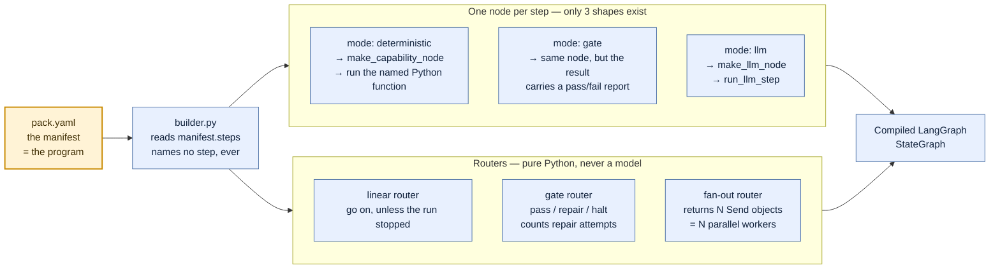
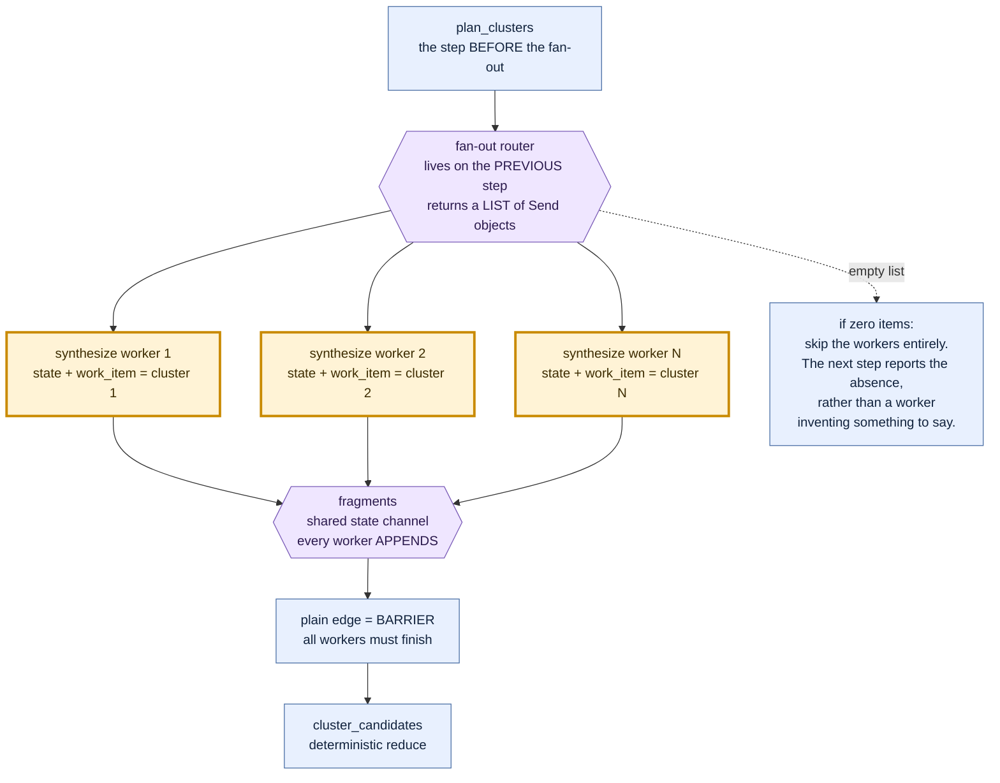
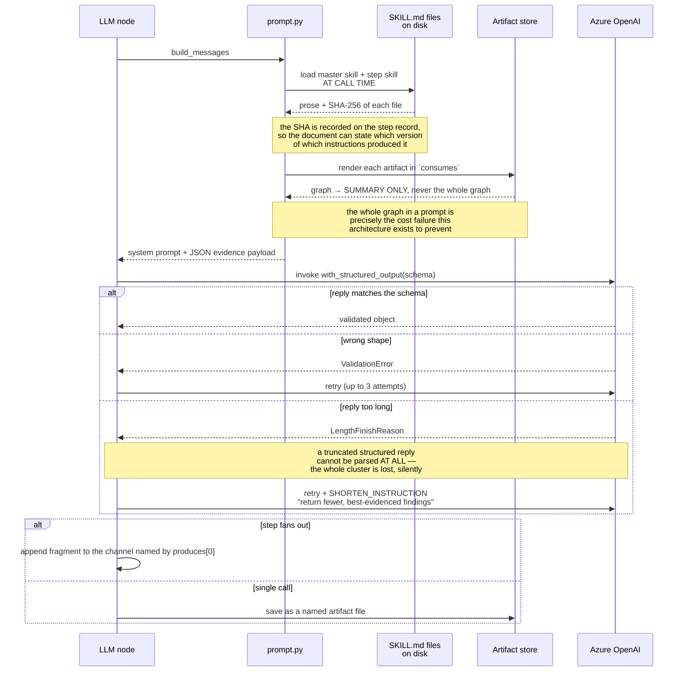
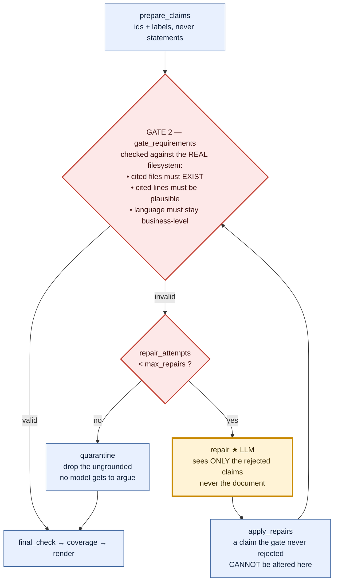

# Understanding the Requirements Pipeline

A plain-language walkthrough of what happens, in order, when this tool turns a codebase into a
requirements document — and exactly where a language model is used, where it is not, and why.

This covers **pipeline 1 only** (requirement generation). The test-generation pack is a separate
pipeline that reads this one's output.

> **If you prefer pictures, jump to [§11 — The Diagram Atlas](#11--the-diagram-atlas).** It has
> twelve diagrams covering the whole system, and §12 is a script for explaining it out loud.

---

## 1. What this tool is trying to do

You give it a codebase. It gives you back a requirements document (a BRD) that says what the
software actually does — in business language, not code language.

The hard part is not writing the document. The hard part is **making sure every sentence in it is
true**. Anyone can point a language model at a repository and get a confident-sounding document
back. Most of it will be invented, and nothing in it will tell you which parts.

So the whole design is built around one promise:

> Every statement in the final document can be traced back to a real line, in a real file, in code
> that can actually be reached from outside the system.

Everything else in this pipeline — the graph, the packets, the gates, the clustering — exists to
keep that promise. Once you see that, the design stops looking complicated and starts looking
obvious.

---

## 2. The words you need

These terms appear everywhere in the code. Here they are in plain English.

| Term | What it actually means |
|---|---|
| **Pack** | One complete pipeline, defined in a folder. `codebase-requirement-skills/` is the requirements pack. |
| **Manifest** | The `pack.yaml` file. It lists the steps in order. **This file *is* the program.** |
| **Step** | One stage of the pipeline. Has an id, a mode, and what it reads and writes. |
| **Capability** | A Python function registered under a name. A deterministic step names one and runs it. |
| **Artifact** | A named result saved to disk in the run folder — `inventory`, `graph`, `clusters`, `brd`. Steps pass data to each other through these. |
| **Skill** | A `SKILL.md` file — the instructions given to the model. Kept as Markdown on purpose, never as Python strings. |
| **Entity** | One node in the knowledge graph: a function, a class, a file, a database table, a config key. |
| **Boundary** | A place the outside world can reach in: an HTTP route, a CLI command, a scheduled job, a button. |
| **Cluster** | A small slice of the graph around one boundary. This is what one model call gets to see. |
| **Packet** | The cluster, serialised into compact JSON, kept under a character budget. **The model never sees source code — it sees a packet.** |
| **Fragment** | One parallel worker's reply. Many workers write fragments; a later step collects them. |
| **Channel** | A shared list in the run state that fragments get appended to. |
| **Gate** | A checking step. If it fails, the pipeline stops or repairs — it never just carries on quietly. |
| **Fan-out** | Running the same step many times in parallel, once per item (once per cluster, once per module). |

---

## 3. The two-layer design

Almost every "how does this work" question answers itself once you separate these two layers.

### Layer 1 — the manifest is the program

`pack.yaml` is not a config file. It is the workflow itself.

`src/agentic/graph/builder.py` reads `manifest.steps` and builds a LangGraph state machine from it —
one node per step, wired together by the order in the file. **Nothing inside `src/agentic/graph/`
mentions a single step name, skill name, or artifact name.**

Why this matters: adding a whole new pipeline (threat modelling, migration analysis) means adding a
folder with a YAML file in it. It does not mean editing the engine.

### Layer 2 — every step is one of only three shapes

`src/agentic/graph/nodes.py` turns each step into a node, and there are only three possibilities:

1. **`mode: deterministic`** → look up the named Python function and run it. No model involved.
2. **`mode: gate`** → same thing, but the result includes a pass/fail report that the *router* reads
   to decide where to go next.
3. **`mode: llm`** → build a prompt, call the model, force the reply into a schema.

That's it. Three shapes cover every step any pack will ever declare, because all the differences
live in the manifest.

---

## 4. The single most important fact

Out of roughly **28 steps in this pipeline, only 5 call a language model.**

They are:

| # | Step | What it decides |
|---|---|---|
| 1 | `classify_boundaries` | "Is this function an HTTP endpoint, a CLI command, or just dead code?" |
| 2 | `synthesize` | "What business capability does this slice of code offer?" ← the main one |
| 3 | `analyse_module` | "What is true of this whole part of the product, that no single endpoint shows?" |
| 4 | `elevate` | "What is this product for, and what are its handful of business outcomes?" |
| 5 | `repair` | "Fix these specific claims the gate rejected." |

**Everything else is ordinary Python.** Ingestion, graph building, schema parsing, clustering,
module partitioning, consolidation, deduplication, confidence scoring, both gates, and all
rendering — no model touches any of it.

### The rule behind that split

> **Use the model only for judgement about meaning that no rule can compute. Never use it for
> anything derivable. Never let it state a fact it wasn't handed.**

Three consequences of that rule, which you'll see enforced in several places:

- **The model never sees source code.** It sees evidence packets — compact records of entities and
  their connections. This is both a cost control and a truthfulness control.
- **The model never picks the next step.** Routing is pure Python in `graph/router.py`. The comment
  there explains why: a supervisor that could choose the next step could reason its way *past a
  failed gate* because continuing looked more helpful. Here it structurally cannot.
- **The model doesn't get to score its own confidence.** It reports a number, that number is kept
  for comparison, and then a deterministic step recalculates confidence from the actual evidence.

---

## 5. The pipeline, step by step

Now the actual walk. For each step: what goes in, what happens, what comes out, and **model or no
model**.

---

### Phase 0 — `ingest`  ·  *no model*

**In:** a zip file or a folder.
**Out:** `inventory` — the list of files, with language and size for each.

Unpacks the archive **safely**: it rejects path traversal (`../../etc/passwd`), absolute paths,
symlinks, encrypted entries, and files whose compression ratio suggests a zip bomb. Then it walks
the tree, skipping `.git`, `node_modules`, `dist`, `.venv`, build output — none of which are
evidence about the product.

**Fails closed.** If there's nothing analysable, it halts rather than writing a document based on
filenames.

**Why no model:** these are filesystem facts. A model adds nothing and could invent a file that
isn't there.

---

### Phase 1 — `graphify_extract`  ·  *no model*

**In:** `inventory`.
**Out:** `graphify_raw` — raw nodes and edges.

Runs Graphify, which uses local tree-sitter parsers to read **36 languages**. It answers "what is
defined here, and who calls whom".

This replaced an older set of hand-written Python-only extractors. That swap bought 36 languages —
and quietly lost some things the old extractors used to find. **Three of the four changes described
in section 8 exist to recover what that swap lost.** Worth remembering: it is a recurring theme in
this codebase.

---

### Phase 1b — `adapt_graph`  ·  *no model*

**In:** `inventory`, `graphify_raw`.
**Out:** `graph` — the canonical knowledge graph.

Converts Graphify's output into this project's own shape: entities and relationships with
content-addressed ids. It also reconstructs end-lines, because Graphify reports where something
starts and never where it ends.

**This is where docstrings get attached** (change #1, section 8.1).

Split from the step above on purpose: if this fails, you know it's a mapping bug and not a missing
binary. A failure that names itself is worth a separate step.

---

### Phase 1b(ii) — `extract_declarations`  ·  *no model*

**In:** `inventory`, `graph`.
**Out:** `graph` (added to).

Opens the files that state **policy** rather than perform behaviour: `schema.sql`, `.env.example`,
`docker-compose.yml`, `requirements.txt`, `package.json`, Dockerfiles.

Here is the insight that justifies this step. A call graph answers *"who calls whom"*. That is the
right question for behaviour and the **wrong question for policy** — because:

> Nothing calls a database schema. Nothing calls a settings file. Yet they state, more strongly than
> any application code can, what the product must do.

A line like `CHECK (role IN ('admin', 'recruiter', 'sysadmin'))` is a hard rule the database
enforces whatever the code does. No amount of call-graph walking will ever find it, because it sits
on no call path at all.

It produces six kinds of node: `CONFIG_KEY`, `DATA_ENTITY`, `DATA_FIELD`, `DATA_INDEX`,
`DOMAIN_POLICY`, `EXTERNAL_SERVICE`. Credentials are redacted. Only fixed, literal values are kept —
never a guessed one.

**Why no model:** parsing `CHECK (role IN (...))` is a parse, not a judgement. And a parsed value
can be quoted exactly; a model's paraphrase of it cannot be trusted as a citation.

---

### Phase 1b(iii) — `extract_instruction_artifacts`  ·  *no model*

**In:** `inventory`, `graph`.
**Out:** `graph` (added to).

Reads skill files, prompt files and agent-config Markdown **as structure**, and draws a `LOADS` edge
from the code that opens one to the file itself.

This is the newest change and is explained in full in section 8.4 — including the two rules that
were built, measured, and thrown away before the third one worked.

---

### Phase 1c — `propose_boundary_candidates`  ·  *no model*

**In:** `graph`.
**Out:** `boundary_candidates` (the full list) and `boundary_candidate_batches` (the same list, cut
into batches of 120).

We need to find the places the outside world can reach in. But Graphify doesn't mark anything as "a
route" — it has no idea what Flask or Express is. So the signal has to come from **graph shape**
instead.

Here's the trick, and it's a genuinely good one:

> A route handler is called by a framework. A CLI command is called by the runtime. A button
> callback is called by the UI toolkit. **None of them are called by the code sitting next to
> them.** So on a call graph built only from this repository, every one of them has the same
> property: **nothing in this repository calls it.**

That is a *shape*, not a framework list. It works for Flask, Express, Spring, Sinatra, gin, and for
frameworks nobody involved has ever heard of. That is what makes the tool language-independent.

It over-collects badly — dead code and unused public helper functions look exactly the same as a
route handler. That is fine, and deliberate: the next step exists to sort them out.

Along with each candidate it gathers **nearby string literals** (within 3 lines) and the names the
file uses but never defines. That's where a decorator, an annotation, or a registration call shows
up — `@app.route("/users")` leaves the literal `"/users"` sitting right above the function.

---

### Phase 1d — `classify_boundaries`  ·  ★ **MODEL CALL #1** (fan-out: one call per batch of 120)

**In:** one batch of candidates.
**Out:** `BoundaryAssignments` — a class for each candidate, or `NONE`.

The first model call in the whole pipeline. The reason it must be a model:

> Deterministic code can find *which functions are suspicious*. Only judgement can say **"this one
> is an HTTP endpoint and that one is dead code"** — because the difference isn't structural, it's
> semantic, and it looks different in every framework.

**What the model is shown:** qualified name, kind, location, how many things call it, what undefined
names it references, and the nearby literals. **Not source code.**

**What it is told:** classify each one, and say `NONE` for the rest. It is explicitly warned that
**most candidates are not boundaries** — a function nothing calls is usually dead code, a
test-only helper, or a public library function.

**Why a wrong answer is survivable:** the model classifies a node it was handed. It never states a
file path or a line number. So the worst it can do is mislabel a boundary — it structurally cannot
fabricate a citation.

This step used to be one single call over a **truncated** list. That was the biggest bug in the
pipeline and is change #2 (section 8.2).

---

### Phase 1d(ii) — `collect_boundary_assignments`  ·  *no model*

Takes every batch worker's reply and concatenates them into the one flat list that the next step has
always consumed. A fragment whose shape doesn't parse is **reported, not guessed at**.

This is the pattern to notice: **fan out to N model calls, then reduce deterministically.** It
appears three times in this pipeline. Because the reduce step restores the exact original shape,
nothing downstream ever needs to know that classification now costs many calls instead of one.

---

### Phase 1e — `discover_entry_points`  ·  *no model*

**In:** `inventory`, `graph`, `boundary_assignments`.
**Out:** `graph` (boundaries added), `entry_point_coverage`.

Turns the classifier's answers into real boundary nodes in the graph.

Design note worth understanding: the classifier's answers arrive here as **one adapter among
several**. Other adapters can contribute boundaries too. The point is that every boundary in the
run gets created in exactly one place and counted by exactly one coverage report — so if a whole
paradigm is being missed, it shows up as a number rather than as silence.

---

### Phase 2 — `gate_graph`  ·  *no model* — **Gate 1**, `on_fail: halt`

Structural checks on the graph. Does it have boundaries at all? Is it coherent?

If it fails, the router sends the run to the halt node, which writes a `run_failed.md` explaining
what went wrong and which steps completed. The philosophy, quoted from that file:

> "This workflow stops rather than producing a weaker document. A gate failure means the evidence
> could not support a trustworthy result, and a document that hid that would be worse than no
> document."

---

### Phase 2b — `partition_modules`  ·  *no model*

**In:** `graph`.
**Out:** `modules`, `boundary_modules`.

Groups boundaries into **modules** — parts of the product.

How does it decide which boundaries belong together? By **how much code they share**. If `/rounds`,
`create_round` and `create_slot_invite` all reach mostly the same set of functions underneath, they
are three faces of one feature. (Measured with Jaccard overlap over each boundary's reachable set.)

Two obvious alternatives were tried on a real 381-file repository and **rejected on measurement**:

- **Group by directory** → gave a *layer* split: `app/api` (1,081 nodes) and `app/services` (1,299).
  Those are architectural layers, not product features.
- **Community detection on the graph** → collapsed api + services + repositories into a single
  1,244-node hairball, because a layered application is densely interconnected by construction.

Reach-overlap gave actual features. Result: 293 boundaries became 21 modules.

This step also **hands down each cluster's area code** — which fixes something that was structurally
impossible before. See section 8.3.

---

### `plan_clusters`  ·  *no model* — **the cost-control step of the entire system**

**In:** `graph`, `boundary_modules`.
**Out:** `clusters`.

This step decides **what slice of evidence each model call is allowed to see**. It is the single
reason this tool can analyse a large repository at all.

It builds three kinds of cluster:

**1. Boundary clusters.** Start at a boundary, walk outward along "workflow" edges (calls,
registrations, loads), collect what you reach, and serialise it into a packet under a character
budget. If a cluster is too big for one packet, it is **sliced into several packets** — never
truncated. Slicing costs one more bounded call and loses nothing; truncating loses the deepest,
most specific part of the walk, which is exactly the part nobody else would have written.

Boundaries that share the same workflow are **merged into one packet**. Two routes on one handler is
one call, not two — and, importantly, sending them separately would produce two near-identical
requirements that both survive deduplication *because each one is independently true*.

**2. Declaration clusters.** One packet per declaring file (a schema, a settings file), on a
**separate budget**. Pooling them with boundaries was tried and is wrong, and the reasoning is
sharp:

> A schema and an HTTP verb are not competing samples of one population.

Pooling just chose a new victim — served last, declarations got starved; served first, they starved
the largest class of endpoints. There was no ordering that resolved it, because the premise was
wrong.

**3. Residual clusters.** Everything meaningful that no boundary walk and no declaration group
reached — background jobs, migrations, admin scripts, whole subsystems no route touches. Grouped by
directory (one packet per file would cost a call per file to say very little).

**Selection is sampling, never truncation.** `_stratified` takes its quota by walking every class in
turn. The reason is a bug worth internalising:

> Taking the first N of a list is only correct if the ordering is meaningful. Here the primary sort
> key (degree) is routinely identical across a whole class of boundaries, so the ordering collapses
> to the alphabetical tiebreak on the name — and where names start with a class discriminator (an
> HTTP verb, a queue name), the list arrives **grouped by class**, so truncating it silently
> deletes entire categories.

This exact bug has now been found **four separate times** in this codebase, in four different capped
lists.

---

### Phase 3a — `synthesize`  ·  ★ **MODEL CALL #2** (fan-out: one worker per cluster)

**This is the workhorse.** It is where requirements actually get written.

**In:** one evidence packet — compact entity records, their workflow edges, and `depends_on` (the
external systems this cluster uses). Never raw source.
**Out:** a `BRDFragment` — candidate requirements with citations.

**Why a model:** "what business capability does this code offer?" is irreducibly a language
judgement. There is no rule that turns a call graph into the sentence "a recruiter can invite a
candidate to a scheduled round".

**Why fan out:** cost becomes linear in the number of boundaries, not in the size of the repository.
200 endpoints means 200 small calls instead of one impossible one. And crucially, **one worker
failing does not kill the run** — the node catches a fan-out worker's exception, records it, and
lets every other worker finish. The gap analysis reports the missing cluster.

The step is told explicitly: describe only what this cluster's evidence supports, do not speculate
about the rest of the system, and **do not write a product purpose** — a later step does that from
every cluster together.

---

### Phase 3a(ii) — `analyse_module`  ·  ★ **MODEL CALL #3** (fan-out: one worker per module)

**In:** one module — all its boundaries, its external dependencies, the policy declared in its
scope, the instruction rules its code loads, and an evidence packet.
**Out:** a `ModuleAnalysis`.

This is the **altitude the pipeline was missing**, and the reasoning for adding it is the clearest
example of the design thinking in this project:

- `synthesize` sees **one boundary** — a median of nine graph nodes.
- `elevate` sees a list of **finding titles** for the whole repository.
- Between them sat only deterministic steps.

So **nothing anywhere reasoned about a *part* of the product.** And that meant a whole class of
requirement was literally unwritable:

- *"Every write path here goes through one repository layer."*
- *"Nothing in this part accepts a request without a tenant id."*
- *"The retry bound is three across all six handlers."*

Each of those is true of a module and **invisible from inside any one of its boundaries**. They are
system requirements, cross-cutting rules and quality properties — three of the families that no
stored run had ever populated.

The instruction to this worker is unusually strict, and the test it gives is a good one:

> "If the statement would be just as true written from one endpoint, it belongs there, not here.
> Returning nothing but a name and a purpose is a correct and frequent result."

It is also told that a `residual` module is a bag of unrelated behaviours, not a part of the
product — so for those, returning nothing is the right answer.

Anything it was asked for and could not write goes into `unevidenced` **with the reason**. An honest
gap gets read by the completeness report; a guessed entry gets rejected.

---

### `collect_module_analyses` · `cluster_candidates` · `digest_areas`  ·  *no model*

- **`collect_module_analyses`** — reduce the module workers' replies into one artifact.
- **`cluster_candidates`** — group candidate requirements by **what they say**, not by where in the
  code they came from. This is the step whose absence made the old output read as a flat inventory
  of behaviours: before it, every comparison required two candidates to *share code* before their
  wording was even looked at, and **nothing ever asked whether two candidates meant the same thing**.
  Two workers describing the same capability from the entry point and from the work behind it cite
  different lines *by construction*, so they were never compared.
- **`digest_areas`** — build a compact digest: area code, business name, boundaries, and the
  **titles** of the requirements written for it.

All deterministic — term overlap and signature matching, no model.

---

### Phase 3c — `elevate`  ·  ★ **MODEL CALL #4** (single call, no fan-out)

**In:** the area digest, the module analyses, and a **summary** of the graph.
**Out:** `TopTier` — the product purpose, the handful of business outcomes, and which area serves
which outcome.

Note what it is **not** given: the requirements themselves. It gets titles only. The full
requirements are already written, already grounded, already checked, and are carried into the
document by the next step without a model touching them.

This replaced an older step called `reduce`, and the replacement is the whole point of the rebuild:

> `reduce` was handed every finding and asked to return the finished document in one reply. With an
> 8,000-token output ceiling, that caps **any** repository at roughly a dozen requirements no matter
> how much it was shown.

`elevate` is small in, small out — and it stays that way as the repository grows.

---

### `assemble`  ·  *no model*

**In:** the fragments, the top tier, the capability clusters.
**Out:** `brd` — the first full draft.

Every grounded finding from every cluster is carried through **unchanged** and attached to the
business requirement its area was bound to. **Nothing is summarised or dropped for space.** The only
claims that leave are the ones a gate rejects, and that happens on the record.

This is why the requirement count now tracks the size of the codebase instead of the size of one
model reply.

---

### The consolidation block  ·  *all deterministic, no model*

Seven steps in a row, and together they are the responsibility the old workflow simply skipped:
taking a repository-wide pile of candidates and settling it into a requirement **set**.

| Step | What it does |
|---|---|
| `consolidate` | Levels, duplicates, parameterised families, hierarchy. Merges "X for invoices" + "X for orders" into one parameterised requirement. |
| `check_correspondence` | **Does the claim say what the code it cites actually does?** Every other check compares a statement to another statement or to a blacklist. This one compares it to the evidence. |
| `score_confidence` | Recomputes confidence from the evidence. The model's own number is kept alongside so the two can be compared — **the model does not get to assert its own confidence.** |
| `strip_implementation` | Moves implementation detail out of the statement and into the traceability data. Runs **before** the gate on purpose: a well-grounded requirement that happens to name a framework is a *wording* problem, and deleting it over that discards checked evidence. |
| `resolve` | Every candidate leaves with **exactly one disposition**. What can't be published goes to `unresolved_candidates` *with its evidence and the reason* — nothing is deleted silently. |
| `derive_criteria` | Acceptance criteria last, once the set is final — a criterion written against a requirement that later gets merged or dropped would either vanish or follow it onto something it was never about. |
| `prepare_claims` | Stamps ids and fixes citation labels, so the gate judges claims rather than bookkeeping. Never touches a statement, a path, or a line range. |

---

### Phase 4 — `gate_requirements`  ·  *no model* — **Gate 2**, `on_fail: repair`

Re-checks every surviving claim against the **real filesystem**, not just the graph:

- cited files must actually exist
- cited line numbers must be plausible
- statements must stay in business language

---

### `repair`  ·  ★ **MODEL CALL #5** (bounded loop)

**In:** the gate's issue list and **only the rejected claims**.
**Out:** `RepairedItems`.

The loop is bounded: the gate router counts attempts against `max_repairs`, and the repair node
itself increments the counter — because the router can't write state, so otherwise the bound would
never bind.

The important design decision here: repair sees **only the rejected items**, never the document.
Handing it the whole BRD was ruinous in two directions at once:

- **On input** it blew past the artifact size cap and arrived truncated, so the model was asked to
  fix a document it could only partly see.
- **On output** it was expected to re-emit every requirement inside one bounded reply — which past a
  few dozen is arithmetically impossible. The document came back a fraction of its size and
  **nothing recorded the loss.**

Everything that passed is carried across by the next step without a model touching it.

---

### `apply_repairs` · `quarantine` · `final_check` · `report_family_coverage` · `render`  ·  *no model*

- **`apply_repairs`** — put repaired claims back, carry everything else across untouched. **A claim
  the gate never rejected cannot be altered here at all.** That is why a rejection over one phrase
  can no longer shrink the whole document.
- **`quarantine`** — reached only when the repair budget is spent. Removes what could not be
  grounded, so an honest thinner document can still be produced. Deterministic on purpose: **no
  model gets to argue for keeping a claim the gate rejected.**
- **`final_check`** — the last look at the finished set, and the only step that can see it whole.
  Duplicate titles, relations pointing at nothing, cycles in the parent chain — these are properties
  of the *whole set* and are invisible until nothing is going to move again.
- **`report_family_coverage`** — completeness. See section 8.3.
- **`render`** — the deliverables. **Always runs, even when little grounded**, so the gap analysis
  can explain why coverage is thin.

---

## 6. How a model call actually works, mechanically

Every one of the five model steps goes through the same code path in `src/agentic/llm/steps.py`.

**Step 1 — build the system prompt** (`build_system_prompt`). Three pieces glued together:

1. the **master skill** body — the grounding rules that apply to everything in the run,
2. the **step's own skill** section, and
3. the step's `instructions:` block from `pack.yaml`,
4. plus a fixed output contract about citations.

All of this is **read from the Markdown files on disk at call time**. Changing what the model is
told means editing a `SKILL.md`, not editing Python. And the **exact SHA-256 of the skill file** is
recorded on the step record — so a finished document can state which version of which instructions
produced it, and drift between the Markdown and the code becomes auditable instead of invisible.

**Step 2 — build the human message.** A JSON evidence payload. It walks the step's `consumes` list
and renders each artifact through a registered renderer. The important one:

> The `graph` renderer returns a **summary only** — counts, kinds, a few ranked documentation
> outlines, module intent. **The whole graph must never enter a prompt.** That is precisely the cost
> failure this architecture exists to prevent.

**Step 3 — force the shape.** `model.with_structured_output(schema)`, where the schema name comes
from the manifest (`BoundaryAssignments`, `BRDFragment`, `ModuleAnalysis`, `TopTier`,
`RepairedItems`). The shape is enforced by the provider, not parsed out of prose — so a malformed
reply is a retry, not a silently broken document.

**Step 4 — three retries, with one special case.** A wrong *shape* just retries. But a **length
failure** is handled specially: the code appends a `SHORTEN_INSTRUCTION` telling the model its
previous reply was discarded entirely and to return fewer, better-evidenced findings. The reason
this matters:

> A truncated structured reply cannot be parsed at all, so the **whole cluster is lost** rather than
> shortened — and for a fan-out worker that loss is completely silent unless something asks again
> for less.

**Step 5 — route the output.** If the step fans out, the reply becomes a *fragment* appended to the
state channel named by `produces[0]`. Otherwise it is saved as a named artifact file.

### How fan-out actually dispatches

This one is slightly unusual and worth seeing clearly.

The fan-out step is **not** entered by a normal edge. It is entered by the **router of the step
before it**, which returns a list of `Send` objects — one per work item, each carrying a copy of the
state with `work_item` set. That is what creates N parallel workers.

The barrier is then a plain edge from the fan-out step to the next step: **all workers must finish
before the reduce step runs**, and one failing worker must not stop the others.

If there are zero items to fan out over, the router skips straight past the worker step — the
downstream step then reports the absence, rather than a worker inventing something to say.

---

## 7. What the state looks like while running

`AgentState` is a dictionary that flows through the graph. The parts that matter:

- **`artifacts`** — a map of name → file path in the run folder. This is how steps pass data.
- **`fragments`** — the channel `synthesize`'s workers write into.
- **`boundary_fragments`** — the channel `classify_boundaries`'s workers write into.
- **`module_fragments`** — the channel `analyse_module`'s workers write into.
- **`gate_reports`** — per-gate pass/fail, read by the routers.
- **`completed_steps`, `step_records`, `metrics`** — the audit trail.
- **`repair_attempts`** — what makes the repair loop terminate.

**Why three separate fragment channels instead of one?** This is a subtle, good decision. Every
field on `BRDFragment` has a default value. So a boundary-classification reply landing in the
shared `fragments` channel **would not fail validation** — the fields simply wouldn't overlap, and
validating an empty object succeeds. It would silently become a spuriously empty requirement
fragment, inflating the "N replies could not be read" counting for a phase that has nothing to do
with boundary classification.

A dedicated channel avoids that entire category of bug, instead of relying on
permissive-validation-happens-to-filter-it-out.

---

## 8. The four changes made to the original design

In the order they happened.

### 8.1 — Semantic meaning from docstrings and comments

**The problem.** Graphify *had* already found every docstring and marked comment in the codebase.
But it kept them as separate `RATIONALE` nodes, **cut to about 80 characters**, joined to the thing
they describe by a `rationale_for` edge that **no workflow walk ever follows.**

So the developers' own written statements of intent were sitting in the graph, truncated, attached
to nothing any model would ever read.

**The fix.** Read the **full text** back from the source file and attach it as a `docstring`
attribute **on the entity it describes**. Now it travels inside evidence packets, reaches the
correspondence checker, and feeds a new `module_intent` summary.

**No model, fully deterministic, and every word traces to a real source line.** That last part is
why this is a good fix rather than a lazy one: it adds meaning without adding any claim that can't
be checked.

---

### 8.2 — Batch boundary classification instead of truncating it

**The problem, and it was the worst one.** `MAX_CANDIDATES = 120` was a hard cap. Everything past it
was **silently discarded**. On the largest stored run (381 files):

> **1,868 of 1,988 candidates — 94% — were never shown to the classifier at all**, no matter how
> many of them were real endpoints.

Every one of those discarded candidates never gets classified, so it never seeds a cluster, so it
never produces a requirement. And nothing anywhere said so.

**Two other fixes were considered and rejected**, and the reasoning is instructive:

- **Raise the cap.** The cap was sized against the *reply's* output ceiling, not the prompt's.
  Raising it just moves the cliff edge and risks the same length failure at a larger scale.
- **Sample better** (use `_stratified` to pick a *better* 120). This fixes the categorical skew, but
  still throws away real candidates — just a better-chosen 120 instead of an alphabetically
  arbitrary one.

**Batching is strictly stronger.** Every candidate gets classified, in some batch. The
categorical-skew failure mode cannot happen at all — **not "happens less", but structurally cannot,
because nothing is selected out.**

**What changed in the flow:** `classify_boundaries` became a fan-out step (one model call per batch
of 120), plus a new deterministic reduce step that restores the exact original output shape — so
nothing downstream changed at all.

**One shared-code generalisation made it possible:** fan-out fragments used to always go to a
hardcoded `"fragments"` channel. Now they go to the channel named by the step's `produces`. The
existing steps declare `produces: [fragments]`, so they behave identically — the change is
backward-compatible by construction.

---

### 8.3 — Declared policy, a module tier, and full graph coverage

**The measurement that started it.** Across **all twenty** stored runs:

```
functional_requirements      19/20  OK      business_rules                0/20  EMPTY
business_requirements        13/20  OK      success_criteria              0/20  EMPTY
system_requirements           5/20  thin    technical_constraints         0/20  EMPTY
out_of_scope, open_questions  3/20  thin    data_requirements             0/20  EMPTY
                                            integration_requirements      0/20  EMPTY
                                            non_functional_requirements   0/20  EMPTY
                                            reporting_requirements        0/20  EMPTY
                                            assumptions                   0/20  EMPTY
```

Seven of thirteen requirement families had **never** been populated. Not sparse — *never*.

And on the reference run:

```
distinct entities reaching any packet   634 of 5,084  = 12.5%
average packet                          8,103 chars against a 40,000 budget  = 20%
packets reporting an omission           0 of 84
```

**The packets were not trimmed — they were empty.** And the budget to carry more was already being
paid for and left unspent.

The cause was **not the prompts** (they ask for all thirteen families). Four separate fixes:

**(a) `extract_declarations` — the missing producer.** Six node kinds had hand-written support in
four different files — `compact_entity`, `render.py`, `gates.py`, `declaration_groups` — and
**nothing anywhere emitted a single one of them.** They were orphaned when the Python-only
extractors were replaced by Graphify.

And the consequence was worse than a gap. `DECLARATION_KINDS` was used as a **ranking key**:

```python
key=lambda item: (-sum(1 for e in item[1] if e.kind in DECLARATION_KINDS), item[0])
```

Always zero — so the sort collapsed to `item[0]`, the file path. **A live, correct, fully wired
mechanism was running inert**, and the comment three lines above it described the exact defect it
existed to prevent.

Result: 633 new nodes on the reference repository, 12 credentials redacted, and policy recovered
that no call graph could ever have carried.

**(b) `analyse_module` — the missing altitude.** Covered in the step walkthrough above.

**(c) Residual clustering — 12.5% → 67.3% coverage.** Boundary clustering answers "what can an
outside actor cause to run", which is the right question for a *requirement* and the wrong question
for *coverage*. Background jobs, migrations, admin scripts and entire subsystems reached no model at
all.

**(d) `report_family_coverage` — why nobody noticed for twenty runs.** Gate 1 checks the graph.
Gate 2 checks every surviving claim is grounded. **Neither ever checked whether the document was
complete.** So a BRD with seven permanently empty families passed everything, because each claim in
it was individually well-evidenced.

> The quality bar was **all precision and no recall.**

Now, per family, it distinguishes two things that had looked identical: empty because the product
**declares nothing** of that kind (an honest result), or empty because evidence sits in the graph
**unused** (a defect in this pipeline, and named as one). Reported, never enforced — a thin document
is a fact about a codebase as often as it is a bug.

**The best insight in this change**, though, is a small one about coordination. `pack.yaml` used to
tell every parallel worker:

> *"clusters covering the same part of the product must use the same area code"*

**Which parallel workers cannot possibly obey** — none of them can see what the others chose. The
result was `ARCH` / `BAP` / `BATC` / `BCH`: four different area codes for batches, and 14 of 22
areas holding exactly one capability each.

Area codes are now **handed down from the deterministic partition**. That is a bug class worth
remembering: *asking isolated agents to agree on something none of them can see.*

---

### 8.4 — Instruction artifacts (the newest change)

**The measurement that settled it.** Run against a normal repository, it found 24 Markdown nodes, 17
of them agent skill files — and exactly **one** carried any text (the README, because of its name),
with **zero** edges to anything.

Then it was run against **this project itself**:

```
137 markdown nodes ·  54 SKILL.md nodes
  0 carried any text ·  0 edges to anything
```

The cause: the Markdown reader matched a **hardcoded filename whitelist** whose only Markdown
pattern was `readme*`. So a `SKILL.md` returned nothing at all.

Why that is damning rather than merely a gap: this project's own architecture states that skill
instructions live in Markdown *"never inside prompt string literals"* — a deliberate choice to move
behaviour out of code. Analysing itself, it read **none of them**. It would have documented the
loader and said nothing about what is loaded.

**The general principle:** for an LLM-powered product, **the skill or prompt file *is* the
implementation.** The code around it only opens a file and posts it to an API.

**What was built:**

- **`INSTRUCTION_ARTIFACT`** — the file, with its declared name, description, and section headings.
- **`INSTRUCTION_RULE`** — one declared prohibition or obligation, with its modality ("must",
  "never"), its section, and its line number.
- **A `LOADS` edge** from the code that opens the file to the artifact.

Result: 19 artifacts, 315 rules, and **280 instruction nodes now reaching evidence packets — from
zero.**

Role is decided by **location first, then filename**, because those are what projects actually use
to mean "these are instructions". A file under `.agents/skills/` is an instruction artifact whatever
it's called; a file called `SKILL.md` is one wherever it sits. A README *inside* a skill directory
stays documentation, because it describes the pack rather than instructing a model.

#### The grounding decision (read this part carefully)

Putting `LOADS` into `WORKFLOW_EDGE_KINDS` means **a requirement may be grounded in an instruction
file when traced code loads it.** That is a policy decision, not a technicality.

It follows the schema precedent: nothing *calls* a schema either, and a declared constraint earns
citability because the database enforces it. An instruction file earns it because the model is given
it on every single request.

**But the enforcement is weaker, and it is labelled as weaker:**

- Rules carry `RESOLVED` provenance and **0.7 confidence**, not `EXTRACTED` certainty.
- The synthesis instruction requires them worded as declared policy: *"the system is instructed to
  refuse X"* — **never** *"the system refuses X"*.

> **An instruction asks; a constraint enforces.**

Reversing the decision is one line — remove the entry — and a test asserts it is present, so removal
becomes a deliberate act with a failing test attached rather than a quiet change of policy.

#### Loader matching: two rules built, measured, and thrown away

This was the hard part, and it is the best worked example of the project's method. A false `LOADS`
edge gets walked like any other, so **one wrong link lets a requirement ground itself in an
unrelated instruction file** — the exact fabrication the whole pipeline exists to prevent.

| Attempt | Edges found | Verdict |
|---|---|---|
| Every path segment is a match literal | **114** | **All false.** The repository root was a literal for every artifact, so any line mentioning the repo name linked to all nineteen. |
| Only the distinctive leaf directory | **12** | **All false.** A directory is named after a domain concept, and a concept is an ordinary English word. |
| Path-shaped or glob, inside quotes, not in a comment | **0** here | **Correct.** Those skill files are for the developer's coding agent; no product code loads them. |

The second attempt's failures deserve reading, because in a summary table they look like successes:

```
literal='extraction'  matched   "extraction": result,          <- a dict key in an API response
literal='queue'       matched   # ...the Needs-Review queue...  <- a comment
literal='queue'       matched   @router.get("/queue")          <- a route path
```

The surviving rule has four parts, each of which removed a class of false edge:

1. **Path-shaped only** — a separator, or a filename with an instruction suffix. Distinguishes
   naming a *file* from mentioning a *concept*.
2. **Globs allowed, but must contain a separator** — a registry globs rather than naming each file,
   so without glob support only a hardcoded single path would be detectable. Bare `*.md` is rejected:
   it names a file *type* and would link one loader to every artifact.
3. **Must be inside a quoted string** — a path in prose is a description, not a load.
4. **Not in a comment, and backticks are not quote characters** — backticks delimit a template
   literal in JavaScript but are Markdown markup in Python docstrings, and this project's comments
   use them constantly.

Every edge records **which literal matched**, so a reviewer can tell a real load from a coincidence
without re-deriving it.

#### The ranking defect found next door

While tracing how Markdown reached a prompt, the documentation list turned out to be selected with
**no ordering at all** — the first four in graph order, and graph order is sorted by **content
hash**. So the selection was deterministic and semantically arbitrary:

```
docker-compose.yml            <- three of four slots went to infrastructure
README.md                     <- survived by luck of hashing
docker-compose.override.yml
frontend/Dockerfile
```

What makes it clearly a defect rather than a judgement call: **ten lines below**, the module-intent
list does the same capped selection and ranks properly, *with a comment explaining why*. The
reasoning had been written down, applied to one of two adjacent capped lists, and not the other.

Now ranked by what a file actually states about the product: a README or an architecture document
outranks a deployment recipe, and an override file — a variant of a variant — ranks below the file
it overrides.

**This was the fourth instance of the same pattern in this codebase:** a capped list taken in
arbitrary order. The others were the boundary-candidate cap, the declaration-file ranking, and the
area codes each worker invented alone.

---

## 9. Recurring patterns worth internalising

Five ideas show up again and again. If you learn these, the rest of the codebase reads easily.

**1. Truncation is never the answer; sampling or slicing is.** Taking the first N of a list is only
correct if the ordering is meaningful, and it usually isn't. Four separate bugs in this codebase were
the same bug.

**2. A consumer without a producer is worse than a gap.** When six node kinds had support in four
files and nothing emitted them, a correct ranking key was silently always-zero and a working
mechanism ran inert. Orphaned code doesn't just do nothing — it can quietly disable something else.

**3. Fan out to the model, reduce deterministically.** Every parallel model phase is followed by a
plain Python reduce step that restores the exact shape downstream already expected. That is what
makes adding a parallel phase invisible to everything after it.

**4. Never ask isolated agents to coordinate.** If N parallel workers must agree on something none
of them can see, they will not. Compute it beforehand and hand it down.

**5. Precision without recall is not quality.** Twenty runs passed every gate with seven of thirteen
requirement families permanently empty, because every check asked "is this claim true?" and nothing
ever asked "is anything missing?"

---

## 10. Known risks, honestly stated

- **The module tier has never run against a real model.** Every number in change 8.3 comes from
  deterministic steps and stubbed model calls. Its *output quality* is unmeasured. Expect the first
  full run to look noisier before it looks deeper.
- **Consolidation has never run at this volume or across tiers.** Roughly double the evidence plus a
  new altitude means the consolidation block will need tuning.
- **A false zero and a true zero look identical** in loader detection. It is precision-tuned, so a
  path assembled at runtime or read from config produces no edge. The step reports that none was
  found; it cannot report that none exists.
- **A declared rule is not an observed behaviour.** Nothing proves the model complies with its own
  instruction file. That is why confidence is reduced and the wording requirement exists — and it is
  the limitation most likely to be lost when a requirement is read out of context.
- **A declared value is not a used value.** There are no edges from a `CONFIG_KEY` to the code that
  reads it, so a requirement resting on one asserts *declared* policy, not observed behaviour.
- **The extraction step sequence is duplicated in five test files**, only one of which derives it
  from the manifest. It has now bitten three consecutive changes, each fixing it by hand. **Fix this
  before the next change.**
- **Cross-altitude duplication is managed by instruction, not by construction.** Nothing structurally
  prevents a module worker restating what a boundary worker already wrote.

**Deliberately not done:** a plain README's prose does **not** become policy. A README stating
"invoices over £10,000 require manager approval" produces no policy node. This is a recorded
decision, not an omission — prose in a README is a much weaker claim than either a schema constraint
or an instruction handed to a model on every request, and turning paragraphs into policy invites
exactly the over-extraction the whole design fights.

---

# 11 · The Diagram Atlas

Twelve diagrams, from the widest view down to individual mechanisms. Read them in order the first
time. After that, each one stands alone.

**Legend used throughout:**

| Shape / colour | Meaning |
|---|---|
| 🟦 Blue box | **Deterministic step** — ordinary Python, no model |
| 🟨 Yellow box, thick border | **LLM step** — an actual API call |
| 🟥 Red box | **Gate** — a checking step that can stop or redirect the run |
| ⬜ Dashed box | **Artifact** — a named file saved in the run folder |

---

## D1 — The whole thing in seven boxes

Start here. If someone asks "what does this tool do", this is the answer.

```
   ┌──────────┐
   │   ZIP    │   a codebase
   └────┬─────┘
        │
        ▼
   ┌──────────────────┐
   │  1. INVENTORY    │   which files exist, in which languages
   └────┬─────────────┘
        │
        ▼
   ┌──────────────────┐
   │  2. GRAPH        │   what is defined, who calls whom,
   │                  │   what is declared, what is instructed
   └────┬─────────────┘
        │
        ▼
   ┌──────────────────┐
   │  3. BOUNDARIES   │   where the outside world can reach in
   └────┬─────────────┘
        │
        ▼
   ┌──────────────────┐
   │  4. CLUSTERS     │   the graph cut into small evidence packets
   └────┬─────────────┘      ← THIS is what makes it affordable
        │
        ▼
   ┌──────────────────┐
   │  5. FINDINGS     │   one model call per packet, in parallel
   └────┬─────────────┘      ← THIS is the only creative step
        │
        ▼
   ┌──────────────────┐
   │  6. SETTLED SET  │   deduped, levelled, checked, scored
   └────┬─────────────┘      ← all deterministic
        │
        ▼
   ┌──────────────────┐
   │  7. DOCUMENT     │   every sentence cites a real file and line
   └──────────────────┘
```

**What to say about it:** "It doesn't ask a model to read a codebase. It *builds a map* of the
codebase deterministically, cuts that map into small pieces, and asks the model one narrow question
per piece. Then it checks every answer against the map again."

---

## D2 — The full pipeline, every step

This is the master diagram. Everything else in this atlas zooms into one part of it.

```mermaid
flowchart TD
    Z["ZIP or folder"] --> S1

    subgraph P0["PHASE 0 — Ingestion"]
        S1["ingest<br/>safe unzip, file inventory<br/>halts if nothing analysable"]
    end

    subgraph P1["PHASE 1 — Build the knowledge graph"]
        direction TB
        S2["graphify_extract<br/>tree-sitter, 36 languages"]
        S3["adapt_graph<br/>normalise + attach full docstrings"]
        S4["extract_declarations<br/>schema, env, compose, manifests"]
        S5["extract_instruction_artifacts<br/>SKILL.md files + LOADS edges"]
        S2 --> S3 --> S4 --> S5
    end

    subgraph P1C["PHASE 1c/1d — Find the boundaries"]
        direction TB
        S6["propose_boundary_candidates<br/>in-degree zero on CALLS<br/>+ cut into batches of 120"]
        S7["classify_boundaries<br/>ONE CALL PER BATCH, in parallel"]
        S8["collect_boundary_assignments<br/>reduce every batch reply"]
        S9["discover_entry_points<br/>create boundary nodes + coverage report"]
        S6 --> S7 --> S8 --> S9
    end

    G1["GATE 1 — gate_graph<br/>structural checks<br/>on_fail: HALT"]

    subgraph P2["PHASE 2b/3 — Decide what each call sees"]
        direction TB
        S10["partition_modules<br/>boundaries grouped by shared reach<br/>hands down the area codes"]
        S11["plan_clusters<br/>boundary + declaration + residual packets<br/>THE COST-CONTROL STEP"]
        S10 --> S11
    end

    subgraph P3["PHASE 3 — Write the findings"]
        direction TB
        S12["synthesize<br/>ONE CALL PER CLUSTER, in parallel<br/>the workhorse"]
        S13["analyse_module<br/>ONE CALL PER MODULE, in parallel"]
        S14["collect_module_analyses"]
        S15["cluster_candidates<br/>group by what they SAY"]
        S16["digest_areas<br/>titles only"]
        S17["elevate<br/>ONE CALL, whole product<br/>purpose + outcomes"]
        S12 --> S13 --> S14 --> S15 --> S16 --> S17
    end

    S18["assemble<br/>every finding carried through UNCHANGED"]

    subgraph P3E["PHASE 3e — Settle the set. All deterministic."]
        direction TB
        S19["consolidate — levels, duplicates, families"]
        S20["check_correspondence — claim vs evidence"]
        S21["score_confidence — recomputed, not asserted"]
        S22["strip_implementation — wording, before the gate"]
        S23["resolve — one disposition each, nothing deleted"]
        S24["derive_criteria — acceptance criteria last"]
        S25["prepare_claims — ids and labels"]
        S19 --> S20 --> S21 --> S22 --> S23 --> S24 --> S25
    end

    G2["GATE 2 — gate_requirements<br/>checked against the REAL filesystem<br/>on_fail: REPAIR"]

    S26["repair<br/>sees ONLY the rejected claims"]
    S27["apply_repairs<br/>untouched claims cannot be altered"]
    S28["quarantine<br/>drop what could not be grounded"]

    subgraph P4["PHASE 4c/5 — Finish"]
        direction TB
        S29["final_check — properties of the whole set"]
        S30["report_family_coverage — completeness"]
        S31["render — deliverables, always runs"]
        S29 --> S30 --> S31
    end

    HALT["HALT<br/>writes run_failed.md<br/>explaining why"]
    OUT["Requirements document<br/>+ gap analysis<br/>+ unresolved candidates"]

    S1 --> S2
    S5 --> S6
    S9 --> G1
    G1 -->|pass| S10
    G1 -->|fail| HALT
    S11 --> S12
    S17 --> S18 --> S19
    S25 --> G2
    G2 -->|pass| S29
    G2 -->|fail, budget left| S26
    G2 -->|fail, budget spent| S28
    S26 --> S27 --> G2
    S28 --> S29
    S31 --> OUT

    classDef det fill:#e8f0fe,stroke:#4a6fa5,color:#12233d
    classDef llm fill:#fff3d6,stroke:#c98a00,color:#3d2c00,stroke-width:3px
    classDef gate fill:#fde8e8,stroke:#c0392b,color:#3d1210,stroke-width:2px
    classDef term fill:#eee,stroke:#666,color:#222

    class S1,S2,S3,S4,S5,S6,S8,S9,S10,S11,S14,S15,S16,S18,S19,S20,S21,S22,S23,S24,S25,S27,S28,S29,S30,S31 det
    class S7,S12,S13,S17,S26 llm
    class G1,G2 gate
    class Z,OUT,HALT term
```



**How to read it:** the five thick yellow boxes are the *only* places a model is called. Everything
blue is ordinary Python. The two red boxes are the only places the run can change direction.

**What to say about it:** "Twenty-eight steps, five model calls. The model is asked five narrow
questions; everything else — building the map, cutting it up, checking the answers, settling
duplicates, scoring confidence, rendering — is deterministic code."

---

## D3 — The engine: how a YAML file becomes a running program

This is the part people find surprising. There is no hardcoded pipeline anywhere.



**The one sentence that matters:** *nothing inside `src/agentic/graph/` names a single step, skill,
or artifact.* Every decision comes from the manifest.

**What to say about it:** "Adding a second pipeline — threat modelling, migration analysis — is
adding a folder with a YAML file in it. It is a data change, not a code change. That's the whole
reason the manifest exists."

**Why routing is deliberately dumb:** a router that could *reason* about where to go next could
reason its way past a failed gate, because continuing would look more helpful in the moment. Here
it structurally cannot. That is a safety property, bought by giving up flexibility on purpose.

---

## D4 — Artifact lineage: what feeds what

Steps never call each other. They read and write **named artifacts** in the run folder. This is the
data-flow view of the same pipeline.

```mermaid
flowchart LR
    A1(["inventory"]) --> S2["graphify_extract"]
    S2 --> A2(["graphify_raw"])
    A1 --> S3["adapt_graph"]
    A2 --> S3
    S3 --> A3(["graph"])

    A3 --> S4["extract_declarations"] --> A3
    A3 --> S5["extract_instructions"] --> A3

    A3 --> S6["propose_boundaries"]
    S6 --> A4(["boundary_candidates"])
    S6 --> A5(["boundary_candidate_batches"])

    A5 -. one worker per batch .-> S7["classify_boundaries"]
    S7 --> C1{{"boundary_fragments<br/>state channel"}}
    C1 --> S8["collect_assignments"] --> A6(["boundary_assignments"])

    A6 --> S9["discover_entry_points"] --> A3

    A3 --> S10["partition_modules"]
    S10 --> A7(["modules"])
    S10 --> A8(["boundary_modules"])

    A3 --> S11["plan_clusters"]
    A8 --> S11
    S11 --> A9(["clusters"])

    A9 -. one worker per cluster .-> S12["synthesize"]
    S12 --> C2{{"fragments<br/>state channel"}}

    A7 -. one worker per module .-> S13["analyse_module"]
    S13 --> C3{{"module_fragments<br/>state channel"}}
    C3 --> S14["collect_modules"] --> A10(["module_analyses"])

    C2 --> S15["cluster_candidates"] --> A11(["capability_clusters"])
    C2 --> S16["digest_areas"]
    A11 --> S16
    S16 --> A12(["area_digest"])

    A12 --> S17["elevate"]
    A10 --> S17
    A3 --> S17
    S17 --> A13(["top_tier"])

    C2 --> S18["assemble"]
    A13 --> S18
    A11 --> S18
    S18 --> A14(["brd"])

    A14 --> S19["consolidation block<br/>7 deterministic steps"] --> A14
    A14 --> G2["GATE 2"] --> A15(["requirement_gate"])
    A15 --> S26["repair"] --> A16(["repairs"])
    A16 --> S27["apply_repairs"] --> A14
    A14 --> S31["render"] --> A17(["deliverables"])

    classDef art fill:#f7f7f7,stroke:#888,color:#333,stroke-dasharray:4 3
    classDef chan fill:#efe6ff,stroke:#7b5cb8,color:#2b1a4d
    classDef llm fill:#fff3d6,stroke:#c98a00,color:#3d2c00,stroke-width:3px
    classDef gate fill:#fde8e8,stroke:#c0392b,color:#3d1210,stroke-width:2px
    classDef det fill:#e8f0fe,stroke:#4a6fa5,color:#12233d

    class A1,A2,A3,A4,A5,A6,A7,A8,A9,A10,A11,A12,A13,A14,A15,A16,A17 art
    class C1,C2,C3 chan
    class S7,S12,S13,S17,S26 llm
    class G2 gate
    class S2,S3,S4,S5,S6,S8,S9,S10,S11,S14,S15,S16,S18,S19,S27,S31 det
```



**Two things to notice:**

1. **`graph` is written five times** — by `adapt_graph`, then enriched by `extract_declarations`,
   `extract_instruction_artifacts`, and `discover_entry_points`. Each pass only *adds*; none
   rewrites what a previous pass wrote. There are tests asserting every pre-existing entity survives
   byte-identical.
2. **Purple channels are not files.** They are shared lists in the run state, because many parallel
   workers write at once and files would race. Dotted arrows mean "one worker per item".

---

## D5 — The graph enrichment stack

Four passes build the graph, and each answers a question the one before it cannot.

```
  ┌──────────────────────────────────────────────────────────────────┐
  │  PASS 4 · discover_entry_points                                  │
  │  Q: "where can the outside world reach in?"                      │
  │  → ENDPOINT, CLI_ENTRY, SCHEDULED_JOB, UI_ACTION nodes           │
  └──────────────────────────────────────────────────────────────────┘
  ┌──────────────────────────────────────────────────────────────────┐
  │  PASS 3 · extract_instruction_artifacts          ← change 8.4    │
  │  Q: "what is the model TOLD to do?"                              │
  │  → INSTRUCTION_ARTIFACT, INSTRUCTION_RULE + LOADS edges          │
  │  Because for an LLM product, the SKILL.md *is* the code.         │
  └──────────────────────────────────────────────────────────────────┘
  ┌──────────────────────────────────────────────────────────────────┐
  │  PASS 2 · extract_declarations                   ← change 8.3    │
  │  Q: "what is DECLARED to be true?"                               │
  │  → CONFIG_KEY, DATA_ENTITY, DATA_FIELD, DATA_INDEX,              │
  │    DOMAIN_POLICY, EXTERNAL_SERVICE                               │
  │  Because nothing CALLS a database schema.                        │
  └──────────────────────────────────────────────────────────────────┘
  ┌──────────────────────────────────────────────────────────────────┐
  │  PASS 1b · adapt_graph + docstring attachment    ← change 8.1    │
  │  Q: "what did the developers SAY they were doing?"               │
  │  → full docstring text attached to the entity it describes       │
  └──────────────────────────────────────────────────────────────────┘
  ┌──────────────────────────────────────────────────────────────────┐
  │  PASS 1 · graphify_extract                                       │
  │  Q: "what is defined, and who calls whom?"                       │
  │  → FILE, FUNCTION, METHOD, CLASS + CALLS edges, 36 languages     │
  └──────────────────────────────────────────────────────────────────┘
```

**The key line for explaining this:**

> "A call graph answers *who calls whom*. That is the right question for **behaviour** and the wrong
> question for **policy** — because nothing calls a database schema, and nothing calls a prompt
> file, yet both state what the product must do more strongly than any code does."

Three of these four passes exist because an earlier change swapped hand-written Python-only
extractors for Graphify. That bought 36 languages and quietly dropped three classes of evidence.
Passes 1b, 2 and 3 are the recovery.

---

## D6 — Where boundaries come from

The cleverest idea in the system, and the one that makes it language-independent.

```
  THE PROBLEM
  Graphify has no idea what Flask, Express or Spring is.
  Nothing in its output says "this is a route".

  THE INSIGHT
  ┌─────────────────────────────────────────────────────────────┐
  │  A route handler   is called by a framework.                │
  │  A CLI command     is called by the runtime.                │
  │  A scheduled job   is called by a scheduler.                │
  │  A button callback is called by the UI toolkit.             │
  │                                                             │
  │  NONE of them are called by the code sitting next to them.  │
  │                                                             │
  │  → On a call graph built only from THIS repository,         │
  │    every one of them has IN-DEGREE ZERO on CALLS.           │
  └─────────────────────────────────────────────────────────────┘

  That is a SHAPE, not a framework list.
  It works for frameworks nobody has ever heard of.

  THE CATCH                              THE FIX
  ┌──────────────────────────┐          ┌─────────────────────────────┐
  │ Dead code also has       │          │ Deterministic code finds    │
  │ in-degree zero.          │   ──►    │ the CANDIDATES.             │
  │ So do unused public      │          │ A model makes the JUDGEMENT.│
  │ helpers and test-only    │          │ It is told: "most of these  │
  │ functions.               │          │ are NOT boundaries."        │
  └──────────────────────────┘          └─────────────────────────────┘

  EVIDENCE THE MODEL IS GIVEN PER CANDIDATE
  ┌───────────────────────────────────────────────────────────────┐
  │  qualified_name          my.module.create_round               │
  │  kind                    FUNCTION                             │
  │  location                app/api/rounds.py:41                 │
  │  inbound_calls           0                                    │
  │  references_undefined    ["router", "Depends", "HTTPException"]│
  │  nearby_literals         ["/rounds", "POST"]   ← within 3 lines│
  └───────────────────────────────────────────────────────────────┘
       ↑ NOT source code. Never source code.
```

**Why a wrong answer here is cheap:** the model classifies a node it was *handed*. It never states a
file path or a line number. So the worst possible outcome is a mislabelled boundary — it
structurally cannot fabricate a citation.

---

## D7 — `plan_clusters`: the cost-control step

If someone asks "how does this not cost a fortune on a big repo", this is the answer.

```
                        THE KNOWLEDGE GRAPH
                         5,000+ entities
                              │
                              │  never enters a prompt — not once
                              ▼
        ┌─────────────────────────────────────────────────┐
        │              plan_clusters                       │
        │   cuts the graph into small evidence packets     │
        └─────────────────────────────────────────────────┘
                              │
        ┌─────────────────────┼─────────────────────┐
        ▼                     ▼                     ▼
  ┌──────────────┐    ┌──────────────┐    ┌──────────────┐
  │  BOUNDARY    │    │ DECLARATION  │    │  RESIDUAL    │
  │  CLUSTERS    │    │  CLUSTERS    │    │  CLUSTERS    │
  ├──────────────┤    ├──────────────┤    ├──────────────┤
  │ walk outward │    │ one per      │    │ meaningful   │
  │ from each    │    │ declaring    │    │ code NOTHING │
  │ boundary     │    │ file         │    │ reached      │
  │              │    │              │    │              │
  │ "what can an │    │ "what does   │    │ jobs,        │
  │ outside actor│    │ the product  │    │ migrations,  │
  │ cause to     │    │ DECLARE?"    │    │ admin        │
  │ run?"        │    │              │    │ scripts      │
  │              │    │ SEPARATE     │    │              │
  │              │    │ BUDGET       │    │ ← change 8.3 │
  └──────────────┘    └──────────────┘    └──────────────┘
        │                     │                     │
        └─────────────────────┼─────────────────────┘
                              ▼
                    one packet per cluster
                    bounded by a char budget
                              │
                              ▼
                   one model call per packet
```

**Three rules this step follows, each of which fixes a real bug:**

| Rule | The bug it prevents |
|---|---|
| **Slice, never truncate.** A cluster too big for one packet becomes several packets. | Truncating loses the *tail* of a breadth-first walk — the deepest, most specific work, which is exactly the requirements nobody else would write. |
| **Sample, never take the first N.** `_stratified` walks every class in turn. | The sort key is routinely identical across a class, so the order collapses to the alphabetical tiebreak — and truncating an alphabetical list silently deletes whole categories. |
| **Declarations get their own budget**, never pooled with boundaries. | *"A schema and an HTTP verb are not competing samples of one population."* Pooling just picks a new victim to starve. |

**Coverage, before and after residual clustering:**

```
                        before      after
  graph coverage         12.5%      67.3%
  clusters                  84        141
  packet budget used       20%      25.5%
```

The packets weren't *trimmed*. They were **empty** — and the budget to carry more was already being
paid for and left unspent.

---

## D8 — The three altitudes

The thing that was missing for twenty runs, and why whole requirement families were unwritable.

```
        ALTITUDE 3 ───────────────────────────────────────────────
        elevate                            THE WHOLE PRODUCT
        ★ 1 model call                     "What is this product for?"
        sees: finding TITLES only          "What are its outcomes?"
        │
        │        ← was a straight drop. Nothing in between.
        │
        ALTITUDE 2 ───────────────────────────────────────────────
        analyse_module         ← change 8.3   ONE PART OF THE PRODUCT
        ★ 1 model call per module             "Every write path here
        sees: all boundaries of the module,    goes through one layer"
              declared policy in scope,       "Nothing here accepts a
              external dependencies,           request without tenant id"
              instruction rules it loads      "Retry bound is 3 across
                                               all six handlers"
        │
        ALTITUDE 1 ───────────────────────────────────────────────
        synthesize                         ONE BOUNDARY
        ★ 1 model call per cluster         "A recruiter can invite a
        sees: one evidence packet           candidate to a round"
              median NINE graph nodes
```

**The argument for altitude 2, which is worth memorising:**

> Each of those middle statements is **true of a module and invisible from inside any one of its
> boundaries**. They are system requirements, cross-cutting rules and quality properties — three of
> the families that no stored run had ever populated. The prompts asked for them. There was simply
> no vantage point from which they could be written.

**The test the module worker is given** — a good line to quote:

> *"If the statement would be just as true written from one endpoint, it belongs there, not here.
> Returning nothing but a name and a purpose is a correct and frequent result."*

---

## D9 — Fan-out: how one step becomes N parallel model calls

This is the mechanism that appears three times in the pipeline. It looks odd the first time.



**The three non-obvious parts:**

1. **The fan-out step is not entered by a normal edge.** It is entered by the *router of the step
   before it*, which returns a list of `Send` objects — one per work item, each carrying a copy of
   the state with `work_item` set.
2. **The barrier is just a plain edge.** All workers must finish before the reduce step runs. And
   one worker failing must not stop the others — a failed fan-out worker is caught, recorded, and
   reported by the gap analysis. **One broken cluster does not lose the other 140.**
3. **The reduce step restores the exact original shape**, which is why adding a parallel phase is
   completely invisible to everything downstream.

**Why three separate channels** (`fragments`, `boundary_fragments`, `module_fragments`) instead of
one shared list — this is subtle and worth being able to explain:

```
  Every field on BRDFragment has a DEFAULT value.
        │
        ▼
  So a boundary-classification reply landing in the `fragments` channel
  would NOT fail validation. The fields simply wouldn't overlap,
  and validating an empty object SUCCEEDS.
        │
        ▼
  It would silently become a spuriously empty requirement fragment,
  inflating the "N replies could not be read" metric for a phase
  that has nothing to do with boundary classification.
        │
        ▼
  A dedicated channel kills that whole category of bug by construction,
  instead of relying on permissive-validation-happens-to-filter-it-out.
```

---

## D10 — Anatomy of one model call

Every one of the five LLM steps goes through exactly this path.



**The system prompt is assembled from four pieces:**

```
  ┌────────────────────────────────────────────────────┐
  │ 1. MASTER SKILL                                    │
  │    grounding rules for the whole run               │  ← from pack.yaml's
  │                                                    │    master_skill
  ├────────────────────────────────────────────────────┤
  │ 2. THIS STEP'S SKILL SECTION                       │  ← SKILL.md on disk
  ├────────────────────────────────────────────────────┤
  │ 3. THE STEP'S `instructions:` BLOCK                │  ← pack.yaml
  ├────────────────────────────────────────────────────┤
  │ 4. FIXED OUTPUT CONTRACT                           │  ← prompt.py
  │    "cite only paths that appear verbatim in the    │
  │     evidence you were given"                       │
  └────────────────────────────────────────────────────┘
```

**The line to quote:** "Changing what the model is told means editing a Markdown file, not editing
Python. And the exact SHA-256 of that Markdown is stamped on the run — so drift between the
instructions and the code is auditable instead of invisible."

---

## D11 — Gate 2 and the bounded repair loop

The only loop in the entire pipeline.



**Three design decisions visible in this one diagram:**

1. **The counter is incremented by the repair node, not the router** — because a router cannot write
   state, so otherwise the bound would never bind and the loop would never terminate.
2. **Repair sees only the rejected items.** Handing it the whole document failed in both directions
   at once: on input it blew the size cap and arrived truncated, so the model was fixing a document
   it could only partly see; on output it was expected to re-emit every requirement in one bounded
   reply, which past a few dozen is arithmetically impossible. **The document came back a fraction
   of its size and nothing recorded the loss.**
3. **Quarantine is deterministic on purpose** — no model gets to argue for keeping a claim the gate
   rejected.

---

## D12 — Where the four changes landed

The same pipeline, annotated with what was added and why.

```
  ingest
    │
  graphify_extract
    │
  adapt_graph ◄────────────── 8.1  DOCSTRINGS
    │                         Graphify found every docstring and kept an
    │                         80-char label on a node nothing ever reached.
    │                         Now the FULL text is attached to the entity
    │                         it describes. No model. Every word traces
    │                         to a real source line.
    │
  extract_declarations ◄───── 8.3a DECLARED POLICY
    │                         6 node kinds had consumers in 4 files and
    │                         NO PRODUCER. Worse: DECLARATION_KINDS was a
    │                         ranking key that was always zero, so a live,
    │                         correct sort collapsed to the file path.
    │                         → 633 new nodes on the reference repo.
    │
  extract_instructions ◄───── 8.4  INSTRUCTION ARTIFACTS   [UNCOMMITTED]
    │                         Analysing ITSELF, the tool found 54 SKILL.md
    │                         files: 0 with text, 0 with edges. For an LLM
    │                         product the SKILL.md *is* the implementation.
    │                         → 19 artifacts, 315 rules, 280 nodes reaching
    │                           packets, from zero.
    │
  propose_boundaries ◄─────── 8.2  BATCHING
    │                         MAX_CANDIDATES=120 was a HARD CAP that
  classify_boundaries ◄────── silently discarded everything past it.
    │   now FAN-OUT           On the biggest run: 1,868 of 1,988
    │                         candidates — 94% — were never classified
  collect_assignments ◄────── at all. Now: batch + fan out + reduce.
    │                         Nothing is selected out.
    │
  gate_graph
    │
  partition_modules ◄──────── 8.3b MODULE TIER + AREA CODES
    │                         The missing altitude. Also fixed: pack.yaml
    │                         told every PARALLEL worker to "use the same
    │                         area code" — which parallel workers cannot
    │                         obey. Result was ARCH/BAP/BATC/BCH: four
    │                         codes for one thing. Now handed down from
    │                         the deterministic partition.
  plan_clusters ◄──────────── 8.3c RESIDUAL CLUSTERING
    │                         12.5% → 67.3% graph coverage.
  synthesize
    │
  analyse_module ◄─────────── 8.3b  ★ NEW LLM TIER
    │
    ⋮
    │
  report_family_coverage ◄─── 8.3d COMPLETENESS
    │                         Gate 1 checks the graph. Gate 2 checks each
    │                         claim is grounded. NEITHER ever checked the
    │                         document was COMPLETE. All precision, no
  render                      recall. Seven families empty for 20 runs.
```

**The measurement that drove change 8.3**, worth having at hand:

```
  Across ALL TWENTY stored runs:
    functional_requirements      19/20        business_rules               0/20
    business_requirements        13/20        success_criteria             0/20
    system_requirements           5/20        technical_constraints        0/20
    out_of_scope, open_questions  3/20        data_requirements            0/20
                                              integration_requirements     0/20
                                              non_functional_requirements  0/20
                                              reporting_requirements       0/20
                                              assumptions                  0/20

  Seven of thirteen families NEVER populated. Not sparse — never.
  And the cause was not the prompts. They ask for all thirteen.
```

---

# 12 · Explaining this to someone else

## The 60-second version

> "It turns a codebase into a requirements document where every sentence cites a real file and line.
>
> The trick is that it **never gives a model the codebase**. First it builds a knowledge graph
> deterministically — what's defined, who calls whom, what the schema declares, what the prompt
> files instruct. Then it finds the places the outside world can reach in, using graph shape rather
> than a framework list: a route handler is called by a framework, never by the code beside it, so
> it has in-degree zero. Then it cuts the graph into small evidence packets around each of those
> boundaries, and asks one model call per packet what business capability it offers.
>
> Out of twenty-eight steps, **five call a model**. Everything else — clustering, deduplication,
> confidence scoring, both gates, rendering — is ordinary Python. And the model never picks the next
> step, because a router that could reason would reason its way past a failed gate."

## The five questions you'll get, and the answers

**"Why not just give Claude the repo and ask?"**
Three reasons, in order of severity. It would invent things and nothing would tell you which parts.
It wouldn't fit — a real repo is millions of tokens. And the output ceiling caps any single reply at
roughly a dozen requirements no matter how much input you give it, so the document's size would
track the model's reply limit instead of the codebase.

**"How does it know what's an API endpoint if it doesn't know the framework?"**
It doesn't look for frameworks. It looks for *shape*: anything invoked from outside — a route, a CLI
command, a cron job, a button — is called by a framework or a runtime, never by the code next to it.
So on a call graph built from this repo alone, all of them have in-degree zero. That over-collects
(dead code looks identical), so a model does the final judgement over a bounded list, and is
explicitly told most candidates are not boundaries.

**"What stops it hallucinating a requirement?"**
Four things stacked. The model only ever sees an evidence packet, so it has nothing to cite that
wasn't handed to it. Gate 2 checks every citation against the real filesystem. A separate
deterministic step asks whether the claim actually *says what the code it cites does*. And
confidence is recomputed from evidence — the model's own number is kept alongside for comparison,
but it doesn't get to assert its own reliability.

**"What happens when it can't ground something?"**
It doesn't delete it. It moves to `unresolved_candidates` **with its evidence and the reason**. And
if a gate fails hard, the run halts and writes a file explaining why — the stated philosophy is that
a document hiding a failure is worse than no document.

**"What's the weakest part right now?"**
The module tier has never run against a real model — every number for it comes from deterministic
steps and stubbed calls, so its *output quality* is unmeasured. And consolidation has never run at
this volume or across two altitudes, so the first full run should be expected to look noisier before
it looks deeper.

## The five ideas that generalise beyond this project

1. **Truncation is never the answer; sampling or slicing is.** Taking the first N is only correct if
   the ordering is meaningful, and it usually isn't. The same bug was found four separate times in
   four different capped lists.
2. **A consumer without a producer is worse than a gap.** Six orphaned node kinds didn't just do
   nothing — they made a ranking key uniformly zero, which silently disabled a correct sort
   elsewhere.
3. **Fan out to the model, reduce deterministically.** The reduce step restoring the original shape
   is what makes a parallel phase invisible to everything downstream.
4. **Never ask isolated agents to coordinate.** If N parallel workers must agree on something none
   of them can see, they won't. Compute it first and hand it down.
5. **Precision without recall is not quality.** Twenty runs passed every gate with seven of thirteen
   requirement families permanently empty, because every check asked "is this claim true?" and
   nothing ever asked "is anything missing?"
