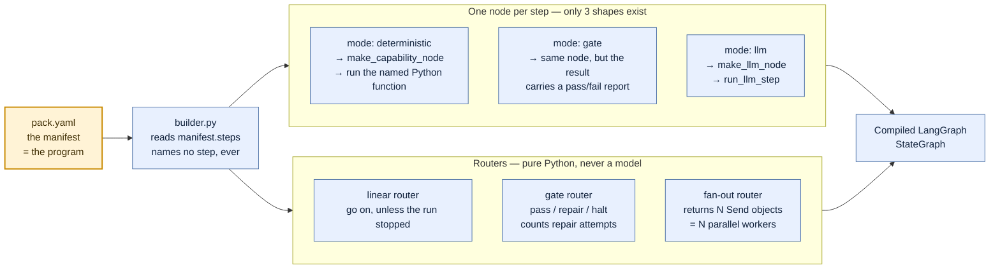
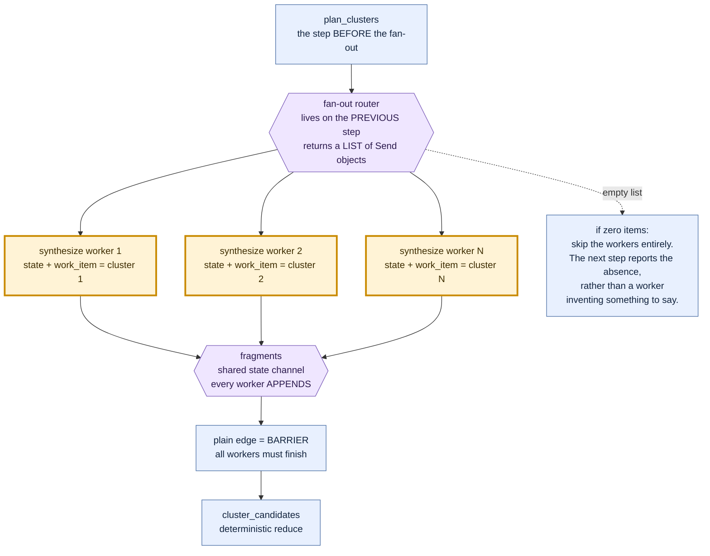
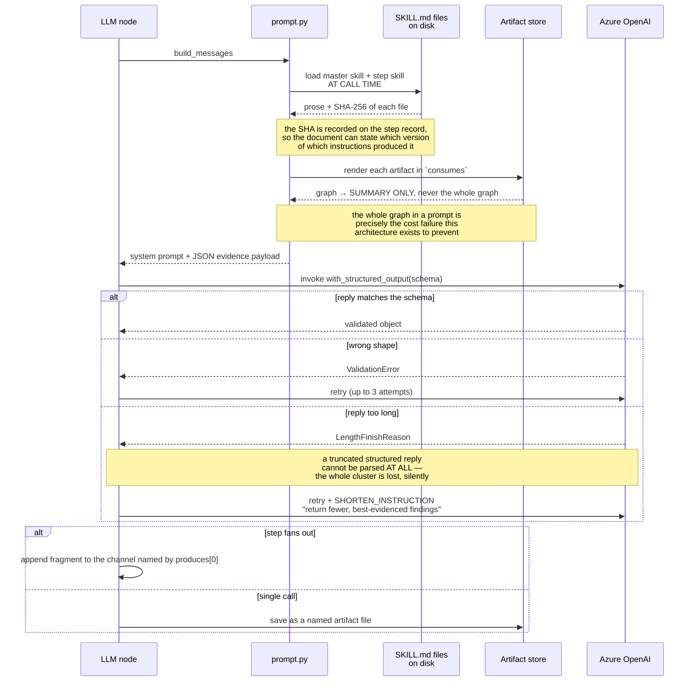
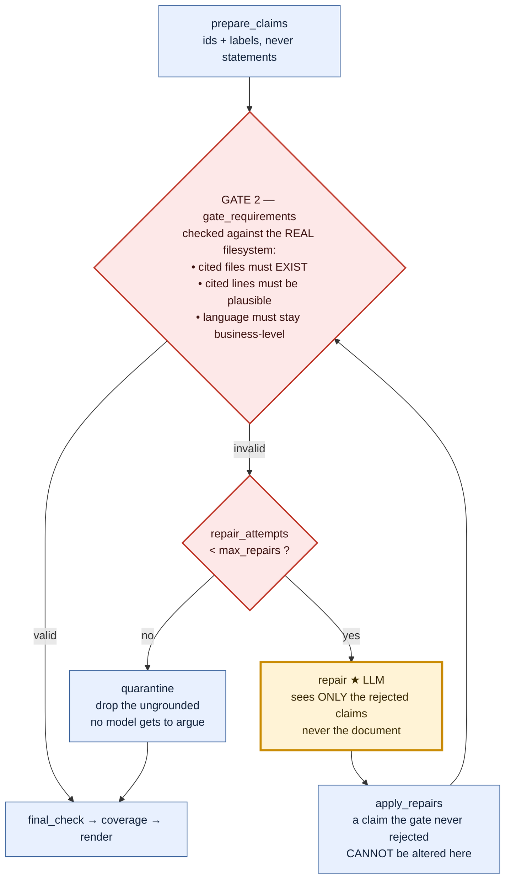

# Understanding the Requirements Pipeline

A plain-language walkthrough of what happens, in order, when this tool turns a codebase into a
requirements document — and exactly where a language model is used, where it is not, and why.

This covers **pipeline 1 only** (requirement generation). The test-generation pack is a separate
pipeline that reads this one's output.

---

## Contents

**Part A — How it works** *(read this first)*

| § | | |
|---|---|---|
| [1](#1-what-this-tool-is-trying-to-do) | What this tool is trying to do | the one promise the whole design keeps |
| [2](#2-the-words-you-need) | The words you need | glossary — packet, boundary, cluster, fragment, channel |
| [3](#3-the-two-layer-design) | The two-layer design | the manifest is the program; three node shapes |
| [4](#4-the-single-most-important-fact) | **The single most important fact** | **5 model calls out of ~28 steps, and the rule behind it** |
| [5](#5-the-pipeline-step-by-step) | The pipeline, step by step | every step, marked *model* or *no model* |
| [6](#6-how-a-model-call-actually-works-mechanically) | How a model call works | prompt assembly, retries, fan-out dispatch |
| [7](#7-what-the-state-looks-like-while-running) | The run state | artifacts, channels, why three channels not one |

**Part B — What changed and what it costs**

| § | | |
|---|---|---|
| [8](#8-the-four-changes-made-to-the-original-design) | The four changes | each with the measurement that motivated it |
| [9](#9-recurring-patterns-worth-internalising) | Recurring patterns | five ideas that generalise |
| [10](#10-known-risks-honestly-stated) | Known risks | stated honestly, including what is unmeasured |

**Part C — Pictures and scripts** *(if you learn visually, start here)*

| § | | |
|---|---|---|
| [11](#11--the-diagram-atlas) | **The Diagram Atlas** | **12 diagrams, widest view down to single mechanisms** |
| [12](#12--explaining-this-to-someone-else) | Explaining it to someone else | the 60-second version + the 5 questions you'll get |

**Part D — Deep dives**

| § | | |
|---|---|---|
| [13](#13--deep-dives--twelve-specific-questions) | Extraction and clustering | Q1–Q12 — analysable files, tree-sitter, declarations, boundaries, modules, clusters |
| [14](#14--the-synthesis-tiers-and-how-a-claim-gets-checked) | Synthesis and checking | Q13–Q18 — the three tiers, what a claim is, and how confidence is computed |
| [15](#15--gates-edges-packets-and-budgets) | Gates, edges and budgets | Q19–Q23 — both gates, the LOADS edge code, packet arithmetic, and where confidence comes from |

---

## 1. What this tool is trying to do

You give it a codebase. It gives you back a requirements document (a BRD) that says what the
software actually does — in business language, not code language.

The hard part is not writing the document. The hard part is **making sure every sentence in it is
true**. Anyone can point a language model at a repository and get a confident-sounding document
back. Most of it will be invented, and nothing in it will tell you which parts.

So the whole design is built around one promise:

> Every statement in the final document can be traced back to a real line, in a real file, in code
> that can actually be reached from outside the system.

Everything else in this pipeline — the graph, the packets, the gates, the clustering — exists to
keep that promise. Once you see that, the design stops looking complicated and starts looking
obvious.

---

## 2. The words you need

These terms appear everywhere in the code. Here they are in plain English.

| Term | What it actually means |
|---|---|
| **Pack** | One complete pipeline, defined in a folder. `codebase-requirement-skills/` is the requirements pack. |
| **Manifest** | The `pack.yaml` file. It lists the steps in order. **This file *is* the program.** |
| **Step** | One stage of the pipeline. Has an id, a mode, and what it reads and writes. |
| **Capability** | A Python function registered under a name. A deterministic step names one and runs it. |
| **Artifact** | A named result saved to disk in the run folder — `inventory`, `graph`, `clusters`, `brd`. Steps pass data to each other through these. |
| **Skill** | A `SKILL.md` file — the instructions given to the model. Kept as Markdown on purpose, never as Python strings. |
| **Entity** | One node in the knowledge graph: a function, a class, a file, a database table, a config key. |
| **Boundary** | A place the outside world can reach in: an HTTP route, a CLI command, a scheduled job, a button. |
| **Cluster** | A small slice of the graph around one boundary. This is what one model call gets to see. |
| **Packet** | The cluster, serialised into compact JSON, kept under a character budget. **The model never sees source code — it sees a packet.** |
| **Fragment** | One parallel worker's reply. Many workers write fragments; a later step collects them. |
| **Channel** | A shared list in the run state that fragments get appended to. |
| **Gate** | A checking step. If it fails, the pipeline stops or repairs — it never just carries on quietly. |
| **Fan-out** | Running the same step many times in parallel, once per item (once per cluster, once per module). |

---

## 3. The two-layer design

Almost every "how does this work" question answers itself once you separate these two layers.

### Layer 1 — the manifest is the program

`pack.yaml` is not a config file. It is the workflow itself.

`src/agentic/graph/builder.py` reads `manifest.steps` and builds a LangGraph state machine from it —
one node per step, wired together by the order in the file. **Nothing inside `src/agentic/graph/`
mentions a single step name, skill name, or artifact name.**

Why this matters: adding a whole new pipeline (threat modelling, migration analysis) means adding a
folder with a YAML file in it. It does not mean editing the engine.

### Layer 2 — every step is one of only three shapes

`src/agentic/graph/nodes.py` turns each step into a node, and there are only three possibilities:

1. **`mode: deterministic`** → look up the named Python function and run it. No model involved.
2. **`mode: gate`** → same thing, but the result includes a pass/fail report that the *router* reads
   to decide where to go next.
3. **`mode: llm`** → build a prompt, call the model, force the reply into a schema.

That's it. Three shapes cover every step any pack will ever declare, because all the differences
live in the manifest.

---

## 4. The single most important fact

Out of roughly **28 steps in this pipeline, only 5 call a language model.**

They are:

| # | Step | What it decides |
|---|---|---|
| 1 | `classify_boundaries` | "Is this function an HTTP endpoint, a CLI command, or just dead code?" |
| 2 | `synthesize` | "What business capability does this slice of code offer?" ← the main one |
| 3 | `analyse_module` | "What is true of this whole part of the product, that no single endpoint shows?" |
| 4 | `elevate` | "What is this product for, and what are its handful of business outcomes?" |
| 5 | `repair` | "Fix these specific claims the gate rejected." |

**Everything else is ordinary Python.** Ingestion, graph building, schema parsing, clustering,
module partitioning, consolidation, deduplication, confidence scoring, both gates, and all
rendering — no model touches any of it.

### The rule behind that split

> **Use the model only for judgement about meaning that no rule can compute. Never use it for
> anything derivable. Never let it state a fact it wasn't handed.**

Three consequences of that rule, which you'll see enforced in several places:

- **The model never sees source code.** It sees evidence packets — compact records of entities and
  their connections. This is both a cost control and a truthfulness control.
- **The model never picks the next step.** Routing is pure Python in `graph/router.py`. The comment
  there explains why: a supervisor that could choose the next step could reason its way *past a
  failed gate* because continuing looked more helpful. Here it structurally cannot.
- **The model doesn't get to score its own confidence.** It reports a number, that number is kept
  for comparison, and then a deterministic step recalculates confidence from the actual evidence.

---

## 5. The pipeline, step by step

Now the actual walk. For each step: what goes in, what happens, what comes out, and **model or no
model**.

---

### Phase 0 — `ingest`  ·  *no model*

**In:** a zip file or a folder.
**Out:** `inventory` — the list of files, with language and size for each.

Unpacks the archive **safely**: it rejects path traversal (`../../etc/passwd`), absolute paths,
symlinks, encrypted entries, and files whose compression ratio suggests a zip bomb. Then it walks
the tree, skipping `.git`, `node_modules`, `dist`, `.venv`, build output — none of which are
evidence about the product.

**Fails closed.** If there's nothing analysable, it halts rather than writing a document based on
filenames.

**Why no model:** these are filesystem facts. A model adds nothing and could invent a file that
isn't there.

---

### Phase 1 — `graphify_extract`  ·  *no model*

**In:** `inventory`.
**Out:** `graphify_raw` — raw nodes and edges.

Runs Graphify, which uses local tree-sitter parsers to read **36 languages**. It answers "what is
defined here, and who calls whom".

This replaced an older set of hand-written Python-only extractors. That swap bought 36 languages —
and quietly lost some things the old extractors used to find. **Three of the four changes described
in section 8 exist to recover what that swap lost.** Worth remembering: it is a recurring theme in
this codebase.

---

### Phase 1b — `adapt_graph`  ·  *no model*

**In:** `inventory`, `graphify_raw`.
**Out:** `graph` — the canonical knowledge graph.

Converts Graphify's output into this project's own shape: entities and relationships with
content-addressed ids. It also reconstructs end-lines, because Graphify reports where something
starts and never where it ends.

**This is where docstrings get attached** (change #1, section 8.1).

Split from the step above on purpose: if this fails, you know it's a mapping bug and not a missing
binary. A failure that names itself is worth a separate step.

---

### Phase 1b(ii) — `extract_declarations`  ·  *no model*

**In:** `inventory`, `graph`.
**Out:** `graph` (added to).

Opens the files that state **policy** rather than perform behaviour: `schema.sql`, `.env.example`,
`docker-compose.yml`, `requirements.txt`, `package.json`, Dockerfiles.

Here is the insight that justifies this step. A call graph answers *"who calls whom"*. That is the
right question for behaviour and the **wrong question for policy** — because:

> Nothing calls a database schema. Nothing calls a settings file. Yet they state, more strongly than
> any application code can, what the product must do.

A line like `CHECK (role IN ('admin', 'recruiter', 'sysadmin'))` is a hard rule the database
enforces whatever the code does. No amount of call-graph walking will ever find it, because it sits
on no call path at all.

It produces six kinds of node: `CONFIG_KEY`, `DATA_ENTITY`, `DATA_FIELD`, `DATA_INDEX`,
`DOMAIN_POLICY`, `EXTERNAL_SERVICE`. Credentials are redacted. Only fixed, literal values are kept —
never a guessed one.

**Why no model:** parsing `CHECK (role IN (...))` is a parse, not a judgement. And a parsed value
can be quoted exactly; a model's paraphrase of it cannot be trusted as a citation.

---

### Phase 1b(iii) — `extract_instruction_artifacts`  ·  *no model*

**In:** `inventory`, `graph`.
**Out:** `graph` (added to).

Reads skill files, prompt files and agent-config Markdown **as structure**, and draws a `LOADS` edge
from the code that opens one to the file itself.

This is the newest change and is explained in full in section 8.4 — including the two rules that
were built, measured, and thrown away before the third one worked.

---

### Phase 1c — `propose_boundary_candidates`  ·  *no model*

**In:** `graph`.
**Out:** `boundary_candidates` (the full list) and `boundary_candidate_batches` (the same list, cut
into batches of 120).

We need to find the places the outside world can reach in. But Graphify doesn't mark anything as "a
route" — it has no idea what Flask or Express is. So the signal has to come from **graph shape**
instead.

Here's the trick, and it's a genuinely good one:

> A route handler is called by a framework. A CLI command is called by the runtime. A button
> callback is called by the UI toolkit. **None of them are called by the code sitting next to
> them.** So on a call graph built only from this repository, every one of them has the same
> property: **nothing in this repository calls it.**

That is a *shape*, not a framework list. It works for Flask, Express, Spring, Sinatra, gin, and for
frameworks nobody involved has ever heard of. That is what makes the tool language-independent.

It over-collects badly — dead code and unused public helper functions look exactly the same as a
route handler. That is fine, and deliberate: the next step exists to sort them out.

Along with each candidate it gathers **nearby string literals** (within 3 lines) and the names the
file uses but never defines. That's where a decorator, an annotation, or a registration call shows
up — `@app.route("/users")` leaves the literal `"/users"` sitting right above the function.

---

### Phase 1d — `classify_boundaries`  ·  ★ **MODEL CALL #1** (fan-out: one call per batch of 120)

**In:** one batch of candidates.
**Out:** `BoundaryAssignments` — a class for each candidate, or `NONE`.

The first model call in the whole pipeline. The reason it must be a model:

> Deterministic code can find *which functions are suspicious*. Only judgement can say **"this one
> is an HTTP endpoint and that one is dead code"** — because the difference isn't structural, it's
> semantic, and it looks different in every framework.

**What the model is shown:** qualified name, kind, location, how many things call it, what undefined
names it references, and the nearby literals. **Not source code.**

**What it is told:** classify each one, and say `NONE` for the rest. It is explicitly warned that
**most candidates are not boundaries** — a function nothing calls is usually dead code, a
test-only helper, or a public library function.

**Why a wrong answer is survivable:** the model classifies a node it was handed. It never states a
file path or a line number. So the worst it can do is mislabel a boundary — it structurally cannot
fabricate a citation.

This step used to be one single call over a **truncated** list. That was the biggest bug in the
pipeline and is change #2 (section 8.2).

---

### Phase 1d(ii) — `collect_boundary_assignments`  ·  *no model*

Takes every batch worker's reply and concatenates them into the one flat list that the next step has
always consumed. A fragment whose shape doesn't parse is **reported, not guessed at**.

This is the pattern to notice: **fan out to N model calls, then reduce deterministically.** It
appears three times in this pipeline. Because the reduce step restores the exact original shape,
nothing downstream ever needs to know that classification now costs many calls instead of one.

---

### Phase 1e — `discover_entry_points`  ·  *no model*

**In:** `inventory`, `graph`, `boundary_assignments`.
**Out:** `graph` (boundaries added), `entry_point_coverage`.

Turns the classifier's answers into real boundary nodes in the graph.

Design note worth understanding: the classifier's answers arrive here as **one adapter among
several**. Other adapters can contribute boundaries too. The point is that every boundary in the
run gets created in exactly one place and counted by exactly one coverage report — so if a whole
paradigm is being missed, it shows up as a number rather than as silence.

---

### Phase 2 — `gate_graph`  ·  *no model* — **Gate 1**, `on_fail: halt`

Structural checks on the graph. Does it have boundaries at all? Is it coherent?

If it fails, the router sends the run to the halt node, which writes a `run_failed.md` explaining
what went wrong and which steps completed. The philosophy, quoted from that file:

> "This workflow stops rather than producing a weaker document. A gate failure means the evidence
> could not support a trustworthy result, and a document that hid that would be worse than no
> document."

---

### Phase 2b — `partition_modules`  ·  *no model*

**In:** `graph`.
**Out:** `modules`, `boundary_modules`.

Groups boundaries into **modules** — parts of the product.

How does it decide which boundaries belong together? By **how much code they share**. If `/rounds`,
`create_round` and `create_slot_invite` all reach mostly the same set of functions underneath, they
are three faces of one feature. (Measured with Jaccard overlap over each boundary's reachable set.)

Two obvious alternatives were tried on a real 381-file repository and **rejected on measurement**:

- **Group by directory** → gave a *layer* split: `app/api` (1,081 nodes) and `app/services` (1,299).
  Those are architectural layers, not product features.
- **Community detection on the graph** → collapsed api + services + repositories into a single
  1,244-node hairball, because a layered application is densely interconnected by construction.

Reach-overlap gave actual features. Result: 293 boundaries became 21 modules.

This step also **hands down each cluster's area code** — which fixes something that was structurally
impossible before. See section 8.3.

---

### `plan_clusters`  ·  *no model* — **the cost-control step of the entire system**

**In:** `graph`, `boundary_modules`.
**Out:** `clusters`.

This step decides **what slice of evidence each model call is allowed to see**. It is the single
reason this tool can analyse a large repository at all.

It builds three kinds of cluster:

**1. Boundary clusters.** Start at a boundary, walk outward along "workflow" edges (calls,
registrations, loads), collect what you reach, and serialise it into a packet under a character
budget. If a cluster is too big for one packet, it is **sliced into several packets** — never
truncated. Slicing costs one more bounded call and loses nothing; truncating loses the deepest,
most specific part of the walk, which is exactly the part nobody else would have written.

Boundaries that share the same workflow are **merged into one packet**. Two routes on one handler is
one call, not two — and, importantly, sending them separately would produce two near-identical
requirements that both survive deduplication *because each one is independently true*.

**2. Declaration clusters.** One packet per declaring file (a schema, a settings file), on a
**separate budget**. Pooling them with boundaries was tried and is wrong, and the reasoning is
sharp:

> A schema and an HTTP verb are not competing samples of one population.

Pooling just chose a new victim — served last, declarations got starved; served first, they starved
the largest class of endpoints. There was no ordering that resolved it, because the premise was
wrong.

**3. Residual clusters.** Everything meaningful that no boundary walk and no declaration group
reached — background jobs, migrations, admin scripts, whole subsystems no route touches. Grouped by
directory (one packet per file would cost a call per file to say very little).

**Selection is sampling, never truncation.** `_stratified` takes its quota by walking every class in
turn. The reason is a bug worth internalising:

> Taking the first N of a list is only correct if the ordering is meaningful. Here the primary sort
> key (degree) is routinely identical across a whole class of boundaries, so the ordering collapses
> to the alphabetical tiebreak on the name — and where names start with a class discriminator (an
> HTTP verb, a queue name), the list arrives **grouped by class**, so truncating it silently
> deletes entire categories.

This exact bug has now been found **four separate times** in this codebase, in four different capped
lists.

---

### Phase 3a — `synthesize`  ·  ★ **MODEL CALL #2** (fan-out: one worker per cluster)

**This is the workhorse.** It is where requirements actually get written.

**In:** one evidence packet — compact entity records, their workflow edges, and `depends_on` (the
external systems this cluster uses). Never raw source.
**Out:** a `BRDFragment` — candidate requirements with citations.

**Why a model:** "what business capability does this code offer?" is irreducibly a language
judgement. There is no rule that turns a call graph into the sentence "a recruiter can invite a
candidate to a scheduled round".

**Why fan out:** cost becomes linear in the number of boundaries, not in the size of the repository.
200 endpoints means 200 small calls instead of one impossible one. And crucially, **one worker
failing does not kill the run** — the node catches a fan-out worker's exception, records it, and
lets every other worker finish. The gap analysis reports the missing cluster.

The step is told explicitly: describe only what this cluster's evidence supports, do not speculate
about the rest of the system, and **do not write a product purpose** — a later step does that from
every cluster together.

---

### Phase 3a(ii) — `analyse_module`  ·  ★ **MODEL CALL #3** (fan-out: one worker per module)

**In:** one module — all its boundaries, its external dependencies, the policy declared in its
scope, the instruction rules its code loads, and an evidence packet.
**Out:** a `ModuleAnalysis`.

This is the **altitude the pipeline was missing**, and the reasoning for adding it is the clearest
example of the design thinking in this project:

- `synthesize` sees **one boundary** — a median of nine graph nodes.
- `elevate` sees a list of **finding titles** for the whole repository.
- Between them sat only deterministic steps.

So **nothing anywhere reasoned about a *part* of the product.** And that meant a whole class of
requirement was literally unwritable:

- *"Every write path here goes through one repository layer."*
- *"Nothing in this part accepts a request without a tenant id."*
- *"The retry bound is three across all six handlers."*

Each of those is true of a module and **invisible from inside any one of its boundaries**. They are
system requirements, cross-cutting rules and quality properties — three of the families that no
stored run had ever populated.

The instruction to this worker is unusually strict, and the test it gives is a good one:

> "If the statement would be just as true written from one endpoint, it belongs there, not here.
> Returning nothing but a name and a purpose is a correct and frequent result."

It is also told that a `residual` module is a bag of unrelated behaviours, not a part of the
product — so for those, returning nothing is the right answer.

Anything it was asked for and could not write goes into `unevidenced` **with the reason**. An honest
gap gets read by the completeness report; a guessed entry gets rejected.

---

### `collect_module_analyses` · `cluster_candidates` · `digest_areas`  ·  *no model*

- **`collect_module_analyses`** — reduce the module workers' replies into one artifact.
- **`cluster_candidates`** — group candidate requirements by **what they say**, not by where in the
  code they came from. This is the step whose absence made the old output read as a flat inventory
  of behaviours: before it, every comparison required two candidates to *share code* before their
  wording was even looked at, and **nothing ever asked whether two candidates meant the same thing**.
  Two workers describing the same capability from the entry point and from the work behind it cite
  different lines *by construction*, so they were never compared.
- **`digest_areas`** — build a compact digest: area code, business name, boundaries, and the
  **titles** of the requirements written for it.

All deterministic — term overlap and signature matching, no model.

---

### Phase 3c — `elevate`  ·  ★ **MODEL CALL #4** (single call, no fan-out)

**In:** the area digest, the module analyses, and a **summary** of the graph.
**Out:** `TopTier` — the product purpose, the handful of business outcomes, and which area serves
which outcome.

Note what it is **not** given: the requirements themselves. It gets titles only. The full
requirements are already written, already grounded, already checked, and are carried into the
document by the next step without a model touching them.

This replaced an older step called `reduce`, and the replacement is the whole point of the rebuild:

> `reduce` was handed every finding and asked to return the finished document in one reply. With an
> 8,000-token output ceiling, that caps **any** repository at roughly a dozen requirements no matter
> how much it was shown.

`elevate` is small in, small out — and it stays that way as the repository grows.

---

### `assemble`  ·  *no model*

**In:** the fragments, the top tier, the capability clusters.
**Out:** `brd` — the first full draft.

Every grounded finding from every cluster is carried through **unchanged** and attached to the
business requirement its area was bound to. **Nothing is summarised or dropped for space.** The only
claims that leave are the ones a gate rejects, and that happens on the record.

This is why the requirement count now tracks the size of the codebase instead of the size of one
model reply.

---

### The consolidation block  ·  *all deterministic, no model*

Seven steps in a row, and together they are the responsibility the old workflow simply skipped:
taking a repository-wide pile of candidates and settling it into a requirement **set**.

| Step | What it does |
|---|---|
| `consolidate` | Levels, duplicates, parameterised families, hierarchy. Merges "X for invoices" + "X for orders" into one parameterised requirement. |
| `check_correspondence` | **Does the claim say what the code it cites actually does?** Every other check compares a statement to another statement or to a blacklist. This one compares it to the evidence. |
| `score_confidence` | Recomputes confidence from the evidence. The model's own number is kept alongside so the two can be compared — **the model does not get to assert its own confidence.** |
| `strip_implementation` | Moves implementation detail out of the statement and into the traceability data. Runs **before** the gate on purpose: a well-grounded requirement that happens to name a framework is a *wording* problem, and deleting it over that discards checked evidence. |
| `resolve` | Every candidate leaves with **exactly one disposition**. What can't be published goes to `unresolved_candidates` *with its evidence and the reason* — nothing is deleted silently. |
| `derive_criteria` | Acceptance criteria last, once the set is final — a criterion written against a requirement that later gets merged or dropped would either vanish or follow it onto something it was never about. |
| `prepare_claims` | Stamps ids and fixes citation labels, so the gate judges claims rather than bookkeeping. Never touches a statement, a path, or a line range. |

---

### Phase 4 — `gate_requirements`  ·  *no model* — **Gate 2**, `on_fail: repair`

Re-checks every surviving claim against the **real filesystem**, not just the graph:

- cited files must actually exist
- cited line numbers must be plausible
- statements must stay in business language

---

### `repair`  ·  ★ **MODEL CALL #5** (bounded loop)

**In:** the gate's issue list and **only the rejected claims**.
**Out:** `RepairedItems`.

The loop is bounded: the gate router counts attempts against `max_repairs`, and the repair node
itself increments the counter — because the router can't write state, so otherwise the bound would
never bind.

The important design decision here: repair sees **only the rejected items**, never the document.
Handing it the whole BRD was ruinous in two directions at once:

- **On input** it blew past the artifact size cap and arrived truncated, so the model was asked to
  fix a document it could only partly see.
- **On output** it was expected to re-emit every requirement inside one bounded reply — which past a
  few dozen is arithmetically impossible. The document came back a fraction of its size and
  **nothing recorded the loss.**

Everything that passed is carried across by the next step without a model touching it.

---

### `apply_repairs` · `quarantine` · `final_check` · `report_family_coverage` · `render`  ·  *no model*

- **`apply_repairs`** — put repaired claims back, carry everything else across untouched. **A claim
  the gate never rejected cannot be altered here at all.** That is why a rejection over one phrase
  can no longer shrink the whole document.
- **`quarantine`** — reached only when the repair budget is spent. Removes what could not be
  grounded, so an honest thinner document can still be produced. Deterministic on purpose: **no
  model gets to argue for keeping a claim the gate rejected.**
- **`final_check`** — the last look at the finished set, and the only step that can see it whole.
  Duplicate titles, relations pointing at nothing, cycles in the parent chain — these are properties
  of the *whole set* and are invisible until nothing is going to move again.
- **`report_family_coverage`** — completeness. See section 8.3.
- **`render`** — the deliverables. **Always runs, even when little grounded**, so the gap analysis
  can explain why coverage is thin.

---

## 6. How a model call actually works, mechanically

Every one of the five model steps goes through the same code path in `src/agentic/llm/steps.py`.

**Step 1 — build the system prompt** (`build_system_prompt`). Three pieces glued together:

1. the **master skill** body — the grounding rules that apply to everything in the run,
2. the **step's own skill** section, and
3. the step's `instructions:` block from `pack.yaml`,
4. plus a fixed output contract about citations.

All of this is **read from the Markdown files on disk at call time**. Changing what the model is
told means editing a `SKILL.md`, not editing Python. And the **exact SHA-256 of the skill file** is
recorded on the step record — so a finished document can state which version of which instructions
produced it, and drift between the Markdown and the code becomes auditable instead of invisible.

**Step 2 — build the human message.** A JSON evidence payload. It walks the step's `consumes` list
and renders each artifact through a registered renderer. The important one:

> The `graph` renderer returns a **summary only** — counts, kinds, a few ranked documentation
> outlines, module intent. **The whole graph must never enter a prompt.** That is precisely the cost
> failure this architecture exists to prevent.

**Step 3 — force the shape.** `model.with_structured_output(schema)`, where the schema name comes
from the manifest (`BoundaryAssignments`, `BRDFragment`, `ModuleAnalysis`, `TopTier`,
`RepairedItems`). The shape is enforced by the provider, not parsed out of prose — so a malformed
reply is a retry, not a silently broken document.

**Step 4 — three retries, with one special case.** A wrong *shape* just retries. But a **length
failure** is handled specially: the code appends a `SHORTEN_INSTRUCTION` telling the model its
previous reply was discarded entirely and to return fewer, better-evidenced findings. The reason
this matters:

> A truncated structured reply cannot be parsed at all, so the **whole cluster is lost** rather than
> shortened — and for a fan-out worker that loss is completely silent unless something asks again
> for less.

**Step 5 — route the output.** If the step fans out, the reply becomes a *fragment* appended to the
state channel named by `produces[0]`. Otherwise it is saved as a named artifact file.

### How fan-out actually dispatches

This one is slightly unusual and worth seeing clearly.

The fan-out step is **not** entered by a normal edge. It is entered by the **router of the step
before it**, which returns a list of `Send` objects — one per work item, each carrying a copy of the
state with `work_item` set. That is what creates N parallel workers.

The barrier is then a plain edge from the fan-out step to the next step: **all workers must finish
before the reduce step runs**, and one failing worker must not stop the others.

If there are zero items to fan out over, the router skips straight past the worker step — the
downstream step then reports the absence, rather than a worker inventing something to say.

---

## 7. What the state looks like while running

`AgentState` is a dictionary that flows through the graph. The parts that matter:

- **`artifacts`** — a map of name → file path in the run folder. This is how steps pass data.
- **`fragments`** — the channel `synthesize`'s workers write into.
- **`boundary_fragments`** — the channel `classify_boundaries`'s workers write into.
- **`module_fragments`** — the channel `analyse_module`'s workers write into.
- **`gate_reports`** — per-gate pass/fail, read by the routers.
- **`completed_steps`, `step_records`, `metrics`** — the audit trail.
- **`repair_attempts`** — what makes the repair loop terminate.

**Why three separate fragment channels instead of one?** This is a subtle, good decision. Every
field on `BRDFragment` has a default value. So a boundary-classification reply landing in the
shared `fragments` channel **would not fail validation** — the fields simply wouldn't overlap, and
validating an empty object succeeds. It would silently become a spuriously empty requirement
fragment, inflating the "N replies could not be read" counting for a phase that has nothing to do
with boundary classification.

A dedicated channel avoids that entire category of bug, instead of relying on
permissive-validation-happens-to-filter-it-out.

---

## 8. The four changes made to the original design

In the order they happened.

### 8.1 — Semantic meaning from docstrings and comments

**The problem.** Graphify *had* already found every docstring and marked comment in the codebase.
But it kept them as separate `RATIONALE` nodes, **cut to about 80 characters**, joined to the thing
they describe by a `rationale_for` edge that **no workflow walk ever follows.**

So the developers' own written statements of intent were sitting in the graph, truncated, attached
to nothing any model would ever read.

**The fix.** Read the **full text** back from the source file and attach it as a `docstring`
attribute **on the entity it describes**. Now it travels inside evidence packets, reaches the
correspondence checker, and feeds a new `module_intent` summary.

**No model, fully deterministic, and every word traces to a real source line.** That last part is
why this is a good fix rather than a lazy one: it adds meaning without adding any claim that can't
be checked.

---

### 8.2 — Batch boundary classification instead of truncating it

**The problem, and it was the worst one.** `MAX_CANDIDATES = 120` was a hard cap. Everything past it
was **silently discarded**. On the largest stored run (381 files):

> **1,868 of 1,988 candidates — 94% — were never shown to the classifier at all**, no matter how
> many of them were real endpoints.

Every one of those discarded candidates never gets classified, so it never seeds a cluster, so it
never produces a requirement. And nothing anywhere said so.

**Two other fixes were considered and rejected**, and the reasoning is instructive:

- **Raise the cap.** The cap was sized against the *reply's* output ceiling, not the prompt's.
  Raising it just moves the cliff edge and risks the same length failure at a larger scale.
- **Sample better** (use `_stratified` to pick a *better* 120). This fixes the categorical skew, but
  still throws away real candidates — just a better-chosen 120 instead of an alphabetically
  arbitrary one.

**Batching is strictly stronger.** Every candidate gets classified, in some batch. The
categorical-skew failure mode cannot happen at all — **not "happens less", but structurally cannot,
because nothing is selected out.**

**What changed in the flow:** `classify_boundaries` became a fan-out step (one model call per batch
of 120), plus a new deterministic reduce step that restores the exact original output shape — so
nothing downstream changed at all.

**One shared-code generalisation made it possible:** fan-out fragments used to always go to a
hardcoded `"fragments"` channel. Now they go to the channel named by the step's `produces`. The
existing steps declare `produces: [fragments]`, so they behave identically — the change is
backward-compatible by construction.

---

### 8.3 — Declared policy, a module tier, and full graph coverage

**The measurement that started it.** Across **all twenty** stored runs:

```
functional_requirements      19/20  OK      business_rules                0/20  EMPTY
business_requirements        13/20  OK      success_criteria              0/20  EMPTY
system_requirements           5/20  thin    technical_constraints         0/20  EMPTY
out_of_scope, open_questions  3/20  thin    data_requirements             0/20  EMPTY
                                            integration_requirements      0/20  EMPTY
                                            non_functional_requirements   0/20  EMPTY
                                            reporting_requirements        0/20  EMPTY
                                            assumptions                   0/20  EMPTY
```

Seven of thirteen requirement families had **never** been populated. Not sparse — *never*.

And on the reference run:

```
distinct entities reaching any packet   634 of 5,084  = 12.5%
average packet                          8,103 chars against a 40,000 budget  = 20%
packets reporting an omission           0 of 84
```

**The packets were not trimmed — they were empty.** And the budget to carry more was already being
paid for and left unspent.

The cause was **not the prompts** (they ask for all thirteen families). Four separate fixes:

**(a) `extract_declarations` — the missing producer.** Six node kinds had hand-written support in
four different files — `compact_entity`, `render.py`, `gates.py`, `declaration_groups` — and
**nothing anywhere emitted a single one of them.** They were orphaned when the Python-only
extractors were replaced by Graphify.

And the consequence was worse than a gap. `DECLARATION_KINDS` was used as a **ranking key**:

```python
key=lambda item: (-sum(1 for e in item[1] if e.kind in DECLARATION_KINDS), item[0])
```

Always zero — so the sort collapsed to `item[0]`, the file path. **A live, correct, fully wired
mechanism was running inert**, and the comment three lines above it described the exact defect it
existed to prevent.

Result: 633 new nodes on the reference repository, 12 credentials redacted, and policy recovered
that no call graph could ever have carried.

**(b) `analyse_module` — the missing altitude.** Covered in the step walkthrough above.

**(c) Residual clustering — 12.5% → 67.3% coverage.** Boundary clustering answers "what can an
outside actor cause to run", which is the right question for a *requirement* and the wrong question
for *coverage*. Background jobs, migrations, admin scripts and entire subsystems reached no model at
all.

**(d) `report_family_coverage` — why nobody noticed for twenty runs.** Gate 1 checks the graph.
Gate 2 checks every surviving claim is grounded. **Neither ever checked whether the document was
complete.** So a BRD with seven permanently empty families passed everything, because each claim in
it was individually well-evidenced.

> The quality bar was **all precision and no recall.**

Now, per family, it distinguishes two things that had looked identical: empty because the product
**declares nothing** of that kind (an honest result), or empty because evidence sits in the graph
**unused** (a defect in this pipeline, and named as one). Reported, never enforced — a thin document
is a fact about a codebase as often as it is a bug.

**The best insight in this change**, though, is a small one about coordination. `pack.yaml` used to
tell every parallel worker:

> *"clusters covering the same part of the product must use the same area code"*

**Which parallel workers cannot possibly obey** — none of them can see what the others chose. The
result was `ARCH` / `BAP` / `BATC` / `BCH`: four different area codes for batches, and 14 of 22
areas holding exactly one capability each.

Area codes are now **handed down from the deterministic partition**. That is a bug class worth
remembering: *asking isolated agents to agree on something none of them can see.*

---

### 8.4 — Instruction artifacts (the newest change)

**The measurement that settled it.** Run against a normal repository, it found 24 Markdown nodes, 17
of them agent skill files — and exactly **one** carried any text (the README, because of its name),
with **zero** edges to anything.

Then it was run against **this project itself**:

```
137 markdown nodes ·  54 SKILL.md nodes
  0 carried any text ·  0 edges to anything
```

The cause: the Markdown reader matched a **hardcoded filename whitelist** whose only Markdown
pattern was `readme*`. So a `SKILL.md` returned nothing at all.

Why that is damning rather than merely a gap: this project's own architecture states that skill
instructions live in Markdown *"never inside prompt string literals"* — a deliberate choice to move
behaviour out of code. Analysing itself, it read **none of them**. It would have documented the
loader and said nothing about what is loaded.

**The general principle:** for an LLM-powered product, **the skill or prompt file *is* the
implementation.** The code around it only opens a file and posts it to an API.

**What was built:**

- **`INSTRUCTION_ARTIFACT`** — the file, with its declared name, description, and section headings.
- **`INSTRUCTION_RULE`** — one declared prohibition or obligation, with its modality ("must",
  "never"), its section, and its line number.
- **A `LOADS` edge** from the code that opens the file to the artifact.

Result: 19 artifacts, 315 rules, and **280 instruction nodes now reaching evidence packets — from
zero.**

Role is decided by **location first, then filename**, because those are what projects actually use
to mean "these are instructions". A file under `.agents/skills/` is an instruction artifact whatever
it's called; a file called `SKILL.md` is one wherever it sits. A README *inside* a skill directory
stays documentation, because it describes the pack rather than instructing a model.

#### The grounding decision (read this part carefully)

Putting `LOADS` into `WORKFLOW_EDGE_KINDS` means **a requirement may be grounded in an instruction
file when traced code loads it.** That is a policy decision, not a technicality.

It follows the schema precedent: nothing *calls* a schema either, and a declared constraint earns
citability because the database enforces it. An instruction file earns it because the model is given
it on every single request.

**But the enforcement is weaker, and it is labelled as weaker:**

- Rules carry `RESOLVED` provenance and **0.7 confidence**, not `EXTRACTED` certainty.
- The synthesis instruction requires them worded as declared policy: *"the system is instructed to
  refuse X"* — **never** *"the system refuses X"*.

> **An instruction asks; a constraint enforces.**

Reversing the decision is one line — remove the entry — and a test asserts it is present, so removal
becomes a deliberate act with a failing test attached rather than a quiet change of policy.

#### Loader matching: two rules built, measured, and thrown away

This was the hard part, and it is the best worked example of the project's method. A false `LOADS`
edge gets walked like any other, so **one wrong link lets a requirement ground itself in an
unrelated instruction file** — the exact fabrication the whole pipeline exists to prevent.

| Attempt | Edges found | Verdict |
|---|---|---|
| Every path segment is a match literal | **114** | **All false.** The repository root was a literal for every artifact, so any line mentioning the repo name linked to all nineteen. |
| Only the distinctive leaf directory | **12** | **All false.** A directory is named after a domain concept, and a concept is an ordinary English word. |
| Path-shaped or glob, inside quotes, not in a comment | **0** here | **Correct.** Those skill files are for the developer's coding agent; no product code loads them. |

The second attempt's failures deserve reading, because in a summary table they look like successes:

```
literal='extraction'  matched   "extraction": result,          <- a dict key in an API response
literal='queue'       matched   # ...the Needs-Review queue...  <- a comment
literal='queue'       matched   @router.get("/queue")          <- a route path
```

The surviving rule has four parts, each of which removed a class of false edge:

1. **Path-shaped only** — a separator, or a filename with an instruction suffix. Distinguishes
   naming a *file* from mentioning a *concept*.
2. **Globs allowed, but must contain a separator** — a registry globs rather than naming each file,
   so without glob support only a hardcoded single path would be detectable. Bare `*.md` is rejected:
   it names a file *type* and would link one loader to every artifact.
3. **Must be inside a quoted string** — a path in prose is a description, not a load.
4. **Not in a comment, and backticks are not quote characters** — backticks delimit a template
   literal in JavaScript but are Markdown markup in Python docstrings, and this project's comments
   use them constantly.

Every edge records **which literal matched**, so a reviewer can tell a real load from a coincidence
without re-deriving it.

#### The ranking defect found next door

While tracing how Markdown reached a prompt, the documentation list turned out to be selected with
**no ordering at all** — the first four in graph order, and graph order is sorted by **content
hash**. So the selection was deterministic and semantically arbitrary:

```
docker-compose.yml            <- three of four slots went to infrastructure
README.md                     <- survived by luck of hashing
docker-compose.override.yml
frontend/Dockerfile
```

What makes it clearly a defect rather than a judgement call: **ten lines below**, the module-intent
list does the same capped selection and ranks properly, *with a comment explaining why*. The
reasoning had been written down, applied to one of two adjacent capped lists, and not the other.

Now ranked by what a file actually states about the product: a README or an architecture document
outranks a deployment recipe, and an override file — a variant of a variant — ranks below the file
it overrides.

**This was the fourth instance of the same pattern in this codebase:** a capped list taken in
arbitrary order. The others were the boundary-candidate cap, the declaration-file ranking, and the
area codes each worker invented alone.

---

## 9. Recurring patterns worth internalising

Five ideas show up again and again. If you learn these, the rest of the codebase reads easily.

**1. Truncation is never the answer; sampling or slicing is.** Taking the first N of a list is only
correct if the ordering is meaningful, and it usually isn't. Four separate bugs in this codebase were
the same bug.

**2. A consumer without a producer is worse than a gap.** When six node kinds had support in four
files and nothing emitted them, a correct ranking key was silently always-zero and a working
mechanism ran inert. Orphaned code doesn't just do nothing — it can quietly disable something else.

**3. Fan out to the model, reduce deterministically.** Every parallel model phase is followed by a
plain Python reduce step that restores the exact shape downstream already expected. That is what
makes adding a parallel phase invisible to everything after it.

**4. Never ask isolated agents to coordinate.** If N parallel workers must agree on something none
of them can see, they will not. Compute it beforehand and hand it down.

**5. Precision without recall is not quality.** Twenty runs passed every gate with seven of thirteen
requirement families permanently empty, because every check asked "is this claim true?" and nothing
ever asked "is anything missing?"

---

## 10. Known risks, honestly stated

- **The module tier has never run against a real model.** Every number in change 8.3 comes from
  deterministic steps and stubbed model calls. Its *output quality* is unmeasured. Expect the first
  full run to look noisier before it looks deeper.
- **Consolidation has never run at this volume or across tiers.** Roughly double the evidence plus a
  new altitude means the consolidation block will need tuning.
- **A false zero and a true zero look identical** in loader detection. It is precision-tuned, so a
  path assembled at runtime or read from config produces no edge. The step reports that none was
  found; it cannot report that none exists.
- **A declared rule is not an observed behaviour.** Nothing proves the model complies with its own
  instruction file. That is why confidence is reduced and the wording requirement exists — and it is
  the limitation most likely to be lost when a requirement is read out of context.
- **A declared value is not a used value.** There are no edges from a `CONFIG_KEY` to the code that
  reads it, so a requirement resting on one asserts *declared* policy, not observed behaviour.
- **The extraction step sequence is duplicated in five test files**, only one of which derives it
  from the manifest. It has now bitten three consecutive changes, each fixing it by hand. **Fix this
  before the next change.**
- **Cross-altitude duplication is managed by instruction, not by construction.** Nothing structurally
  prevents a module worker restating what a boundary worker already wrote.

**Deliberately not done:** a plain README's prose does **not** become policy. A README stating
"invoices over £10,000 require manager approval" produces no policy node. This is a recorded
decision, not an omission — prose in a README is a much weaker claim than either a schema constraint
or an instruction handed to a model on every request, and turning paragraphs into policy invites
exactly the over-extraction the whole design fights.

---

# 11 · The Diagram Atlas

Twelve diagrams, from the widest view down to individual mechanisms. Read them in order the first
time. After that, each one stands alone.

**Legend used throughout:**

| Shape / colour | Meaning |
|---|---|
| 🟦 Blue box | **Deterministic step** — ordinary Python, no model |
| 🟨 Yellow box, thick border | **LLM step** — an actual API call |
| 🟥 Red box | **Gate** — a checking step that can stop or redirect the run |
| ⬜ Dashed box | **Artifact** — a named file saved in the run folder |

---

## D1 — The whole thing in seven boxes

Start here. If someone asks "what does this tool do", this is the answer.

```
   ┌──────────┐
   │   ZIP    │   a codebase
   └────┬─────┘
        │
        ▼
   ┌──────────────────┐
   │  1. INVENTORY    │   which files exist, in which languages
   └────┬─────────────┘
        │
        ▼
   ┌──────────────────┐
   │  2. GRAPH        │   what is defined, who calls whom,
   │                  │   what is declared, what is instructed
   └────┬─────────────┘
        │
        ▼
   ┌──────────────────┐
   │  3. BOUNDARIES   │   where the outside world can reach in
   └────┬─────────────┘
        │
        ▼
   ┌──────────────────┐
   │  4. CLUSTERS     │   the graph cut into small evidence packets
   └────┬─────────────┘      ← THIS is what makes it affordable
        │
        ▼
   ┌──────────────────┐
   │  5. FINDINGS     │   one model call per packet, in parallel
   └────┬─────────────┘      ← THIS is the only creative step
        │
        ▼
   ┌──────────────────┐
   │  6. SETTLED SET  │   deduped, levelled, checked, scored
   └────┬─────────────┘      ← all deterministic
        │
        ▼
   ┌──────────────────┐
   │  7. DOCUMENT     │   every sentence cites a real file and line
   └──────────────────┘
```

**What to say about it:** "It doesn't ask a model to read a codebase. It *builds a map* of the
codebase deterministically, cuts that map into small pieces, and asks the model one narrow question
per piece. Then it checks every answer against the map again."

---

## D2 — The full pipeline, every step

This is the master diagram. Everything else in this atlas zooms into one part of it.

```mermaid
flowchart TD
    Z["ZIP or folder"] --> S1

    subgraph P0["PHASE 0 — Ingestion"]
        S1["ingest<br/>safe unzip, file inventory<br/>halts if nothing analysable"]
    end

    subgraph P1["PHASE 1 — Build the knowledge graph"]
        direction TB
        S2["graphify_extract<br/>tree-sitter, 36 languages"]
        S3["adapt_graph<br/>normalise + attach full docstrings"]
        S4["extract_declarations<br/>schema, env, compose, manifests"]
        S5["extract_instruction_artifacts<br/>SKILL.md files + LOADS edges"]
        S2 --> S3 --> S4 --> S5
    end

    subgraph P1C["PHASE 1c/1d — Find the boundaries"]
        direction TB
        S6["propose_boundary_candidates<br/>in-degree zero on CALLS<br/>+ cut into batches of 120"]
        S7["classify_boundaries<br/>ONE CALL PER BATCH, in parallel"]
        S8["collect_boundary_assignments<br/>reduce every batch reply"]
        S9["discover_entry_points<br/>create boundary nodes + coverage report"]
        S6 --> S7 --> S8 --> S9
    end

    G1["GATE 1 — gate_graph<br/>structural checks<br/>on_fail: HALT"]

    subgraph P2["PHASE 2b/3 — Decide what each call sees"]
        direction TB
        S10["partition_modules<br/>boundaries grouped by shared reach<br/>hands down the area codes"]
        S11["plan_clusters<br/>boundary + declaration + residual packets<br/>THE COST-CONTROL STEP"]
        S10 --> S11
    end

    subgraph P3["PHASE 3 — Write the findings"]
        direction TB
        S12["synthesize<br/>ONE CALL PER CLUSTER, in parallel<br/>the workhorse"]
        S13["analyse_module<br/>ONE CALL PER MODULE, in parallel"]
        S14["collect_module_analyses"]
        S15["cluster_candidates<br/>group by what they SAY"]
        S16["digest_areas<br/>titles only"]
        S17["elevate<br/>ONE CALL, whole product<br/>purpose + outcomes"]
        S12 --> S13 --> S14 --> S15 --> S16 --> S17
    end

    S18["assemble<br/>every finding carried through UNCHANGED"]

    subgraph P3E["PHASE 3e — Settle the set. All deterministic."]
        direction TB
        S19["consolidate — levels, duplicates, families"]
        S20["check_correspondence — claim vs evidence"]
        S21["score_confidence — recomputed, not asserted"]
        S22["strip_implementation — wording, before the gate"]
        S23["resolve — one disposition each, nothing deleted"]
        S24["derive_criteria — acceptance criteria last"]
        S25["prepare_claims — ids and labels"]
        S19 --> S20 --> S21 --> S22 --> S23 --> S24 --> S25
    end

    G2["GATE 2 — gate_requirements<br/>checked against the REAL filesystem<br/>on_fail: REPAIR"]

    S26["repair<br/>sees ONLY the rejected claims"]
    S27["apply_repairs<br/>untouched claims cannot be altered"]
    S28["quarantine<br/>drop what could not be grounded"]

    subgraph P4["PHASE 4c/5 — Finish"]
        direction TB
        S29["final_check — properties of the whole set"]
        S30["report_family_coverage — completeness"]
        S31["render — deliverables, always runs"]
        S29 --> S30 --> S31
    end

    HALT["HALT<br/>writes run_failed.md<br/>explaining why"]
    OUT["Requirements document<br/>+ gap analysis<br/>+ unresolved candidates"]

    S1 --> S2
    S5 --> S6
    S9 --> G1
    G1 -->|pass| S10
    G1 -->|fail| HALT
    S11 --> S12
    S17 --> S18 --> S19
    S25 --> G2
    G2 -->|pass| S29
    G2 -->|fail, budget left| S26
    G2 -->|fail, budget spent| S28
    S26 --> S27 --> G2
    S28 --> S29
    S31 --> OUT

    classDef det fill:#e8f0fe,stroke:#4a6fa5,color:#12233d
    classDef llm fill:#fff3d6,stroke:#c98a00,color:#3d2c00,stroke-width:3px
    classDef gate fill:#fde8e8,stroke:#c0392b,color:#3d1210,stroke-width:2px
    classDef term fill:#eee,stroke:#666,color:#222

    class S1,S2,S3,S4,S5,S6,S8,S9,S10,S11,S14,S15,S16,S18,S19,S20,S21,S22,S23,S24,S25,S27,S28,S29,S30,S31 det
    class S7,S12,S13,S17,S26 llm
    class G1,G2 gate
    class Z,OUT,HALT term
```



**How to read it:** the five thick yellow boxes are the *only* places a model is called. Everything
blue is ordinary Python. The two red boxes are the only places the run can change direction.

**What to say about it:** "Twenty-eight steps, five model calls. The model is asked five narrow
questions; everything else — building the map, cutting it up, checking the answers, settling
duplicates, scoring confidence, rendering — is deterministic code."

---

## D3 — The engine: how a YAML file becomes a running program

This is the part people find surprising. There is no hardcoded pipeline anywhere.



**The one sentence that matters:** *nothing inside `src/agentic/graph/` names a single step, skill,
or artifact.* Every decision comes from the manifest.

**What to say about it:** "Adding a second pipeline — threat modelling, migration analysis — is
adding a folder with a YAML file in it. It is a data change, not a code change. That's the whole
reason the manifest exists."

**Why routing is deliberately dumb:** a router that could *reason* about where to go next could
reason its way past a failed gate, because continuing would look more helpful in the moment. Here
it structurally cannot. That is a safety property, bought by giving up flexibility on purpose.

---

## D4 — Artifact lineage: what feeds what

Steps never call each other. They read and write **named artifacts** in the run folder. This is the
data-flow view of the same pipeline.


**Two things to notice:**

1. **`graph` is written five times** — by `adapt_graph`, then enriched by `extract_declarations`,
   `extract_instruction_artifacts`, and `discover_entry_points`. Each pass only *adds*; none
   rewrites what a previous pass wrote. There are tests asserting every pre-existing entity survives
   byte-identical.
2. **Purple channels are not files.** They are shared lists in the run state, because many parallel
   workers write at once and files would race. Dotted arrows mean "one worker per item".

---

## D5 — The graph enrichment stack

Four passes build the graph, and each answers a question the one before it cannot.

```
  ┌──────────────────────────────────────────────────────────────────┐
  │  PASS 4 · discover_entry_points                                  │
  │  Q: "where can the outside world reach in?"                      │
  │  → ENDPOINT, CLI_ENTRY, SCHEDULED_JOB, UI_ACTION nodes           │
  └──────────────────────────────────────────────────────────────────┘
  ┌──────────────────────────────────────────────────────────────────┐
  │  PASS 3 · extract_instruction_artifacts          ← change 8.4    │
  │  Q: "what is the model TOLD to do?"                              │
  │  → INSTRUCTION_ARTIFACT, INSTRUCTION_RULE + LOADS edges          │
  │  Because for an LLM product, the SKILL.md *is* the code.         │
  └──────────────────────────────────────────────────────────────────┘
  ┌──────────────────────────────────────────────────────────────────┐
  │  PASS 2 · extract_declarations                   ← change 8.3    │
  │  Q: "what is DECLARED to be true?"                               │
  │  → CONFIG_KEY, DATA_ENTITY, DATA_FIELD, DATA_INDEX,              │
  │    DOMAIN_POLICY, EXTERNAL_SERVICE                               │
  │  Because nothing CALLS a database schema.                        │
  └──────────────────────────────────────────────────────────────────┘
  ┌──────────────────────────────────────────────────────────────────┐
  │  PASS 1b · adapt_graph + docstring attachment    ← change 8.1    │
  │  Q: "what did the developers SAY they were doing?"               │
  │  → full docstring text attached to the entity it describes       │
  └──────────────────────────────────────────────────────────────────┘
  ┌──────────────────────────────────────────────────────────────────┐
  │  PASS 1 · graphify_extract                                       │
  │  Q: "what is defined, and who calls whom?"                       │
  │  → FILE, FUNCTION, METHOD, CLASS + CALLS edges, 36 languages     │
  └──────────────────────────────────────────────────────────────────┘
```

**The key line for explaining this:**

> "A call graph answers *who calls whom*. That is the right question for **behaviour** and the wrong
> question for **policy** — because nothing calls a database schema, and nothing calls a prompt
> file, yet both state what the product must do more strongly than any code does."

Three of these four passes exist because an earlier change swapped hand-written Python-only
extractors for Graphify. That bought 36 languages and quietly dropped three classes of evidence.
Passes 1b, 2 and 3 are the recovery.

---

## D6 — Where boundaries come from

The cleverest idea in the system, and the one that makes it language-independent.

```
  THE PROBLEM
  Graphify has no idea what Flask, Express or Spring is.
  Nothing in its output says "this is a route".

  THE INSIGHT
  ┌─────────────────────────────────────────────────────────────┐
  │  A route handler   is called by a framework.                │
  │  A CLI command     is called by the runtime.                │
  │  A scheduled job   is called by a scheduler.                │
  │  A button callback is called by the UI toolkit.             │
  │                                                             │
  │  NONE of them are called by the code sitting next to them.  │
  │                                                             │
  │  → On a call graph built only from THIS repository,         │
  │    every one of them has IN-DEGREE ZERO on CALLS.           │
  └─────────────────────────────────────────────────────────────┘

  That is a SHAPE, not a framework list.
  It works for frameworks nobody has ever heard of.

  THE CATCH                              THE FIX
  ┌──────────────────────────┐          ┌─────────────────────────────┐
  │ Dead code also has       │          │ Deterministic code finds    │
  │ in-degree zero.          │   ──►    │ the CANDIDATES.             │
  │ So do unused public      │          │ A model makes the JUDGEMENT.│
  │ helpers and test-only    │          │ It is told: "most of these  │
  │ functions.               │          │ are NOT boundaries."        │
  └──────────────────────────┘          └─────────────────────────────┘

  EVIDENCE THE MODEL IS GIVEN PER CANDIDATE
  ┌───────────────────────────────────────────────────────────────┐
  │  qualified_name          my.module.create_round               │
  │  kind                    FUNCTION                             │
  │  location                app/api/rounds.py:41                 │
  │  inbound_calls           0                                    │
  │  references_undefined    ["router", "Depends", "HTTPException"]│
  │  nearby_literals         ["/rounds", "POST"]   ← within 3 lines│
  └───────────────────────────────────────────────────────────────┘
       ↑ NOT source code. Never source code.
```

**Why a wrong answer here is cheap:** the model classifies a node it was *handed*. It never states a
file path or a line number. So the worst possible outcome is a mislabelled boundary — it
structurally cannot fabricate a citation.

---

## D7 — `plan_clusters`: the cost-control step

If someone asks "how does this not cost a fortune on a big repo", this is the answer.

```
                        THE KNOWLEDGE GRAPH
                         5,000+ entities
                              │
                              │  never enters a prompt — not once
                              ▼
        ┌─────────────────────────────────────────────────┐
        │              plan_clusters                       │
        │   cuts the graph into small evidence packets     │
        └─────────────────────────────────────────────────┘
                              │
        ┌─────────────────────┼─────────────────────┐
        ▼                     ▼                     ▼
  ┌──────────────┐    ┌──────────────┐    ┌──────────────┐
  │  BOUNDARY    │    │ DECLARATION  │    │  RESIDUAL    │
  │  CLUSTERS    │    │  CLUSTERS    │    │  CLUSTERS    │
  ├──────────────┤    ├──────────────┤    ├──────────────┤
  │ walk outward │    │ one per      │    │ meaningful   │
  │ from each    │    │ declaring    │    │ code NOTHING │
  │ boundary     │    │ file         │    │ reached      │
  │              │    │              │    │              │
  │ "what can an │    │ "what does   │    │ jobs,        │
  │ outside actor│    │ the product  │    │ migrations,  │
  │ cause to     │    │ DECLARE?"    │    │ admin        │
  │ run?"        │    │              │    │ scripts      │
  │              │    │ SEPARATE     │    │              │
  │              │    │ BUDGET       │    │ ← change 8.3 │
  └──────────────┘    └──────────────┘    └──────────────┘
        │                     │                     │
        └─────────────────────┼─────────────────────┘
                              ▼
                    one packet per cluster
                    bounded by a char budget
                              │
                              ▼
                   one model call per packet
```

**Three rules this step follows, each of which fixes a real bug:**

| Rule | The bug it prevents |
|---|---|
| **Slice, never truncate.** A cluster too big for one packet becomes several packets. | Truncating loses the *tail* of a breadth-first walk — the deepest, most specific work, which is exactly the requirements nobody else would write. |
| **Sample, never take the first N.** `_stratified` walks every class in turn. | The sort key is routinely identical across a class, so the order collapses to the alphabetical tiebreak — and truncating an alphabetical list silently deletes whole categories. |
| **Declarations get their own budget**, never pooled with boundaries. | *"A schema and an HTTP verb are not competing samples of one population."* Pooling just picks a new victim to starve. |

**Coverage, before and after residual clustering:**

```
                        before      after
  graph coverage         12.5%      67.3%
  clusters                  84        141
  packet budget used       20%      25.5%
```

The packets weren't *trimmed*. They were **empty** — and the budget to carry more was already being
paid for and left unspent.

---

## D8 — The three altitudes

The thing that was missing for twenty runs, and why whole requirement families were unwritable.

```
        ALTITUDE 3 ───────────────────────────────────────────────
        elevate                            THE WHOLE PRODUCT
        ★ 1 model call                     "What is this product for?"
        sees: finding TITLES only          "What are its outcomes?"
        │
        │        ← was a straight drop. Nothing in between.
        │
        ALTITUDE 2 ───────────────────────────────────────────────
        analyse_module         ← change 8.3   ONE PART OF THE PRODUCT
        ★ 1 model call per module             "Every write path here
        sees: all boundaries of the module,    goes through one layer"
              declared policy in scope,       "Nothing here accepts a
              external dependencies,           request without tenant id"
              instruction rules it loads      "Retry bound is 3 across
                                               all six handlers"
        │
        ALTITUDE 1 ───────────────────────────────────────────────
        synthesize                         ONE BOUNDARY
        ★ 1 model call per cluster         "A recruiter can invite a
        sees: one evidence packet           candidate to a round"
              median NINE graph nodes
```

**The argument for altitude 2, which is worth memorising:**

> Each of those middle statements is **true of a module and invisible from inside any one of its
> boundaries**. They are system requirements, cross-cutting rules and quality properties — three of
> the families that no stored run had ever populated. The prompts asked for them. There was simply
> no vantage point from which they could be written.

**The test the module worker is given** — a good line to quote:

> *"If the statement would be just as true written from one endpoint, it belongs there, not here.
> Returning nothing but a name and a purpose is a correct and frequent result."*

---

## D9 — Fan-out: how one step becomes N parallel model calls

This is the mechanism that appears three times in the pipeline. It looks odd the first time.



**The three non-obvious parts:**

1. **The fan-out step is not entered by a normal edge.** It is entered by the *router of the step
   before it*, which returns a list of `Send` objects — one per work item, each carrying a copy of
   the state with `work_item` set.
2. **The barrier is just a plain edge.** All workers must finish before the reduce step runs. And
   one worker failing must not stop the others — a failed fan-out worker is caught, recorded, and
   reported by the gap analysis. **One broken cluster does not lose the other 140.**
3. **The reduce step restores the exact original shape**, which is why adding a parallel phase is
   completely invisible to everything downstream.

**Why three separate channels** (`fragments`, `boundary_fragments`, `module_fragments`) instead of
one shared list — this is subtle and worth being able to explain:

```
  Every field on BRDFragment has a DEFAULT value.
        │
        ▼
  So a boundary-classification reply landing in the `fragments` channel
  would NOT fail validation. The fields simply wouldn't overlap,
  and validating an empty object SUCCEEDS.
        │
        ▼
  It would silently become a spuriously empty requirement fragment,
  inflating the "N replies could not be read" metric for a phase
  that has nothing to do with boundary classification.
        │
        ▼
  A dedicated channel kills that whole category of bug by construction,
  instead of relying on permissive-validation-happens-to-filter-it-out.
```

---

## D10 — Anatomy of one model call

Every one of the five LLM steps goes through exactly this path.



**The system prompt is assembled from four pieces:**

```
  ┌────────────────────────────────────────────────────┐
  │ 1. MASTER SKILL                                    │
  │    grounding rules for the whole run               │  ← from pack.yaml's
  │                                                    │    master_skill
  ├────────────────────────────────────────────────────┤
  │ 2. THIS STEP'S SKILL SECTION                       │  ← SKILL.md on disk
  ├────────────────────────────────────────────────────┤
  │ 3. THE STEP'S `instructions:` BLOCK                │  ← pack.yaml
  ├────────────────────────────────────────────────────┤
  │ 4. FIXED OUTPUT CONTRACT                           │  ← prompt.py
  │    "cite only paths that appear verbatim in the    │
  │     evidence you were given"                       │
  └────────────────────────────────────────────────────┘
```

**The line to quote:** "Changing what the model is told means editing a Markdown file, not editing
Python. And the exact SHA-256 of that Markdown is stamped on the run — so drift between the
instructions and the code is auditable instead of invisible."

---

## D11 — Gate 2 and the bounded repair loop

The only loop in the entire pipeline.



**Three design decisions visible in this one diagram:**

1. **The counter is incremented by the repair node, not the router** — because a router cannot write
   state, so otherwise the bound would never bind and the loop would never terminate.
2. **Repair sees only the rejected items.** Handing it the whole document failed in both directions
   at once: on input it blew the size cap and arrived truncated, so the model was fixing a document
   it could only partly see; on output it was expected to re-emit every requirement in one bounded
   reply, which past a few dozen is arithmetically impossible. **The document came back a fraction
   of its size and nothing recorded the loss.**
3. **Quarantine is deterministic on purpose** — no model gets to argue for keeping a claim the gate
   rejected.

---

## D12 — Where the four changes landed

The same pipeline, annotated with what was added and why.

```
  ingest
    │
  graphify_extract
    │
  adapt_graph ◄────────────── 8.1  DOCSTRINGS
    │                         Graphify found every docstring and kept an
    │                         80-char label on a node nothing ever reached.
    │                         Now the FULL text is attached to the entity
    │                         it describes. No model. Every word traces
    │                         to a real source line.
    │
  extract_declarations ◄───── 8.3a DECLARED POLICY
    │                         6 node kinds had consumers in 4 files and
    │                         NO PRODUCER. Worse: DECLARATION_KINDS was a
    │                         ranking key that was always zero, so a live,
    │                         correct sort collapsed to the file path.
    │                         → 633 new nodes on the reference repo.
    │
  extract_instructions ◄───── 8.4  INSTRUCTION ARTIFACTS   [UNCOMMITTED]
    │                         Analysing ITSELF, the tool found 54 SKILL.md
    │                         files: 0 with text, 0 with edges. For an LLM
    │                         product the SKILL.md *is* the implementation.
    │                         → 19 artifacts, 315 rules, 280 nodes reaching
    │                           packets, from zero.
    │
  propose_boundaries ◄─────── 8.2  BATCHING
    │                         MAX_CANDIDATES=120 was a HARD CAP that
  classify_boundaries ◄────── silently discarded everything past it.
    │   now FAN-OUT           On the biggest run: 1,868 of 1,988
    │                         candidates — 94% — were never classified
  collect_assignments ◄────── at all. Now: batch + fan out + reduce.
    │                         Nothing is selected out.
    │
  gate_graph
    │
  partition_modules ◄──────── 8.3b MODULE TIER + AREA CODES
    │                         The missing altitude. Also fixed: pack.yaml
    │                         told every PARALLEL worker to "use the same
    │                         area code" — which parallel workers cannot
    │                         obey. Result was ARCH/BAP/BATC/BCH: four
    │                         codes for one thing. Now handed down from
    │                         the deterministic partition.
  plan_clusters ◄──────────── 8.3c RESIDUAL CLUSTERING
    │                         12.5% → 67.3% graph coverage.
  synthesize
    │
  analyse_module ◄─────────── 8.3b  ★ NEW LLM TIER
    │
    ⋮
    │
  report_family_coverage ◄─── 8.3d COMPLETENESS
    │                         Gate 1 checks the graph. Gate 2 checks each
    │                         claim is grounded. NEITHER ever checked the
    │                         document was COMPLETE. All precision, no
  render                      recall. Seven families empty for 20 runs.
```

**The measurement that drove change 8.3**, worth having at hand:

```
  Across ALL TWENTY stored runs:
    functional_requirements      19/20        business_rules               0/20
    business_requirements        13/20        success_criteria             0/20
    system_requirements           5/20        technical_constraints        0/20
    out_of_scope, open_questions  3/20        data_requirements            0/20
                                              integration_requirements     0/20
                                              non_functional_requirements  0/20
                                              reporting_requirements       0/20
                                              assumptions                  0/20

  Seven of thirteen families NEVER populated. Not sparse — never.
  And the cause was not the prompts. They ask for all thirteen.
```

---

# 12 · Explaining this to someone else

## The 60-second version

> "It turns a codebase into a requirements document where every sentence cites a real file and line.
>
> The trick is that it **never gives a model the codebase**. First it builds a knowledge graph
> deterministically — what's defined, who calls whom, what the schema declares, what the prompt
> files instruct. Then it finds the places the outside world can reach in, using graph shape rather
> than a framework list: a route handler is called by a framework, never by the code beside it, so
> it has in-degree zero. Then it cuts the graph into small evidence packets around each of those
> boundaries, and asks one model call per packet what business capability it offers.
>
> Out of twenty-eight steps, **five call a model**. Everything else — clustering, deduplication,
> confidence scoring, both gates, rendering — is ordinary Python. And the model never picks the next
> step, because a router that could reason would reason its way past a failed gate."

## The five questions you'll get, and the answers

**"Why not just give Claude the repo and ask?"**
Three reasons, in order of severity. It would invent things and nothing would tell you which parts.
It wouldn't fit — a real repo is millions of tokens. And the output ceiling caps any single reply at
roughly a dozen requirements no matter how much input you give it, so the document's size would
track the model's reply limit instead of the codebase.

**"How does it know what's an API endpoint if it doesn't know the framework?"**
It doesn't look for frameworks. It looks for *shape*: anything invoked from outside — a route, a CLI
command, a cron job, a button — is called by a framework or a runtime, never by the code next to it.
So on a call graph built from this repo alone, all of them have in-degree zero. That over-collects
(dead code looks identical), so a model does the final judgement over a bounded list, and is
explicitly told most candidates are not boundaries.

**"What stops it hallucinating a requirement?"**
Four things stacked. The model only ever sees an evidence packet, so it has nothing to cite that
wasn't handed to it. Gate 2 checks every citation against the real filesystem. A separate
deterministic step asks whether the claim actually *says what the code it cites does*. And
confidence is recomputed from evidence — the model's own number is kept alongside for comparison,
but it doesn't get to assert its own reliability.

**"What happens when it can't ground something?"**
It doesn't delete it. It moves to `unresolved_candidates` **with its evidence and the reason**. And
if a gate fails hard, the run halts and writes a file explaining why — the stated philosophy is that
a document hiding a failure is worse than no document.

**"What's the weakest part right now?"**
The module tier has never run against a real model — every number for it comes from deterministic
steps and stubbed calls, so its *output quality* is unmeasured. And consolidation has never run at
this volume or across two altitudes, so the first full run should be expected to look noisier before
it looks deeper.

## The five ideas that generalise beyond this project

1. **Truncation is never the answer; sampling or slicing is.** Taking the first N is only correct if
   the ordering is meaningful, and it usually isn't. The same bug was found four separate times in
   four different capped lists.
2. **A consumer without a producer is worse than a gap.** Six orphaned node kinds didn't just do
   nothing — they made a ranking key uniformly zero, which silently disabled a correct sort
   elsewhere.
3. **Fan out to the model, reduce deterministically.** The reduce step restoring the original shape
   is what makes a parallel phase invisible to everything downstream.
4. **Never ask isolated agents to coordinate.** If N parallel workers must agree on something none
   of them can see, they won't. Compute it first and hand it down.
5. **Precision without recall is not quality.** Twenty runs passed every gate with seven of thirteen
   requirement families permanently empty, because every check asked "is this claim true?" and
   nothing ever asked "is anything missing?"

---

# 13 · Deep dives — twelve specific questions

Everything below is read straight from the code, with real numbers from the stored run
`runs/2584e3a7…` (the 381-file `neuleap_talent_scooper_v1.6.4` repository).

### Quick answers

If you just need the one-liner, it's here. Each links to the full working.

| | Question | The short answer |
|---|---|---|
| [Q1](#q1--what-makes-a-file-analysable) | What makes a file analysable? | **Three separate filters** — inventory admission, the `parseable` flag (14 languages), and the fail-closed halt when none qualify |
| [Q2](#q2--what-is-tree-sitter-and-how-does-graphify-use-it) | What is tree-sitter? | A parser generator — one grammar per language, same tree API, runs locally. Graphify wraps it across a whole directory and resolves names across files |
| [Q3](#q3--what-is-adapt_graph-is-it-self-made) | Is `adapt_graph` self-made? | **Yes, entirely ours.** It is the anti-corruption layer — the only file in the project that knows Graphify's format |
| [Q4](#q4--how-are-extracted-declarations-stored-in-the-graph) | How are declarations stored? | **As ordinary `Entity` nodes and `Relationship` edges** — identical types to Graphify's own output, so every existing mechanism works on them with zero new code |
| [Q5](#q5--why-build-the-knowledge-graph-before-declarations-and-instruction-artifacts) | Why the graph first? | They need FILE nodes to attach to, FUNCTION nodes to find loaders, must exist before boundary ranking, and the "enrich never rewrite" contract depends on it |
| [Q6](#q6--what-do-we-actually-gain-from-declarations-and-markdown) | What do we gain? | Policy no call graph can carry, plus three requirement families that were previously impossible — and four honest limits |
| [Q7](#q7--how-are-instruction-artifacts-represented-in-the-graph) | Instruction artifact format? | Two node kinds, three edge kinds. Rules carry `RESOLVED`/0.7, **not** `EXTRACTED`/1.0 — and that distinction is the whole point |
| [Q8](#q8--a-demo-knowledge-graph) | Demo graph? | Real counts, a real `ENDPOINT` with its real edges, and the exact JSON one model call receives |
| [Q9](#q9--the-logic-behind-proposing-boundary-candidates) | Boundary candidate logic? | One rule, three ways in — and `literals_nearby` is the field the entire naming depends on |
| [Q10](#q10--what-classifications-may-classify_boundaries-return) | Allowed classifications? | **Nine values, a closed enum** — and `NONE` is the most important one in the list |
| [Q11](#q11--how-partition_modules-works) | How `partition_modules` works? | Six stages; naming by **lift rather than frequency** is the subtlest and best idea in it |
| [Q12](#q12--how-clusters-are-planned) | How clusters are planned? | Seven steps, delivering seven guarantees — summarised in a table at the end |

### Three things worth flagging, found while reading the code for this

1. **`parseable` does not decide what Graphify reads.** The binary is handed the whole
   `source_root` *directory*, not a file list. That flag is used **only** for the halt decision and
   the coverage metric. This is the most common misreading of Phase 0. → [Q1](#q1--what-makes-a-file-analysable)
2. **The halt message overstates its own coverage.** It says *"no source in any of the 36
   languages"*, but `PARSEABLE_LANGUAGES` has **14 entries**. Graphify supports 36; this project's
   gate list covers 14. Harmless in practice — but say "fourteen" when you explain it, not
   thirty-six. → [Q1](#q1--what-makes-a-file-analysable)
3. **`indirect_call → REGISTERS` is load-bearing in a way that is easy to miss.** Had that one
   mapping gone to `CALLS` instead, every registered handler would look like ordinary
   called-from-here code and be disqualified as a boundary candidate — routers, task queues and
   agent graphs would all become invisible. One line in a lookup table decides whether a whole
   architectural style can be documented. → [Q3](#q3--what-is-adapt_graph-is-it-self-made)

---

## Q1 — What makes a file "analysable"?

There are **three different filters**, and they are commonly confused. They do different jobs.

### Filter 1 — does the file enter the inventory at all?

In `build_inventory`, a file is skipped entirely if:

```
  ✗ it is not a regular file          (directories, devices)
  ✗ it is a symlink                   (path.is_symlink() — never followed)
  ✗ ANY part of its path is in IGNORED_DIRECTORIES
  ✗ reading its stat() raises OSError (permissions, broken link)
```

`IGNORED_DIRECTORIES` is:

```
.git .hg .svn .idea .vscode __pycache__ node_modules vendor
dist build target .venv venv .tox .mypy_cache .pytest_cache
.ruff_cache site-packages .next .nuxt coverage .gradle
```

The logic: **version control, editor state, dependency trees, and build output are not source
evidence about the product.** A requirement grounded in `node_modules` describes someone else's
library.

### Filter 2 — is it `parseable`?

Every surviving file gets a `language` from its extension via the `LANGUAGES` map, and then a
boolean:

```python
parseable = language in PARSEABLE_LANGUAGES
```

```python
PARSEABLE_LANGUAGES = {
    "Python", "JavaScript", "TypeScript", "Java", "Kotlin", "Go", "Rust",
    "C#", "C++", "C", "C/C++ Header", "Ruby", "PHP", "SQL",
}
```

An unknown extension becomes language `"Other"`, so `parseable = False`.

**The comment above that set says this used to be just `{"Python"}`** — that single constraint is
what the Graphify swap existed to remove. Before it, every non-Python file reached the graph as a
bare `FILE` entity and produced no requirement at all.

### Filter 3 — should the run continue at all?

```
  inventory has ZERO files          → HALT
                                      "the path may be empty, or everything in it was
                                       skipped as build output or dependencies"

  inventory has files but ZERO      → HALT
  of them are parseable               "Analysing this repository would mean guessing
                                       from file names, which this workflow refuses to do."

  some parseable, some not          → CONTINUE, with a warning recording how many
                                      files got inventory-level analysis only
```

This is the **fail-closed** principle: a repository of only Markdown and images gets no document,
rather than an invented one.

### Three important subtleties

**(a) `parseable` does NOT decide what Graphify reads.** This surprises people. `graphify_extract`
passes the whole `source_root` directory to the binary:

```python
command = [executable, "extract", str(source_root), "--code-only", "--no-cluster",
           "--no-gitignore", "--out", str(output_dir)]
```

It is given a *directory*, not a file list. So `parseable` is used **only** for the halt decision
and the coverage metric. Graphify decides for itself what it can parse.

**(b) `extract_declarations` and `extract_instruction_artifacts` read the FULL inventory**, not
just the parseable files. That is the whole point of them — `schema.sql`, `.env.example`,
`docker-compose.yml` and `SKILL.md` are *not* "code", and they are exactly the files those two
steps exist to open.

**(c) There is a real discrepancy worth knowing.** The halt message says *"no source in any of the
36 languages"*, but `PARSEABLE_LANGUAGES` has **14 entries**. Graphify supports 36; this project's
gate list covers 14. So a repository of pure Swift or Scala would halt with a message claiming it
checked 36 languages, even though Graphify might well have parsed it. Harmless in practice (the
gate is about *refusing to guess*, and 14 covers the overwhelming majority), but if you're
explaining this, say "fourteen languages in the gate list" rather than repeating the 36.

---

## Q2 — What is tree-sitter, and how does Graphify use it?

### What tree-sitter is

Tree-sitter is a **parser generator**. For each programming language, someone writes a grammar, and
tree-sitter compiles it into a fast parser that turns source text into a **concrete syntax tree** —
a tree of every construct in the file.

```
  SOURCE TEXT                      TREE-SITTER SYNTAX TREE
  ────────────────                 ───────────────────────────────────
  def submit_feedback(body):       function_definition
      ctx = _link_ctx_for(t)       ├── name: "submit_feedback"
      return repo().save(ctx)      ├── parameters
                                   │   └── identifier: "body"
                                   └── block
                                       ├── assignment
                                       │   ├── left: "ctx"
                                       │   └── right: call
                                       │       └── function: "_link_ctx_for"
                                       └── return_statement
                                           └── call → call
                                               "repo" → ".save"
```

Three properties make it the right tool here:

| Property | Why it matters |
|---|---|
| **Runs locally** | No API calls, no second vendor, nothing leaves the machine. |
| **One grammar per language, same tree API** | Add a language by adding a grammar, not by writing a new extractor. |
| **Error-tolerant** | A file with a syntax error still produces a usable tree for the parts that parse. |

### How Graphify uses it

Graphify is a wrapper that runs tree-sitter across a whole directory and turns the per-file syntax
trees into a **single cross-file graph**: it walks each tree to find definitions, then resolves
names to connect a call site in one file to a definition in another.

The pipeline invokes it as a **subprocess**, with three deliberate flags:

| Flag | Why |
|---|---|
| `--code-only` | "Structure only: local tree-sitter, zero API calls, no second LLM vendor, and nothing about the run stops being reproducible." Graphify can also do doc/PDF concept extraction; that would be a second model vendor in the pipeline. Refused. |
| `--no-cluster` | Graphify has its own Leiden community-detection pass. **This pipeline partitions the graph itself**, around interaction boundaries. "Two different partitions would compete, and only one of them feeds the evidence packets." |
| `--no-gitignore` | An uploaded snapshot often carries a `.gitignore` written for a different checkout layout, which would silently exclude the source under analysis. |

A failure here **halts the run**: "Under a full swap Graphify is the only extractor, so continuing
past a failed extraction would publish a document built on nothing and report it as success."

### What Graphify actually gives back

A `graph.json`. And here is the critical fact that shapes the whole next step:

```json
{"id": "app_main_audit_region", "label": "audit_region()", "file_type": "code",
 "source_file": "app/main.py", "source_location": "L26",
 "_callable": true, "_origin": "ast"}
```

> **There is no `type` or `kind` field on a Graphify node.**

A node carries a label, a file type (`code` or `rationale`), a source file, a start line, and two
booleans. Nothing says "this is a function" or "this is a class". That gap is why the next step
exists.

---

## Q3 — What is `adapt_graph`? Is it self-made?

**Yes — it is entirely this project's own code.** `adapt_graphify_graph` in
`src/agentic/capabilities/graphify.py`. Graphify has no idea it exists.

### Why it is a separate step from `graphify_extract`

Quoted from the module docstring:

> "Two capabilities live here, **deliberately split so a failure is attributable to one of them**:
> `graphify_extract` runs the external binary and hands back the path to its `graph.json` — it
> knows nothing about the canonical schema. `adapt_graphify_graph` reads that file and produces a
> `KnowledgeGraph` — it knows nothing about subprocesses."

A missing binary and a mapping bug are different problems and should fail in different places.

### The boundary it protects

```
   ┌─────────────┐   graph.json   ┌──────────────┐  KnowledgeGraph  ┌────────────────┐
   │  Graphify   │ ─────────────► │ adapt_graph  │ ───────────────► │  EVERYTHING    │
   │  (external) │   their shape  │  (ours)      │    our shape     │  DOWNSTREAM    │
   └─────────────┘                └──────────────┘                  └────────────────┘
                                          ▲
                           the ONLY place that knows Graphify's format
```

> "Everything downstream of `plan_clusters` is untouched by the swap, because the contract between
> extraction and the rest of the pipeline is `KnowledgeGraph` and **nothing else**. The adapter's
> whole job is to satisfy that contract."

If Graphify were replaced tomorrow, this one file changes and nothing else does.

### The five jobs it does

**1. Classify the kind** — because Graphify doesn't provide one. `classify_kind` is a rule ladder,
ordered most-certain first:

```
  file_type == "rationale"           → RATIONALE
  no source_file                     → EXTERNAL_SYMBOL   (a library symbol; cannot ground a claim)
  label is a path-suffix of the file → FILE
  _callable_class flag               → CLASS
  label ends with "()"               → METHOD if it starts with "."  else  FUNCTION
  _callable flag                     → FUNCTION
  otherwise                          → SYMBOL
```

Two hard-won details sit in that ladder:

- **`_callable` is checked AFTER the `()` suffix, on purpose.** "The Go grammar does not mark a
  `func` as callable — so a Go repository classified on that flag alone lands every function under
  SYMBOL, is excluded from call traversal, and produces an empty document." The `()` Graphify
  appends is the portable signal.
- **FILE detection matches a path *suffix*, not a basename.** Graphify labels file nodes with as
  much of the path as it takes to be unambiguous — `main.py` in a flat repo, but `api/mail.py` once
  two directories hold that name. Matching the basename alone "missed every file node in a
  repository with any repeated filename — `__init__.py`, `index.ts`, `mail.py` — and each one fell
  through to SYMBOL and asserted its own filename as a symbol."

**2. Map the relation vocabulary.** Graphify's words → canonical edge kinds:

```
  calls          → CALLS
  uses           → CALLS
  indirect_call  → REGISTERS     ← the most important one, see below
  method         → CONTAINS
  contains       → CONTAINS
  imports        → IMPORTS
  imports_from   → IMPORTS
  re_exports     → IMPORTS
  inherits       → INHERITS
  references     → REFERENCES
  rationale_for  → EXPLAINS
  triggers       → TRIGGERS
  (anything new) → RELATED_TO    ← not traversed, so an unknown relation adds a visible
                                    node pair rather than silently reshaping a cluster
```

**Why `indirect_call → REGISTERS` matters so much:** Graphify emits `indirect_call` when a function
is handed somewhere *as a value* rather than invoked — `set_defaults(handler=cmd_report)`,
`http.HandleFunc("/x", listItems)`, a route table, a task registry. If that had been mapped to
`CALLS`, **every registered handler would look like ordinary called-from-here code, which
disqualifies it as an interaction-boundary candidate.** A whole architecture style would become
invisible.

**3. Reconstruct end lines** — `_derive_line_ends`. Graphify reports a start line and never a range.
Without this, every citation is one line long. Two passes:

- **Sibling bound**: a definition cannot extend past the start of the next one, so end =
  `next_start - 1`. The last definition in a file runs to the end of the file.
- **Containment repair**: pass 1 is wrong for containers — a class at L5 whose first method starts
  at L11 would "end" at L10, cutting the class off at its own first member. So a container is
  extended to the furthest end among what it contains, iterated to a fixed point.

And a subtlety: a `RATIONALE` is a docstring *inside* the definition it describes, not a sibling.
Counting one as a sibling "truncates every documented function to the lines above its own docstring
— on a fixture whose functions all carry one, the longest span in the graph came out at five
lines."

The result is deliberately an **over-approximation**: "a span that is slightly too long still
contains the evidence, whereas one that is too short silently drops it."

**4. Attach docstrings** (change 8.1) — read the full rationale text back from source and put it on
the entity it describes.

**5. Mint stable, readable identities.**

```
  id              content-addressed hash, e.g. "gf:3ff31deb61c0f8f24512"
  qualified_name  "app/api/interviewer.py::submit_feedback()"
                  ← file path keeps two same-named functions apart,
                    and stays legible in a traceability matrix
```

---

## Q4 — How are extracted declarations stored in the graph?

**As ordinary `Entity` nodes and `Relationship` edges. Exactly the same types Graphify's own output
becomes.** There is no separate store, no side table, no special field.

This is the important design point:

> A declaration is not "metadata attached to the graph". **It is a first-class node in the graph**,
> indistinguishable in type from a function — so every mechanism that already walks, clusters,
> packets, cites and validates nodes works on it with zero new code.

### The mechanism

`extract_declarations` does this:

```python
graph = ctx.load("graph", KnowledgeGraph)          # 1. load the existing graph

builder = GraphBuilder(graph.repository_name)      # 2. seed a builder with EVERYTHING
for entity in graph.entities:                      #    already in it
    builder.add_entity(entity)
for relationship in graph.relationships:
    builder._relationships.setdefault(relationship.id, relationship)

# 3. ... add new entities and edges ...

return CapabilityResult(artifacts={"graph": builder.build()})   # 4. write `graph` back
```

**It is additive by construction** — it only ever calls `add_entity` / `relate`, never removes or
rewrites. A test asserts every pre-existing entity survives byte-identical, and switching
`declaration_extraction=False` reproduces the previous graph node-for-node.

### What a real declaration node looks like

From a `CREATE TABLE app_users (...)` with a `CHECK (role IN (...))`:

```jsonc
// The table
{
  "id": "data_entity:<hash>",
  "kind": "DATA_ENTITY",
  "name": "app_users",
  "qualified_name": "db/schema.sql::app_users",
  "location": {"file": "db/schema.sql", "line_start": 14, "symbol": "app_users"},
  "provenance": "EXTRACTED",
  "confidence": 1.0,
  "attributes": {
    "declares": ["id", "email", "role", "created_at"],
    "description": "Stored collection declared with 4 column(s)."
  }
}

// One of its columns
{
  "id": "data_field:<hash>",
  "kind": "DATA_FIELD",
  "name": "role",
  "qualified_name": "db/schema.sql::app_users.role",
  "location": {"file": "db/schema.sql", "line_start": 18, "symbol": "role"},
  "attributes": {"type": "text", "nullable": false, "default": null, "table": "app_users"}
}

// The policy the CHECK constraint states
{
  "id": "policy:<hash>",
  "kind": "DOMAIN_POLICY",
  "name": "app_users.role vocabulary",
  "qualified_name": "db/schema.sql::app_users.role",
  "location": {"file": "db/schema.sql", "line_start": 18, "symbol": "role"},
  "attributes": {
    "rule_source": "schema_constraint",
    "table": "app_users",
    "columns": ["role"],
    "allowed_values": ["admin", "recruiter", "sysadmin"],
    "constraint": "CHECK … IN",
    "description": "app_users.role accepts only admin, recruiter, sysadmin."
  }
}
```

### The three edge kinds that wire them in

```
   FILE "db/schema.sql"
        │
        │ DECLARES          ← _attach(): hangs each declaration off its file,
        ▼                     so `declaration_groups` can cluster per file
   DATA_ENTITY "app_users"
        │
        ├── DECLARES ──► DATA_FIELD "role"
        ├── DECLARES ──► DATA_FIELD "email"
        │
        └── ENFORCES ──► DOMAIN_POLICY "app_users.role vocabulary"
```

### Six kinds, six sources

| Kind | Read from | Example |
|---|---|---|
| `CONFIG_KEY` | `.env.example`, `docker-compose.yml`, settings files | `ARCHIVE_AFTER_DAYS = 30` |
| `DATA_ENTITY` | `CREATE TABLE` in `.sql` | `app_users` |
| `DATA_FIELD` | each column | `app_users.role`, with type / nullable / default |
| `DATA_INDEX` | `CREATE INDEX` / `UNIQUE` | uniqueness guarantees |
| `DOMAIN_POLICY` | `CHECK … IN (…)` constraints | the enumerated vocabulary above |
| `EXTERNAL_SERVICE` | `requirements.txt`, `package.json`, compose services | `redis`, `minio`, `stripe` |

Measured on the reference repo: **633 nodes** (141 CONFIG_KEY, 34 DATA_ENTITY, 363 DATA_FIELD,
35 DATA_INDEX, 4 DOMAIN_POLICY, 56 EXTERNAL_SERVICE), **12 credentials redacted**.

Two invariants worth knowing: **fixed values only** (an unusual value shape is dropped, never
guessed) and **credential redaction** (a key matching `api_key|password|secret|token` keeps its
*name* and loses its *value*, flagged `secret_like: true`).

---

## Q5 — Why build the knowledge graph BEFORE declarations and instruction artifacts?

Four reasons, and they compound. This is not an arbitrary ordering.

### Reason 1 — the declarations need something to attach to

Both steps do this:

```python
file_ids = {entity.location.file: entity.id
            for entity in graph.entities if entity.kind == "FILE"}
```

They need the **map from file path → FILE entity id**. That map only exists once Graphify has run
and `adapt_graph` has minted FILE entities. Without it, `_attach` finds no owner and every
declaration becomes an orphan node with zero edges — which is precisely the disease the instruction
change was written to cure.

```
  WRONG ORDER                       RIGHT ORDER
  ───────────                       ───────────
  DATA_ENTITY "app_users"           FILE "db/schema.sql"
       (no edges)                        │ DECLARES
                                         ▼
  ← invisible to every walk         DATA_ENTITY "app_users"
    in the pipeline                      │ DECLARES
                                         ▼
                                    DATA_FIELD "role"
```

### Reason 2 — instruction artifacts need the CODE graph to find their loaders

The `LOADS` edge runs *from the code that opens the file* to the artifact. To draw it, the step
needs every `FUNCTION`, `METHOD` and `CLASS` already in the graph with locations:

```python
definitions = [e for e in graph.entities
               if e.kind in {"FUNCTION", "METHOD", "CLASS"}
               and e.location is not None and e.location.line_start]
```

It then finds path literals in source and attributes each to **the nearest enclosing definition**,
"so the walk arrives at a function a boundary can reach rather than at a file nothing calls."

You cannot find the loader before you know what the functions are.

### Reason 3 — declarations must exist before boundaries are proposed

From the step's own docstring:

> "Runs after `adapt_graph` and **before `propose_boundaries`**, so the declarations are present
> when boundary candidates are ranked and when `declaration_groups` looks for unreached policy."

And `plan_clusters` computes `reached` — the set of nodes some boundary walk touched — then builds
declaration and residual clusters from what is *left over*. If declarations arrived after
clustering, that subtraction would be computed against an incomplete graph.

### Reason 4 — the "enrich, never rewrite" contract

Each pass is an **additive layer over a finished object**. The pattern is identical in all three:
load the graph, seed a builder with everything in it, add, write back. That contract is what makes
each one independently switchable, independently testable, and independently reversible.

If they ran interleaved with extraction, "reproduces the previous graph exactly when switched off"
would be untestable — and that guarantee is the reason each change could be merged safely.

### The ordering in one line

```
  graphify   →  what EXISTS          (need this first — everything hangs off it)
      ↓
  adapt      →  what it MEANS + what developers SAID
      ↓
  declare    →  what is DECLARED     (needs FILE nodes to attach to)
      ↓
  instruct   →  what is INSTRUCTED   (needs FUNCTION nodes to find loaders)
      ↓
  boundaries →  what is REACHABLE    (needs the complete graph to rank against)
```

---

## Q6 — What do we actually gain from declarations and Markdown?

### The gain from declarations

**1. Policy that no call graph can ever carry.** The strongest statement:

> Nothing calls a database schema. A `CHECK (role IN ('admin','recruiter','sysadmin'))` is enforced
> by the database **whatever the application code does** — it is a stronger guarantee than any line
> of Python, and it sits on no call path, so a call-graph walk will never reach it.

Real policy recovered on the reference run:

```
  app_users.role       accepts only  admin, recruiter, sysadmin
  review_queue.state   accepts only  open, resolved, discarded, approved
  ARCHIVE_AFTER_DAYS = 30
```

**2. Requirement families that were literally impossible before.** `data_requirements` needs data
entities. `integration_requirements` needs external services. `technical_constraints` need declared
configuration. All three were 0/20 across every stored run — and the prompts were asking for them
the whole time.

**3. It repaired a broken sort elsewhere.** `DECLARATION_KINDS` was used as a ranking key that was
always zero, so a correct sort silently collapsed to file path. Giving the set members fixed a
mechanism nobody knew was broken.

**4. The inputs were already sitting in the inventory and never opened** — `schema.sql`,
`.env.example`, `docker-compose.yml`, `requirements.txt`, `package.json`, three Dockerfiles.

### The gain from instruction Markdown

**1. For an LLM-powered product, the Markdown *is* the implementation.** The code around it opens a
file and posts it to an API. Documenting the code and not the Markdown documents the plumbing and
not the product.

**2. The self-analysis proof.** Run against itself, the tool found:

```
  137 markdown nodes ·  54 SKILL.md nodes
    0 carried any text ·  0 edges to anything
```

This project's own architecture says instructions live in Markdown *"never inside prompt string
literals"*. Analysing itself, it read none of them.

**3. Refusals and limits become traceable.** "The system is instructed to refuse X" can now be
grounded in the line that says so — the kind of requirement that matters most in a compliance
review and that no call graph contains.

**4. Measured result:** 19 artifacts, 315 rules, **280 instruction nodes reaching evidence packets,
from zero.**

### The honest limits — say these too

| | |
|---|---|
| **Declared ≠ used** | There are no `READS_CONFIG` edges. A requirement resting on a `CONFIG_KEY` asserts *declared* policy, not observed behaviour. |
| **Instructed ≠ obeyed** | Nothing proves the model complies with its instruction file. Hence 0.7 confidence and the mandatory wording *"is instructed to"*. |
| **Heuristic rule extraction** | A prohibition phrased without a modality word is missed; a rhetorical "you must understand" can be captured. Every rule cites its line so a reader can check. |
| **A plain README is still not policy** | A README saying "invoices over £10,000 need approval" produces no policy node. Deliberate — prose invites over-extraction. |

---

## Q7 — How are instruction artifacts represented in the graph?

**Two node kinds and three edge kinds.** Same `Entity`/`Relationship` types as everything else.

### Deciding which Markdown files qualify

`classify_markdown_role` decides by **location first, then filename**, "because those are what
projects actually use to mean *these are instructions*":

```
  IS an instruction artifact:
    • any file under an instruction directory   .agents/skills/, skills/, prompts/, .claude/
    • any file named            SKILL.md, AGENTS.md, CLAUDE.md, …
    • any file starting with    prompt*, system-prompt*, system_prompt*, skill*, persona*
    • with suffix              .md  .markdown  .mdx  .txt

  is NOT (stays ordinary documentation):
    • readme, changelog, contributing, license, code_of_conduct
    • ...including a README INSIDE a skill directory — it describes the pack,
      it does not instruct a model
```

### Node kind 1 — `INSTRUCTION_ARTIFACT` (the file)

```jsonc
{
  "id": "instruction:<hash>",
  "kind": "INSTRUCTION_ARTIFACT",
  "name": "evidence-grounded-requirement-synthesis",       // from YAML frontmatter `name:`
  "qualified_name": "codebase-requirement-skills/evidence-grounded-requirement-synthesis/SKILL.md",
  "location": {"file": "…/SKILL.md", "line_start": 1, "line_end": 412, "symbol": null},
  "provenance": "EXTRACTED",       // the file and its headings are read syntactically
  "confidence": 1.0,
  "attributes": {
    "artifact_role": "instruction",
    "declared_name": "evidence-grounded-requirement-synthesis",
    "description": "Turn graph evidence into grounded requirement candidates.",
    "sections": ["Interaction boundaries", "Evidence precedence", "Module analysis"],
    "section_lines": [12, 58, 140],
    "body_starts_at": 7,
    "rule_count": 23
  }
}
```

Note it is stored as **structure, not a prose blob** — declared name, description, and the list of
section headings the author themselves chose. This follows the schema precedent: a declaration file
becomes structure rather than text.

### Node kind 2 — `INSTRUCTION_RULE` (one declared obligation or prohibition)

```jsonc
{
  "id": "instruction_rule:<hash>",
  "kind": "INSTRUCTION_RULE",
  "name": "A claim must never cite a file that does not appear in the evidence",
  "qualified_name": "…/SKILL.md::L88",
  "location": {"file": "…/SKILL.md", "line_start": 88, "line_end": 88,
               "symbol": null, "scope": "Evidence precedence"},   // ← scope = the section

  "provenance": "RESOLVED",     // ← NOT EXTRACTED. This is the honest part.
  "confidence": 0.7,            // ← deliberately reduced

  "attributes": {
    "rule_source": "instruction_file",
    "modality": "never",        // ← load-bearing: separates a RULE from the prose around it
    "statement": "A claim must never cite a file that does not appear in the evidence",
    "section": "Evidence precedence"
  }
}
```

**Why `RESOLVED` and 0.7 rather than `EXTRACTED` and 1.0** — the code comment says it best:

> "The *line* is parsed with certainty, but a rule in an instruction file is a **request to a
> model**, not a constraint a runtime enforces. A schema's CHECK holds whatever the code does; this
> holds only as far as the model complies."

### The edges

```
   FILE ".../SKILL.md"
        │ DECLARES
        ▼
   INSTRUCTION_ARTIFACT "evidence-grounded-requirement-synthesis"
        │ ENFORCES  (one per rule)
        ├──► INSTRUCTION_RULE  "must never cite a file not in evidence"   modality=never
        ├──► INSTRUCTION_RULE  "cite at the span of the definition"       modality=must
        └──► INSTRUCTION_RULE  "omitting a claim is preferable to…"       modality=must

   FUNCTION "src/agentic/skills/registry.py::load()"
        │ LOADS        ← THE GROUNDING EDGE. In WORKFLOW_EDGE_KINDS,
        ▼                so an evidence walk can traverse it.
   INSTRUCTION_ARTIFACT
```

### How a rule is detected in the text

Bounded, and every bound exists because of a bug found in testing:

```
  ✓ line contains a MODALITY word     must / must not / never / always / may not / required
  ✓ 20 ≤ length ≤ 400 characters
  ✓ not a heading, code fence, table row, HTML, or list marker
  ✓ headings inside ``` code fences are IGNORED — a skill file with a Python
    example was gaining phantom sections named after its own comments
  ✗ colon-terminated lines are rejected — "The output must feel:" is a
    complete-looking requirement that says nothing
  cap: 30 rules per artifact, 40 sections per artifact, 256 KB per file
```

---

## Q8 — A demo knowledge graph

Everything below is **real data**, read out of `runs/2584e3a7…/artifacts/graph.json`.

### What the whole graph looks like

```
  repository:  neuleap_talent_scooper_v1.6.4      381 files
  entities:    5,084          relationships:  11,813

  ENTITY KINDS                       RELATIONSHIP KINDS
  ─────────────────────────          ──────────────────────────
  FUNCTION           1,781           CALLS          3,681
  RATIONALE            928           CONTAINS       2,769
  CLASS                450           IMPORTS        2,658   ← never traversed
  SYMBOL               417           REFERENCES     1,200   ← never traversed
  MODULE_SURFACE       406           EXPLAINS         928
  FILE                 381           EXPOSES          293
  EXTERNAL_SYMBOL      256           INHERITS         174
  METHOD               172           REGISTERS         59   ← traversed
  ENDPOINT             157   ←┐      RELATED_TO        50
  REGISTERED_ENTRY     109   ←┤      TRIGGERS           1
  UI_ACTION             26   ←┤
  SCRIPT_ENTRY           1   ←┘  293 boundaries total
```

**Read that table and you can already answer a lot.** 293 boundaries out of 5,084 nodes — that's the
6% of the graph the whole document is grown from. And `EXPOSES` is 293, exactly matching: one per
boundary.

*(This run predates the declaration and instruction passes, which is why you see no `CONFIG_KEY`,
`DATA_ENTITY` or `INSTRUCTION_ARTIFACT` here. That absence is exactly what change 8.3 and 8.4 fixed.)*

### One real boundary, end to end

Here is an actual endpoint from that run, with its real neighbourhood:

```
  ┌──────────────────────────────────────────────────────────────────────┐
  │ ENDPOINT   "/{token}/feedback"                                       │
  │ id         entrypoint:7e0bd105b12a3102b4b2                           │
  │ at         app/api/interviewer.py:632-827  symbol=submit_feedback    │
  │ provenance INFERRED   confidence 0.55   ← a MODEL classified this    │
  │ attributes rationale: "It has a nearby literal that registers        │
  │                        it as an endpoint."                           │
  │            classified_from: "graph-shape"                            │
  │            registrars: ["Any", "post"]                               │
  │            discovered_by: "classified-boundary"                      │
  │            effect: "mutate"                                          │
  └──────────────────────────────────────────────────────────────────────┘
                              ▲
                              │ EXPOSES        ← the ONE edge a boundary has.
                              │                  A boundary is a DECLARATION;
                              │                  the behaviour lives in what exposes it.
  ┌───────────────────────────┴──────────────────────────────────────────┐
  │ FUNCTION   "app/api/interviewer.py::submit_feedback()"               │
  │ id         gf:3ff31deb61c0f8f24512                                   │
  │ language   Python                                                    │
  │ at         app/api/interviewer.py:632-827                            │
  │ provenance EXTRACTED   confidence 1.0   ← tree-sitter was CERTAIN    │
  │ attributes graphify_id: resume_agent_prod_app_api_interviewer_…      │
  │            origin: "ast"                                             │
  │            line_end_estimated: true     ← reconstructed by adapt_graph│
  └──────────────────────────────────────────────────────────────────────┘
          │
          │ CALLS (real outgoing edges, with the evidence line on each)
          │
          ├─► FUNCTION  interviewer.py::_link_ctx_for()        ev L637
          ├─► FUNCTION  interviewer.py::_require_session()     ev L638
          ├─► FUNCTION  interviewer.py::_round_for()           ev L643
          ├─► FUNCTION  interviewer.py::_compose_feedback()    ev L657
          ├─► FUNCTION  repositories/__init__.py::repo()       ev L677
          ├─► FUNCTION  services/interview_plan.py::forward_stages()  ev L715
          ├─► FUNCTION  rounds.py::_apply_nba_key()            ev L761
          │
          └─► CLASS     interviewer.py::SubmitFeedbackBody     ev L632
                        (REFERENCES — not traversed by workflow walks)
```

### The three things to notice

**1. Provenance and confidence differ, and they mean something.**

```
  FUNCTION  submit_feedback   EXTRACTED  1.00   tree-sitter parsed it. Certain.
  ENDPOINT  /{token}/feedback INFERRED   0.55   a model judged it from shape. Not certain.
```

The gates and the synthesis prompt both read these to decide **how strongly a claim may be
worded**. A requirement resting on a 0.55 INFERRED boundary cannot be stated as confidently as one
resting on a 1.0 EXTRACTED call.

**2. The boundary has exactly one edge, pointing *in*.** That is why `workflow_from` steps
*backwards* across `EXPOSES` before walking forward: "a boundary that declares nothing, such as a
route, is only a declaration, so the walk has to step back across EXPOSES to whatever serves it or
the packet is a single node and the requirement is written from nothing."

**3. Every edge carries an evidence line.** `ev L637` is not decoration — it is what a citation
resolves to, and what Gate 2 re-checks against the real file.

### What this becomes as an evidence packet

The walk from this one boundary produces the cluster; `compact_entity` shrinks each node; the result
is what a model actually receives:

```jsonc
{
  "cluster": {
    "boundary": "/{token}/feedback",
    "boundary_kind": "ENDPOINT",
    "boundary_location": "app/api/interviewer.py:L632-827:submit_feedback",
    "also_exposed_by": [],
    "evidence": {
      "records": [
        {"n": {"k": "ENDPOINT", "q": "/{token}/feedback",
               "at": "app/api/interviewer.py:L632-827:submit_feedback",
               "effect": "mutate", "p": "INFERRED", "c": 0.55},
         "out": []},
        {"n": {"k": "FUNCTION", "q": "app/api/interviewer.py::submit_feedback()",
               "at": "app/api/interviewer.py:L632-827:submit_feedback",
               "p": "EXTRACTED", "c": 1.0},
         "out": [
           ["CALLS", "app/api/interviewer.py::_require_session()", "EXTRACTED", 1.0,
            "app/api/interviewer.py:L638"],
           ["CALLS", "app/services/interview_plan.py::forward_stages()", "EXTRACTED", 1.0,
            "app/api/interviewer.py:L715"]
         ]}
      ],
      "depends_on": [{"name": "redis", "ecosystem": "pypi"}],
      "omitted": 0
    }
  }
}
```

> **That JSON is the entire universe the model sees for this requirement.** No source code. No other
> part of the repository. Nothing it can cite that isn't in there.

---

## Q9 — The logic behind proposing boundary candidates

### The core rule

```python
if inbound and not referenced and not registrars:
    continue          # skip it — not a candidate
```

Read aloud: **"something calls it, it references no framework names, and nothing registers it —
so it's ordinary internal code."** Everything else becomes a candidate.

### The three ways in

```
  ┌────────────────────────────────────────────────────────────────────┐
  │ WAY 1 — NOTHING CALLS IT            inbound_calls == 0             │
  │                                                                    │
  │ A framework invokes it. Or a runtime. Or nobody, and it's dead.    │
  │ Either way it's worth asking about.                                │
  └────────────────────────────────────────────────────────────────────┘
  ┌────────────────────────────────────────────────────────────────────┐
  │ WAY 2 — SOMETHING REGISTERS IT      has REGISTERS edges in         │
  │                                                                    │
  │ http.HandleFunc("/x", listItems) — the handler IS called from      │
  │ outside even though something in this repo names it. Without this  │
  │ every router-based architecture would be invisible.                │
  └────────────────────────────────────────────────────────────────────┘
  ┌────────────────────────────────────────────────────────────────────┐
  │ WAY 3 — IT REFERENCES FRAMEWORK NAMES   references_undefined_names │
  │                                                                    │
  │ @app.post(…) becomes a REFERENCES edge to an EXTERNAL_SYMBOL       │
  │ called "post". @GetMapping the same way. A handler can be both     │
  │ decorated AND called directly from a test — this keeps it.         │
  └────────────────────────────────────────────────────────────────────┘
```

### Which node kinds are eligible

```python
CANDIDATE_KINDS = {"FUNCTION", "METHOD", "CLASS", "MODULE_SURFACE"}
```

A `FILE` or an `EXTERNAL_SYMBOL` cannot *be* consumed from outside. `MODULE_SURFACE` is special: a
module-level call whose result is consumed — a widget, a control, a top-level registration. "For a
script-style UI it is the *entire* interaction surface, and without it such a product has no
boundary, no cluster, and an empty document."

That last one has its own neat shape rule:

```
  uploaded = st.file_uploader("Choose a PDF")   ← ASSIGNED  → a way in. Candidate.
  if st.button("Add to Index"):                 ← TESTED    → a way in. Candidate.
  st.success("Done!")                           ← DISCARDED → display. Not a candidate.
```

A control offers the outside world a way in; a rendering call states nothing anyone can act on.

### The evidence gathered per candidate

```
  qualified_name              copied exactly — the model must return it verbatim
  name, kind, at, in          identity and location
  inbound_calls               how many things in THIS repo call it
  outbound_calls              how many things it calls
  references_undefined_names  where a decorator / annotation shows up
  registered_by              who hands it somewhere as a value
  call                        for a module-level control: st.button, gr.Interface
  module_level                is it a top-level statement?
  literals_nearby             up to 6 quoted strings, within 3 lines
```

### Why `literals_nearby` exists — the single most important field

> "The extractor records that a handler references `post`, never the `"/orders"` handed to it, so
> **every endpoint would be published as the function that serves it** and the document could not
> say what a client calls."

It is gathered from **two** places, and the second one matters:

```
  1. near the definition itself          @app.post("/orders")     ← 1 line above
                                         def create_order(): ...

  2. near every REGISTRATION SITE        func main() {
                                           http.HandleFunc("/orders", createOrder)
                                         }                        ← in a different file!
```

"A Go handler is named at the `http.HandleFunc` call inside `main`, nowhere near its own definition,
so the literal that identifies it can only be found at the registration site."

This is also **the one place in the entire step that touches source code**, and it is bounded to 3
lines either side and yields only quoted strings — never the code.

### How candidates are ordered

```python
candidates.sort(key=lambda item: (
    -len(item["references_undefined_names"]),   # most framework references first
    -len(item["registered_by"]),                # then most registrars
    -item["outbound_calls"],                    # then does the most work
    item["qualified_name"],                     # stable tiebreak
))
```

The reasoning: "a candidate nothing calls but which calls a lot is a likelier entry point than a
leaf, and one carrying registration references is likelier still."

**And note the honest comment next to it:** ordering "no longer decides who gets discarded — every
candidate below is classified, in some batch — but it still decides *which batch* a candidate lands
in, so the richest evidence is what a partial or early-failing run gets through first."

That sentence is the whole of change 8.2 in miniature.

### The batching

```
  1,988 candidates  ÷  120 per batch  =  17 batches  =  17 parallel model calls
  Before:  1,988 → sort → keep first 120 → THROW AWAY 1,868
```

---

## Q10 — What classifications may `classify_boundaries` return?

**A closed set of nine.** The model cannot invent a tenth — the schema is an enum, and structured
output is enforced by the provider.

```python
class BoundaryClass(StrEnum):
    ENDPOINT          = "ENDPOINT"           # HTTP route, GraphQL resolver, RPC method
    CLI_ENTRY         = "CLI_ENTRY"          # the program's main entry
    CLI_COMMAND       = "CLI_COMMAND"        # one subcommand
    SCRIPT_ENTRY      = "SCRIPT_ENTRY"       # __main__ guard, a runnable script
    UI_ACTION         = "UI_ACTION"          # button, form submit, widget callback
    SCHEDULED_JOB     = "SCHEDULED_JOB"      # cron, celery beat, timer
    EVENT_CONSUMER    = "EVENT_CONSUMER"     # queue subscriber, webhook receiver
    REGISTERED_ENTRY  = "REGISTERED_ENTRY"   # handed to a registry; reached from outside
    NONE              = "NONE"               # ← ordinary internal code
```

### `NONE` is the most important value in that list

From the schema's own docstring:

> "`NONE` is **not a failure** — most candidates are ordinary internal functions that happen to be
> uncalled, and saying so is the correct answer. **Without it the model has no way to decline and
> will promote helpers to boundaries.**"

This is a general lesson: if you give a classifier only positive labels, it will use them. The
escape hatch has to be a first-class option, and the prompt has to say it is expected —
which it does: *"Most candidates are not boundaries."*

### The full reply shape, per candidate

```python
class BoundaryAssignment(BaseModel):
    qualified_name: str            # copied EXACTLY. A name not in the evidence is discarded.
    entry_class: BoundaryClass     # one of the nine above
    identifier:  str | None = None # "POST /orders", "sync-users", "Add to Index"
                                   # "Use the literal value shown in the evidence;
                                   #  leave null rather than inventing one."
    effect:      str | None = None # "read" or "mutate", only where evidence shows which.
                                   # Never guessed.
    rationale:   str | None = None # one short sentence naming the evidence that decided it
```

### Why this schema is so narrow — the safety argument

> "The schema is deliberately narrow: a class from a closed set, an identifier, and the handler it
> belongs to. **Everything else about the boundary is derived from the graph, not from the reply.**"

Look back at the real ENDPOINT node in Q8. The model supplied three things: `ENDPOINT`,
`/{token}/feedback`, `effect: mutate`, and one sentence of rationale. Its **file, its line range,
its symbol, its handler, its registrars** — all of that came from the graph.

So the worst possible outcome of a wrong answer is a **mislabelled boundary**. The model
structurally cannot produce a fabricated citation, because it never supplies a location.

And `BOUNDARY_KINDS` in `graph_ops.py` mirrors this enum exactly — which is what makes a
classification walkable, clusterable and gate-checkable with no extra code.

---

## Q11 — How `partition_modules` works

Six stages. The whole thing is deterministic — no model.

### Stage 1 — choose the seeds

```python
every_boundary = index.boundary_ids()          # includes EXPOSERS (handlers) too
boundary_ids = [b for b in every_boundary
                if index.entities[b].kind in BOUNDARY_KINDS]   # ← boundaries ONLY
```

**Why filter out the handlers**, when `boundary_ids()` deliberately includes them? Because they
serve different purposes:

```
  For REACHABILITY   including handlers is RIGHT — a requirement citing a handler
                     is citing the point where the system is consumed.

  For PARTITIONING   including handlers is WRONG — a route and its own handler enter
                     as two separate seeds, which HALVES the effective similarity
                     between two real features, and promotes junk to module heads.
```

The junk was real and is recorded: `APIRouter@17`, `msg.get@306` became module heads before this
guard existed.

### Stage 2 — compute each boundary's reach

```python
reach = {b: set(index.workflow_from(b, max_depth=6, max_nodes=600)) for b in boundary_ids}
```

A breadth-first walk along `WORKFLOW_EDGE_KINDS` — 6 hops deep, up to 600 nodes. This is a *set of
node ids*: "the code this boundary can cause to run".

### Stage 3 — agglomerate by Jaccard overlap

```python
def _jaccard(left, right):
    return len(left & right) / len(left | right)
```

```
   Two boundaries, and the code each reaches:

   /rounds          reaches {A, B, C, D, E}
   create_round     reaches {A, B, C, F}

   shared:  {A,B,C}  = 3
   union:   {A,B,C,D,E,F} = 6
   Jaccard: 3/6 = 0.50   →  0.50 ≥ 0.30  →  MERGE
```

**`MERGE_SIMILARITY = 0.30`**, and the comment says it was *measured, not chosen*: "on the reference
run 0.30 separates scheduling from review-queue from intake while still merging a route with the
handler that serves it. Lower merges unrelated features through a shared utility; higher leaves
every route its own module."

**The merge is agglomerative — best pair first, repeatedly — and that choice is deliberate:**

> "A single pass is **order-dependent**, so two runs over the same graph could produce different
> modules, and this pipeline's whole contract is that the deterministic half is reproducible.
> Taking the best pair each round makes the result **a function of the graph alone**."

### Stage 4 — separate real modules from stragglers

```
  group has ≥ 2 boundaries   →  a real module, gets its own analysis call
  group has 1 boundary       →  a BEHAVIOUR, not a module
                                → pooled into one residual module, code "MISC"

  more than max_modules (20) →  the overflow also joins MISC
                                (they keep their boundaries and their findings —
                                 they just don't earn their own call)
```

Why not give every singleton its own call? "It would cost one call per route and say nothing a
boundary cluster did not already say." Why not drop them? "That would leave their findings with no
module and no area code."

### Stage 5 — name each module by *lift*, not frequency

This is the subtlest part and the best idea in the module.

```
  SCORE = (times the word appears in THIS module) ÷ (modules the word appears in at all)
          ─────────────────────────────────────    ──────────────────────────────────────
                  in-module frequency                     how common it is overall
```

> "Raw frequency picks whichever word is commonest, which on any real repository is a word that
> appears everywhere — so **the most common word is exactly the least informative one.** Scoring by
> lift picks the word that tells this module *apart*, which is what a code is for."

Two guards around it:

```
  1. words come from entity.name ONLY, never qualified_name
     → a qualified name carries the file path, the path carries the repo name,
       so every module on "resume-agent-PROD" scored "resume" highest and
       every code after the first collided into RES2…RES14.

  2. _UNINFORMATIVE_WORDS is stripped
     post get put patch delete http api router endpoint handler route
     index main app src lib list dict item items …
     → these name a MECHANISM, not a feature.
```

Result on the reference run: `PARS REVI ROUN ORCH INTA QUES GATH BOOK BACK LINK AUTH …` — 293
boundaries became 21 modules.

**And the code is only an identifier.** The *name a reader sees* is written by the model in
`analyse_module`, in the product's own business words. So a module falling back to a positional
`M07` still publishes under a real heading.

### Stage 6 — partition the declarations, then build packets

```python
declarations = assign_declarations(index, all_members)   # computed ONCE, before the loop
```

Why up front: "the assignment is a **global** decision — which module owns a declaration depends on
every module's code, not just this one's."

This fixed a real bug. Directory-ancestry scoping "put repository-root policy in scope for all 21
modules", so every module saw the same 60 declarations and would restate the same schema twenty
times. Scoping by *file* was tried first and gives every module an empty list, since a schema holds
no code. A **partition** — nothing duplicated, nothing selected out — is the answer.

### The two outputs

```
  modules           a plain LIST — one work item per module, for analyse_module to fan out over
                    {module_code, boundaries, member_count, depends_on,
                     declared_policy, instruction_rules, packet, residual}

  boundary_modules  a MAP: boundary id → module code
                    ← this is what plan_clusters reads to stamp each cluster's area code
```

That second output is the fix for the coordination bug: area codes are now **handed down** instead
of each of 84 isolated workers inventing one.

---

## Q12 — How clusters are planned

`build_boundary_clusters`. The single most important deterministic step in the pipeline, because it
decides what every model call is allowed to see.

### Step 1 — load the module map (optional)

```python
module_of = ctx.load("boundary_modules") if present else {}
```

Optional so the step still runs standalone in tests and with `module_analysis` off — in which case
every cluster carries an empty code and the worker invents an area exactly as before.

### Step 2 — rank boundaries by connectivity

```python
ranked = sorted(boundaries, key=lambda e: (-index.degree(e.id), e.qualified_name))
primary = [e for e in ranked if e.kind in BOUNDARY_KINDS] or ranked
```

Rank by degree "so that, when the cluster cap bites, the richest workflows survive". And `primary`
again excludes handlers — "only cluster around the boundary itself, not around every handler that
serves one, **or a single endpoint would produce two near-identical packets**."

### Step 3 — merge boundaries that share a workflow

```python
member_ids = index.workflow_from(entity.id)              # walk outward
member_ids += index.declared_policy(member_ids)          # + module-level config in scope
signature  = frozenset(m for m in member_ids
                       if entities[m].kind not in BOUNDARY_KINDS)   # ignore boundary nodes
```

Two boundaries with the **same signature** — the same set of non-boundary work behind them — land in
one group.

```
   POST /orders  ──┐
                   ├──► same handler, same work  ──► ONE packet, ONE call
   PUT  /orders  ──┘                                 ("also_exposed_by" names both)
```

> "Sending near-identical packets separately instead produces near-identical claims that **survive
> as duplicates, because each one is independently true**."

That's the key insight — deduplication downstream *cannot* fix this, because neither claim is wrong.
It has to be prevented at the packet level.

### Step 4 — select by stratified sampling, never truncation

```python
planned = _stratified(groups, settings.max_clusters)
```

```
  entry_point_class(entity)  →  the class a boundary belongs to for sampling
     reads, in order:  method → effect → trigger → channel → event
     e.g.  "ENDPOINT:POST"  "ENDPOINT:GET"  "SCHEDULED_JOB"  "UI_ACTION"
```

`kind` alone is too coarse — "a repository whose entry points are all one kind would be a single
class and get no protection at all". And `method` precedes `effect` on purpose: "a route that
records both is more usefully split five ways than two — collapsing every state-changing verb into
one class would sample POST, PUT, PATCH and DELETE as though they were interchangeable."

`_stratified` then takes its quota by walking every class in turn:

```
  TRUNCATION  [POST,POST,POST,POST,GET,GET,DELETE,PATCH]  take 4  →  4× POST
              ↑ the ordering collapsed to an alphabetical tiebreak,
                so 147 state-changing endpoints sorted after the reads and vanished

  STRATIFIED  round 1: POST, GET, DELETE, PATCH    →  every class represented
```

### Step 5 — add declaration clusters, on their own budget

```python
extra = declaration_groups(index, reached, limit_per_file=max(max_clusters, 400))
planned += _stratified(extra, max(1, max_clusters // 4))
```

One cluster per declaring file. The `400` per-file limit is a fixed bug: "a 34-table, 363-column
schema against a limit of 80 dropped most of the columns, and **a column is where a `NOT NULL` or a
default actually lives**." An oversized group is split across packets rather than truncated, so a
high limit costs one more bounded call and nothing else.

### Step 6 — add residual clusters

```python
reached = {member for group in groups for member in group["members"]}
residual_groups = _residual_groups(index, reached)     # grouped by DIRECTORY
planned += _stratified(residual_groups, max(1, max_clusters // 2))
```

Everything meaningful nothing reached. Grouped by directory because "an unreached subsystem is a
directory's worth of code and one packet per file would cost a call per file to say very little."

Three exclusions, each for a reason:

```
  NOISE_KINDS excluded   RATIONALE  (its text is already on the entity, post-change-8.1)
                         SYMBOL     (an unresolved name with no body to describe)
  DECLARATIONS excluded  they have their own path — without this, one schema.sql produced
                         TWO clusters describing the same tables twice
  tiny directories       a directory holding less than the minimum is a stray helper,
   excluded              not a subsystem
```

And residual clusters are **flagged**, so the worker is told not to invent a boundary for code
nothing reaches — which Gate 2 would reject anyway.

### Step 7 — build the packets

```python
packets = build_packets(index, member_ids, char_budget=...)   # SLICES, never truncates
```

```
  cluster of 400 nodes, budget 40,000 chars
         │
         ├── packet 1 of 3  (records until the budget is spent)
         ├── packet 2 of 3  (what overflowed packet 1)
         └── packet 3 of 3  (what overflowed packet 2, + "omitted": N)
```

`depends_on` is computed **once over the whole cluster**, not per slice — "a dependency belongs to
the cluster, and a model reading part 3 of 4 still needs to know what the whole thing talks to."

And there's a deadlock guard: if one record alone exceeds the budget, drop it rather than loop
forever — and record the drop.

### What one cluster looks like coming out

```jsonc
{
  "cluster_id": "cl_0031",
  "boundary": "/{token}/feedback",
  "boundary_kind": "ENDPOINT",
  "boundary_location": "app/api/interviewer.py:L632-827:submit_feedback",
  "also_exposed_by": [],            // other boundaries merged into this packet
  "module_code": "INTV",            // ← HANDED DOWN from partition_modules
  "residual": false,                // ← if true, the worker skips the boundary frame
  "class": "ENDPOINT:POST",         // ← what _stratified sampled on
  "packet": { "records": [...], "depends_on": [...], "omitted": 0 }
}
```

### The whole step in one table

| Guarantee | Mechanism |
|---|---|
| Cost is **linear in boundaries**, not in repo size | one bounded packet per cluster |
| The model **never reads source** | `compact_entity` records only |
| **No category is silently deleted** | `_stratified`, not `groups[:limit]` |
| **Nothing is lost to a budget** | slicing into multiple packets, with `omitted` reported |
| **No duplicate work** | boundaries with identical signatures merged into one packet |
| **Nothing is described twice** | declarations excluded from residual |
| **Workers agree on area codes** | codes handed down from the module partition |

---

# 14 · The synthesis tiers, and how a claim gets checked

Six more questions, about the middle of the pipeline — where requirements are written, merged, and
then held to account.

---

## Q13 — `synthesize` vs `analyse_module`: what is each one actually looking at?

They are **two different altitudes reading two different inputs and returning two different
schemas.** Nothing overlaps except the `BRDItem` type used inside both.

### Side by side

| | `synthesize` | `analyse_module` |
|---|---|---|
| **Fans out over** | `clusters` | `modules` |
| **One worker per** | one boundary cluster | one part of the product |
| **Typical count** | 141 workers | 21 workers |
| **Sees** | ~9 graph nodes (median) | all boundaries of the module + a 600-node packet |
| **Output schema** | `BRDFragment` | `ModuleAnalysis` |
| **Writes to channel** | `fragments` | `module_fragments` |
| **Reduced by** | `cluster_candidates` / `digest_areas` | `collect_module_analyses` |
| **Work-item renderer** | none — the default `cluster` shape | `_render_module_work_item` |
| **Question it answers** | "What can someone do through *this* entry point?" | "What is true of *this whole part*, that no single entry point shows?" |

### What each one is handed — the evidence, literally

```jsonc
// ── synthesize's work item ────────────────────────────────
{
  "cluster": {
    "boundary": "/{token}/feedback",
    "boundary_kind": "ENDPOINT",
    "boundary_location": "app/api/interviewer.py:L632-827:submit_feedback",
    "also_exposed_by": [],
    "evidence": { "records": [...], "depends_on": [...], "omitted": 0 }
  }
}

// ── analyse_module's work item ────────────────────────────
{
  "module": {
    "module_code": "INTV",
    "boundary_count": 9,          // ← it can SEE nine boundaries at once
    "member_count": 412,
    "residual": false,
    "boundaries": ["/{token}/feedback", "/{token}/start", "/rounds", ...]
  },
  "depends_on":        [...],     // ← external systems. A boundary can't see these.
  "declared_policy":   [...],     // ← config keys + schema constraints in scope
  "instruction_rules": [...],     // ← rules from SKILL.md files this module's code loads
  "evidence": { "records": [...] }
}
```

> **The three top-level keys are the whole point.** `depends_on`, `declared_policy` and
> `instruction_rules` are lifted out of the packet and put at the top level, because they are
> **the two evidence classes a module can see and a boundary cannot**, and burying them in the
> records would waste them.

### What each one returns

```
  BRDFragment                        ModuleAnalysis
  ─────────────────────              ────────────────────────
  purpose_hint                       module_code      ← copied exactly, never invented
  area_code, area_name, areas        module_name      ← the product's own business words
                                     module_purpose
  functional_requirements     ──┐
  business_rules                │    module_capabilities    ← only what no boundary could establish
  success_criteria              │    cross_cutting_rules    ← a guard across SEVERAL boundaries
  system_requirements           │    quality_properties     ← a timeout, a cap, a retry bound
  technical_constraints         │    data_invariants        ← from schema constraints
  observations                  │    integration_points     ← one per external system
  data_requirements             │
  integration_requirements      │    generalises   ← titles it sits ABOVE, so assembly can
  non_functional_requirements   │                    collapse it if it adds nothing
  reporting_requirements      ──┘    unevidenced   ← what it was asked for and could not write
```

### The one-sentence difference

> `synthesize` writes **what the product does**. `analyse_module` writes **what is true across a
> part of it** — and is explicitly forbidden from doing the first.

The instruction to `analyse_module` states the test plainly:

> *"If the statement would be just as true written from one endpoint, it belongs there, not here.
> Returning nothing but a name and a purpose is a correct and frequent result."*

And for a `residual` module — a bag of unrelated single behaviours — *"return the code and stop."*

### Why the altitude had to exist at all

Three statements that are impossible to write from inside one boundary:

```
  "Every write path here goes through one repository layer."
       ← needs to see ALL the write paths

  "Nothing in this part accepts a request without a tenant id."
       ← needs to see that the guard is on ALL of them, not just this one

  "The retry bound is three across all six handlers."
       ← needs to see six handlers AND the declared config that sets the bound
```

Each is a **system requirement, a cross-cutting rule, or a quality property** — three of the
families that were 0/20 across every stored run.

---

## Q14 — Why still cluster candidates "by what they say", now that `collect_module_analyses` exists?

**Because they do entirely unrelated jobs on entirely unrelated data.** This is the most common
confusion about the middle of the pipeline, and the answer is clean once you see the inputs.

```
  collect_module_analyses          reads   module_fragments   ← analyse_module's replies
  cluster_candidates               reads   fragments          ← synthesize's replies
                                           ─────────────────
                                           They never touch the same data.
```

### What each one actually does

```
┌──────────────────────────────────────────────────────────────────────┐
│ collect_module_analyses       =  PLUMBING                            │
│                                                                      │
│ 21 replies scattered across a shared channel                         │
│                    ↓                                                 │
│ one sorted list                                                      │
│                                                                      │
│ It compares NOTHING. It reads no statement. Its only judgement is    │
│ "does this fragment have a module_code?" — if not, count it as       │
│ unreadable and drop it. That is the entire logic.                    │
└──────────────────────────────────────────────────────────────────────┘

┌──────────────────────────────────────────────────────────────────────┐
│ cluster_candidates            =  SEMANTIC COMPARISON                 │
│                                                                      │
│ ~800 individual requirement statements from 141 isolated workers     │
│                    ↓                                                 │
│ grouped by WHAT THEY MEAN, across the whole repository               │
│                                                                      │
│ It builds a term signature per statement, scores overlap, and        │
│ classifies each pair as duplicate / parent / sibling / unrelated.    │
└──────────────────────────────────────────────────────────────────────┘
```

One is a `for` loop that appends to a list. The other is the step whose absence "made the output
read as a behaviour inventory".

### Four reasons module analysis cannot replace it

**1. A module is a partition; duplication crosses partitions.** Every boundary belongs to exactly
one module. So a module worker can only ever see its own boundaries — and two boundaries in
*different* modules describing the same capability are invisible to both of them. A partition, by
construction, cannot detect duplication across its own cells.

**2. The worst duplication happens *inside one cluster*, and it is invisible by construction:**

> "Two workers describing the same capability from the entry point and from the work behind it
> **cite different lines by construction** and were never compared."

Every comparison before this step required two candidates to *share code* — the same citation span,
or a node in common on the call path — before their wording was even looked at. **Nothing ever asked
whether two candidates meant the same thing.**

**3. Module analyses contain no boundary capabilities to deduplicate.** `analyse_module` is
explicitly instructed not to restate boundary work. So even in principle, the module tier holds
none of the material that needs merging.

**4. They run in parallel, not in sequence.** Both tiers fan out at the same time. `cluster_candidates`
consumes `fragments` the moment the synthesis workers finish — it does not, and cannot, wait to see
what the module tier concluded.

### How `cluster_candidates` groups by meaning

No model. Term signatures and overlap scoring:

```
  "A recruiter can submit interview feedback for a candidate round"
  "Interview feedback is recorded against the round it belongs to"
         │
         ├── stem + strip frame words  →  {recruit, submit, interview, feedback, candidat, round}
         │                                {interview, feedback, record, round, belong}
         │
         ├── overlap score
         │
         └── relation:  duplicate  /  parent  /  sibling  /  unrelated
```

And one guard worth noting: `_same_evidence` — two candidates citing the same span are treated
differently from two that arrived at the same meaning independently. Independent agreement is
stronger evidence than the same worker saying it twice.

### The division of labour, in one line

> **Module analysis is a new altitude of *authorship*. Capability clustering is *reconciliation*
> across the existing one.** Adding a floor to a building does not tidy the floor below it.

---

## Q15 — What does `digest_areas` do?

It compresses everything the 141 synthesis workers wrote into **the smallest input from which the
top tier can still be written**. Deterministic; no model.

### The compression

```
   ~800 full requirements, each with statement, rationale, evidence,
   acceptance criteria, graph path, confidence…               ≈ hundreds of KB
                            │
                            │   digest_areas
                            ▼
   ~20 areas, each with: area code, business name, its boundaries,
   and the TITLES of its requirements                         ≈ a few KB
```

> "Titles only. The full statements are already written and already grounded; **sending them again
> is what made the old merge step unaffordable**, and reading them is not what the remaining call
> is for."

### What one area looks like

```jsonc
{
  "area_code": "INTV",
  "area_name": "Interview delivery",
  "boundaries": ["/{token}/feedback", "/{token}/start", "/rounds"],   // capped at 12
  "what_this_area_does": ["Runs a candidate through a scheduled interview round."],
  "capability_titles": [           // up to 250 — see below
    "Submit interview feedback for a round",
    "Start an interview session from an invite token",
    "Advance a candidate to the next stage"
  ],
  "rule_titles": ["Feedback may only be submitted once per round"],   // capped at 60
  "finding_counts": {"functional_requirements": 31, "business_rules": 4}
}
```

### Three details that each fix a real defect

**1. Grouped by each requirement's *own* area, not by the cluster's.**

> "One boundary reaching several parts of a product must appear as several areas in the digest, or
> the step that writes the top tier sees one lump and binds it to a single outcome."

**2. The title cap went from 40 to 250, and the comment explains exactly why:**

> "The cap used to be 40, which was safe when the elevation step bound whole *areas* and only
> needed a flavour of each; now it binds capabilities **individually** and **one it cannot see is
> one it cannot place**."

When a downstream step changes what it does with an input, the cap on that input has to be revisited.
Whatever is still cut is reported as `capability_titles_omitted`, never silently dropped.

**3. The digest carries an explicit warning about itself:**

> *"Areas are shown only to group the list for reading — **they record where code was found, not
> what it is for**, so do not bind by area: capabilities under one area often serve different
> outcomes."*

The digest tells the model not to trust the digest's own structure. That is unusual and correct —
an area is a fact about the repository's layout, not about the product's purpose.

---

## Q16 — How `elevate` differs from the other two model calls

This is the clearest way to see the three-tier design, so here is all of it at once.

### The three tiers side by side

| | `synthesize` | `analyse_module` | `elevate` |
|---|---|---|---|
| **Calls** | 141 (parallel) | 21 (parallel) | **1** |
| **Altitude** | one boundary | one part | the whole product |
| **Input** | an evidence packet | a module packet + policy | **titles only** |
| **Sees code evidence?** | yes — records and edges | yes | **no** |
| **Sees the graph?** | no | no | yes — **summary only** |
| **May cite files/lines?** | **yes, must** | **yes, must** | ❌ **forbidden** |
| **Output** | `BRDFragment` | `ModuleAnalysis` | `TopTier` |
| **Scales with repo size?** | yes — more boundaries, more calls | yes | **no — stays one small call** |

### The single biggest difference: `elevate` is forbidden from citing

Every other model call in this pipeline *must* produce citations. `elevate` must not:

> **"Leave `evidence` and `graph_path` empty on every business requirement.** You are shown titles,
> never files or line numbers, so any citation you write is **a guess** — and a guessed citation is
> caught by validation, which then **deletes the outcome and orphans every capability beneath it**."

And then the justification, which is the philosophical core of the whole three-tier design:

> **"An outcome's warrant is not a line of code; it is that these capabilities, each already cited,
> add up to it."**

A business outcome like *"a hiring team can run a structured interview process end to end"* is not
true at any line. It is true because thirty already-cited capabilities compose into it. The step
after `elevate` derives the citation from the capabilities it binds — "both honest and checkable".

### What `elevate` actually does: three judgements, and only three

```
  1. WHAT THE PRODUCT IS
     product_purpose + business_problem
     From the areas together and from graph.declared_documentation
     "what someone can now do that they could not before, and for whom"
     → return null rather than inventing a plausible-sounding one

  2. THE BUSINESS REQUIREMENTS
     One per genuinely distinct outcome. "A product of three areas may have two;
     a platform of nineteen may have eight or ten. Judge by the work, not by a
     target number."

     The test:  it must survive rewriting the implementation.
                If the statement stops being true when a screen is redesigned,
                it is a capability and belongs below.

     And:       "Never rename an area and call it an outcome — an area is where
                work lives, an outcome is what someone gets."

  3. BIND EVERY CAPABILITY, ONE AT A TIME
     bindings[] — for each outcome, the exact TITLES of the capabilities realising it.
     "This is how hundreds of requirements attach to the top tier without any of
      them being restated: you send titles, not statements."
```

### Why binding is by capability and never by area

> "Capabilities grouped under one area routinely serve different outcomes, and one outcome is
> routinely realised by capabilities drawn from several areas — a product that lets someone do two
> unrelated things through one entry point will show both under the same area, and **binding the
> area would put them under the same outcome, which is false.**"

And the instruction for an orphan is notably honest:

> "Where none of your outcomes needs a capability, **leave it out of every binding**: it is
> published unattached and reported as a gap, which is honest. Placing it somewhere plausible
> instead states something about the product that is not true. **Never invent an outcome purely to
> have somewhere to put an orphan.**"

### Why `elevate` exists at all — the arithmetic

```
  THE OLD STEP  `reduce`
  ──────────────────────
  input:   every finding in the repository
  asked:   return the finished document in one reply
  reality: an 8,000-token output ceiling caps ANY repository at
           roughly a dozen requirements, however much it was shown
           → the document's size tracked the MODEL'S REPLY LIMIT,
             not the codebase

  THE REPLACEMENT  `elevate`
  ──────────────────────────
  input:   titles + module analyses + a graph summary       (small)
  output:  a purpose, ~8 outcomes, and bindings by title    (small)
  → small in, small out, and it STAYS that way as the repository grows
```

### Where module analyses win a tie

`elevate` reads both the area digest and the module analyses, and is told which to trust:

> "Prefer those names and purposes over anything you would infer from titles alone — they were
> written with the module's declared configuration, its schema constraints and its external
> dependencies in view, **none of which reach a title list**. Where a module analysis and the area
> digest disagree about what a part of the product is for, **the module analysis saw more**."

That is the module tier paying for itself: it is the only place where declared policy and external
dependencies inform a *name*.

---

## Q17 — What creates a claim, what is evidence, and how can deterministic code check it?

### What creates a claim

A claim is a **`BRDItem`**. Exactly four steps can create one, and all four are model calls:

```
  synthesize       → functional_requirements, business_rules, success_criteria, …
  analyse_module   → module_capabilities, cross_cutting_rules, quality_properties, …
  elevate          → product_purpose, business_problem, business_requirements
  repair           → corrected versions of claims Gate 2 rejected
```

**No deterministic step ever writes a statement.** They merge claims, re-file them, re-score them,
strip wording, drop them, or stamp ids onto them — but the sentence itself always came from a model
that was looking at evidence.

### What a claim carries

```jsonc
{
  "id": "FR-014",              // ← stamped by prepare_claims, NOT by the model
  "title": "Submit interview feedback for a round",
  "statement": "A recruiter can record structured feedback against a scheduled
                interview round, which advances the candidate to the next stage.",
  "rationale": "...",

  "evidence": [                        // ← THE CLAIM'S WARRANT
    {"file": "app/api/interviewer.py", "line_start": 632, "line_end": 827,
     "symbol": "submit_feedback", "scope": null}
  ],
  "graph_path": ["/{token}/feedback", "app/api/interviewer.py::submit_feedback()"],

  "confidence": 0.85,          // ← recomputed by score_confidence
  "model_confidence": 1.0,     // ← what the model claimed, kept for comparison
  "abstraction_basis": "external_capability",
  "requirement_type": "functional",
  "validation": { "verdict": "supported", "checked_by": "deterministic", ... },
  "disposition": "published"
}
```

### What evidence is

A `SourceLocation` — and the separation of `symbol` from `scope` is the whole design:

```python
class SourceLocation(BaseModel):
    file:       str
    line_start: int | None
    line_end:   int | None
    symbol:     str | None    # a name that APPEARS AT THESE LINES
    scope:      str | None    # the enclosing definition the lines sit INSIDE
```

> - **`symbol` asserts a name that appears at these lines.** Verification re-reads the file and
>   rejects the citation when it does not — **this is the anti-fabrication check.**
> - **`scope` names the enclosing definition.** Its name lives at the `def` or `class` header,
>   which may be hundreds of lines above, so it **carries no such promise and is never
>   line-checked.**
>
> "Collapsing the two makes every statement deep inside a long function look fabricated."

That distinction is why the prompt is so insistent: *"an omitted symbol costs the citation nothing,
and a wrong one invalidates it."*

### How deterministic code can check a sentence — three layers

**Layer 1 — Existence** (`verify.py`). Open the real file:

```
  ✓ does the path resolve INSIDE the source root?      (also blocks path escape)
  ✓ is line_start ≥ 1 and ≤ the file's length?
  ✓ does `symbol` actually appear within ±25 lines?    ← SYMBOL_WINDOW
```

The window exists because "line numbers drift by a few lines when a model paraphrases a decorated
definition's span, so an exact match would reject sound citations."

**Layer 2 — Correspondence** (`correspondence.py`). Six checks. A check returns `None` to pass, or
one sentence saying what disagreed:

| Check | What it asks | Kind |
|---|---|---|
| `cites_something` | Is there any citation at all? | **objective** |
| `span_adequate` | Is the span under 400 lines? *"A citation covering a whole module names everything and therefore says nothing."* | **objective** |
| `resolves_to_known_code` | Did the extractors *understand* anything there? (a bare FILE or a RATIONALE node doesn't count) | **objective** |
| `lexically_anchored` | Does any substantive word in the statement appear in what the cited code calls itself? | interpretive |
| `actor_reachable` | If it claims an outside actor can do this, is the cited code reachable from any entry point? | interpretive |
| `effect_agreement` | If it says something is *changed*, does it cite anything that changes state? | interpretive |

**Layer 3 — Entailment** (optional, batched model call). Only what survives layer 2, asked one
question: *do these facts support this sentence?* And told: *"When in doubt, mark it supported: a
wrongly rejected claim costs more than a wrongly kept one, because a reviewer can catch the second."*

### The clever part: how a rule with no domain knowledge compares meaning

`lexically_anchored` is the strongest structural check, and the trick is that **the vocabulary it
compares against is the codebase's own**, not any list held in this project:

```
  _identifier_words() splits an identifier however the codebase spells its names:

     createInvoice  ─┐
     create_invoice  ├──►  {create, invoice}
     CreateInvoice   │
     CREATE_INVOICE ─┘

  Splitting on CASE and SEPARATORS rather than on a known naming convention
  is what keeps this working across languages that disagree about how
  identifiers look.
```

It gathers vocabulary from three places, and the second and third were both added after failures:

1. **entity names** — `name` and `qualified_name`
2. **prose the entity carries** — `docstring`, `rationale`, `statement`, `description`, `value`,
   `predicate`, `path`, `handler`, and a README's `content_outline`.
   *"A docstring is the single richest source of the code's own vocabulary, and leaving it out made
   the anchoring check reject claims that quoted the function's own words."*
3. **the actual source lines** — `cited_source_words` reads ±25 lines of the real file.
   *"A handler called `create_invoice` mentions `reference`, `amount` and `save_invoice` in its
   body, and a requirement is often anchored by one of those rather than by the function's name."*

Then `FRAME_WORDS` strips the ~90 words carried by almost every requirement sentence ("the",
"system", "user", "provide", "ensure", "able") so that finding them proves nothing.

### The two ideas that make deterministic checking trustworthy

**(a) Abstention is built into every check.** A check that cannot know says nothing rather than
rejecting:

```
  no entry point detected anywhere       → actor_reachable ABSTAINS
                                           (otherwise it would reject every functional
                                            claim in any repo this can't parse)
  claim written entirely in words the    → lexically_anchored ABSTAINS
  code has no reason to contain            (judged by entailment instead)
  no boundary declares an effect at all  → effect_agreement ABSTAINS
                                           "absence of a declaration is not a
                                            declaration of absence"
  repository documented in another       → CHANGE_VERBS finds no match, abstains
  language
```

**(b) Objective and interpretive failures have different consequences.**

> "An **objective** check answers a question with one right answer: is there a citation, does
> anything recognised sit there, is the span small enough. An **interpretive** one weighs a
> sentence against code and **can be wrong** — and the anchoring check is wrong in a *predictable
> direction*, because the synthesis skill asks for requirements in the product's own business
> words and then this compares them against the code's identifiers. **A claim written exactly as
> instructed can share no vocabulary with the thing it correctly describes.**"

So a check that can be wrong **cannot delete a requirement on its own** — it makes the claim an
open question instead.

### And nothing is ever deleted

> "A failing claim is marked `rejected`, told why, and **published anyway**. A reverse-engineering
> document that quietly deletes what it doubts is worse than one that says which claims it is
> unsure of: **the reader can check a doubtful claim, but cannot recover a deleted one.**"

---

## Q18 — What does `score_confidence` depend on?

### Why it exists

> "Confidence arrived as a number the model wrote down about its own output, and nothing ever
> checked it or changed it. In one measured run it was **exactly 1.0 on 40 of 60 requirements** — a
> document declaring itself certain about two thirds of its contents, none of which any person had
> read. **A number that is 1.0 whatever the evidence carries no information**, and the review list
> built from it was therefore empty of precisely the items most worth reviewing."

### The full formula

```
  START                                                          0.35
        ↑ low on purpose: "grounding is what earns confidence here,
          and a claim that has demonstrated none of it should read as doubtful"

  ── CORRESPONDENCE (the strongest single signal) ────────────────────
  + verdict == supported                                        + 0.25
      + and checked_by == entailment                            + 0.10
  + verdict == unchecked (the check was switched off)           + 0.15
        ↑ "not knowing is not the same as knowing it is wrong"
  + verdict == rejected                        → CAP THE TOTAL AT 0.30

  ── SHAPE OF THE CITATION ───────────────────────────────────────────
  + any citation names a symbol                                 + 0.10
        ↑ "a symbol can be resolved to one construct; a bare line range cannot"
  + every span ≤ 60 lines                                       + 0.05
        ↑ "small enough that the reader can see what is being pointed at"

  ── INDEPENDENT CORROBORATION ───────────────────────────────────────
  + 0.05 per extra FILE cited, capped at                        + 0.10
        ↑ "the fifth citation of the same behaviour says much less than the
           second, and an item citing twenty places is usually vague rather
           than well founded"

  ── WHAT THE EVIDENCE IS ────────────────────────────────────────────
  + any cited entity has provenance EXTRACTED                   + 0.10
        ↑ parsed out of the code, not inferred from prose beside it.
          "Prose states intent and intent goes stale; code is what runs."
  + a declared constraint / constant / explanation stands behind it + 0.05
        ↑ a DECLARATION_KINDS node, or an attribute carrying
          rule_source / rationale / statement / allowed_values

  ── BOUNDS ──────────────────────────────────────────────────────────
  FLOOR   0.10
  CEILING 0.95      ← never 1.0. "Nothing in this document has been read by
                       a person, so nothing in it is certain — and saying
                       otherwise is a lie the document tells its reader."
```

### Worked examples

```
  A WELL-GROUNDED CLAIM
  0.35  base
 +0.25  correspondence: supported
 +0.10  citation names a symbol
 +0.05  span is 42 lines
 +0.10  evidence was parsed out of the code
  ────
  0.85  → published without a note

  THE BEST POSSIBLE CLAIM
  0.35 +0.25 +0.10 (entailed) +0.10 +0.05 +0.10 (2 files) +0.10 +0.05  =  1.10
  → CAPPED AT 0.95

  A CLAIM WITH THE CHECK SWITCHED OFF
  0.35 + 0.15 (unchecked) = 0.50
  → below 0.70, so the item gains an assumption explaining exactly why

  A CONTRADICTED CLAIM
  whatever it scored → min(value, 0.30), and every other reason is DISCARDED:
  reasons = ["the cited code does not support the statement"]
```

### Two design choices worth knowing

**1. The score comes with its reasons.**

> "Reasons are returned alongside the number because **a score nobody can account for is not much
> better than a score nobody computed.**"

Below 0.70 the reasons are written onto the item itself as an assumption — *"Confidence is low
because only these hold: …"* — because that is where a reader needs to know why. Above it, they are
left off as noise.

**2. The model's number is kept, not discarded.** `model_confidence` preserves what the model
claimed, "so the two can be compared and **this pass can be judged**". The step reports how many
claims moved up, how many moved down, and how many had declared themselves certain.

### How the weights were arrived at

Stated plainly in the module docstring, and worth repeating because it is unusually honest:

> "The weights below are **a stated judgement, not a fitted calibration**, and they are written out
> as constants so they can be **argued with and changed**. They are set against one fixed point: a
> claim that passed the correspondence check, cites a span small enough to read, and rests on code
> that was actually parsed **must clear the review threshold** the deliverables already use, without
> needing a model call to get there. Below that, the review list fills up with everything and stops
> being a list. **A first attempt at these weights put every true claim in the corpus at 0.65, just
> under the line**, which is how that fixed point came to be written down."

And the property that matters more than any individual number:

> "**What matters more than any individual weight is that the number now varies with the evidence
> and that nothing can reach certainty.**"

---

# 15 · Gates, edges, packets and budgets

Five more questions, about the checking machinery and the arithmetic of what fits in a prompt.

---

## Q19 — Gate 1 and Gate 2: what they check, and how deterministic code can be enough for *any* repository

### Gate 1 — `validate_graph` · 8 checks · `on_fail: halt`

Checks the graph is structurally usable. Only three of the eight can stop the run.

| Check | Issue | Severity |
|---|---|---|
| Edge starts and ends at the same node | `SELF_RELATIONSHIP` | warning |
| **Every entity's location resolves on the real filesystem** | `UNRESOLVABLE_LOCATION` | **ERROR** |
| **A boundary with nothing exposing it** | `ORPHAN_BOUNDARY` | **ERROR** |
| Under 50% of files yielded any definition | `LOW_EXTRACTION_COVERAGE` | warning |
| Over 30% of edges are AMBIGUOUS | `HIGH_AMBIGUITY` | warning |
| **No FILE entities at all** | `NO_FILE_ENTITIES` | **ERROR** |
| No interaction boundary found anywhere | `NO_INTERACTION_BOUNDARY` | warning |
| Over 50% of boundaries were classified, not parsed | `INFERRED_BOUNDARY_SHARE` | warning |

Two of those warnings are worth understanding, because they are *deliberately* not errors:

> **`NO_INTERACTION_BOUNDARY`** — "Not an error: **a library legitimately has no boundary.** The
> synthesis step must say so rather than inventing one, and the gap analysis carries the warning."

> **`INFERRED_BOUNDARY_SHARE`** — "Not an error. Under Graphify this is the **normal** state — nothing
> in its output marks a route, so every boundary is classified rather than parsed. The warning
> exists so the gap analysis says which document rests on judgement and which on syntax, rather
> than letting a reader assume the latter."

### What was *removed* from Gate 1 is as instructive as what remains

Two sets of checks were deleted, for two different reasons:

```
  REMOVED — because they were a unit test in disguise
  ───────────────────────────────────────────────────
  duplicate ids · dangling edges

  "One adapter now mints every id from stable_id and builds every edge from
   its own id map, so both conditions are defects in THAT ADAPTER rather than
   findings about the repository — and a gate that can only ever fire on a bug
   in the step before it is a unit test wearing a gate's clothes."

  They now raise in the adapter instead of being reported as findings.

  REMOVED — because they encoded a false premise
  ──────────────────────────────────────────────
  NO_ANALYSABLE_SOURCE · NO_FILES_PARSED · parse_coverage

  "Both asserted 'no Python here means nothing to analyse', which is FALSE
   once extraction covers 36 languages."

  The judgement moved to ingestion, on the far narrower condition of
  no parseable source at all — which is where it belongs.
```

That second one is the general lesson: **a check inherits the assumptions of whoever wrote it.** When
the extractor changed, three gate checks silently became wrong, and they had to be deleted rather
than tuned.

### Gate 2 — `validate_requirements` · `on_fail: repair`

Runs in two passes — over the whole set, then over every item.

**Whole-set checks:**

| Check | Issue | Severity |
|---|---|---|
| No product purpose established | `NO_PRODUCT_PURPOSE` | warning |
| No business requirement grounded | `NO_BUSINESS_REQUIREMENT` | warning |
| Two items with the same statement | `DUPLICATE_STATEMENT` | warning |
| Names a parent that isn't published | `UNRESOLVED_PARENT` | warning |
| No `abstraction_basis` given | `NO_ABSTRACTION_BASIS` | warning |
| **Tier and grounds disagree** | `CLASSIFICATION_INCOHERENT` | **ERROR** |

**Per-item checks:**

| Check | Issue | Severity |
|---|---|---|
| **Empty statement** | `EMPTY_STATEMENT` | **ERROR** |
| **Statement contains technical vocabulary** | `TECHNICAL_VOCABULARY` | **ERROR** |
| **An acceptance criterion does** | `CRITERION_VOCABULARY` | **ERROR** |
| **No evidence at all** | `NO_EVIDENCE` | **ERROR** |
| **A citation doesn't resolve on disk** | `INVALID_EVIDENCE_FILE` / `_LINE` / `_SYMBOL` | **ERROR** |
| **No graph path** | `NO_GRAPH_PATH` | **ERROR** |
| **Graph path names no node that exists** | `UNRESOLVED_GRAPH_PATH` | **ERROR** |
| **Traces only to internal processing** | `NO_INTERACTION_BOUNDARY` | **ERROR** |
| **A "business rule" tracing to no policy** | `RULE_WITHOUT_POLICY` | **ERROR** |
| A criterion not saying what it validates | `CRITERION_WITHOUT_REQUIREMENT` | warning |

Note `UNRESOLVED_PARENT` is a warning, and the reasoning is a good example of proportionate repair:

> "A dangling parent is a defect in the hierarchy, not in the claim: the requirement itself was
> cited, traced, and boundary-checked, and the thing it pointed at was removed by something else.
> **Treated as an error it cost the *child* its place** — one rejected claim taking a grounded one
> down with it, and then that one's children in turn."

### Now the real question: how is deterministic code enough for *any* repository?

Five separate mechanisms, and they stack.

**1. Most checks are about the filesystem and the graph, not about the language.**

```
  "does this file exist?"                  ← true or false in any language
  "is line 632 within the file?"           ← arithmetic
  "does this graph path name a real node?" ← a dictionary lookup
  "does this boundary have anything        ← a graph property
   exposing it?"
```

None of these knows what Python is. They'd behave identically on COBOL.

**2. The hardest check derives its vocabulary from the repository itself.**

This is the key idea. `NO_INTERACTION_BOUNDARY` and `TECHNICAL_VOCABULARY` both consult
`known_symbols`, which is built at runtime:

```python
known_symbols = {
    entity.qualified_name
    for entity in graph.entities
    if entity.kind in {"FUNCTION", "METHOD", "CLASS", "MODULE"}
}
```

So "is this word technical?" is answered partly by *"is this word the name of something in this
codebase?"* — which is a different answer for every repository, computed fresh each run. The same
principle drives the correspondence checker's `_identifier_words`, which splits `createInvoice`,
`create_invoice` and `CREATE_INVOICE` into the same two words without knowing any naming convention.

**3. Every check that cannot know, abstains.**

```
  no boundary detected anywhere       → the reachability check abstains rather than
                                        rejecting every functional claim in the repo
  claim written in words the code      → the anchoring check abstains; entailment decides
   has no reason to contain
  no boundary declares an effect       → the effect check abstains
                                        "absence of a declaration is not a
                                         declaration of absence"
  documented in another language       → the change-verb regex matches nothing, abstains
```

**4. Severity is calibrated to what the check can actually prove.** A structural fact is an error. A
judgement is a warning. Errors trigger repair or quarantine; warnings reach the gap analysis and are
reported to the reader.

**5. Failures are reported, never hidden.** A thin document that says *why* it is thin is an honest
result. `report_family_coverage` exists precisely to distinguish "this product declares nothing of
that kind" from "this pipeline cannot read what it declares".

### The honest exception — and you should say this part out loud

**The jargon linter is the one place that is *not* repository-derived.** `jargon.py` holds two
hardcoded lists:

```python
EXTERNAL_SYSTEMS   = {"redis", "postgres", "kafka", "fastapi", "react", "langchain", …}
IMPLEMENTATION_TERMS = {"rest", "http", "json", "function", "method", "class", "handler",
                        "middleware", "button", "checkbox", "dropdown", "async", …}
```

That is English, and it is a curated list. It will miss a framework nobody wrote down, and it will
flag a domain where "handler" or "button" is genuinely the business word. The module knows this and
argues each exclusion individually:

> `"process"` **is deliberately absent.** "It is ordinary business English — a claim is processed, an
> approval has a process — and flagging it rejected sound requirements for no gain in stakeholder
> readability."
>
> `"prompt"` and `"flag"` **are deliberately absent:** "'prompt the user' and 'flag for review' are
> ordinary business English, and rejecting them would cost more sound requirements than the
> technical readings would gain."

And external system names are **allowed** in the families whose whole job is to name them:
*"'The system shall read mail from a Microsoft 365 mailbox' is not jargon; it is the requirement."*

**So the accurate claim is:** the gates are language-independent *by construction* everywhere except
the jargon linter, which is English-language and list-based, and is the one part that would need
extending for an unusual domain.

---

## Q20 — How does a node "call" a skill file? Show the code.

**It doesn't — and that is the whole problem the `LOADS` edge exists to solve.**

> Nothing *calls* a Markdown file. There is no call edge to find, because there is no call. Before
> this existed, instruction files sat in the graph as file nodes with **zero edges**, "as orphaned
> as the schema nodes were before a producer existed, and for the same reason."

So the edge has to be recovered from **text**: a loader reaches one of these files by *naming* it in
a string, or by *globbing* the directory it sits in.

### The code

```python
for number, raw in enumerate(lines, start=1):
    # Fast path. Every match sits inside quotes and is either path-shaped or a glob, so a
    # line with no quote, or with neither a separator nor a wildcard, cannot match any
    # artifact and the per-artifact loop can be skipped. On a 381-file repository this is
    # most lines, and it took this step from minutes to under a second.
    if not any(quote in raw for quote in QUOTE_CHARACTERS):
        continue
    if "/" not in raw and not any(character in raw for character in _GLOB_CHARS):
        continue
    # Prose about a path is not a load of it.
    if _COMMENT_START.match(raw):
        continue

    for artifact_path, artifact_id, literals in artifacts:
        matched = next(
            (literal for literal in literals
             if literal in raw and _inside_a_string_literal(raw, literal)),
            None,
        )
        if matched is None:
            # A registry globs the directory rather than naming the file. Checked second
            # because an exact path is the stronger evidence when both are present.
            matched = next(
                (f"glob:{run}" for run in _quoted_runs(raw)
                 if _glob_matches_artifact(run, artifact_path)),
                None,
            )
        if matched is None:
            continue

        # The enclosing definition, so the edge starts somewhere a boundary walk reaches.
        source_id = file_ids.get(path)
        enclosing = None
        for entity in by_file.get(path, []):
            start = entity.location.line_start or 0
            end = entity.location.line_end or start
            if start <= number <= max(end, start) + _LOADER_WINDOW:
                enclosing = entity
        if enclosing is not None:
            source_id = enclosing.id

        builder.relate(
            source_id,
            artifact_id,
            "LOADS",
            # The literal is parsed with certainty; that this line is what *loads* the file
            # is an inference from the name appearing here.
            provenance=Provenance.RESOLVED,
            confidence=0.7,
            evidence=[SourceLocation(file=path, line_start=number, line_end=number, symbol=None)],
            # The literal that matched is recorded, not just the target. Without it a
            # reviewer cannot tell a real load from a coincidental name collision, and
            # this edge is the one that lets an instruction file ground a requirement.
            attributes={"loads": artifact_path, "matched_literal": matched},
        )
```

### Reading that code, line by line

```
  ┌─ THE FAST PATH ─────────────────────────────────────────────────────┐
  │ no quote character on the line          → skip                      │
  │ no "/" and no glob character            → skip                      │
  │ line starts with # // -- /* *           → skip (it's a comment)     │
  │                                                                     │
  │ "On a 381-file repository this is most lines, and it took this step  │
  │  from minutes to under a second."                                   │
  └─────────────────────────────────────────────────────────────────────┘

  ┌─ THE MATCH, in two attempts ────────────────────────────────────────┐
  │ 1. an exact path literal, inside quotes                             │
  │       "codebase-requirement-skills/…/SKILL.md"                      │
  │ 2. a glob, inside quotes, containing a separator                    │
  │       "skills/*/SKILL.md"                                           │
  │                                                                     │
  │ Exact first — "an exact path is the stronger evidence when both      │
  │ are present."                                                       │
  └─────────────────────────────────────────────────────────────────────┘

  ┌─ THE SOURCE OF THE EDGE ────────────────────────────────────────────┐
  │ Default:  the FILE node.                                            │
  │ Better:   the nearest ENCLOSING FUNCTION / METHOD / CLASS.          │
  │                                                                     │
  │ Why it matters: "so the walk arrives at a FUNCTION a boundary can    │
  │ reach rather than at a file nothing calls."                         │
  │                                                                     │
  │ A file node is a dead end for a workflow walk. A function is not.   │
  └─────────────────────────────────────────────────────────────────────┘

  ┌─ THE EDGE ITSELF ───────────────────────────────────────────────────┐
  │ RESOLVED, 0.7 — not EXTRACTED, 1.0                                  │
  │ "The literal is parsed with certainty; that this line is what        │
  │  LOADS the file is an inference from the name appearing here."      │
  │                                                                     │
  │ evidence = the exact line number, so it is citable                  │
  │ attributes.matched_literal = WHICH literal matched                  │
  │ "Without it a reviewer cannot tell a real load from a coincidental   │
  │  name collision."                                                   │
  └─────────────────────────────────────────────────────────────────────┘
```

### What the edge lets you do

```
   ENDPOINT "/chat"
        │ EXPOSES
        ▼
   FUNCTION handle_chat()
        │ CALLS
        ▼
   FUNCTION load_skill()                    ← the loader
        │ LOADS                             ← THIS EDGE
        ▼
   INSTRUCTION_ARTIFACT "refusal-policy"
        │ ENFORCES
        ▼
   INSTRUCTION_RULE "must never disclose another tenant's records"
```

Because `LOADS` is in `WORKFLOW_EDGE_KINDS`, that whole chain is one evidence walk — so a requirement
about the endpoint can be grounded in the rule. That is the grounding decision, and it is one line
in a set that a test asserts is present.

> ⚠️ **That diagram is the easy case — a loader naming one file.** Real products almost never do
> that: they glob a directory into a registry and pick a skill by name at runtime. **The edge is
> then not connected to the right artifact; it is connected to all of them, or to none.** See
> [Q24](#q24--but-the-function-doesnt-name-a-skill--an-llm-picks-one-at-runtime-how-is-the-edge-connected-to-the-right-node),
> which is the most important limitation in this section.

---

## Q21 — What is `depends_on`, and how do we know it's three packets?

Two separate questions that happen to live in the same function.

### `depends_on` — external systems as *facts*, not as nodes

The problem it solves is a genuine conflict between two correct decisions:

```
  DECISION 1:  EXTERNAL_SYMBOL is in NOISE_KINDS         ← right, and stays
  DECISION 2:  IMPORTS / REFERENCES are outside           ← right, and stays
               WORKFLOW_EDGE_KINDS
               "import edges connect almost everything to everything and
                would make every cluster the whole graph"

  CONSEQUENCE: every node naming an external system was filtered out
               BEFORE the packet was built.

  BUT the manifest asks for "one integration requirement per external system
  this cluster depends on, and what happens when it is unavailable."

  → The honest reply was ALWAYS an empty list.
    integration_requirements: 0/20 runs.
```

The fix does not relax either decision. It carries the dependency as a **field on the packet**
instead of as a walkable node:

> "Nothing is reachable *through* a dependency, and the fact itself is in front of the model."

```python
for relationship in index.outgoing.get(member, []):
    if relationship.kind not in {"IMPORTS", "REFERENCES", "INHERITS"}:
        continue
    target = index.entities.get(relationship.target)
    if target is None or target.kind not in {"EXTERNAL_SYMBOL", "EXTERNAL_SERVICE"}:
        continue
    record = {"name": name, "via": relationship.kind}
    # A manifest entry is the stronger evidence: it proves the dependency is declared by
    # the product rather than inferred from a bare name the parser could not resolve.
    if match := declared.get(key):
        record["declared_version"] = match.attributes.get("declared_version") or ""
        record["ecosystem"] = match.attributes.get("ecosystem") or ""
        record["at"] = match.location.compact()
```

```jsonc
"depends_on": [
  {"name": "redis",  "via": "IMPORTS", "ecosystem": "pypi",
   "declared_version": "5.0.1", "at": "requirements.txt:L14"},   // ← CITABLE
  {"name": "boto3",  "via": "IMPORTS"}                            // ← name only, and says so
]
```

Two details: it is **deduplicated by name** (one entry per system, never one per call), and capped at
`MAX_DEPENDS_ON = 24` — "a cluster depending on more than this is depending on a **language's
standard library**, not on a set of integrations worth enumerating."

### "How do we know it's 3 packets?" — nobody decides. It emerges.

The packet count is **not chosen**. It falls out of an arithmetic loop:

```python
def build_packets(index, entity_ids, *, char_budget, max_parts=6):
    remaining = list(entity_ids)
    # Computed ONCE over the whole cluster, not per slice: a dependency belongs to the
    # cluster, and a model reading part 3 of 4 still needs to know what the whole thing
    # talks to.
    depends_on = external_dependencies(index, entity_ids)
    while remaining and len(packets) < max_parts:
        packet = build_packet(index, remaining, char_budget=char_budget)
        overflow = packet.pop("overflow", [])
        if not packet["records"]:
            break
        packet["omitted"] = 0
        packets.append(packet)
        if len(overflow) >= len(remaining):
            # No progress: one record alone exceeds the budget. Drop it rather than loop forever.
            overflow = overflow[1:]
        remaining = overflow            # ← what didn't fit goes into the NEXT packet
    if packets:
        packets[-1]["omitted"] = len(remaining)   # ← only what NEVER fit is "omitted"
    return packets
```

And inside `build_packet`, each record is JSON-encoded and measured:

```python
encoded = len(json.dumps(record, separators=(",", ":"), ensure_ascii=False))
if records and used + encoded > char_budget:
    remaining = entity_ids[entity_ids.index(entity_id):]
    return {**_packet_shell(records, used), "omitted": len(remaining), "overflow": remaining}
```

**Worked example** — a cluster of 400 nodes, budget 40,000 characters:

```
  packet 1:  add records until 40,000 chars spent  → 150 records fit, 250 overflow
  packet 2:  start again with those 250            → 160 fit, 90 overflow
  packet 3:  start again with those 90             →  90 fit, 0 overflow
  loop ends because `remaining` is empty
                                     ↓
                            THREE packets
                     "omitted": 0 on the last one
```

Change any one input and the count changes:

```
  a smaller cluster              →  1 packet
  a bigger char_budget           →  fewer packets
  a cluster of 3,000 nodes       →  hits max_parts=6, and the rest is
                                     reported as `omitted` on packet 6
```

**Each packet becomes its own fan-out work item — its own model call:**

```python
for part, packet in enumerate(packets, start=1):
    clusters.append({
        # Each slice is dispatched separately, so its id must be distinct or the
        # fan-out channel collapses them onto one another.
        "cluster_id": f"{lead.id}#{part}" if len(packets) > 1 else lead.id,
        "part": part,
        "of_parts": len(packets),
        ...
    })
```

So a 3-packet cluster costs **3 model calls**, with ids `…#1`, `…#2`, `…#3`. The alternative —
truncating at the budget — loses the tail of a breadth-first walk, which is "the deepest, most
specific work: exactly the requirements nobody else would write."

---

## Q22 — What is the 600-node budget `analyse_module` sees?

**Careful here — `MODULE_PACKET_NODES = 600` is not the size of the module's packet.** It is the cap
on *each individual boundary's reach walk*, used while computing the partition:

```python
reach = {
    boundary_id: set(
        index.workflow_from(boundary_id, max_depth=6, max_nodes=MODULE_PACKET_NODES)
    )
    for boundary_id in boundary_ids
}
```

Its stated intent:

> "How far a module's own evidence packet may walk. **Deeper than a boundary packet** because a
> module legitimately spans several workflows, and **bounded** because the point of a module packet
> is the shape of the part, not every statement inside it."

### The actual size chain

```
  ONE BOUNDARY's reach walk         ≤ 600 nodes, ≤ 6 hops        ← MODULE_PACKET_NODES
            │
            │  a module has several boundaries
            ▼
  THE MODULE's members = UNION of its boundaries' reaches
            │                     ← can be FAR more than 600
            │                       (the reference run's modules held
            │                        hundreds to low thousands)
            ▼
  build_packets(members, char_budget=30_000, max_parts=1)
            │                                    ↑↑↑↑↑↑↑↑↑↑↑
            ▼
  EXACTLY ONE PACKET, ≤ 30,000 characters
  whatever did not fit → reported as `packet["omitted"]`
```

### The asymmetry worth knowing — and it is deliberate

| | boundary cluster | module |
|---|---|---|
| `char_budget` | **40,000** (`evidence_packet_chars`) | **30,000** (`module_packet_chars`) |
| `max_parts` | **6** — slices into up to six calls | **1** — one call only |
| What overflows | **goes into the next packet** | **is reported as `omitted`** |

So a boundary cluster is **sliced**; a module is **truncated, with the truncation reported**.

That looks inconsistent with the "slice, never truncate" rule stated everywhere else — and it is,
but for a defensible reason: a module analysis is asked only for what is true *across* the part.
Statements that need the deep detail have already been written, in full and grounded, by the
boundary workers below. Slicing a module into six calls would buy six partial views of a shape that
is supposed to be seen whole.

**Still worth flagging as a real risk:** on a very large module, whatever falls past 30,000
characters never reaches the module worker, and the count is the only record of it. If module
analyses come back thin on a big repository, `packet["omitted"]` is the first number to look at.

### What the module worker actually receives

```jsonc
{
  "module": {
    "module_code": "INTV", "boundary_count": 9, "member_count": 412,
    "residual": false,
    "boundaries": [ /* up to 40, each with qualified_name, kind, at */ ]
  },
  "depends_on":        [ /* ≤ 24 external systems */ ],
  "declared_policy":   [ /* partitioned — no two modules see the same policy */ ],
  "instruction_rules": [ /* scoped by the LOADS edge */ ],
  "evidence":          { "records": [...], "chars": 28431, "omitted": 0 }
}
```

The three lists above `evidence` are deliberately hoisted to the top level, because they are the two
evidence classes a module can see and a boundary cannot — burying them among 400 records would waste
them.

---

## Q23 — The confidence you see: from the model, or calculated?

**Calculated.** Every number in the finished document is computed by deterministic Python. The
model's number is kept beside it for comparison, and is never published as the confidence.

### The flow

```
  ┌─────────────────────────────────────────────────────────────────┐
  │ 1. synthesize / analyse_module writes  confidence: 1.0          │
  │    ← the model's own opinion of its own output                  │
  └─────────────────────────────────────────────────────────────────┘
                              ↓
  ┌─────────────────────────────────────────────────────────────────┐
  │ 2. assemble carries it through unchanged                        │
  └─────────────────────────────────────────────────────────────────┘
                              ↓
  ┌─────────────────────────────────────────────────────────────────┐
  │ 3. score_confidence                                             │
  │                                                                 │
  │      if item.model_confidence is None:                          │
  │          item.model_confidence = original    ← PRESERVE it      │
  │      value, reasons = score(item, view.entities_for(item))      │
  │      item.confidence = value                 ← OVERWRITE it     │
  └─────────────────────────────────────────────────────────────────┘
                              ↓
  ┌─────────────────────────────────────────────────────────────────┐
  │ 4. The document renders  item.confidence  = the computed number │
  │    item.model_confidence remains on the record, for comparison  │
  └─────────────────────────────────────────────────────────────────┘
```

### Why it works this way

> "Confidence arrived as a number **the model wrote down about its own output**, and nothing ever
> checked it or changed it. In one measured run it was **exactly 1.0 on 40 of 60 requirements** — a
> document declaring itself certain about two thirds of its contents, none of which any person had
> read. **A number that is 1.0 whatever the evidence carries no information**, and the review list
> built from it was therefore empty of precisely the items most worth reviewing."

That last clause is the real damage: a self-reported confidence doesn't just mislead, it **breaks
the mechanism that depends on it**. The review queue is built by filtering on confidence, so a
uniformly-1.0 score empties the queue exactly when it is most needed.

### The one exception

```python
if not getattr(ctx.settings, "confidence_recalibration", True):
    return CapabilityResult(..., messages=["Confidence recalibration is switched off for this run."])
```

With the switch off, the model's number survives into the document — and the run says so in its
messages. Default is on.

### Don't confuse the two different confidences

There are **two** confidence numbers in this system, computed in completely different places:

| | **Node / edge confidence** | **Claim confidence** |
|---|---|---|
| Lives on | an `Entity` or `Relationship` in the graph | a `BRDItem` in the document |
| Set by | the provenance mapping, deterministically | `score_confidence` |
| Values | EXTRACTED 1.0 · RESOLVED 0.95 · INFERRED 0.7 · AMBIGUOUS 0.4 | 0.10 – 0.95, from evidence |
| Example | the real `ENDPOINT` in Q8: **INFERRED, 0.55** | a well-grounded requirement: **0.85** |

Neither comes from a model asserting a number about itself. The graph's confidence comes from *how
the fact was obtained*; the claim's comes from *what stands behind it*. And a claim's score reads
the graph's provenance as one of its inputs — `PARSED_EVIDENCE` is awarded when any cited entity is
`EXTRACTED`.

### The one-sentence answer

> **What you see is computed from the evidence. What the model claimed is kept in
> `model_confidence` so the two can be compared and this pass can itself be judged** — and the
> ceiling is 0.95, never 1.0, because nothing in the document has been read by a person.

---

## Q24 — But the function doesn't name a skill — an LLM picks one at runtime. How is the edge connected to the right node?

**It isn't. It is connected to *all* the candidates, or to *none* of them.** This is the sharpest
limitation in the instruction-artifact design, and it deserves to be stated plainly rather than
buried.

### First, a precision about this project

In *this* codebase the model does not choose the skill — **the manifest does**:

```yaml
- id: synthesize
  skill: evidence-grounded-requirement-synthesis     # ← named in DATA, not chosen by a model
```

```python
# nodes.py — the step's skill is resolved from the manifest, not from a reply
skill=manifest.skill_registry().load(step.skill)
```

So the selection is config-driven rather than model-driven. **But that makes the problem *harder*,
not easier** — the name lives in a YAML file the extractor never opens, and it reaches the loader
through a variable. Static text matching cannot follow it. A model choosing at runtime is the same
problem one step worse.

### What actually happens — traced through this project's own loader

```python
class SkillRegistry:
    def skill_files(self) -> dict[str, Path]:
        """Map skill name to file, discovered as `<root>/<skill-name>/SKILL.md`."""
        found: dict[str, Path] = {}
        for path in sorted(self.root.glob("*/SKILL.md")):   # ← THE ONLY QUOTED LITERAL
            found[path.parent.name] = path
        return found

    def load(self, name: str) -> LoadedSkill:
        files = self.skill_files()
        path = files.get(name)          # ← THE ACTUAL SELECTION. No literal. No edge.
        ...
```

Run the real matcher against the real line:

```
  does '*/SKILL.md' match every artifact?
    True   codebase-requirement-skills/evidence-grounded-requirement-synthesis/SKILL.md
    True   codebase-requirement-skills/requirement-and-graph-validation-gates/SKILL.md
    True   test-generation-skills/test-case-design/SKILL.md

  the real loader line:
    for path in sorted(self.root.glob("*/SKILL.md")):
    quoted run contains the glob?  True

  the selection line:
    path = files.get(name)     -> quotes? False   →  NO EDGE
```

So the graph ends up saying:

```
  skill_files()  ──LOADS──►  evidence-grounded-requirement-synthesis/SKILL.md
  skill_files()  ──LOADS──►  requirement-and-graph-validation-gates/SKILL.md
  skill_files()  ──LOADS──►  traceable-requirements-deliverables/SKILL.md
  skill_files()  ──LOADS──►  … every other SKILL.md …

  load(name)     ──────────►  (nothing)
```

> **The enumeration point gets edges. The selection point gets none.** The graph records *which
> files this code can reach*, never *which one ran for a given request*.

### The three cases, and what each yields

| How the loader reaches the file | Edges produced | Precision |
|---|---|---|
| **Exact quoted path** — `open("prompts/refusal.md")` | **1**, to the right artifact | ✅ exact |
| **Glob into a registry** — `glob("*/SKILL.md")` | **N**, one per matching artifact | ⚠️ set-valued |
| **Runtime selection** — name from config, a database, a user, or a model's reply | **0** | ❌ invisible |

The second row is what nearly every real agentic product looks like. The third is what the user's
question describes, and the change log already admits it:

> "**A false zero and a true zero look identical.** Loader detection is precision-tuned, so a path
> assembled at runtime, read from configuration, or passed through a variable **produces no edge**.
> The step reports that none was found; **it cannot report that none exists.**"

### Is the set-valued edge defensible?

**Partly — and the boundary between the two halves matters.**

```
  ✅ DEFENSIBLE
  The loader genuinely CAN load any of them. For a statement about the
  system as a whole — "the system is instructed to refuse X" — the set is
  the honest answer, because X is in the pack and the pack is what ships.

  ❌ NOT DEFENSIBLE
  A requirement about ONE boundary, grounded in a rule from a skill that
  boundary never selects. The walk reaches the loader, the loader reaches
  every artifact, and nothing in the graph says the endpoint and the rule
  have anything to do with each other.

  That is over-attribution, and it is a real false-grounding risk —
  the same failure mode the 114-edge and 12-edge experiments were
  rejected for, arriving through a door the fourth rule left open.
```

### What limits the damage

Five guards, none of which fixes the problem, all of which bound it:

1. **`_MAX_LOADERS_PER_ARTIFACT = 6`** — caps how many loaders any one artifact accumulates.
2. **`provenance=RESOLVED, confidence=0.7`** — never `EXTRACTED`/1.0. The edge is labelled an
   inference at the point it is created.
3. **`attributes.matched_literal` records *what* matched** — and this is the single most useful
   audit signal in the whole feature. A reviewer seeing `glob:*/SKILL.md` knows immediately this is
   a set-valued edge, not a precise one. Seeing `prompts/refusal.md` knows it is exact.
4. **The mandatory wording** — *"the system is instructed to refuse X"*, never *"the system refuses
   X"*. A set-valued edge supports the first and never the second.
5. **The correspondence checker still runs on the claim**, so a statement that shares no vocabulary
   with what it cites is flagged regardless of how the edge was formed.

**How to audit it in one command:** filter the graph's `LOADS` edges for
`matched_literal` starting with `glob:`. Those are the set-valued ones, and any requirement grounded
through them is asserting *"this is in the pack"*, not *"this rule governs this endpoint"*.

### What would be needed to actually solve it

| Approach | Why it isn't done |
|---|---|
| **Dataflow analysis** — track `name` back to its origin | Graphify produces a **call graph, not a dataflow graph**. This would need per-language dataflow analysis — precisely the per-language work the Graphify swap existed to eliminate. |
| **Read the config** — parse `pack.yaml`, map `step.skill` → directory | Solvable *for this project*, and worthless generally. It is a project-specific config parser — the same "framework list" approach the design rejects for boundary detection, where the whole point is that the signal is a **shape**, not a catalogue of known conventions. |
| **Trace it at runtime** | The tool reads code; it never executes it. That constraint is load-bearing for safety and is not negotiable. |

A generic reader for *"a configuration file names a key that resolves to a directory"* is
conceivable — it is a real and common pattern, not unique to this project. But it is a **new
evidence class** with its own precision problem, not a tweak to the matcher. It would need the same
measure-and-discard discipline the loader rule got, and it has not had it.

### The honest summary

> The `LOADS` edge answers **"what instruction files can this code reach?"** It does not answer
> **"which one governed this request?"**, and for a registry-plus-runtime-selection architecture —
> which is most of them — **it cannot.**
>
> The grounding decision is sound for the first question and overclaims on the second. Anyone
> reading a requirement grounded through a `glob:` edge should read it as *"a rule shipped in this
> product's instruction pack"*, not *"the rule that runs at this endpoint"*.

That distinction is not currently enforced anywhere — the wording requirement covers
*instructed-versus-enforced*, but nothing separates *this specific rule* from *some rule in the
pack*. **That is the next thing this feature needs**, and it is a smaller change than it sounds: the
information is already on the edge, in `matched_literal`.
