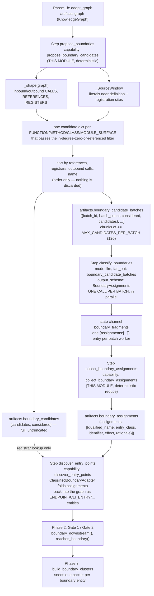
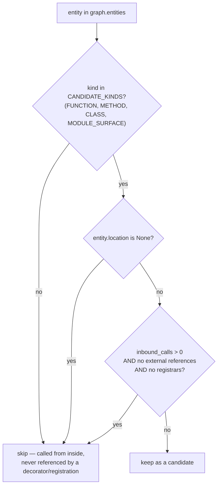
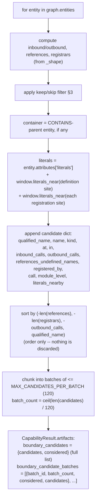
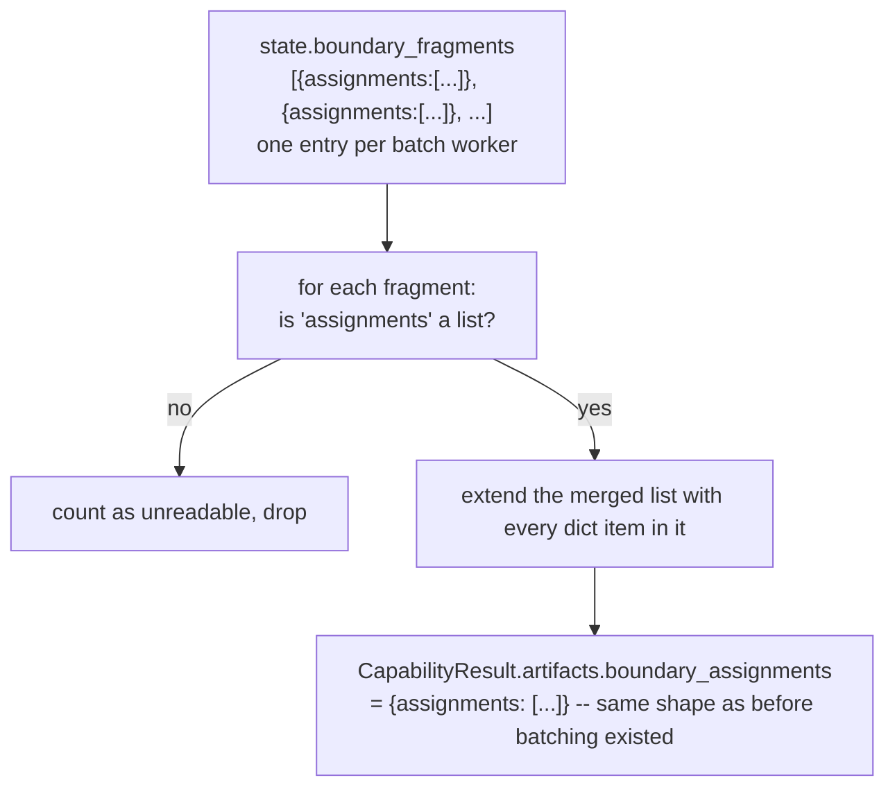
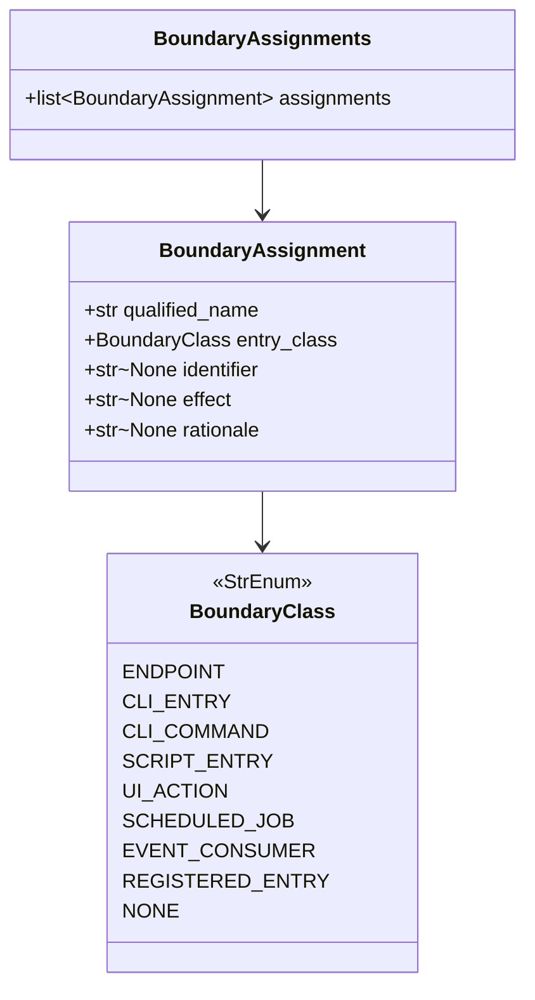
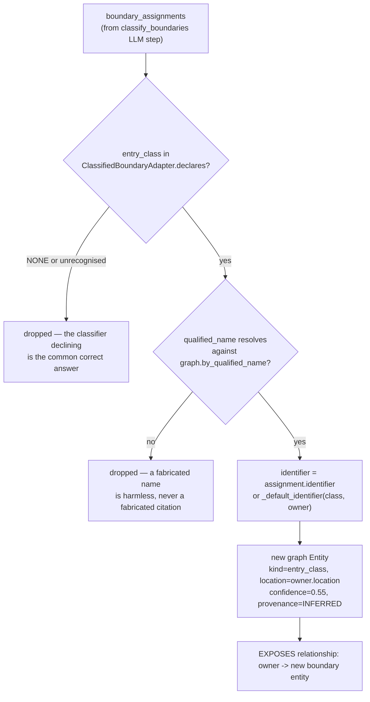

# `boundaries.py` — Phase 1c/1d: proposing and classifying interaction-boundary candidates

> **Updated 2026-09-18.** The candidate list used to be truncated at `MAX_CANDIDATES` (120) with
> everything past that silently discarded, and `classify_boundaries` was a single LLM call over
> whatever survived. Both are fixed: the list is now **batched**, not truncated, and
> `classify_boundaries` **fans out** one call per batch, the same mechanism `synthesize` already
> used for clusters. This doc describes the current, batched design; the change itself — motivation,
> full diff, and the runs that showed the old failure mode — is in
> [changes/batch_boundary_classification.md](../changes/batch_boundary_classification.md) and
> `flow.md` §10 B3.

Module: [src/agentic/capabilities/boundaries.py](../../src/agentic/capabilities/boundaries.py)
Schema: [src/agentic/schemas/boundaries.py](../../src/agentic/schemas/boundaries.py) — what the
downstream LLM classification step is allowed to return
Registered capabilities: `propose_boundary_candidates` (step `propose_boundaries`, `on_fail: halt`);
`collect_boundary_assignments` (step `collect_boundary_assignments`, `on_fail: warn_and_continue`)
Consumers: `classify_boundaries` (LLM step, `fan_out: boundary_candidate_batches`, schema
`BoundaryAssignments`) → `collect_boundary_assignments` (this module) →
[entry_points.py](../../src/agentic/capabilities/entry_points.py)'s `ClassifiedBoundaryAdapter`
Pack: [codebase-requirement-skills/pack.yaml](../../codebase-requirement-skills/pack.yaml) — Phase 1c/1d

## 1. Purpose

An **interaction boundary** is where a system is consumed from outside — a route, a CLI command, a
scheduled job, a UI control. Every functional requirement, business requirement, and success
criterion this pipeline publishes must trace back to one (Gate 2, `gates.py`); a claim that cannot
is rejected. The old pipeline found boundaries syntactically: a Python AST walk saw `@app.post(...)`,
`if __name__ == "__main__"`, an `argparse` subcommand. Graphify replaced that walk and, per its own
module docstring, **emits structure, not intent** — nothing in its output says "this function is a
route handler."

`boundaries.py` is the deterministic half of the replacement. It does not decide what *is* a
boundary — that judgement is delegated to a model in the next pipeline step (`classify_boundaries`).
Its job is narrower and mechanical:

1. Select which graph nodes are even worth asking about (`CANDIDATE_KINDS`).
2. Attach the shape evidence a human reader would use to make that judgement — in-degree on `CALLS`,
   referenced-but-undefined names, registration relationships, and nearby string literals.
3. Rank the list and split it into batches, so **every** candidate gets classified while any one
   classification call still stays within its output budget — the rank decides batch *order*, not
   which candidates survive, because none are discarded any more.

The module docstring states the load-bearing insight directly: a handler is invoked by a framework,
a runtime, or a user — **never by the code around it**. So on a call graph built only from one
repository, a route handler, a CLI command, a scheduled job, and a UI callback all share one
property: **in-degree zero on `CALLS`**. That's a shape, not a framework list, and it holds for
Express, Spring, Sinatra, Flask, gin, and anything nobody here has heard of. The tradeoff is named
just as directly: it over-collects (dead code and public library functions look identical), which is
exactly why the downstream classifier has a `NONE` option and is told most candidates are not
boundaries.

## 2. Where it sits in the pipeline

Two things worth calling out about this shape:

- `propose_boundary_candidates` **never touches an LLM**. It is pure graph traversal plus bounded
  source reads. Only `classify_boundaries` (a separate manifest step, `mode: llm`, and now a
  fan-out step) spends model calls — one per batch of up to 120 candidates, rather than one call
  for the whole (formerly truncated) repository.
- The module comment at the top is explicit about the seam: *"This module owns the deterministic
  half: which nodes are worth asking about, and what evidence goes with each. The asking is a
  manifest `llm` step, fanned out one worker per batch of `MAX_CANDIDATES_PER_BATCH` candidates so a
  repository is never asked about in a single call with no fallback ... the folding back into the
  graph is `ClassifiedBoundaryAdapter` in `entry_points`, so every boundary in the run is created in
  one place and counted by one coverage report."* Nothing in this module mutates the graph — not
  `propose_boundary_candidates`, and not `collect_boundary_assignments` either, which only reduces a
  state channel into a flat artifact.

## 3. Candidate selection — what gets asked about at all

`CANDIDATE_KINDS = {"FUNCTION", "METHOD", "CLASS", "MODULE_SURFACE"}`
([boundaries.py:42](../../src/agentic/capabilities/boundaries.py#L42)) — a file or an external
symbol cannot itself be consumed from outside, so those kinds never enter the pool. `MODULE_SURFACE`
gets its own explanatory comment: it's a module-level call whose result is consumed — a widget, a
control, a top-level registration — and for a script-style UI (Streamlit, Gradio) it is *the entire
interaction surface*. Without it such a product would have no boundary, no cluster, and an empty
output document.

The keep/skip rule at [boundaries.py:203-204](../../src/agentic/capabilities/boundaries.py#L203-L204)
is the actual filter, and its comment explains why a *called* function can still be a candidate:
*"a handler can be both decorated and called directly from a test, and a subcommand is both
registered by its parser and, to Graphify, referenced from it."* So the exclusion only fires for the
narrow case of something called from inside the repo, referencing nothing external, and registered by
nothing — ordinary internal code.

## 4. Shape evidence — `_shape()`

[boundaries.py:91-127](../../src/agentic/capabilities/boundaries.py#L91-L127). One pass over
`graph.relationships` produces four maps:

| Map | Built from | What it captures |
|---|---|---|
| `inbound_calls` | `CALLS` edges, keyed by target | How many places *inside this repo* call this node. Zero is the headline signal. |
| `outbound_calls` | `CALLS` edges, keyed by source | Used only as an ordering tiebreak — a node that calls a lot is a likelier entry point than a leaf. |
| `references` | `REFERENCES` / `INHERITS` edges to an `EXTERNAL_SYMBOL`, filtered through `_UNINFORMATIVE_REFERENCES` | Where a decorator or annotation shows up. Graphify emits `@app.post(...)` as a `references` edge to an `EXTERNAL_SYMBOL` named `post` — this is that edge, named. |
| `registered_by` | `REGISTERS` edges, keyed by target | Something in the repo *handed this node somewhere as a value* rather than calling it — `app.add_url_rule(handler)`, `parser.set_defaults(func=handler)`. Comment: "a registered handler is reached from outside even though something in this repository names it, so it must stay a candidate." |

`_UNINFORMATIVE_REFERENCES` ([boundaries.py:82-88](../../src/agentic/capabilities/boundaries.py#L82-L88))
is a filter, not a framework list — it strips language/container-level names (`self`, `str`, `dict`,
`dataclass`, `print`, …) that appear beside nearly every definition and would otherwise bury the one
reference that actually carries signal.

## 5. Literal evidence — `_SourceWindow`

[boundaries.py:130-166](../../src/agentic/capabilities/boundaries.py#L130-L166). The one place this
module touches raw source, and deliberately narrow: it reads string literals within `LITERAL_WINDOW`
(3) lines of a definition or a registration call, and nothing else — never the surrounding code.

Why this exists at all, per the class docstring: without it, "the extractor records that a handler
references `post`, never the `"/orders"` handed to it, so every endpoint would be published as the
name of the function that serves it and the document could not say what a client calls." Two source
locations are scanned per candidate — the definition's own header, and (separately) every
`REGISTERS`-edge registration site, because a Go handler is typically named at the
`http.HandleFunc(...)` call site inside `main`, nowhere near its own definition.

Filtering is by shape, not meaning (`_useful_literal`,
[boundaries.py:77-79](../../src/agentic/capabilities/boundaries.py#L77-L79)): a literal survives if
it's non-empty, has no space, and is under `MAX_LITERAL_CHARS` (120) — the reasoning being that a
route, a topic, or a command name has no spaces, while a help string or log message does. Each file
is read and cached at most once per run (`_cache: dict[str, tuple[str, ...]]`), and a candidate keeps
at most `MAX_LITERALS` (6) literals, de-duplicated in insertion order.

Files are read with `encoding="utf-8-sig", errors="ignore"` and any `OSError` yields an empty tuple
rather than propagating — a missing or unreadable file just means "no literals," never a halt.

## 6. The capability — `propose_boundary_candidates`

[boundaries.py:169-285](../../src/agentic/capabilities/boundaries.py#L169-L285). Per selected entity,
builds one candidate dict, then ranks and batches the whole list — no longer truncates it:

Two fields on the candidate dict come straight from Graphify's own node attributes rather than from
this module's own analysis: `call` (the module-level call expression itself, e.g. `st.button` /
`gr.Interface` — "what says who is being addressed and how") and `module_level`
([boundaries.py:230-233](../../src/agentic/capabilities/boundaries.py#L230-L233)).

**Ranking** ([boundaries.py:243-250](../../src/agentic/capabilities/boundaries.py#L243-L250)) used
to decide which candidates survived the `MAX_CANDIDATES` cap; now it only decides **batch order** —
every candidate is classified, in some batch, regardless of rank. The comment's reasoning is
unchanged: "A candidate nothing calls but which calls a lot is a likelier entry point than a leaf,
and a candidate carrying registration references is likelier still," so the richest evidence still
lands in batch 1 rather than being spread evenly — which matters only if a run is cut short (a batch
failing, or the run stopping mid-way) rather than for correctness of the finished run. Sort key, in
order: most external references first, then most registrars, then most outbound calls, then
alphabetical by qualified name as a stable tiebreak.

**Batching is reported, not silent**: `metrics={"candidates": ..., "batches": ...}` and a `messages`
entry ("`N` boundary candidates split into `M` classification batches of up to 120.") fires whenever
there is more than one batch
([boundaries.py:276-284](../../src/agentic/capabilities/boundaries.py#L276-L284)).
`MAX_CANDIDATES_PER_BATCH` — the same constant and the same value (120) that used to be the hard cap
— is still explicitly sized against the model's *output* ceiling, not its input: "The reply is what
overruns, not the prompt: each assignment is a few short fields." What changed is what happens to a
candidate past that size: it used to be discarded; it is now simply asked about in a later batch.

## 6b. The reduce step — `collect_boundary_assignments`

[boundaries.py:288-323](../../src/agentic/capabilities/boundaries.py#L288-L323). `classify_boundaries`
fans out one worker per batch (same mechanism as `synthesize` over `clusters`), and each worker's
`BoundaryAssignments` reply is appended to the `boundary_fragments` state channel rather than saved
as a file — the standard shape for a fan-out step's output (`fragment`/`fragments` in
`registry.py`/`steps.py`/`nodes.py`), except routed to a **channel of its own**
(`AgentState.boundary_fragments`) rather than the `fragments` channel `synthesize` already owns.
That separation matters: `assemble_requirements` reads the *entire* `fragments` channel and treats
every entry as a `BRDFragment`, so a `BoundaryAssignments` reply landing there instead would either
fail validation silently or — since every `BRDFragment` field has a default — validate as a
spuriously empty fragment, polluting `assemble_requirements`'s counts for a phase this module has
nothing to do with.

This is the step that makes the batching invisible to everything downstream: `discover_entry_points`
still reads one `boundary_assignments` artifact shaped `{assignments: [...]}`, exactly as it did when
`classify_boundaries` was a single call. An unreadable batch reply (wrong shape, e.g. a provider
returning something that doesn't validate) is dropped and counted in `messages`, never guessed at or
silently absorbed.

## 7. The schema — what comes back — `schemas/boundaries.py`

[schemas/boundaries.py](../../src/agentic/schemas/boundaries.py) is the contract for the
`classify_boundaries` LLM step: what one fan-out worker returns for the one batch it was given, later
merged by `collect_boundary_assignments` (§6b) into `boundary_assignments`. It is deliberately narrow —
per its own module docstring, "a class from a closed set, an identifier, and the handler it belongs
to. Everything else about the boundary is derived from the graph, not from the reply."

`BoundaryClass` mirrors `graph_ops.BOUNDARY_KINDS` plus `NONE`. The `NONE` option is called out as
load-bearing, not a failure case: "most candidates are not boundaries. ... Without it the model has
no way to decline and will promote helpers to boundaries." Every field on `BoundaryAssignment` is
optional except `qualified_name` and `entry_class` — `identifier`, `effect`, and `rationale` are all
`str | None` with instructions to leave them null rather than invent a value.

`qualified_name` must be **copied exactly** from the candidate evidence; the field doc says "a name
that does not appear there is discarded" — this is what `ClassifiedBoundaryAdapter` enforces (§8
below): a fabricated name simply fails to resolve against the graph and is dropped, rather than
being trusted at face value.

## 8. What happens to the assignments — `ClassifiedBoundaryAdapter`

This module doesn't fold anything back into the graph itself — that happens one step later, in
[entry_points.py](../../src/agentic/capabilities/entry_points.py). Worth summarising here because it
closes the loop this module opens:

The location of the new boundary entity is **never** taken from the model — it's the location of the
`qualified_name` entity the model named, resolved against the graph
([entry_points.py:144-146](../../src/agentic/capabilities/entry_points.py#L144-L146)): *"The model is
never trusted about *where* anything is."* This is the safety property the whole design rests on: a
wrong classification produces a mislabelled boundary; it can never produce a fabricated citation to a
line that doesn't exist.

`discover_entry_points` also re-attaches each assignment's own `registered_by` /
`references_undefined_names` evidence as `registrars`
([entry_points.py:261-286](../../src/agentic/capabilities/entry_points.py#L261-L286)) before handing
it to the adapter — the model is asked only to name a class, but the registrar names that justified
it are facts pulled straight back from `boundary_candidates`, not from the reply.

## 9. Downstream consumers

- **Gate 2** (`gates.py`) calls `GraphIndex.boundary_ids()` / `.boundary_downstream()` /
  `.reaches_boundary()` (`graph_ops.py`), which read `BOUNDARY_KINDS` — the set that
  `entry_point_adapter()` grows every time a new adapter (including `ClassifiedBoundaryAdapter`)
  registers. Every `business_requirements`, `functional_requirements`, and `success_criteria` claim
  must trace to a node in this set or be rejected.
- **`build_boundary_clusters`** (`graph_ops.py:641`) seeds one evidence packet per boundary entity —
  `primary = [entity for entity in ranked if entity.kind in BOUNDARY_KINDS]`
  ([graph_ops.py:662](../../src/agentic/capabilities/graph_ops.py#L662)) — and groups boundaries that
  share the same downstream workflow before dispatching one `synthesize` LLM call per group. A
  boundary this module never proposed, or the classifier declined, never becomes a cluster and never
  produces a requirement.
- **`prompt.py`**'s `_render_boundary_batch_work_item` (registered via `renders_work_item` under
  `"boundary_candidate_batches"`) renders each fan-out worker's one batch — its `candidates` list and
  `batch` metadata (`batch_id`, `batch_count`, `considered`) — **unsummarised**, since it's already
  the whole evidence for that worker's call. It adds one clarifying note about what `inbound_calls`
  and `references_undefined_names` mean, since the model sees only the rendered JSON, not this
  module's comments. This replaced an earlier `@renders("boundary_candidates")` whole-artifact
  renderer, retired once `classify_boundaries` stopped `consumes`-ing the flat artifact and started
  fanning out over batches instead; `_WORK_ITEM_RENDERERS` is a small registry mirroring `_RENDERERS`,
  keyed by the `fan_out` target's artifact name rather than by a `consumes` name, with a fallback that
  keeps `clusters` and testgen's `test_batches` rendering exactly as before (see the doc comment at
  its definition in `prompt.py` for why an unregistered fan-out target still gets a "cluster" shape).

## 10. Design rationale, in one place

- **Deterministic candidate generation, fanned-out LLM judgement.** Finding *candidates* is cheap
  and mechanical (graph shape); deciding *which candidates are real* needs judgement a hand-written
  heuristic can't cheaply encode (is this dead code, a public library function, or a route?).
  Splitting the module this way means the expensive/fuzzy part costs one model call per batch of
  `MAX_CANDIDATES_PER_BATCH`, growing linearly with repository size instead of being capped and
  silently losing candidates the way it was before 2026-09-18.
- **Language-agnostic by construction.** In-degree-zero-on-`CALLS`, an external reference, and a
  `REGISTERS` edge are graph-shape facts Graphify produces uniformly across languages. Nothing here
  is a framework list (`@app.route`, `@GetMapping`, …) — the module docstring is explicit that this
  is the point.
- **Evidence, never source.** `_SourceWindow` is scoped to quoted literals within a 3-line window,
  specifically so the model is shown "the strings a registration names, never the code around them."
  This bounds both prompt size and the surface for source leaking into a boundary label.
- **Low confidence by design.** The adapter that consumes these classifications assigns `confidence =
  0.55` — "deliberately low, and lower than any syntactic detector would have been... a requirement
  resting on [a model inference] should be worded as cautiously as its evidence deserves"
  ([entry_points.py:203-207](../../src/agentic/capabilities/entry_points.py#L203-L207)). That
  cautious framing starts here, in what evidence is (and isn't) handed to the classifier.
- **Failure is attributable and visible, not silent.** Truncation is reported as a metric and a
  message; a `NONE` classification is an expected, correctly-declining answer, not an error; a
  fabricated `qualified_name` is dropped rather than silently trusted. The design consistently prefers
  "say nothing rather than say something false" at every stage.

## 11. Suggested improvements

**Correctness / accuracy**
- The keep/skip filter at [boundaries.py:203-204](../../src/agentic/capabilities/boundaries.py#L203-L204)
  only exempts a called node when it has an external reference *or* a registrar. A node that is
  called from inside the repo **and** decorated with something Graphify resolved as an internal
  symbol rather than an `EXTERNAL_SYMBOL` (e.g. a decorator defined in the same repository, like a
  project's own `@app.route` re-export or a local `@requires_auth`) produces no entry in `references`
  at all (`_shape` only records `REFERENCES`/`INHERITS` edges whose target `kind ==
  "EXTERNAL_SYMBOL"`, [boundaries.py:119-125](../../src/agentic/capabilities/boundaries.py#L119-L125)),
  so such a handler is silently dropped as a candidate before the classifier ever sees it — with no
  message reporting the gap. This is now a sharper contrast than before 2026-09-18: batching *is*
  reported (`messages` names the batch count whenever there's more than one), but a candidate that
  never became a candidate at all still leaves no trace anywhere.
- `_useful_literal`'s "no spaces" heuristic ([boundaries.py:77-79](../../src/agentic/capabilities/boundaries.py#L77-L79))
  rejects legitimate route/command strings that do contain a space by convention in some frameworks
  (e.g. a Click command with a multi-word help-adjacent label, or a literal like `"GET /orders"`
  combined into one string) and, in the other direction, happily accepts single-token log-level
  strings or format specifiers (`"%s-%d"`, `"utf-8"`) that carry no boundary-naming signal at all. A
  shape-only filter is deliberately crude by design, but the false-negative case (a real route
  literal with an embedded space) is silent — there's no `messages` entry saying "N candidates had
  literals nearby but none survived the shape filter."
- `_STRING_LITERAL`'s regex ([boundaries.py:69-72](../../src/agentic/capabilities/boundaries.py#L69-L72))
  has no escape handling — a literal containing an escaped quote (`"a \"quoted\" path"`) terminates
  the match early and yields a truncated, misleading literal rather than being skipped or fully
  captured.

**Performance**
- `_SourceWindow.literals_near` is called once for the definition site and once per registration
  site per candidate ([boundaries.py:210-218](../../src/agentic/capabilities/boundaries.py#L210-L218)),
  and it re-scans the whole `LITERAL_WINDOW` line range with `_STRING_LITERAL.finditer` on every
  call — there's no per-(file, line) memoisation, only per-file line caching. A file with many
  registration sites clustered near each other (a large `argparse` subcommand table, a big Express
  router file) re-runs the regex over overlapping line ranges repeatedly instead of scanning the file
  once and slicing cached per-line results. Batching changed *how many model calls* a large candidate
  list costs; it did not change this — every candidate, batched or not, still pays this per-candidate
  literal scan while `propose_boundary_candidates` builds the list.
- `graph.by_id()` is called once here ([boundaries.py:173](../../src/agentic/capabilities/boundaries.py#L173))
  and Graphify's own `adapt_graphify_graph` and `entry_points.py` each build their own
  `{entity.id: entity}` / `{entity.qualified_name: entity}` dict independently in the same run
  (e.g. [entry_points.py:168](../../src/agentic/capabilities/entry_points.py#L168) and
  [entry_points.py:293](../../src/agentic/capabilities/entry_points.py#L293)). None of these are
  individually expensive, but on a large graph three-plus independent O(entities) dict-builds per run
  for what is conceptually the same lookup is avoidable if `KnowledgeGraph` cached the map (it already
  exposes `by_id()`/`by_qualified_name()` as methods, not cached properties — see
  [core.py:99-103](../../src/agentic/schemas/core.py#L99-L103)). `collect_boundary_assignments`
  (§6b) adds no new instance of this — it never touches the graph at all.

**Robustness**
- `registration_sites` collects `(file, line)` from **every** `evidence` entry on a `REGISTERS`
  relationship ([boundaries.py:185-190](../../src/agentic/capabilities/boundaries.py#L185-L190)), with
  no cap. A generated or templated file that registers hundreds of routes in one loop (an OpenAPI
  codegen output, a bulk `for route in routes: app.add_url_rule(...)` pattern) could produce a long
  tail of registration sites for a single target entity, each triggering its own bounded-but-nonzero
  file read/scan — `MAX_LITERALS` caps what's *kept* per candidate but not the work done to find it.
- `_SourceWindow` swallows every `OSError` uniformly into "no literals"
  ([boundaries.py:145-152](../../src/agentic/capabilities/boundaries.py#L145-L152)) — a genuinely
  missing file (stale graph, renamed since extraction) and a permissions error look identical to a
  file that simply has no useful literals nearby. Nothing here or in the capability's `messages`
  distinguishes "this candidate's source couldn't be read" from "this candidate's source had nothing
  to say," which could mask a stale-graph problem (source moved/renamed between `graphify_extract`
  and this step) as an ordinary absence of evidence.

**Consistency**
- `boundaries.py` and `schemas/boundaries.py` are two files with the same base name in different
  packages (`agentic.capabilities.boundaries` vs `agentic.schemas.boundaries`), which matches the
  project's general capability/schema pairing convention elsewhere (`graph_ops` ↔ no dedicated schema
  file; `entry_points` ↔ no dedicated schema file) but is easy to mis-`import` given how similarly the
  two module docstrings read (both open with "An interaction boundary is where a system is consumed
  from outside…"). Worth double-checking any new contributor's `from agentic.capabilities.boundaries
  import ...` vs `from agentic.schemas.boundaries import ...` doesn't get swapped, since both are
  valid imports that would fail loudly (`ImportError`) rather than silently — low risk, but worth a
  one-line note in one of the two docstrings cross-referencing the other, which neither currently
  does.
- `LITERAL_WINDOW`, `MAX_LITERALS`, and `MAX_LITERAL_CHARS` are hardcoded module constants with no
  `Settings` override, unlike `MAX_CANDIDATES_PER_BATCH` which is also hardcoded but at least has an
  explicit sizing rationale in its comment (and now a doubly explicit one, since the comment also
  explains why it moved from a cap to a batch size). If a future repository's registration literals
  routinely sit further than 3 lines from their registration call (a decorator-factory pattern
  spanning several lines, or a route table defined far from `app.include_router(...)`), there's
  currently no way to widen the window without editing this module — the same "no override" shape
  flagged for Graphify's CLI flags in [graphify.md §12](graphify.md#12-suggested-improvements).
- **New in this design:** `collect_boundary_assignments`'s `on_fail: warn_and_continue`
  (`pack.yaml`) means a bug in the reduce step degrades to "no boundaries were classified" rather
  than halting the run — consistent with the rest of this phase's philosophy, but worth knowing: a
  silent reduce-step failure and a genuinely boundary-free repository currently look identical to
  `discover_entry_points`, which tolerates a missing `boundary_assignments` artifact by design (see
  its own docstring). A `messages` entry distinguishing "this step ran and found nothing" from "this
  step didn't run" would close that gap, the same way `boundary_fragments` batch/unreadable counts
  already do inside `collect_boundary_assignments` itself.
