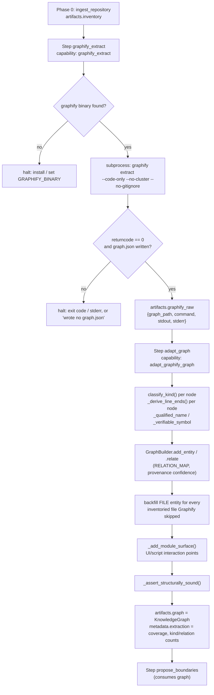
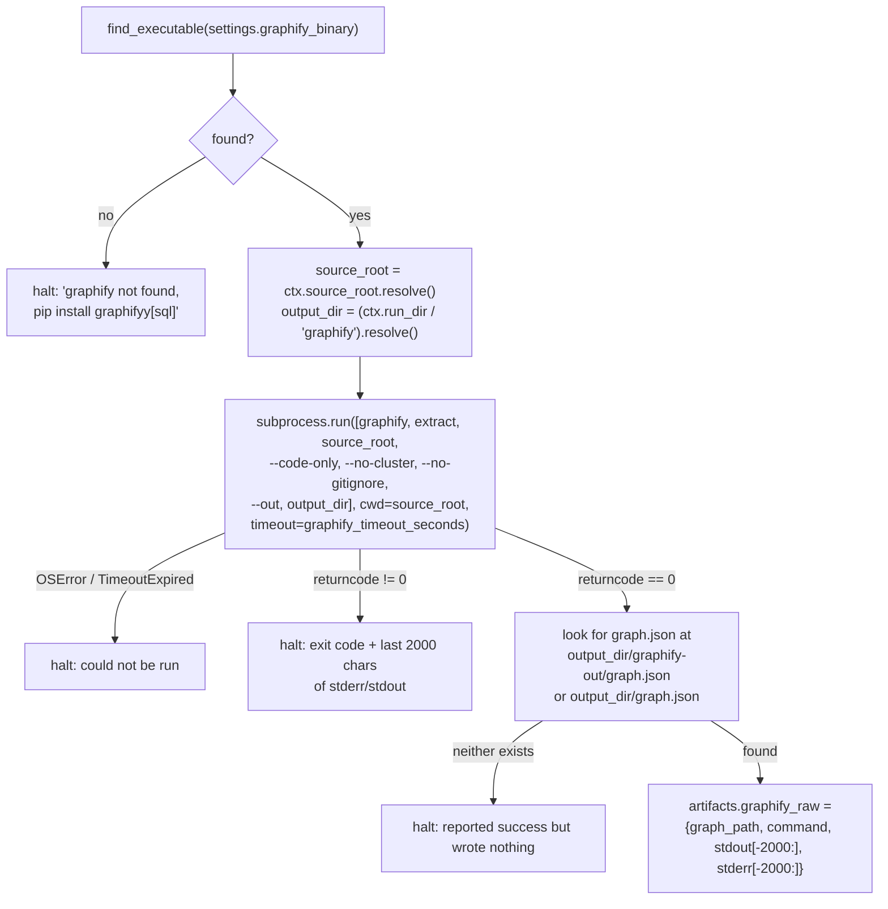
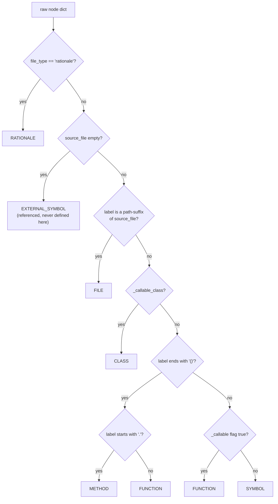
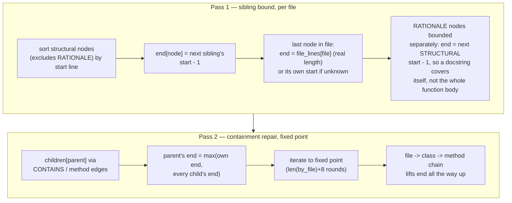
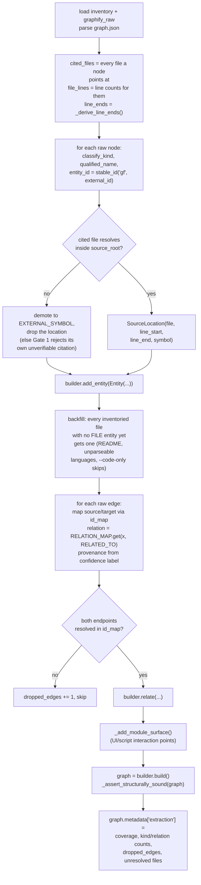
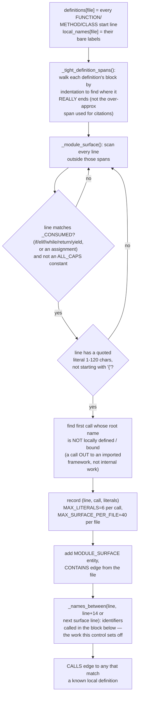
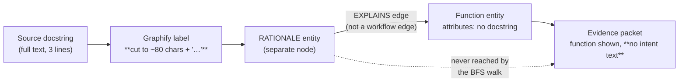
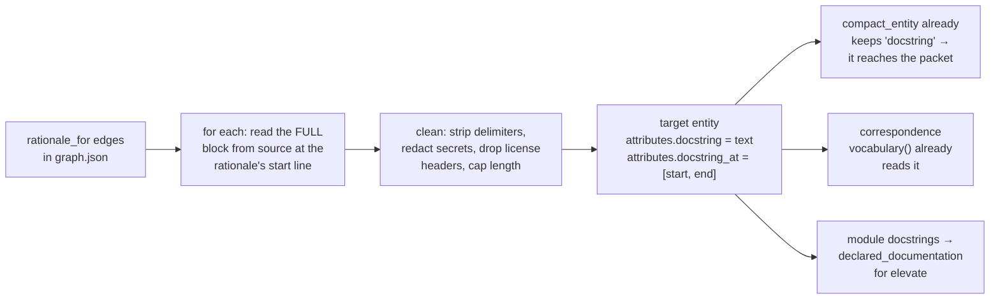

# `graphify.py` — Phase 1: structural extraction and normalisation

Module: [src/agentic/capabilities/graphify.py](../../src/agentic/capabilities/graphify.py)
Registered capabilities: `graphify_extract` (step `graphify_extract`, `on_fail: halt`),
`adapt_graphify_graph` (step `adapt_graph`, `on_fail: halt`)
Pack: [codebase-requirement-skills/pack.yaml](../../codebase-requirement-skills/pack.yaml) — Phase 1 / 1b

## 1. Purpose

This module is the language-agnostic replacement for the old Python-only AST extractor. The
module docstring states the split up front, and it is deliberate: **two capabilities, so a
failure is attributable to one of them**, not a shared blob of "extraction went wrong somehow."

1. **`graphify_extract`** — shells out to the external `graphify` binary and hands back the path
   to the `graph.json` it wrote. It knows nothing about node kinds, schemas, or the canonical
   graph — purely "run this subprocess, find its output file."
2. **`adapt_graphify_graph`** — reads that raw JSON and produces a `KnowledgeGraph`
   (`agentic.schemas.core`). It knows nothing about subprocesses. Its entire job is satisfying the
   contract every downstream step (`propose_boundaries`, `build_boundary_clusters`, synthesis…)
   already depends on, so the swap from AST parsing to Graphify was invisible past this file.

The module's own docstring ([graphify.py:14-30](../../src/agentic/capabilities/graphify.py#L14-L30))
records the three quirks of Graphify's actual output (measured against `graphifyy 0.9.52`) that
drive most of the code below:

- No `type`/`kind` field on a node — kind must be **classified**, not looked up (`classify_kind`).
- `source_location` is always a single start line, never a range — end lines are **reconstructed**
  (`_derive_line_ends`).
- The `_callable` boolean is unreliable across languages (Go functions report `false`) — the
  language-agnostic signal is the `()` suffix Graphify appends to every callable's label.

## 2. Where it sits in the pipeline



Both capabilities are `on_fail: halt` in the manifest — unlike the optional enrichment step this
replaced, Graphify is now the *only* extractor, so a failure here can't be shrugged off; continuing
would publish a document built on nothing.

## 3. Capability 1 — `graphify_extract`: run the binary

Signature: `graphify_extract(ctx: CapabilityContext) -> CapabilityResult`



Notable design choices:

| Choice | Where | Why |
|---|---|---|
| `find_executable` checks PATH, then a venv-sibling fallback | [graphify.py:550-564](../../src/agentic/capabilities/graphify.py#L550-L564) | On Windows, `pip install` into a venv puts `graphify.exe` beside `python.exe` in `Scripts/` without that directory necessarily being on `PATH` for a subprocess |
| `source_root` and `output_dir` are `.resolve()`d before use | [graphify.py:588-591](../../src/agentic/capabilities/graphify.py#L588-L591) | `Settings.runs_dir` defaults to a *relative* `Path("runs")`; passing a relative `source_root` as both the CLI argument and `cwd` makes the child process join them, producing a doubled, non-existent path. A comment on the same lines notes tests never caught this because they pass an absolute `runs_dir` |
| `--code-only` | [graphify.py:596-599](../../src/agentic/capabilities/graphify.py#L596-L599) | Structure only — local tree-sitter, zero API calls, no second LLM vendor in the loop, reproducible. Doc/PDF concept extraction is deferred to a later increment routed through this project's own Azure client |
| `--no-cluster` | [graphify.py:600-603](../../src/agentic/capabilities/graphify.py#L600-L603) | Graphify's own Leiden community detection would compete with this pipeline's own partitioning in `build_boundary_clusters` (graph_ops.py), which clusters around interaction boundaries specifically |
| `--no-gitignore` | [graphify.py:604-606](../../src/agentic/capabilities/graphify.py#L604-L606) | An uploaded snapshot often carries a `.gitignore` written for a different checkout layout, which would silently exclude source under analysis |
| stdout/stderr truncated to last 2000 chars | [graphify.py:646-647](../../src/agentic/capabilities/graphify.py#L646-L647) | Bounds the artifact size while keeping the part of a long log most likely to contain the actual error |

## 4. Node classification — `classify_kind`

Signature: `classify_kind(raw: dict) -> str`

This is the load-bearing function of the whole adapter: every entity's `kind` is *inferred* from
shape, because Graphify's raw nodes carry no kind field at all.



The ordering is the whole design: several signals overlap (a class is also callable; a file node
also has a `source_file`), so each check has to run only against nodes the earlier checks didn't
already claim. Two sub-rules earn their own functions because they were each the fix for a real
false-classification bug:

- **`_is_path_suffix`** ([graphify.py:162-171](../../src/agentic/capabilities/graphify.py#L162-L171))
  — matches on path *segment* boundaries (`mail.py` matches `app/api/mail.py`, `ail.py` does not).
  A plain basename comparison silently misclassified every file node in a repo with any repeated
  filename (`__init__.py`, `index.ts`) as a SYMBOL asserting its own filename.
- **`_callable` checked last, after the `()` suffix** — Graphify's Go grammar does not mark a
  `func` as callable, so classifying on that flag alone puts every Go function under SYMBOL,
  excludes it from call traversal, and produces an empty document for a Go repository. The `()`
  suffix, by contrast, is emitted by every language extractor.

## 5. Naming and citability

Three small functions turn a raw node into something a reader can cite and a verifier can check
against source:

| Function | Produces | Key rule |
|---|---|---|
| `_display_name` ([graphify.py:190-194](../../src/agentic/capabilities/graphify.py#L190-L194)) | Human-readable name | RATIONALE labels (whole sentences from a comment/docstring) are truncated to 80 chars so they don't become unreadable in a traceability matrix |
| `_qualified_name` ([graphify.py:197-213](../../src/agentic/capabilities/graphify.py#L197-L213)) | `file::label`-style unique name | A FILE's qualified name is always its full path (not its possibly-ambiguous label), because two files that share a disambiguating label under different roots would otherwise collide in `by_qualified_name` and one would be silently dropped |
| `_verifiable_symbol` ([graphify.py:216-234](../../src/agentic/capabilities/graphify.py#L216-L234)) | The token verification may check appears on the cited line, or `None` | FILE and RATIONALE never get one (a path isn't written on line 1; a sentence isn't an identifier). A label containing a `/`, `\`, or a space is also rejected — costs nothing (the line is simply not symbol-checked) versus a wrong symbol invalidating a sound citation |

## 6. Reconstructing end lines — `_derive_line_ends`

Signature: `_derive_line_ends(nodes, edges, file_lines=None) -> dict[str, int]`

Graphify only ever reports a start line. Without a span, every citation collapses to one line and
the synthesis prompt's instruction to "cite at the span of the definition it rests on" has nothing
to work with. Two passes:



Pass 1 alone is wrong for containers: a class starting at L5 whose first method starts at L11
would end at L10 — cutting the class off at its own first member. Pass 2 fixes that by extending
every container to the furthest end among what it transitively `contains`.

The result is explicitly an **over-approximation**, and the code says why
([graphify.py:271-273](../../src/agentic/capabilities/graphify.py#L271-L273)): a span that runs a
few lines too long still contains the evidence; one that's too short silently drops it.

## 7. Capability 2 — `adapt_graphify_graph`: build the `KnowledgeGraph`

Signature: `adapt_graphify_graph(ctx: CapabilityContext) -> CapabilityResult`



Points worth calling out:

- **Unresolved citations are demoted, not dropped.** ([graphify.py:706-714](../../src/agentic/capabilities/graphify.py#L706-L714))
  Graphify sometimes attributes a node to a name that isn't a real path in the tree (a bare package
  name lifted from a config file). Emitting it with a location it would produce an entity whose own
  citation the structural gate later rejects — failing the run on the *extractor's* output rather
  than the codebase's. Reclassifying it as `EXTERNAL_SYMBOL` (which asserts nothing about location)
  sidesteps that.
- **FILE spans use the real file length, not the derived end**, because a file may end in something
  Graphify links no other way (a trailing comment block) that `_derive_line_ends` would under-report
  ([graphify.py:725-731](../../src/agentic/capabilities/graphify.py#L725-L731)).
- **Every inventoried file gets a FILE entity**, even one Graphify emitted no node for at all
  ([graphify.py:768-802](../../src/agentic/capabilities/graphify.py#L768-L802)). Two concrete
  regressions this prevents: `--code-only` means a README never appears in the payload at all, yet
  it's the clearest statement a project makes of its own purpose and the source of
  `declared_documentation`; and a file in a language Graphify can't parse would otherwise vanish
  from the graph rather than showing up as "inventoried but not analysed."
- **A dangling edge is dropped, never repaired**, when Graphify references an endpoint it never
  emitted a node for — nothing can be cited about an entity that doesn't exist, so it's counted
  in `dropped_edges` and skipped ([graphify.py:806-813](../../src/agentic/capabilities/graphify.py#L806-L813)).
- **Unmapped relation vocabulary is intentionally visible, not hidden.** Any Graphify relation not
  in `RELATION_MAP` falls through to `RELATED_TO` ([graphify.py:60-80](../../src/agentic/capabilities/graphify.py#L60-L80)),
  which no workflow walk in `graph_ops.WORKFLOW_EDGE_KINDS` follows — an unknown relation shows up
  as an inert node pair instead of silently reshaping a cluster.

### `RELATION_MAP` — Graphify vocabulary → canonical edge kinds

| Graphify relation | Canonical kind | Note |
|---|---|---|
| `calls` | CALLS | |
| `indirect_call` | REGISTERS | A function handed somewhere as a *value* rather than invoked (`set_defaults(handler=cmd_report)`, a route table, a task registry) — deliberately not CALLS, or every registered handler would look like ordinary called-from-here code and lose its status as an interaction-boundary candidate |
| `uses` | CALLS | |
| `method`, `contains` | CONTAINS | |
| `imports`, `imports_from`, `re_exports` | IMPORTS | |
| `inherits` | INHERITS | |
| `references` | REFERENCES | |
| `rationale_for` | EXPLAINS | |
| `triggers` | TRIGGERS | |
| *(anything else)* | RELATED_TO | Not traversed by any workflow walk |

Confidence-label mapping ([graphify.py:92-97](../../src/agentic/capabilities/graphify.py#L92-L97)):
`EXTRACTED → 1.0`, `RESOLVED → 0.95`, `INFERRED → 0.7`, `AMBIGUOUS → 0.4`. `RESOLVED` never
actually appears in Graphify output — it doesn't distinguish a resolved call from a syntactically
certain one — so a mapped CALLS edge always lands as `EXTRACTED`, never `RESOLVED`.

## 8. Module-level interaction surface — `_add_module_surface`

This is the largest piece of original logic in the file and solves a gap specific to
script-style products (Streamlit, Gradio, notebook-shaped apps): their entire interaction surface
is written as **top-level statements**, not function/class definitions. A pure definition-based
extractor sees only helper functions, finds no boundary, forms no cluster, and produces an empty
requirements document — "it looks like a library with nothing exposed," as the docstring puts it
([graphify.py:394-399](../../src/agentic/capabilities/graphify.py#L394-L399)).



The whole discrimination is a *shape*, not a list of framework names, and the module docstring
above `_CONSUMED` spells out the three cases it distinguishes
([graphify.py:360-364](../../src/agentic/capabilities/graphify.py#L360-L364)):

```python
uploaded_file = st.file_uploader("Choose a medical PDF")   # an input; the value is used
if st.button("Add to Index"):                              # a control; the value is tested
st.success("Done!")                                        # display; the value is discarded
```

Only the first two pass `_CONSUMED` — a call whose result is assigned or tested. A display call
whose return value is thrown away asserts nothing anyone can act on, and is excluded.

Other guards baked into this pass:

- **ALL-CAPS assignments are excluded as constants**, not controls
  ([graphify.py:430-436](../../src/agentic/capabilities/graphify.py#L430-L436)) — `RETENTION_DAYS
  = int(os.getenv(...))` reads configuration, it doesn't offer a way in. Left in, every configured
  setting in a repository was crowding out the real interaction points.
- **A call on a locally-bound name is internal work, not a boundary** — `result.get(...)` on a
  value the same file assigned two lines above is excluded via `_BOUND_NAME`/`local_values`
  tracking, because what marks an interaction point is a call *out* to an imported framework.
- **The workflow-window heuristic (`SURFACE_WORKFLOW_WINDOW = 14`)** — identifiers called within 14
  lines after a control (or up to the next control, whichever is closer) are treated as the work
  that control sets off. The comment states this bluntly: "beyond a dozen lines the association
  stops being evidence" ([graphify.py:342-344](../../src/agentic/capabilities/graphify.py#L342-L344)).

`_tight_definition_spans` deliberately computes a **different, tighter** span than the one stored
on entities: the entity span is an over-approximation good for citations (runs to the next sibling
or file end), but using that here would make every line below the last `def` in a Streamlit script
look like it's still inside that function, hiding the whole interaction surface
([graphify.py:963-972](../../src/agentic/capabilities/graphify.py#L963-L972)).

## 9. Supporting-evidence outlines — `safe_file_outline`

Ported unchanged in behaviour from the deleted `extract_python._safe_file_outline`
([graphify.py:503-542](../../src/agentic/capabilities/graphify.py#L503-L542)), because
`llm/prompt.py` builds `declared_documentation` — what `elevate` writes the product purpose from —
by scanning FILE entities for this attribute; losing it would leave the top tier of the document
with nothing but area names to work from. Applies only to a fixed allowlist of manifest/deploy/
README-shaped filenames (`Dockerfile`, `docker-compose*.yml`, `requirements*.txt`,
`pyproject.toml`, `package.json`, `go.mod`, `README*`, …), redacts anything matching
`key/password/secret/token\s*[:=]\s*(.+)` before including a line, and caps output at 50 lines /
200 chars each / a 256 KB source file.

## 10. Data model produced

```
KnowledgeGraph
├── repository_name: str
├── entities: list[Entity]              (sorted by id)
│     ├── id: str                       stable_id("gf", graphify_id) | stable_id("file", path)
│     ├── kind: str                     FILE | FUNCTION | METHOD | CLASS | SYMBOL |
│     │                                 EXTERNAL_SYMBOL | RATIONALE | MODULE_SURFACE
│     ├── name / qualified_name: str
│     ├── language: str | None
│     ├── location: SourceLocation | None   (file, line_start, line_end, symbol)
│     ├── provenance: Provenance         EXTRACTED (INFERRED for RATIONALE / surface CALLS)
│     ├── confidence: float
│     └── attributes: dict               graphify_id, origin, line_end_estimated,
│                                         content_outline (FILE only), call/literals (MODULE_SURFACE)
├── relationships: list[Relationship]   (sorted by id) — CALLS | REGISTERS | CONTAINS | IMPORTS |
│                                         INHERITS | REFERENCES | EXPLAINS | TRIGGERS | RELATED_TO
└── metadata.extraction
      ├── extractor: "graphify"
      ├── files_seen / files_with_nodes / extraction_coverage  (files_with_nodes / files_seen)
      ├── languages, entity_kinds, relationship_kinds          (dicts, sorted)
      ├── dropped_edges, unresolved_cited_files (first 20)
      └── command                                              (the graphify CLI argv, minus argv[0])
```

`extraction_coverage` is deliberately named to sit where the old AST extractor's `parse_coverage`
did, and is read the same way downstream — by Gate 1, the prompt summary, and the gap analysis.

## 11. Reuse and non-reuse elsewhere

- `GraphBuilder` and `stable_id` are shared with every other extractor via
  [graph_ops.py](../../src/agentic/capabilities/graph_ops.py) — `graphify.py` never mints ids or
  assembles the final `KnowledgeGraph` itself.
- `RepositoryInventory` (from `ingest_repository`, see [ingestion.md](ingestion.md)) is consumed
  twice here: once for `language_of` (per-path language lookup) and once for the FILE-entity
  backfill loop that guarantees every inventoried file is represented in the graph.
- Downstream, **everything** from `propose_boundaries` onward depends only on the `KnowledgeGraph`
  contract this module produces — the module docstring calls this out explicitly as the whole
  point of the split: swapping the extractor never touched `plan_clusters` or anything after it.

## 12. Suggested improvements

**Correctness / accuracy**
- `find_executable` treats any `.is_file()` match as usable ([graphify.py:557-564](../../src/agentic/capabilities/graphify.py#L557-L564))
  without checking it's actually executable on POSIX (`os.access(path, os.X_OK)`). A `graphify`
  file that exists but lost its execute bit (common after a plain `tar`/zip extraction on Linux/
  macOS) would be "found" here and then fail inside `subprocess.run` with a less diagnosable
  `PermissionError`/`OSError` than the clean "not found, install with…" message this function
  exists to produce.
- The three CLI flags (`--code-only`, `--no-cluster`, `--no-gitignore`) are hardcoded
  ([graphify.py:596-606](../../src/agentic/capabilities/graphify.py#L596-L606)) with no
  `Settings` override. If a future run genuinely needs Graphify's gitignore respect (e.g. a
  checkout that legitimately vendors dependencies the operator wants excluded), there's currently
  no way to ask for it without editing this module.
- `_SECRET` ([graphify.py:102](../../src/agentic/capabilities/graphify.py#L102)) only catches
  lines shaped like `key = value` with one of four keyword stems. A credential embedded without a
  labelled key (a bare connection string in a YAML list item, an inline AWS access key in a
  comment) passes through `safe_file_outline` unredacted into `content_outline`, which later
  reaches the LLM prompt.

**Performance**
- `_names_between` re-reads and re-splits the whole source file from scratch for **every** surface
  call in `_add_module_surface`'s inner loop ([graphify.py:940-955](../../src/agentic/capabilities/graphify.py#L940-L955),
  implementation at [graphify.py:999-1010](../../src/agentic/capabilities/graphify.py#L999-L1010)).
  A file can have up to `MAX_SURFACE_PER_FILE` (40) surface points, and the same file was *already*
  read once in `_module_surface` and once more in `_tight_definition_spans` — so a busy Streamlit
  script can re-read and re-`splitlines()` itself 40+ times in one adapter run. Reading the file
  once per path and passing the cached `list[str]` through all three helpers would cut this to one
  read per file regardless of surface density.
- `_file_line_counts` is called once in bulk for `cited_files` ([graphify.py:685](../../src/agentic/capabilities/graphify.py#L685)),
  but then called again **individually, inside the per-file loop** that backfills FILE entities for
  inventory-only files ([graphify.py:798](../../src/agentic/capabilities/graphify.py#L798)) —
  `_file_line_counts(ctx.source_root, {record.path})` opens and re-scans one file per iteration
  instead of batching the whole `{record.path for record in inventory.files if record.path not in
  files_with_file_entity}` set into a single call the way `cited_files` already does.
- `_resolves` calls `.resolve()` on `source_root` fresh on every invocation
  ([graphify.py:469-476](../../src/agentic/capabilities/graphify.py#L469-L476)), once per node with
  a location. Resolving `ctx.source_root` once outside the per-node loop and passing the resolved
  `Path` in would save a filesystem round-trip per cited node on a large repository.

**Robustness**
- `_assert_structurally_sound` raises `AdapterError` (an ordinary `RuntimeError`) rather than
  returning a `CapabilityResult(halt_reason=...)` the way every other failure path in this module
  does ([graphify.py:1013-1029](../../src/agentic/capabilities/graphify.py#L1013-L1029)). The
  docstring's reasoning (it's a bug in the adapter, not a finding about the codebase) is sound, but
  it does mean this one failure mode surfaces to the operator as an unhandled traceback rather than
  the clean halt message every other guard in `graphify.py`/`ingest.py` produces — worth confirming
  the graph-node wrapper that calls capabilities actually converts this into a readable run failure
  rather than crashing the process.
- `PARSEABLE_LANGUAGES`-style drift risk exists here too: `RELATION_MAP` is a hand-maintained list
  matched against "every relation observed in a 0.9.52 run" (per its own comment,
  [graphify.py:56-59](../../src/agentic/capabilities/graphify.py#L56-L59)). A Graphify upgrade that
  adds a new relation name silently routes it to `RELATED_TO` — correctly inert rather than
  wrong, but easy to miss since nothing currently surfaces "N relation kinds unmapped, review
  RELATION_MAP" as an operator-visible message the way `messages` is used elsewhere in the pack.

**Consistency**
- `graphify_extract` and `adapt_graphify_graph` are two capabilities in one file, matching the
  ingestion module's "archive intake vs. tree classification" split (see
  [ingestion.md §7](ingestion.md)). As the module continues to grow (the module-surface logic
  alone is ~250 lines), the same suggestion applies: `adapt_graphify_graph`'s node/edge mapping
  and `_add_module_surface`'s heuristic-detection logic are conceptually separable and could move
  to their own module (e.g. `graphify_adapt.py` / `module_surface.py`) without changing the public
  capability names `pack.yaml` refers to.

## 13. Q&A

### Why does a failed extraction halt the whole run instead of just producing a smaller graph?

Because under the current architecture Graphify is not one signal among several — it's the *only*
extractor. The module docstring for `graphify_extract` is explicit: "Unlike the optional
enrichment adapter this replaces, a failure here **halts the run**... continuing past a failed
extraction would publish a document built on nothing and report it as success"
([graphify.py:571-573](../../src/agentic/capabilities/graphify.py#L571-L573)). `pack.yaml` encodes
the same decision structurally: both `graphify_extract` and `adapt_graph` are declared
`on_fail: halt`, the same policy `ingest` uses when there's no analysable source at all.

### What happens to a node Graphify cites at a path that isn't really in the source tree?

It's reclassified as `EXTERNAL_SYMBOL` and loses its location entirely
([graphify.py:706-714](../../src/agentic/capabilities/graphify.py#L706-L714)). This is one of the
more subtle pieces of defensive code in the file: Graphify sometimes attributes a node to a name
that resolves to nothing under `ctx.source_root` — e.g. a bare package name lifted from a config
file rather than an actual file in the checkout. If the adapter trusted that location at face
value, it would emit an entity whose citation Gate 1 (the structural verification gate) would then
reject on its own — turning an extractor quirk into a run failure that looks like a codebase
problem. Demoting it to `EXTERNAL_SYMBOL` (a kind that never asserts a location, per
`_verifiable_symbol`) makes the same information honest instead: "referenced, but not something
this run can point at."

### Why do MODULE_SURFACE entities exist at all — isn't that what FUNCTION/METHOD entities are for?

No — they solve a gap those kinds structurally can't cover. FUNCTION and METHOD are always tied to
a *definition* (a `def`/`class` line Graphify's tree-sitter grammar recognizes). But an entire
class of real products — Streamlit dashboards, Gradio demos, one-shot scripts, notebook-shaped
apps — exposes its interaction surface as **top-level statements that call a UI framework
directly**, with no function wrapping them at all: `if st.button("Run"): do_work()` sitting bare at
module scope. A pure definition-based extractor sees `do_work` as an ordinary helper function that
nothing calls, finds zero interaction boundaries, and (per `build_boundary_clusters`'s own
docstring in `graph_ops.py`) reports "the codebase appears to be a library" for a product that is
very much a working, clickable application. `_add_module_surface` exists specifically to give that
architecture a citable entry point — one `MODULE_SURFACE` entity per module-level control, wired
by a `CALLS` edge to whatever function the surrounding lines actually invoke — so it can be
classified as a boundary candidate exactly like an HTTP route or a CLI command would be.

### How confident is a MODULE_SURFACE entity or its CALLS edge, compared to a Graphify-extracted one?

Deliberately lower on both counts, and for different reasons. The `MODULE_SURFACE` entity itself
carries `provenance=Provenance.EXTRACTED` but `confidence=0.8`
([graphify.py:927-931](../../src/agentic/capabilities/graphify.py#L927-L931)) — the *line* it sits
on and the *call* it names are syntactically certain (a regex match against real source text), but
whether that particular call is genuinely "the" interaction point (versus, say, a decorative
`st.markdown` call the literal/consumed heuristics let through) is a judgment call the heuristic is
making, not a grammar fact. The `CALLS` edge from a surface entity to the work it triggers is
weaker still — `provenance=Provenance.INFERRED, confidence=0.6`
([graphify.py:951-955](../../src/agentic/capabilities/graphify.py#L951-L955)) — because that edge
isn't a real call-graph edge Graphify's parser resolved at all; it's a heuristic association ("this
identifier appears within `SURFACE_WORKFLOW_WINDOW` lines below this control, and matches a known
local definition's name"), which is a much weaker claim than an actual parsed function call. Both
numbers are read downstream by the same confidence machinery every other entity/relationship uses
([confidence.py](../../src/agentic/capabilities/confidence.py) is not detailed here, but the
`Provenance`/`confidence` fields are exactly what it and the synthesis prompt key off of to decide
how strongly a claim built from this evidence may be worded).

### Why is `_tight_definition_spans` a second, different span calculation from the one stored on entities?

Because the two questions it's answering are genuinely different, even though both start from "where
does this definition end?" The span stored on the `Entity.location` (from `_derive_line_ends`) is
built to be generous **on purpose** — it runs to the next sibling's start line, or to the end of the
file for the last definition — because an over-long citation span still contains the evidence a
requirement points at, while a too-short one silently drops it. But that same generosity is wrong
for deciding what counts as "module level" in `_module_surface`: if the last function in a
Streamlit script is treated as running to the end of the file (as its citation span does), every
top-level widget call written below it would be misclassified as sitting *inside* that function and
would never be scanned as a surface candidate at all. `_tight_definition_spans` recomputes a
narrower, indentation-based span instead — walking forward from a definition's header until it
finds the first non-blank line indented no further than the header itself — specifically so the
"outside all definitions" test that drives surface detection is accurate, at the cost of being a
second pass over lines the adapter already read once for the citation span.

## 14. Agent-oriented Graphify vs. the current deterministic pipeline

### 14.1 Clearing up the framing first

The two approaches are **not two different ways of building the graph**. Both use the same
extractor: `graphify extract` runs local tree-sitter parsing, and the code graph it produces is
deterministic either way. The agent-oriented approach differs in two other places:

1. **How the graph is used.** An agent decides what to ask (`query`, `path`, `explain`), gets back
   a small subgraph, and reads raw source only when it needs exact detail. Our pipeline instead
   walks the graph with a fixed algorithm (`GraphIndex.workflow_from`: breadth-first, 6 hops, 250
   nodes, following `WORKFLOW_EDGE_KINDS` only) from **every** interaction boundary. It turns each
   walk into an evidence packet and makes one model call per packet.
2. **Which Graphify features are switched on.** We run with `--code-only --no-cluster`
   ([graphify.py:596-606](../../src/agentic/capabilities/graphify.py#L596-L606)). That turns off
   communities, `GRAPH_REPORT.md` (god nodes, surprising links, suggested questions), and semantic
   extraction from documents. The agent workflow relies on all three.

The commands are real in the installed version (`.venv/Scripts/graphify.exe --help`): `query`
(BFS with a `--budget` token cap, default 2000), `path`, `explain`, `affected` (reverse traversal),
`god-nodes`, `cluster-only` (`--no-label` skips LLM naming), and `extract --mode deep`. None of
the query commands takes a `--backend` flag, so they appear to be local graph traversals. The
agent's judgement lies in **choosing which one to call**, not inside the command.

This is also different from the question in the previous section ("should an LLM build the
graph?"). Here the graph stays the source of truth and every claim still has to pass Gate 2's
`verify_location` ([verify.py:63](../../src/agentic/capabilities/verify.py#L63)). That makes
agentic *querying* much safer than agentic *extraction*.

### 14.2 Side-by-side

| Dimension | Current pipeline (deterministic consumption) | Agent-oriented (query-driven consumption) |
|---|---|---|
| Graph construction | tree-sitter, `--code-only --no-cluster` | Same tree-sitter pass. Optionally `--mode deep` / doc extraction (LLM, INFERRED edges) |
| Finding entry points | CALLS in-degree 0 → one `classify_boundaries` LLM call ([boundaries.py:14-21](../../src/agentic/capabilities/boundaries.py#L14-L21)) | Agent asks `query "how do users reach X"` and explores |
| Gathering evidence | Fixed BFS per boundary, packed to a character budget | Agent chains `query` → `path` → `explain` → selective file reads |
| Coverage | **Systematic**: every boundary is planned or reported as omitted. Stratified sampling, declaration clusters, and `nodes_never_packeted` in the gap report | **Selective**: covers only what the agent thinks to ask. No built-in way to prove what was missed |
| Handles unusual architecture | Only where the fixed walk reaches (dispatch tables needed `REGISTERS` + deeper horizon) | Good. The agent can follow hunches across IMPORTS/REFERENCES edges the walk ignores |
| Uses the "why" (rationale) | RATIONALE nodes only when inside a packet | `explain` shows rationale neighbours directly; doc extraction adds ADR/README concepts |
| Cost | ≈ one call per cluster, bounded by `max_clusters` | Many tool turns per question. Hard to bound without explicit caps |
| Reproducibility | Same tree → same packets → comparable runs | Path depends on model choices; two runs can explore differently |
| Auditability | Packet contents saved; you can see exactly what the model saw | Needs the tool-call transcript stored as an artifact to be auditable |
| Fabrication safety | Model sees packets only, never raw source; Gate 2 verifies citations | Model may read raw files; Gate 2 still verifies, but the model has more room to cite things that aren't graph nodes |

### 14.3 Verdict

**As a replacement: no. As an addition at specific points: yes, and it would likely improve the
output.**

The main reason not to replace the pipeline is **coverage**. A requirements document gets
judged on what it misses as much as on what it says. The current pipeline can state "these 147
endpoints were planned, these 3 classes were thinned, these N nodes never reached a packet." An
exploring agent cannot. It writes well about what it looked at and says nothing about what it
didn't look at. The stratified sampler and declaration clusters in `graph_ops.py` exist because
the pipeline has repeatedly lost whole categories of evidence. A free-roaming agent would bring
that failure back in a form that's harder to detect.

The agent approach **does** beat the fixed walk on judgement-heavy, narrow questions, and the
pipeline already has several of those:

1. **Repairing rejected claims (`repair` step).** When Gate 2 rejects a claim because its evidence
   doesn't resolve or doesn't reach a boundary, the model currently rewrites from the same packet.
   An agent with `path(claim_node, boundary)` and `explain(node)` could *find* the connecting
   evidence, or confirm there is none and drop the claim honestly.
2. **Ambiguous boundary candidates (`classify_boundaries`).** The classifier sees each candidate's
   shape and nearby literals only. For the uncertain ones, `explain` (neighbours, rationale) and
   `affected` (who depends on it) are exactly the extra context that separates a real handler from
   dead code.
3. **Investigating gaps.** After `plan_clusters`, the run already knows which classes were starved
   and which nodes never reached a packet. That list is a natural, **bounded** to-do list for an
   agent: a gap-directed search instead of an open-ended one.
4. **Product-level framing (`elevate`).** Communities and god nodes give a structural outline of
   the system's subsystems. That's a better starting point for area names and product purpose
   than directory names. Treat god nodes as "highly connected," not "business-important," as your
   notes say.

So the recommended design is a **hybrid**. The deterministic pipeline keeps guaranteeing coverage
and building the packets. Agentic querying is added only where a step needs judgement, with a
hard cap on tool calls, and everything still passes Gate 2.

### 14.4 Changes needed

Listed in order of risk. Each phase is useful by itself, and phase A adds no LLM calls.

**Phase A — turn on Graphify's structural extras (deterministic, low risk)**

| Where | Change |
|---|---|
| [graphify.py:592-609](../../src/agentic/capabilities/graphify.py#L592-L609) | Make `--no-cluster` / `--code-only` configurable via `Settings` instead of hardcoded. After extraction, optionally run `graphify cluster-only --no-label --no-viz` (clusters without calling an LLM) and `graphify god-nodes --json --graph <graph.json>` |
| `adapt_graphify_graph` | Carry each node's community id into `Entity.attributes` (check the exact field name on a clustered run first; it isn't in the 0.9.52 `--no-cluster` payload this adapter was written against). Add a `hub_rank` attribute from the god-nodes output. Save `GRAPH_REPORT.md` as a run artifact for operators |
| `graph_ops.py` / `elevate` inputs | Use communities as **metadata only**: area hints for `digest_areas`/`elevate`, a tiebreak in ranking. Do **not** use them as cluster seeds. The `--no-cluster` comment is right that two competing partitions would fight over what feeds the evidence packets |

**Phase B — graph tools for a bounded agent loop (the core change)**

| Where | Change |
|---|---|
| New `capabilities/graph_tools.py` | In-process tools over `GraphIndex`: `graph_query(seed_names, budget)`, `graph_path(a, b)`, `graph_explain(node)`, `graph_affected(node, depth)`, `read_source(file, start, end)` with a line cap. Build them **in-process rather than shelling out to `graphify query`**, because Graphify's `graph.json` lacks everything this pipeline adds after extraction: MODULE_SURFACE nodes, classified boundaries, entry-point adapter nodes, our ids and provenance. `GraphIndex` already has `reachable`, `exposers`, and `workflow_from`; add a shortest-path BFS and a reverse traversal |
| [skills/pack.py](../../src/agentic/skills/pack.py) (`StepMode`, `StepSpec`) | Add a way for a step to declare tools, e.g. `mode: agent` or `tools: [graph_path, graph_explain]` plus `max_tool_calls`. The manifest validator should require a cap |
| [llm/steps.py:40-52](../../src/agentic/llm/steps.py#L40-L52) | Today every LLM step is a single `with_structured_output(schema)` call. Add a bounded tool loop (`bind_tools` + iterate until the final structured answer or the cap). Save the full tool transcript as an artifact so each decision can be audited |
| [graph/nodes.py](../../src/agentic/graph/nodes.py) (`make_llm_node`) | Route the new mode to the tool-loop runner |
| `pack.yaml` | Enable tools on `repair` first (smallest scope, easiest to measure), then on `classify_boundaries` for low-confidence candidates, then add a new `investigate_gaps` step after `plan_clusters` whose input is the starved/unpacketed list |
| Gates | **Unchanged, and they must stay that way.** Every agent-produced claim goes through Gate 2 and `verify_location` exactly like today. Consider one extra check: a citation must point to a node or line range that a tool call actually returned, so the agent can't cite something it never looked at |
| `config.py` | `agent_max_tool_calls`, `agent_token_budget`, and a kill switch per step |

**Phase C — semantic / deep extraction (optional, measure before adopting)**

| Where | Change |
|---|---|
| `graphify_extract` | Drop `--code-only` and/or add `--mode deep`. This makes Graphify call an LLM itself (`--backend gemini/kimi/claude/openai/deepseek/ollama`). This project uses Azure OpenAI; the `openai` backend accepts `OPENAI_BASE_URL`, but compatibility with the Azure deployment is **unverified**. It also brings back the "second LLM vendor / non-reproducible extraction" concern that `--code-only` was chosen to avoid |
| `adapt_graphify_graph` | Doc/concept nodes will have `file_type` values other than `code`/`rationale`, and `classify_kind` would currently mislabel them as FILE/SYMBOL. New semantic relations would fall through to `RELATED_TO`, which is safe but useless until `RELATION_MAP` is extended. INFERRED/AMBIGUOUS confidences are already mapped correctly |

**Measuring whether it actually helps** (do this before and after each phase on the same fixture
repositories):
- Gate 2 rejection rate and the share of rejections that `repair` actually fixes
- Requirements per boundary class; starved/thinned class counts; `nodes_never_packeted`
- Boundary classification precision against a hand-labelled set
- Token cost per run and run-to-run variance (run the same repo 3×)

Adopt a phase only if coverage metrics don't get worse and rejection/repair metrics improve by
more than the added cost and variance.

## 15. Proposal: add semantic meaning to the graph from docstrings and comments

**In one line:** the graph already knows *how* code connects. This proposal gives it *what the code
is for, in the developers' own words*, taken from docstrings and comments Graphify already finds.
It needs no LLM, gives the same result every run, and every word can be traced to a source line.

### 15.1 Before — what happens today

Graphify emits every docstring and marked comment as a separate **RATIONALE** node, plus a
`rationale_for` edge pointing to the function, class or file it describes. Real example from
`graph.json` in run `3d7b962c`:

```json
{"id": "..._auth_rationale_55", "label": "Mint a token + email the set-password link. Returns {sent, link}. The link is…",
 "file_type": "rationale", "source_file": "resume-agent-PROD/app/api/auth.py", "source_location": "L55"}

{"source": "..._auth_rationale_55", "target": "..._auth_send_account_email",
 "relation": "rationale_for", "confidence": "EXTRACTED"}
```

The meaning is lost at four points:



1. **Graphify truncates the text.** `graph.json` holds only the first ~80 characters. The full
   docstring exists only in the source file.
2. **The text sits on a separate node.** `rationale_for` maps to `EXPLAINS`
   ([graphify.py:76](../../src/agentic/capabilities/graphify.py#L76)). `EXPLAINS` isn't in
   `WORKFLOW_EDGE_KINDS` ([graph_ops.py:45](../../src/agentic/capabilities/graph_ops.py#L45)), and
   the edge points *into* the function anyway, so the walk outward from a boundary never reaches it.
3. **The function entity has no `docstring` attribute.** The adapter sets only `graphify_id`,
   `origin`, `line_end_estimated` and `content_outline`
   ([graphify.py:743-748](../../src/agentic/capabilities/graphify.py#L743-L748)).
4. **Code that expects the attribute finds nothing.** `compact_entity` would include `docstring`
   for FUNCTION, METHOD and CLASS ([graph_ops.py:292-294](../../src/agentic/capabilities/graph_ops.py#L292-L294)).
   The correspondence anchoring check also reads it, and its comment explains why: leaving
   docstrings out "made the anchoring check reject claims that quoted the function's own words"
   ([correspondence.py:173-181](../../src/agentic/capabilities/correspondence.py#L173-L181)). Both
   were written for an extractor that set the attribute. The Graphify adapter doesn't, so both
   read nothing today.

**Measured on run `3d7b962c`** (a FastAPI + SPA repository, 4,333 raw Graphify nodes):

| Measure | Value |
|---|---|
| RATIONALE nodes extracted | 928 (≈21% of all nodes) |
| RATIONALE records that reached any evidence packet | **0** |
| Code records (function/method/class) in packets | 409 |
| … of which have a docstring in the source | 251 (61%) |
| … of which carried that docstring into the packet | **0** |

### 15.2 Why it matters — what the model is missing

From the same run, [auth.py](../../runs/3d7b962c-5a54-4ec3-92e1-f4b1fe601712/source/resume-agent-PROD/app/api/auth.py):

- **The module docstring (L1-25)** sets out the whole role model: *Admin* can do everything,
  including overriding a candidate's Next Best Action. *Recruiter* is "blocked — server-side, not
  just in the UI — from the manual override and from Settings". *Sysadmin* has Settings access but
  no override. That is three access-control requirements, written down by the developers. Today
  the model sees at most `"Auth API — JWT login backed by the ``app_users`` table. Backs the SPA
  login…"`, and only if a packet happens to include that node.
- **`_send_account_email` (L55-57)**: "The link is surfaced back to callers ONLY for the admin
  invite-fallback path — never for public forgot-password (which must not reveal the link to the
  requester)." That's a security requirement. The code only shows `return {"sent": ..., "link":
  link}`, so the rule can't be recovered from the code alone.

Without the docstring, the model has to reverse-engineer intent from identifiers and control flow.
With it, the model gets the stated intent **next to the code that implements it**, which is the
evidence pairing the synthesis skill asks for.

### 15.3 After — what we propose

Attach the **full docstring/comment text** to the entity it describes, as a `docstring` attribute,
during `adapt_graphify_graph`:



The RATIONALE nodes and `EXPLAINS` edges stay as they are, so nothing that depends on them changes.
The proposal only *adds* a copy of the text where the rest of the pipeline already looks for it.

### 15.4 How it works

**Step 1 — index the rationale.** Before the node loop in `adapt_graphify_graph`, go through the
edges once and build `doc_sources[target_graphify_id] = [rationale nodes]` from every
`rationale_for` edge. A target can have several (a docstring plus a `# WHY:` comment); keep them in
line order.

**Step 2 — read the full block from source** (new helper `_read_rationale(lines, start_line)`).
Graphify gives the first line of the block. Read forward from there using the delimiter on that
line:

| First line starts with | Read until | Covers |
|---|---|---|
| `"""` / `'''` (optional `r`/`u`/`b`/`f` prefix) | the matching closing delimiter | Python docstrings |
| `/**` or `/*` | the line containing `*/`; strip leading `*` | Java, JS/TS, Go, C#, C/C++, Kotlin, PHP |
| `#`, `//`, `--` | the last consecutive line with the same prefix | line-comment blocks (Python, Ruby, Go, SQL…) |
| anything else | — fall back to Graphify's own (truncated) label | never worse than today |

Don't use the RATIONALE entity's derived span for this. `_derive_line_ends` bounds an annotation at
the next *structural* node, so a function's docstring span runs through the whole function body
(L48-53 for `_password_link`, where the docstring is only L48-49). The delimiter tells you where
the prose actually ends.

Read each file once and cache its lines (the adapter already reads files for line counts; see the
performance note in §12).

**Step 3 — clean the text.**
- Remove the delimiters and the leading comment markers. Keep paragraph breaks and collapse other
  whitespace.
- Redact with the existing `_SECRET` pattern, line by line, as `safe_file_outline` already does.
  Docstrings sometimes carry example credentials.
- Drop blocks that are license or boilerplate headers (`Copyright`, `SPDX-License-Identifier`,
  `Licensed under`).
- Cap length: **600 characters for FUNCTION/METHOD, 1200 for CLASS/FILE**. `compact_entity`
  already bounds prose at 1200 ([graph_ops.py:327-337](../../src/agentic/capabilities/graph_ops.py#L327-L337));
  the lower function cap keeps packets lean. In the measured run the median was 202 characters and
  the maximum 858, so the cap rarely cuts anything.

**Step 4 — attach.** In the node loop, when building an entity whose `graphify_id` is in
`doc_sources`, set:

```python
attributes["docstring"] = text                  # what compact_entity and correspondence read
attributes["docstring_at"] = [start, end]       # where it came from, for audit
```

**Step 5 — let the existing consumers pick it up.**
- **Packets:** nothing to change for FUNCTION/METHOD/CLASS. Add `"docstring"` to the FILE entry in
  `compact_entity`'s `keep` table so module docstrings travel with a file record.
- **Correspondence:** nothing to change. `vocabulary()` already reads `docstring`.
- **`elevate` (product purpose):** in [llm/prompt.py:98-105](../../src/agentic/llm/prompt.py#L98-L105),
  `declared_documentation` only reads `content_outline` (README, manifests). Add module docstrings
  as a **separate, capped list** (e.g. `module_intent`, top 20 by the file's boundary degree), so
  they add to the README instead of pushing it out of `DOC_FILES`.

### 15.5 How it improves the knowledge graph and the output

| Consumer | Before | After |
|---|---|---|
| Evidence packets (`synthesize`) | Function name, location, edges | Same, **plus the developers' stated purpose and constraints** |
| Correspondence anchoring check | Claims in business words often share no vocabulary with identifiers → sent to open questions | Docstring words count as the code's own vocabulary → fewer false "no correspondence" results |
| `elevate` (product purpose) | README + manifests only | Plus module-level statements of intent, e.g. the auth role model |
| Access-control / security / "must not" rules | Only if visible in control flow | Also when stated in a docstring beside the code that enforces it |
| Graph as a knowledge base | Structure only | Structure + intent, attached to the exact node it describes |

Why this is safe to trust:
- **Traceable.** The text is copied verbatim from the source, and `docstring_at` records where. It
  is not a model's paraphrase.
- **Citations don't change.** A function's cited span already includes its docstring, and a FILE's
  span is the whole file, so `verify_location` checks exactly the lines it checks today.
- **Intent still needs code to confirm it.** The synthesis skill's evidence precedence already
  says declared documentation states intent but only a reachable code path confirms a capability
  (see the note in [prompt.py:115-119](../../src/agentic/llm/prompt.py#L115-L119)). A docstring
  arrives inside the packet of the code that implements it, so the pairing is built in.

### 15.6 Costs and risks

| Risk | Size / mitigation |
|---|---|
| Bigger packets → more tokens | Measured: +54K characters on 173K today (**≈ +31%**, ~14K tokens for the run). `build_packets` already splits oversized clusters, so nothing is dropped; there may be a few more packets. The 600-char cap and a setting (`graph_docstrings: bool`, `docstring_max_chars`) keep this adjustable |
| Stale or wrong docstrings | Real risk: a docstring can describe old behaviour. Mitigated because the docstring arrives with the code and code confirms capability. Worth adding a synthesis instruction: "if the docstring and the code disagree, trust the code and say so" |
| Commented-out code captured as "prose" | Graphify mostly emits docstrings and marked comments (`NOTE`, `WHY`, `HACK`), not every comment. If it shows up, drop blocks where most lines look like code (end in `;`, `{`, `}` or `)`) |
| Secrets in docstrings | Same `_SECRET` redaction as outlines |
| FILE entities counted as "understood" code | Leave `_understood` in correspondence.py **unchanged** at first. A module docstring states intent; it shouldn't on its own make a FILE citation count as corresponding code |
| Languages Graphify gives no rationale for | Nothing changes for them: no rationale edge, no attribute, same as today |

### 15.7 Code changes

| File | Change | Size |
|---|---|---|
| [graphify.py](../../src/agentic/capabilities/graphify.py) | `_read_rationale()` reader + cleaner; pre-pass indexing `rationale_for`; set `docstring` / `docstring_at` in the node loop; per-file line cache | ~60 lines |
| [graph_ops.py](../../src/agentic/capabilities/graph_ops.py) | Add `"docstring"` to the FILE `keep` entry; optional per-kind prose cap | ~3 lines |
| [llm/prompt.py](../../src/agentic/llm/prompt.py) | `module_intent` list next to `declared_documentation` | ~15 lines |
| [config.py](../../src/agentic/config.py) | `graph_docstrings: bool = True`, `docstring_max_chars: int = 600` | 2 settings |
| Synthesis skill text | One line: when docstring and code disagree, the code wins | 1 line |
| `tests/test_graphify_adapter.py` | Python triple-quote, JSDoc `/** */`, `//` block, `#` block, single-line docstring, truncated-label fallback, secret redaction, license header dropped, multiple rationales on one target | ~9 tests |

### 15.8 How to check it worked

Run the same repositories before and after (run `3d7b962c`'s source is a good first fixture):

- Packet code records carrying a docstring: **0 → about 61%** expected on this repo
- Correspondence results that are interpretive rejections / open questions: should fall
- Requirements that mention access control, security or "must not" rules: should rise, each
  citing the implementing function
- Total packet characters and packet count: expect roughly +30%, and confirm it stays within budget
- Spot-check 20 requirements: does each docstring-derived statement match what the code does?

### 15.9 Later, optional: LLM-written semantics

Once this is in and measured, LLM summaries could cover code **without** docstrings (39% of packet
code in this run). If that's ever done, keep these guardrails so it can't weaken grounding:

- Store the summary under a different attribute (`summary_inferred`) with `Provenance.INFERRED`.
  Never write it into `docstring`.
- Use it only for navigation: grouping, area naming in `elevate`, search. Keep it **out of
  evidence packets** as a basis for claims.
- Cache it by the file's SHA-256 from the inventory, so unchanged files cost nothing and runs stay
  repeatable.
- Measure it separately against the docstring-only baseline from §15.8.
