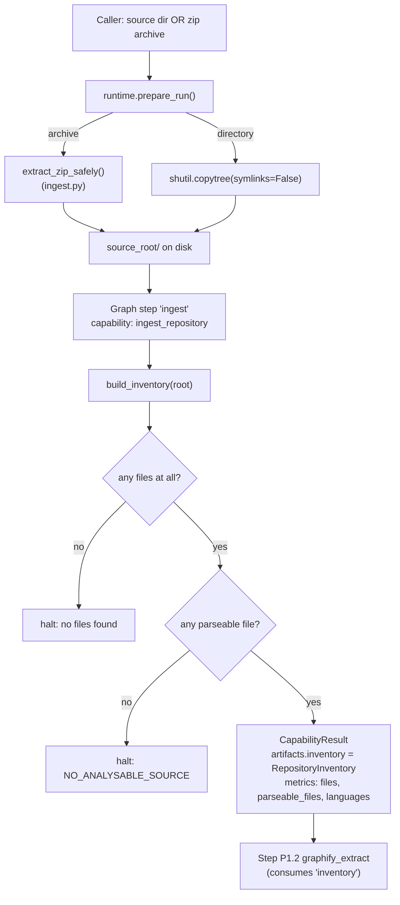
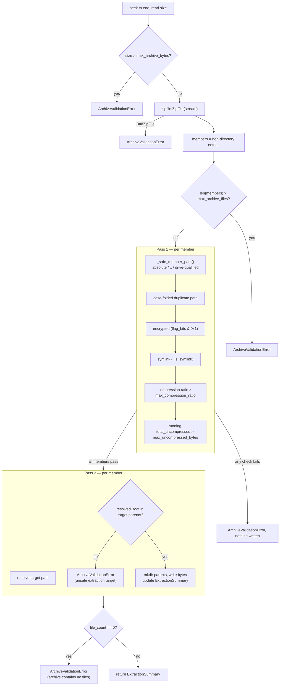
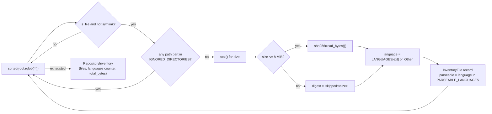

# `ingest.py` — Phase 0 safe ingestion and inventory

Module: [src/agentic/capabilities/ingest.py](../../src/agentic/capabilities/ingest.py)
Registered capability: `ingest_repository` (step `ingest`, on_fail: `halt`)
Also exports: `extract_zip_safely`, `build_inventory` (imported directly by `runtime.py` and by
`testgen/ingest.py`, not resolved through the registry)

## 1. Purpose

This module is the pipeline's front door. Its job is narrow and stated up front in the module
docstring: **target code is read and parsed, never executed or imported**. Everything in the file
serves that one guarantee, split into two responsibilities:

1. **`extract_zip_safely`** — if the input is an uploaded archive, validate every entry in it
   *before* writing anything to disk, so a hostile ZIP cannot escape the run directory, exhaust
   disk space, or plant a symlink.
2. **`build_inventory` / `ingest_repository`** — once there is a real directory on disk (from
   extraction or from a plain source path), walk it once, classify every file by language, hash
   it, and decide whether the run has anything worth analysing at all. If not, halt immediately
   with an honest reason rather than let a later stage silently produce a document from nothing.

## 2. Where it sits in the pipeline



`extract_zip_safely` and `ingest_repository`/`build_inventory` are **not called from the same
place**: extraction happens once, early, inside `runtime.prepare_run` (before the LangGraph graph
is even compiled), because its output — `source_root` — is what the whole run is built around.
`ingest_repository` runs later, as the graph's first node, over whatever ended up at `source_root`
regardless of whether it came from a zip or a plain directory copy.

## 3. `extract_zip_safely` — validate-then-extract

Signature: `extract_zip_safely(stream: BinaryIO, destination: Path, settings: Settings) -> ExtractionSummary`

The core design rule, stated in its docstring: **every check runs across the whole member list
before anything is written**, so a malicious entry late in the archive can't leave a
partially-extracted tree behind.



Checks performed, all raising `ArchiveValidationError` (a `ValueError` subclass):

| Check | Where | Defends against |
|---|---|---|
| Stream must be seekable | [ingest.py:112-117](../../src/agentic/capabilities/ingest.py#L112-L117) | Non-seekable upload streams that can't be size-checked before reading |
| Total archive size vs `max_archive_bytes` | [ingest.py:118-121](../../src/agentic/capabilities/ingest.py#L118-L121) | Disk exhaustion from an oversized upload |
| Valid ZIP structure | [ingest.py:123-126](../../src/agentic/capabilities/ingest.py#L123-L126) | Malformed / non-ZIP uploads |
| File count vs `max_archive_files` | [ingest.py:130-134](../../src/agentic/capabilities/ingest.py#L130-L134) | Millions-of-tiny-files inode/metadata exhaustion |
| Absolute / `..` / drive-qualified paths (`_safe_member_path`) | [ingest.py:83-92](../../src/agentic/capabilities/ingest.py#L83-L92) | Zip-slip / path traversal writing outside `destination` |
| Case-folded duplicate path | [ingest.py:140-143](../../src/agentic/capabilities/ingest.py#L140-L143) | Two entries silently overwriting each other differently on case-insensitive filesystems |
| Encrypted entries (`flag_bits & 0x1`) | [ingest.py:144-145](../../src/agentic/capabilities/ingest.py#L144-L145) | Content the pipeline can't inspect before writing |
| Symlinks (`_is_symlink`, Unix mode bits in `external_attr`) | [ingest.py:95-97](../../src/agentic/capabilities/ingest.py#L95-L97), [146-147](../../src/agentic/capabilities/ingest.py#L146-L147) | A link that resolves outside `destination` after extraction |
| Per-entry compression ratio vs `max_compression_ratio` | [ingest.py:148-154](../../src/agentic/capabilities/ingest.py#L148-L154) | Classic zip-bomb (small compressed, huge decompressed) |
| Running uncompressed total vs `max_uncompressed_bytes` | [ingest.py:155-157](../../src/agentic/capabilities/ingest.py#L155-L157) | Many entries with individually-fine ratios that sum to a bomb |
| Resolved target still under `resolved_root` (second pass) | [ingest.py:161-163](../../src/agentic/capabilities/ingest.py#L161-L163) | Belt-and-suspenders re-check right before the write, independent of the path-string logic above |
| At least one file extracted | [ingest.py:171-172](../../src/agentic/capabilities/ingest.py#L171-L172) | Empty/degenerate archives |

All limits come from `Settings` ([config.py](../../src/agentic/config.py)): `max_archive_bytes`
(50 MB), `max_uncompressed_bytes` (200 MB), `max_archive_files` (10,000),
`max_compression_ratio` (100×) — overridable via `.env`.

## 4. `build_inventory` — classify and hash

Signature: `build_inventory(root: Path, repository_name: str) -> RepositoryInventory`



Notes:
- Called with `sorted(...)` so the resulting inventory (and its hashes) are deterministic run to
  run for the same tree — useful for the correspondence check in `testgen/ingest.py`, which
  compares two inventories byte-for-byte to prove a requirements run and a codebase are the same
  snapshot ([testgen/ingest.py:256-306](../../src/agentic/capabilities/testgen/ingest.py#L256-L306)).
- `IGNORED_DIRECTORIES` ([ingest.py:51-55](../../src/agentic/capabilities/ingest.py#L51-L55)) is
  checked against every path *part*, not just the top level, so a nested `vendor/` or
  `node_modules/` anywhere in the tree is excluded too.
- `MAX_HASHED_BYTES` (8 MiB) caps hashing cost; larger files get a `skipped:<size>` placeholder
  digest instead of `sha256`, trading exactness for not reading huge binaries into memory.
- `OSError` on `stat()`/`read_bytes()` (broken symlink, permission denied, file removed mid-walk)
  silently skips the file rather than failing the whole ingestion ([ingest.py:197-198](../../src/agentic/capabilities/ingest.py#L197-L198)).
- `LANGUAGES` maps 26 extensions to 20 language labels; `PARSEABLE_LANGUAGES` is the subset (14
  languages) that the downstream Graphify tree-sitter extractor can turn into graph entities.
  Anything else is inventoried but marked `parseable=False`.

## 5. `ingest_repository` — the capability entrypoint

Signature: `ingest_repository(ctx: CapabilityContext) -> CapabilityResult`, registered via
`@capability("ingest_repository")` and resolved by the graph builder from `pack.yaml` — the graph
never imports this module directly (see [registry.py](../../src/agentic/capabilities/registry.py)).

Decision sequence:
1. `ctx.source_root` must be a directory → else halt (`"Source path is not a directory"`).
2. `build_inventory(...)` runs. `ctx.state.get("repository_name", root.name)` names the result.
3. No files at all → halt (`"No files were found to analyse..."`).
4. Files exist but **none** are `parseable` → halt with `NO_ANALYSABLE_SOURCE`-style message,
   still attaching the `inventory` artifact and metrics so the failure is inspectable, not silent.
   The comment at [ingest.py:245-251](../../src/agentic/capabilities/ingest.py#L245-L251) is
   explicit about *why*: inventing requirements from file names alone is exactly the failure this
   gate exists to prevent.
5. Otherwise: success. Returns `CapabilityResult` with:
   - `artifacts={"inventory": inventory}` — a `RepositoryInventory` (schema in
     [schemas/core.py](../../src/agentic/schemas/core.py)), persisted as `inventory.json` and
     consumed by the next step (`graphify_extract`).
   - `metrics` — `files`, `parseable_files`, `languages`, `total_bytes`.
   - `messages` — a note when some files were inventory-only (not Python-parseable).

`CapabilityContext`/`CapabilityResult` are the generic capability contract shared by every step in
the graph ([registry.py:29-92](../../src/agentic/capabilities/registry.py#L29-L92)): capabilities
read prior artifacts through `ctx.store`/`ctx.load`, never through graph internals, which is what
makes each one testable by constructing a context around a temp directory.

## 6. Data model produced

```
RepositoryInventory
├── repository_name: str
├── files: list[InventoryFile]
│     ├── path: str            (POSIX-style, relative to source_root)
│     ├── extension: str
│     ├── language: str
│     ├── size: int
│     ├── sha256: str          ("skipped:<size>" for files > 8 MiB)
│     └── parseable: bool
├── languages: dict[str, int]  (sorted by language name)
└── total_bytes: int
```

This is the *only* artifact `ingest_repository` produces, and it's the contract every later step
in the requirements pack implicitly depends on via `graphify_extract` (P1.2).

## 7. Reuse and non-reuse elsewhere

- `runtime.prepare_run` calls `extract_zip_safely` directly (not through the capability registry)
  because extraction has to happen before a graph even exists —
  [runtime.py:98-99](../../src/agentic/runtime.py#L98-L99).
- `testgen/ingest.py` imports `build_inventory` directly to fingerprint a source tree and match it
  against a prior requirements run's `inventory.json`
  ([testgen/ingest.py:272-275](../../src/agentic/capabilities/testgen/ingest.py#L272-L275)) — a
  nice reuse of the same deterministic hashing logic for a completely different purpose
  (provenance matching, not classification).
- `ingest_repository` itself is **deliberately not reused** by the test-generation pack: it would
  halt with "no analysable source" on a `runs/<id>/artifacts/` directory, which is exactly what
  that pack's input looks like ([testgen/ingest.py:7-9](../../src/agentic/capabilities/testgen/ingest.py#L7-L9)).

## 8. Suggested improvements

**Correctness / accuracy**
- The success-path message at [ingest.py:266](../../src/agentic/capabilities/ingest.py#L266)
  still says *"are not Python"*, but `PARSEABLE_LANGUAGES` now covers 14 languages, not just
  Python (see the comment at [ingest.py:57-62](../../src/agentic/capabilities/ingest.py#L57-L62)
  explaining the same history). The message is misleading for a repo that's mostly Java with a
  few Markdown files — it should read something like "not in a parseable language".
- `PARSEABLE_LANGUAGES` covers 14 of the ~36 languages Graphify can actually parse (per the same
  comment). A repository written only in Swift, Scala, Lua, Dart, or Vue halts here as "no
  analysable source" even though the downstream extractor could handle it. Worth pulling this set
  from Graphify's own capability list instead of hand-maintaining a narrower copy that can drift.

**Performance**
- `root.rglob("*")` walks *into* ignored directories (`node_modules`, `.venv`, `dist`, …) and only
  filters afterwards by checking path parts. On a real JS or Python repo this means potentially
  hundreds of thousands of wasted `stat` calls. Pruning during the walk (e.g. `os.walk` with
  in-place `dirnames[:]` filtering, or `pathlib.Path.walk` in 3.12+) would skip descending into
  ignored directories entirely rather than discovering and discarding their contents.
- Hashing is fully sequential and single-threaded. For a large repository with many files near the
  8 MiB cap, this is I/O-bound work that would parallelise well (e.g.
  `concurrent.futures.ThreadPoolExecutor` for the read+hash step) without changing the
  deterministic output, since results are still assembled in sorted path order afterward.
- `path.read_bytes()` loads the whole file into memory before hashing rather than hashing in
  fixed-size chunks. It's bounded by `MAX_HASHED_BYTES` (8 MiB) so it's not unsafe, but a chunked
  `hashlib.sha256()` update loop would keep peak memory flatter if that cap is ever raised.

**Robustness / security**
- Extraction reads each archive member fully into memory (`source.read()`) before writing
  ([ingest.py:165-166](../../src/agentic/capabilities/ingest.py#L165-L166)) rather than streaming
  via `shutil.copyfileobj(source, handle, length=...)`. With `max_uncompressed_bytes` at 200 MB
  this is bounded, but a single 200 MB entry would still spike memory; chunked copying removes
  that ceiling entirely.
- `_safe_member_path` checks for a literal `:` in the first path segment to catch Windows
  drive-qualified paths, but doesn't special-case Windows reserved device names (`CON`, `NUL`,
  `AUX`, `COM1`, `LPT1`, …). Extracting an entry literally named `CON` would behave oddly on a
  Windows extraction target — worth an explicit rejection given this project already runs on
  Windows.
- The compression-ratio and total-uncompressed checks trust the ZIP central directory's declared
  `file_size`, which is standard practice and fine for the classic zip-bomb case, but there's no
  final cross-check that actual bytes written during extraction match the declared size. A
  `written == info.file_size` assertion after each write (or capping the write itself) would catch
  a crafted archive that lies about `file_size` in a way that slips past the ratio check.

**Consistency**
- `extract_zip_safely` and `build_inventory`/`ingest_repository` live in the same module but are
  invoked from two unrelated call sites (`runtime.py` vs. the graph). That's a reasonable split
  today, but as the module accretes more validation logic it may be worth separating
  "archive intake" (`archive.py`) from "tree classification" (`inventory.py`) so each has a
  narrower, more testable surface — especially since `testgen/ingest.py` already only needs
  `build_inventory`, not extraction.

## 9. Q&A

### Why hash the file?

`build_inventory` puts a SHA-256 of each file's contents (capped at `MAX_HASHED_BYTES` = 8 MiB) on
every `InventoryFile` record ([ingest.py:192-196](../../src/agentic/capabilities/ingest.py#L192-L196)).
It is **not** used for anything inside this module or inside the requirements pack itself — path
and size are already enough to build the inventory and pick a language. The hash exists for one
consumer outside this file: `testgen/ingest.py::resolve_from_source`
([testgen/ingest.py:256-306](../../src/agentic/capabilities/testgen/ingest.py#L256-L306)).

That function needs to answer "is this source tree *exactly* the one a prior requirements run
analysed?" so it can reuse that run's `requirements.json` instead of making the operator re-run the
requirements pack. It does this by calling `build_inventory` again over the tree it was handed and
comparing the resulting `{path: sha256}` map against the one stored in an earlier run's
`inventory.json`. If every path and every hash match, the trees are provably byte-identical; if the
code changed since, even by one line, the hash for that path differs and the match fails — which is
the correct, safe outcome (silently reusing stale requirements would be worse than asking for a
re-run).

So the hash is really a **content fingerprint for cross-run identity**, not a security control and
not a dedup mechanism (nothing in `ingest.py` compares hashes against each other within one run).
Files bigger than 8 MiB get `"skipped:<size>"` instead of a real digest, which means two large
files of the same size are indistinguishable to this fingerprint — an accepted gap, since hashing
huge binaries on every ingestion buys little for the cost.

### How do you determine if anything is "worth analysing"?

Two sequential halt checks inside `ingest_repository`
([ingest.py:229-261](../../src/agentic/capabilities/ingest.py#L229-L261)), each producing a
`CapabilityResult.halt_reason` instead of raising, so the run stops cleanly with an explanation
rather than crashing:

1. **Nothing on disk at all.** `not root.is_dir()` or `build_inventory` returns zero files (e.g.
   the path was empty, or everything present matched `IGNORED_DIRECTORIES`). Halts with "No files
   were found to analyse."
2. **Files exist, but none are in a language the pipeline can parse.** After building the
   inventory, it filters `parseable = [r for r in inventory.files if r.parseable]`. If that list is
   empty — the repo is only Markdown, JSON config, images, a `Swift`/`Lua` codebase, etc. — it
   halts with "No source was found in any language this workflow can parse," while still attaching
   the `inventory` artifact so the operator can see exactly what *was* found.

If at least one file is parseable, the run is judged "worth analysing" even if that's the only
parseable file among thousands of others — there's no minimum threshold or ratio check, just
"more than zero." The reasoning given in the code comment
([ingest.py:245-251](../../src/agentic/capabilities/ingest.py#L245-L251)) is that guessing
requirements from file names when nothing can be parsed would be a worse failure mode than halting,
so this is a deliberately fail-closed gate rather than a quality gate.

### Is `@capability` a decorator, and is it built in or user-defined?

It's a **user-defined decorator factory**, not anything from the Python standard library. It's
defined in this project at
[registry.py:99-106](../../src/agentic/capabilities/registry.py#L99-L106):

```python
def capability(name: str) -> Callable[[Capability], Capability]:
    def decorate(fn: Capability) -> Capability:
        if name in CAPABILITIES and CAPABILITIES[name] is not fn:
            raise ValueError(f"Capability {name!r} is already registered")
        CAPABILITIES[name] = fn
        return fn
    return decorate
```

`@capability("ingest_repository")` above `def ingest_repository(ctx): ...` calls `capability(...)`
first, which returns `decorate`; Python then applies `decorate` to the function. All `decorate`
does is register the function in the module-level `CAPABILITIES: dict[str, Capability]` under that
string name, and return the function unchanged (so it still behaves as a normal Python function
when called directly, e.g. from tests). It also guards against accidentally registering two
different functions under the same name — re-decorating the *same* function object (e.g. from a
module re-import) is allowed, but a genuine name collision raises `ValueError` immediately at
import time.

This is the mechanism behind the "graph never imports the implementing module" design described in
the file's own module docstring: `pack.yaml` refers to a step by the string `ingest_repository`,
and `get_capability("ingest_repository")` ([registry.py:109-115](../../src/agentic/capabilities/registry.py#L109-L115))
looks it up in `CAPABILITIES` at graph-build time — a lightweight, hand-rolled plugin registry, the
same pattern as Flask's `@app.route(...)` or pytest's `@pytest.fixture`, just scoped to this repo.

### What is "contract" (as used around this code)?

The word is used in two related but distinct senses in this codebase, and `ingest.py` touches the
first one directly:

1. **The capability signature contract.** Stated in the `registry.py` module docstring: "Every
   capability has the same signature: `@capability("name") def fn(ctx: CapabilityContext) ->
   CapabilityResult`." This is the interface every one of the ~25 registered capabilities
   (`ingest_repository` included) must honor so the graph builder can call any of them
   interchangeably without knowing what's inside. It's an informal (duck-typed) contract enforced
   by convention and by the type hints, not by an abstract base class.
2. **The data/artifact contract**, used elsewhere in the pipeline (not in `ingest.py` itself) —
   e.g. `CONTRACT_KEYS` in [schemas/testgen.py](../../src/agentic/schemas/testgen.py#L33-L35),
   which names the published set of fields a `requirements.json` produced by the requirements pack
   is expected to contain. `testgen/ingest.py` checks incoming JSON against `CONTRACT_KEYS` to
   detect an artifact written by an older version of the requirements pack
   (`missing_contract_keys`) and fall back to defaults rather than fail outright. This is the same
   general idea — an agreed, versioned shape between a producer and a consumer that live in
   different packs — just applied to a JSON artifact instead of a function signature.

`ingest_repository`'s own output, `RepositoryInventory`, is itself an implicit contract of this
second kind: `graphify_extract` (the next step) is written assuming an `inventory` artifact with
exactly this shape exists, per the `consumes: [inventory]` declaration validated in the pack
manifest.

### How do you determine what is parseable and what is not?

Two static module-level sets do all the work, both hand-maintained (not derived from anything at
runtime):

1. **`LANGUAGES`** ([ingest.py:21-48](../../src/agentic/capabilities/ingest.py#L21-L48)) — a
   `dict[str, str]` mapping lowercase file extension → language label, e.g. `".py": "Python"`,
   `".rs": "Rust"`, `".md": "Markdown"`. `build_inventory` looks up `path.suffix.lower()` in this
   map; anything with an extension not listed becomes `language = "Other"`
   ([ingest.py:199-200](../../src/agentic/capabilities/ingest.py#L199-L200)). Classification is
   purely by file extension — there is no content sniffing (no shebang parsing, no magic-byte
   detection), so a `.txt` file containing Python code is classified as `"Text"`, not `"Python"`.
2. **`PARSEABLE_LANGUAGES`** ([ingest.py:63-66](../../src/agentic/capabilities/ingest.py#L63-L66))
   — a `set[str]` of 14 language labels (`Python`, `JavaScript`, `TypeScript`, `Java`, `Kotlin`,
   `Go`, `Rust`, `C#`, `C++`, `C`, `C/C++ Header`, `Ruby`, `PHP`, `SQL`) that overlaps with, but is
   a strict subset of, the languages Graphify (the external tree-sitter-based structural extractor)
   actually has grammars for — the comment at
   [ingest.py:57-62](../../src/agentic/capabilities/ingest.py#L57-L62) notes Graphify covers about
   36. Each `InventoryFile.parseable` flag is simply `language in PARSEABLE_LANGUAGES`
   ([ingest.py:208](../../src/agentic/capabilities/ingest.py#L208)).

So "parseable" here means "in the narrower, hand-curated list this pack currently declares it will
send downstream for structural extraction," not "in the full list of languages the extractor could
technically handle." A file's language can be correctly identified (e.g. `"Swift"` if that were
added to `LANGUAGES`) while still being `parseable=False`, simply because `PARSEABLE_LANGUAGES`
hasn't been extended to include it. This is exactly the gap flagged in the "Suggested improvements"
section above — `PARSEABLE_LANGUAGES` should ideally be derived from Graphify's own supported-
language list rather than duplicated and kept in sync by hand.
