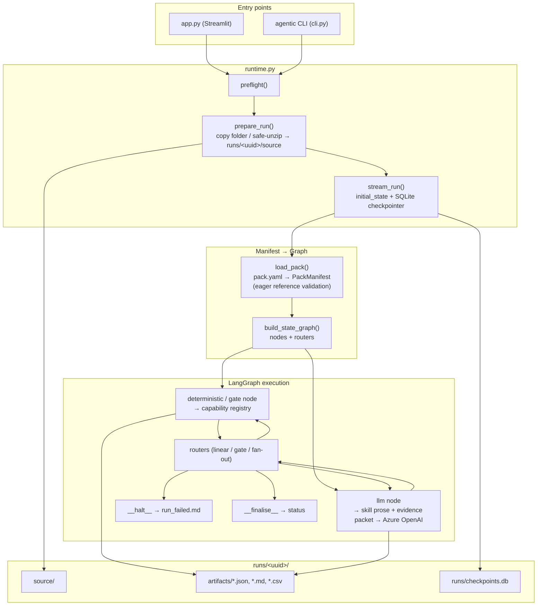
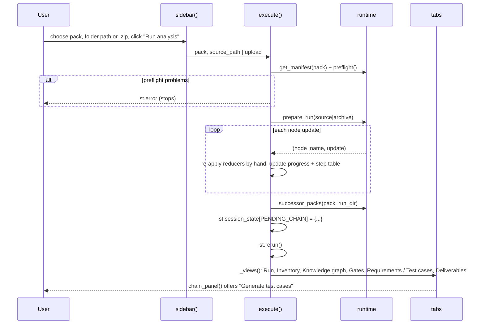
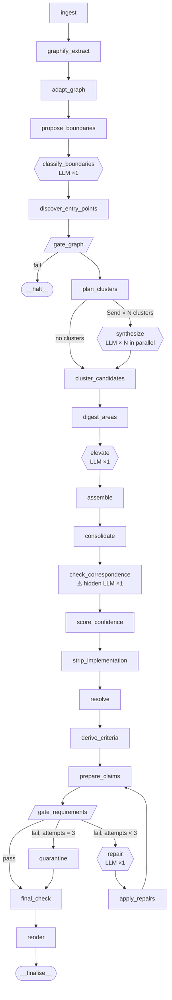
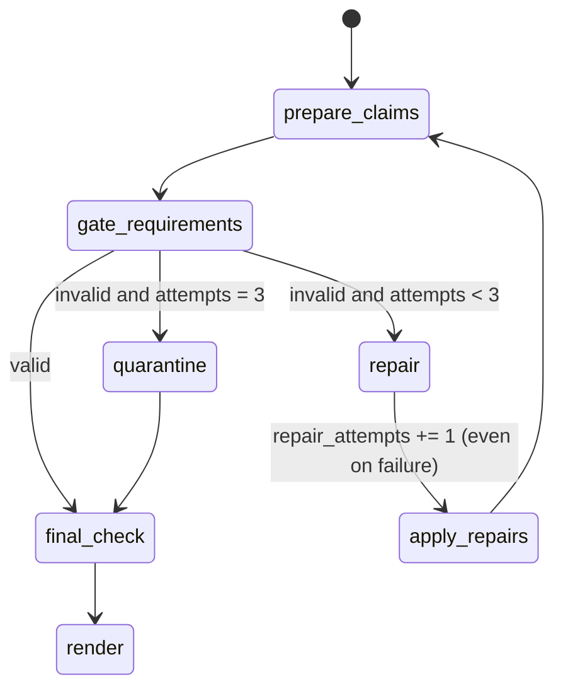
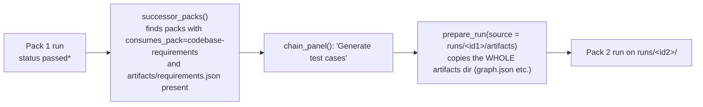
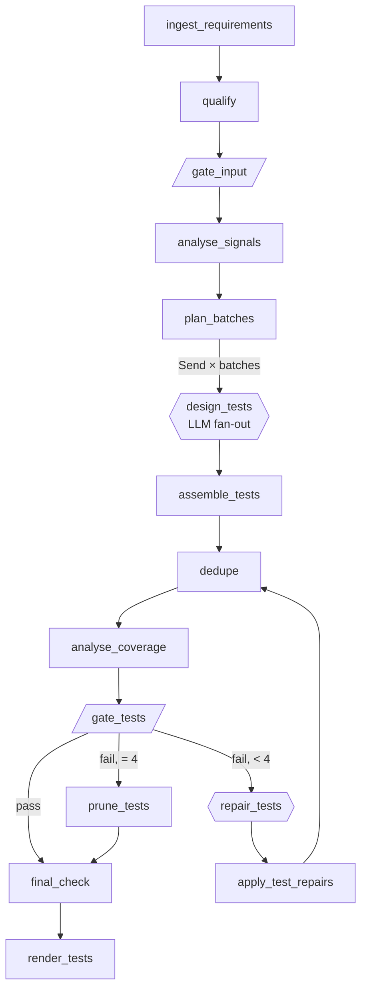

# Application Flow: End to End, Every Step

This document traces one run through the whole application, from the moment someone clicks
**Run analysis** (or types `agentic run`) to the deliverables on disk. It then continues into the
second pack (test-case generation). For each step it covers what goes in, what happens, what comes
out, and how it fails. The later sections list **what is breaking**, **what is weak**, and **what to
improve**, each backed by a code location or evidence from a stored run.

> Scope: `app.py`, `src/agentic/**`, both `pack.yaml` manifests, and the 12 stored runs under
> `runs/`. Claims marked **[verified]** were confirmed against code or run artifacts. Claims marked
> **[likely]** follow from reading the code but were not reproduced.

---

## Contents

1. [The system at a glance](#1-the-system-at-a-glance)
2. [Entry points: UI and CLI](#2-entry-points-ui-and-cli)
3. [Run lifecycle (framework layer)](#3-run-lifecycle-framework-layer)
4. [How a step executes (node internals)](#4-how-a-step-executes-node-internals)
5. [Pack 1: codebase-requirements, step by step](#5-pack-1--codebase-requirements-step-by-step)
6. [The repair loop in detail](#6-the-repair-loop-in-detail)
7. [Deliverables](#7-deliverables)
8. [Chaining Pack 1 into Pack 2](#8-chaining-pack-1-into-pack-2)
9. [Pack 2: testcase-generation, step by step](#9-pack-2--testcase-generation-step-by-step)
10. [What is breaking](#10-what-is-breaking)
11. [What is weak or not good](#11-what-is-weak-or-not-good)
12. [Improvements, prioritised](#12-improvements-prioritised)
13. [Evidence from stored runs](#13-evidence-from-stored-runs)
14. [Test suite status](#14-test-suite-status)

---

## 1. The system at a glance



**Four layers:**

| Layer | Files | Responsibility |
|---|---|---|
| Entry | [app.py](../app.py), [cli.py](../src/agentic/cli.py) | Collect the target and pack, stream progress, show results |
| Runtime | [runtime.py](../src/agentic/runtime.py), [config.py](../src/agentic/config.py) | Preflight, snapshot the source, create the run directory, drive the graph |
| Framework | [graph/](../src/agentic/graph/), [skills/](../src/agentic/skills/), [llm/](../src/agentic/llm/), [state.py](../src/agentic/state.py), [store.py](../src/agentic/store.py) | Compile `pack.yaml` into a LangGraph, run nodes, route, persist artifacts |
| Packs | [codebase-requirement-skills/](../codebase-requirement-skills/), [test-generation-skills/](../test-generation-skills/), [capabilities/](../src/agentic/capabilities/), [schemas/](../src/agentic/schemas/) | The actual work: 21 capabilities + 4 LLM steps (Pack 1), 13 capabilities + 2 LLM steps (Pack 2) |

**Core design contract:** the graph code names no step, skill, or artifact. Everything comes from
`pack.yaml`. Steps exchange **artifacts** (JSON files under `runs/<id>/artifacts/`). Only the paths
live in graph state, and routing is deterministic, so no model decides what runs next.

---

## 2. Entry points: UI and CLI

### 2.1 Streamlit UI ([app.py](../app.py))



Step by step:

1. **`sidebar()`** lists packs via `available_packs()` (scans `*/pack.yaml` under the repo root),
   takes a folder path or `.zip` upload, and shows whether Azure OpenAI is configured.
2. **`_apply_pending_chain()`** runs first on every rerun. If the previous run left a hand-off, it
   pre-selects the next pack and points `source_path` at the previous run's `artifacts/` folder.
3. **`execute()`**:
   - `preflight()` checks that every `mode: llm` step has Azure credentials.
   - `prepare_run()` creates `runs/<uuid>/source` (see §3.2).
   - `stream_run()` yields `(node, update)`. The UI **re-implements the state reducers by hand**
     (lists are concatenated, dicts shallow-merged) to rebuild the state for display.
   - Progress is `len(seen nodes) / len(manifest.steps)`, which is approximate because repair
     loops and `__finalise__` also count.
   - On `passed` / `passed_with_warnings`, `successor_packs()` finds a pack whose manifest declares
     `consumes_pack: <this pack>` and whose `consumes_artifact` exists, then stores the offer.
   - `st.rerun()`.
4. **`main()`** renders the tabs this run earned (`_views`, driven by which artifacts exist) and
   the **chain panel** with a one-click button to start the next pack.
5. **Requirements tab** opens every citation to the real source lines with `read_slice()`.

### 2.2 CLI ([cli.py](../src/agentic/cli.py))

| Command | Does |
|---|---|
| `agentic packs` | List discovered packs |
| `agentic show <pack>` | Print the compiled topology (`describe_topology`) |
| `agentic run <pack> <dir or .zip>` | preflight → prepare_run → stream_run, printing each step record; exit code 1 on halt |

The CLI does **not** chain packs. You run Pack 2 by hand, pointing it at `runs/<id>/artifacts`.

---

## 3. Run lifecycle (framework layer)

### 3.1 Settings ([config.py](../src/agentic/config.py))

Loaded once (`@lru_cache`) from the environment or `.env`:

- **Archive limits:** 50 MB compressed, 200 MB uncompressed, 10k files, 100× compression ratio.
- **Graphify:** binary path, 600 s timeout.
- **Azure OpenAI:** endpoint, key, deployment, api_version; temperature 0; 180 s timeout;
  **8,000 max output tokens**.
- **Cost knobs:** `evidence_packet_chars = 40_000`, `max_clusters = 80`, `max_repairs = 2`
  (unused, since the manifest's `max_repairs: 3` wins).
- **13 feature flags**, all default ON: stratified selection, entry-point adapters, declaration
  clusters, rule classification, collapse parameterised, dedup, confidence recalibration, hedging,
  semantic clustering, leakage review, candidate resolution, correspondence validation,
  correspondence entailment.

### 3.2 `prepare_run()` ([runtime.py:83](../src/agentic/runtime.py#L83))

```
run_id = uuid4()
runs/<run_id>/            ← run_dir
runs/<run_id>/source/     ← source_root (snapshot)
```

- **Archive:** `extract_zip_safely()` validates **every member before writing anything**. It rejects
  absolute paths, `..` traversal, drive letters, duplicate paths (case-insensitive), encrypted
  entries, symlinks, ratios over 100×, too many files, and too many bytes. Only then does it
  extract, re-checking each resolved target stays under the root.
- **Folder:** `shutil.copytree(origin, source_root)` copies the **whole tree**, including `.git`,
  `node_modules`, `.venv` and build output. Those are only filtered later, at ingest. No size limit
  applies to this path.

### 3.3 `preflight()` ([runtime.py:118](../src/agentic/runtime.py#L118))

This only checks for Azure credentials when the pack has `mode: llm` steps. It does **not** check:

- that the `graphify` binary exists (discovered at step 2, after ingest has run);
- that `correspondence` needs the model (it calls Azure from inside a *deterministic* step).

### 3.4 `stream_run()` / `run()` ([runtime.py:146](../src/agentic/runtime.py#L146))

1. `get_manifest(pack)` → `load_pack()` parses `pack.yaml` into `PackManifest`, which validates:
   - step ids are unique; `next`/`repair_step`/`exhausted_step` targets exist;
   - `on_fail: repair` names a `repair_step`;
   - **every `consumes` was produced by an earlier step** (dataflow check);
   - `fan_out` artifact produced earlier;
   - every skill, capability, and output schema resolves (`_resolve_references`).
2. `initial_state()` sets identity, empty artifacts/records/fragments, `repair_attempts=0`,
   `status="running"`.
3. `config = {thread_id: run_id, recursion_limit: 60}`.
4. The SQLite checkpointer opens at `runs/checkpoints.db`.
5. `compile_graph(manifest)` → `graph.stream(state, stream_mode="updates")`.

### 3.5 Graph compilation ([builder.py](../src/agentic/graph/builder.py))

For each step, in manifest order:

| Situation | Edge built |
|---|---|
| Next step is a **fan-out** step | Conditional edge through `make_fanout_router` → `Send(worker, {...state, work_item})` per item, or skip past the worker when the list is empty |
| This step **is** the fan-out step | Plain edge to its successor (a barrier: all workers finish first) |
| This step is a **gate** | `make_gate_router`: pass → successor. Fail → `repair_step` while `repair_attempts < max_repairs`, then `exhausted_step`, else `__halt__`. `warn_and_continue` → successor |
| Anything else | `make_linear_router`: successor, or `__halt__` if `status == failed` / `halt_reason` set |

Plus two synthetic nodes: `__halt__` (writes `run_failed.md`) and `__finalise__` (sets
`passed` / `passed_with_warnings`).

### 3.6 State ([state.py](../src/agentic/state.py))

| Channel | Reducer | Notes |
|---|---|---|
| `artifacts` | shallow dict merge | logical name → path |
| `completed_steps`, `step_records`, `fragments` | list append | fan-out workers append fragments |
| `metrics`, `gate_reports` | shallow dict merge | **last writer wins per key** (see §10, B4) |
| `work_item` | overwrite | set per fan-out branch |
| `repair_attempts` | overwrite | incremented by the repair-target node itself |
| `status`, `halt_reason` | overwrite | |

---

## 4. How a step executes (node internals)

### 4.1 Deterministic and gate nodes ([nodes.py](../src/agentic/graph/nodes.py) `make_capability_node`)

```
ctx = CapabilityContext(state, step, settings, ArtifactStore(run_dir),
                        skill = SkillRegistry.load(step.skill),   # sha256 recorded
                        payload = {manifest, work_item})
result = CAPABILITIES[step.capability](ctx)
  ├─ raises  → on_fail=warn: record "failed", continue
  │          → otherwise:   status=failed, halt_reason=...
  └─ returns CapabilityResult
       artifacts → store.save(name) → state.artifacts[name] = path
       files     → state.artifacts["file:<name>"] = path
       fragment  → state.fragments += [fragment]
       gate      → state.gate_reports[step.id] = report
       metrics   → state.metrics[step.id] = metrics
       halt_reason → status=failed
```

### 4.2 LLM nodes ([llm/steps.py](../src/agentic/llm/steps.py), [llm/prompt.py](../src/agentic/llm/prompt.py))

```
system prompt =  "# Governing workflow" + master_skill body
              +  "# Your task" + step skill (or the ## section named by `section:`)
              +  "# Step-specific instruction" + pack.yaml `instructions`
              +  "# Output" rules (cite only verbatim paths/lines, `symbol` semantics)

human message = JSON {
    repository,
    cluster: {boundary, kind, location, also_exposed_by, evidence: packet}   ← fan-out only
    <each consumed artifact>: render_artifact(name)                         ← per-artifact renderer
}
```

Artifact renderers keep prompts bounded:

| Artifact | What the model sees |
|---|---|
| `graph` | a summary: counts, kinds, extraction coverage, UI surface, up to 4 README/doc outlines |
| `boundary_candidates` | the capped candidate list |
| `clusters` / `test_batches` | titles only (packets go to workers) |
| `requirement_gate` | ERROR issues only |
| `brd` | **only the rejected items** (repair step) |
| `test_suite` | only rejected cases, max 12 per call |
| anything else | raw JSON, **truncated to a 60k-char string preview** if too big |

Execution: `AzureChatOpenAI.with_structured_output(schema)`, with 3 attempts. A `ValidationError`
triggers a retry. A length-limit failure triggers a retry with a "shorten" instruction appended.
Any other error raises. A fan-out worker's output goes to `fragments`, and anything else is saved
under each `produces` name.

LLM failure handling:
- **fan-out worker fails** → record only. The cluster is silently missing (by design).
- **repair target or `warn`** → continue, counting the attempt.
- **anything else** → halt the whole run.

---

## 5. Pack 1: codebase-requirements, step by step

Manifest: [codebase-requirement-skills/pack.yaml](../codebase-requirement-skills/pack.yaml).
Master skill prepended to every LLM step: `codebase-to-requirements-reverse-engineering`.



Legend: `[ ]` deterministic, `{{ }}` LLM, `[/ /]` gate.

### Phase 0: Ingestion

#### Step 1 · `ingest` → `ingest_repository` ([ingest.py](../src/agentic/capabilities/ingest.py)) · on_fail: halt

- **In:** `source_root`
- **Does:** walks the tree with `rglob("*")`, skipping `IGNORED_DIRECTORIES` (`.git`,
  `node_modules`, `venv`, `dist`, `build`, …) and symlinks. It SHA-256s every file up to 8 MB,
  maps extension → language (26 extensions), and marks `parseable` for 14 languages.
- **Out:** `inventory` (files, languages, total bytes)
- **Halts when:** there are no files, or **no parseable file** (fail-closed: it refuses to guess
  from file names).
- **Issues:** the warning text still says *"file(s) are not Python"*
  ([ingest.py:266](../src/agentic/capabilities/ingest.py#L266)), left over from the Python-only
  era. It hashes every file even though nothing downstream uses the hashes.

### Phase 1: Structural extraction

#### Step 2 · `graphify_extract` ([graphify.py](../src/agentic/capabilities/graphify.py)) · halt

- **Does:** finds the `graphify` binary (setting → PATH → next to the interpreter), then runs
  `graphify extract <abs source> --code-only --no-cluster --no-gitignore --out runs/<id>/graphify`
  with a 600 s timeout. Tree-sitter runs locally with zero API calls.
- **Out:** `graphify_raw` = {path to `graph.json`, command, tail of stdout/stderr}
- **Halts when:** the binary is missing, the exit code is non-zero, it times out, or no
  `graph.json` is written.

#### Step 3 · `adapt_graph` → `adapt_graphify_graph` · halt

Normalises Graphify's payload into the canonical `KnowledgeGraph`
([schemas/core.py](../src/agentic/schemas/core.py)):

1. **Classify each node's kind** (`classify_kind`): `rationale` → RATIONALE; no source file →
   EXTERNAL_SYMBOL; label is a path suffix → FILE; `_callable_class` → CLASS; label ends in `()`
   → METHOD/FUNCTION; `_callable` → FUNCTION; else SYMBOL.
2. **Reconstruct end lines** (`_derive_line_ends`), because Graphify only emits a start line. The
   next sibling bounds each node, containment is repaired to a fixed point, and RATIONALE nodes
   are bounded separately.
3. **Map relations** (`RELATION_MAP`): `calls/uses` → CALLS, `indirect_call` → **REGISTERS**,
   `method/contains` → CONTAINS, imports, inherits, references, `rationale_for` → EXPLAINS.
   Unknown relations become RELATED_TO.
4. **Add a FILE entity for every inventoried file**, even ones Graphify skipped. This matters for
   READMEs (`--code-only` drops them) and for their `content_outline`, which becomes
   `declared_documentation`.
5. **Module-level surface** (`_module_surface`): regex-scans top-level lines for *consumed* calls
   that carry a string literal (`if st.button("Add")`, `x = st.file_uploader("…")`) and emits
   **MODULE_SURFACE** entities. This is how Streamlit/Gradio scripts get any boundary at all.
6. Edges whose endpoint was never emitted are dropped and counted. Secrets in outlines are masked
   (`_SECRET`).

- **Out:** `graph`
- **Kinds actually produced** [verified]: FILE, FUNCTION, METHOD, CLASS, SYMBOL, EXTERNAL_SYMBOL,
  RATIONALE, MODULE_SURFACE. Nothing produces DOMAIN_POLICY, DATA_ENTITY, CONFIG_KEY,
  BUSINESS_RULE or ERROR_HANDLER, which later steps depend on (see §10, B2).

#### Step 4 · `propose_boundaries` → `propose_boundary_candidates` ([boundaries.py](../src/agentic/capabilities/boundaries.py)) · halt

- **Idea:** a handler is invoked by a framework, never by the code beside it, so it has **in-degree
  0 on CALLS**. That shape is language-agnostic.
- **Does:** for every FUNCTION/METHOD/CLASS/MODULE_SURFACE with a location, it keeps the entity if
  it is uncalled, **or** is registered (`REGISTERS`), **or** references undefined external names
  (decorators, annotations). It attaches shape evidence (inbound/outbound call counts, referenced
  names, registrars, container, call, and string literals within ±3 lines of the definition *and*
  of each registration site). It sorts by references, then registrars, then out-degree, and **caps
  at 120** (`MAX_CANDIDATES`).
- **Out:** `boundary_candidates` {candidates, considered, truncated}

#### Step 5 · `classify_boundaries` (LLM, schema `BoundaryAssignments`) · on_fail: halt (default)

- **One model call** over all ≤120 candidates. It returns `{qualified_name, entry_class, identifier,
  effect, rationale}`, where `entry_class` ∈ ENDPOINT, CLI_ENTRY, CLI_COMMAND, SCRIPT_ENTRY,
  UI_ACTION, SCHEDULED_JOB, EVENT_CONSUMER, REGISTERED_ENTRY, NONE.
- The model never states a location. The next step resolves the name against the graph.
- **This single call decides everything downstream.** If it returns 5 endpoints, the document can
  only ever describe 5 workflows. See §13 for how much it varies.

#### Step 6 · `discover_entry_points` ([entry_points.py](../src/agentic/capabilities/entry_points.py)) · warn_and_continue

- Runs every registered `EntryPointAdapter`. **Only one exists:** `ClassifiedBoundaryAdapter`.
- For each non-NONE assignment whose `qualified_name` resolves, it creates a boundary entity
  (`kind = entry_class`, `provenance = INFERRED`, `confidence = 0.55`) and an `EXPOSES` edge
  handler → boundary. The candidate's registrar names are folded in for the leakage pass.
- **Out:** updated `graph` + `entry_point_coverage` (by class, by adapter, declared-but-empty,
  failures).

### Phase 2: Gate 1

#### Step 7 · `gate_graph` → `validate_graph` ([gates.py](../src/agentic/capabilities/gates.py)) · on_fail: **halt**

| Check | Severity |
|---|---|
| Self-relationship | warning |
| Entity location does not resolve on disk (`verify_location`) | **ERROR** |
| Boundary with no inbound `EXPOSES` (`ORPHAN_BOUNDARY`) | **ERROR** |
| Extraction coverage < 50% | warning |
| Ambiguous edge ratio > 30% | warning |
| No FILE entities | **ERROR** |
| No interaction boundary | warning |
| > 50% of boundaries INFERRED | warning (always fires now, because all are inferred) |

A single ERROR halts the whole run with no deliverables apart from `run_failed.md`.

### Phase 3: Synthesis

#### Step 8 · `plan_clusters` → `build_boundary_clusters` ([graph_ops.py:640](../src/agentic/capabilities/graph_ops.py#L640)) · halt

This is the cost-control step: one bounded evidence packet per boundary, so no model ever sees raw
source.

1. `boundary_ids()` = entities whose kind is in `BOUNDARY_KINDS` (ENDPOINT, CLI_ENTRY, SCRIPT_ENTRY,
   UI_ACTION, SCHEDULED_JOB) plus their EXPOSES sources. They are ranked by degree.
2. For each boundary, walk `workflow_from()` over `WORKFLOW_EDGE_KINDS` (CALLS, REGISTERS, EXPOSES,
   …) and add `declared_policy()`.
3. **Group boundaries sharing the same workflow signature** into one packet (two routes on one
   handler means one LLM call).
4. `_stratified(groups, max_clusters=80)` samples across entry-point classes so no class is
   starved.
5. **Declaration clusters** (schemas and config files no call path reaches) get a separate budget
   of `max_clusters // 4`. This is effectively dead today: no DECLARATION_KINDS are produced.
6. `build_packets(..., char_budget=40_000)` splits an oversized workflow into several packets
   (`cluster_id#1`, `#2`, …).

- **Out:** `clusters` = [{cluster_id, boundary, boundary_kind, location, also_exposed_by, packet}]
- If there are **zero** clusters, the fan-out router skips `synthesize` entirely.

#### Step 9 · `synthesize` (LLM fan-out, schema `BRDFragment`)

- One call **per cluster, in parallel** (LangGraph `Send`). Each worker sees only its packet.
- The prompt (the longest in the manifest) asks for an **abstraction test** on every behaviour
  (business_outcome → external_capability → internal_behaviour → domain_constraint →
  platform_constraint → quality_property → implementation_detail). It then returns functional
  requirements (3–8 acceptance criteria each), business rules (with an exact parent title), system
  requirements, technical constraints, observations, success criteria, plus the data, integration,
  NFR and reporting families, an `area_code`/`area_name`, and a priority from code defaults.
  Ceilings: 14 FR, 12 BR, 8 SC.
- **Out:** each worker appends one fragment to `state.fragments`.
- A failed worker is recorded and dropped, so its cluster silently produces nothing.

#### Step 10 · `cluster_candidates` → `cluster_capabilities` ([clustering.py](../src/agentic/capabilities/clustering.py)) · warn

- Groups every candidate from every fragment by a **semantic signature of the sentence**
  (actor / modal / action / object / qualifier via regex), regardless of which code it cites. This
  catches the same capability described from the endpoint and from the worker behind it.
- **Out:** `capability_clusters` {clusters (with relation: duplicate / conflicting / …),
  by_title}

#### Step 11 · `digest_areas` ([assemble.py:243](../src/agentic/capabilities/assemble.py#L243)) · halt

- Builds the small input for the one whole-repository call: per area, a code, a name, boundaries
  (≤12), purpose hints (≤6), **every capability title**, and rule titles. It groups by each
  requirement's own `area`, not by the cluster's.
- **Out:** `area_digest`

#### Step 12 · `elevate` (LLM, schema `TopTier`) · on_fail: halt (default)

- Reads the area digest plus the graph summary (including README outlines). It writes
  `product_purpose`, `business_problem`, the **business requirements** (outcomes), and
  `bindings` (outcome → exact capability titles). It also writes assumptions, out-of-scope items
  and open questions.
- It is told to leave evidence empty on business requirements, because they are grounded later
  from their children.

#### Step 13 · `assemble` → `assemble_requirements` · halt

- Builds a `ProductBRD` deterministically. It carries **every** fragment finding across unchanged
  and attaches each FR to the outcome that bound it **by title key**. Unbound FRs stay unattached,
  and that is reported.
- It drops outcomes whose title equals a capability title ("restated") and grounds each outcome's
  evidence in its children (`ground_outcomes`).
- **Out:** `brd`, with metrics: findings_carried, capabilities_unattached, bindings_unmatched, …

### Phase 3e: Consolidation and resolution (all deterministic)

| # | Step → capability | on_fail | What it decides |
|---|---|---|---|
| 14 | `consolidate` → [consolidate.py](../src/agentic/capabilities/consolidate.py) | halt | 7 passes: **rule classification** (a "rule" must cite something *declared*, otherwise it is demoted to internal behaviour), abstraction level from basis → section, success criteria folded into acceptance criteria, duplicate merge within capability clusters, parameterised families collapsed, hierarchy validated |
| 15 | `check_correspondence` → [correspondence.py](../src/agentic/capabilities/correspondence.py) | warn | Does the cited code do what the sentence says? 4 structural checks (span size ≤ 400 lines, word overlap with identifiers, outside-actor claim cites a boundary, mutation claim cites a state change), then **one batched LLM entailment call** for everything that survives. Nothing is dropped; claims are marked `rejected` |
| 16 | `score_confidence` → [confidence.py](../src/agentic/capabilities/confidence.py) | warn | Replaces the model's self-reported confidence with a weighted score from correspondence, symbol precision, corroboration, parsed vs inferred, and declared backing |
| 17 | `strip_implementation` → [leakage.py](../src/agentic/capabilities/leakage.py) | warn | Removes implementation tokens (identifiers, routes, mechanisms *from this repo's own graph* at the cited lines) from statements and records them as observations. Demotes behaviours that fail the redesign test |
| 18 | `resolve` → [resolution.py](../src/agentic/capabilities/resolution.py) | warn | Every candidate gets exactly one disposition: keep, reclassify, observation, open_question, or reject. Unpublishable ones move to `unresolved_candidates` with evidence and reason |
| 19 | `derive_criteria` → [hedging.py](../src/agentic/capabilities/hedging.py) | warn | Fills missing acceptance criteria from observable facts in the cited span (marked as derived). Otherwise it adds open questions and assumptions |
| 20 | `prepare_claims` → [claims.py](../src/agentic/capabilities/claims.py) | halt | Folds items onto tiers, resolves parent links, **stamps positional ids** (`BR-001`, `FR-<AREA>-01`, `OBS-001`, …), and fixes mislabelled citation `symbol`s against the graph |

### Phase 4: Gate 2

#### Step 21 · `gate_requirements` → `validate_requirements` · on_fail: **repair** (max 3) → quarantine

ERRORs (these trigger repair):

- `EMPTY_STATEMENT`, `NO_EVIDENCE`, invalid citation (file / line / symbol via `verify_location`)
- `NO_GRAPH_PATH`, `UNRESOLVED_GRAPH_PATH`
- `NO_INTERACTION_BOUNDARY` (the FR trace reaches no boundary)
- `RULE_WITHOUT_POLICY` (the business rule traces to no BUSINESS_RULE/CONFIG_KEY/ERROR_HANDLER entity)
- `TECHNICAL_VOCABULARY` / `CRITERION_VOCABULARY` (jargon linter, [jargon.py](../src/agentic/capabilities/jargon.py))
- `CLASSIFICATION_INCOHERENT`, `PARENT_TIER_NOT_PERMITTED`, `PARENT_RELATION_NOT_PERMITTED`

WARNINGs: no purpose, no business requirement, duplicate statement, unresolved parent, missing
basis, FR without BR, BR without FR, outcome restates capability, criterion without requirement.

Steps 22–24 (the repair loop) are covered in §6.

#### Step 25 · `final_check` → `validate_synthesis` · warn

A whole-set check once nothing else will move. **Cycles** and **dangling relations** are cleared,
because a consumer could not walk them. Everything else (duplicate titles, unsettled candidates)
is reported in `synthesis_findings`.

#### Step 26 · `render` → `render_deliverables` ([render.py](../src/agentic/capabilities/render.py)) · warn

Writes the files described in §7. It then runs `__finalise__`, which sets `passed_with_warnings`
if any record warned or any gate is invalid, and `passed` otherwise.

---

## 6. The repair loop in detail



1. **`repair`** (LLM, `RepairedItems`) sees **only** the rejected items (`_render_brd`) and the
   gate's ERROR list. It must return only the fixed items, by id, or ids to delete.
2. **`apply_repairs`** merges by id. Repairs naming non-rejected ids are ignored, so a passed claim
   can never be altered. If there is no `repairs` artifact (the first repair call failed), it
   passes everything through.
3. **`prepare_claims`** re-stamps ids (positional).
4. **The gate runs again.**
5. After 3 failures, **`quarantine`** deals with what is left:
   - **grounding failures** (no evidence, bad line, no boundary) → removed;
   - **wording failures** (jargon) → the offending term is stripped and recorded as an
     observation, and the requirement is kept.

---

## 7. Deliverables

Written by `render` into `runs/<id>/artifacts/`:

| File | Reader | Content |
|---|---|---|
| `requirements.md` | stakeholders | Business-language document: purpose, outcomes, FRs by area, rules, families. Verified jargon-free |
| `requirements.json` | tools, **Pack 2** | Machine contract, ids, parents, evidence |
| `traceability_matrix.csv` | reviewers | requirement → evidence → graph path |
| `gap_analysis.md` | reviewers | What was not analysed and why (omitted clusters, inventory-only files, gate warnings) |
| `requirement_analysis.md` | reviewers | `unresolved_candidates`: rejected / open-question items with reasons |
| `technical_specification.md` | engineers | Graph-derived technical view |
| `api_documentation.md` | engineers | Boundaries discovered |
| `workflows.mmd` | engineers | Mermaid workflow reconstruction |
| `run_failed.md` | anyone | Only on halt |

Intermediate JSON artifacts (`inventory`, `graph`, `clusters`, `brd`, gate reports, …) sit beside
them.

---

## 8. Chaining Pack 1 into Pack 2



The chain is generic: any pack that declares `consumes_pack` / `consumes_artifact` is offered, and
the UI names no pack.

---

## 9. Pack 2: testcase-generation, step by step

Manifest: [test-generation-skills/pack.yaml](../test-generation-skills/pack.yaml). Master skill:
`requirements-to-test-derivation`.



| # | Step | Mode | What happens |
|---|---|---|---|
| 1 | `ingest_requirements` → [testgen/ingest.py](../src/agentic/capabilities/testgen/ingest.py) | det, halt | Finds `requirements.json` (plus optional siblings) in `source_root`. It reads defensively: every malformed entry becomes a `ReadIssue` rather than an exception. Tolerates the legacy 20-key format |
| 2 | `qualify` → [qualify.py](../src/agentic/capabilities/testgen/qualify.py) | det, halt | Assigns each requirement a band (testable / deferred / excluded …) with ordered first-match rules. Every requirement gets a record |
| 3 | `gate_input` → [testgen/gates.py](../src/agentic/capabilities/testgen/gates.py) | gate, halt | Blocks only if nothing is worth testing. Everything else is a warning |
| 4 | `analyse_signals` → [analyse.py](../src/agentic/capabilities/testgen/analyse.py) + [signals.py](../src/agentic/capabilities/testgen/signals.py) | det | Anti-explosion: English-language regex decides which test **dimensions** each requirement activates, its risk, and its **case budget**, before any model call |
| 5 | `plan_batches` → [batching.py](../src/agentic/capabilities/testgen/batching.py) | det | Groups requirements **by area** into bounded packets |
| 6 | `design_tests` | LLM fan-out (`TestDesignFragment`) | Designs cases within the given budget and dimensions |
| 7 | `assemble_tests` → [testgen/assemble.py](../src/agentic/capabilities/testgen/assemble.py) | det, halt | Stamps ids, computes derived fields, and drops untraceable cases into `notes` |
| 8 | `dedupe` → [dedupe.py](../src/agentic/capabilities/testgen/dedupe.py) | det, warn | Folds duplicate cases (`superseded_by`) |
| 9 | `analyse_coverage` → [coverage.py](../src/agentic/capabilities/testgen/coverage.py) | det, warn | Verdict per requirement against **activated** dimensions only: sufficient / positive_only / thin / none / deferred / excluded |
| 10 | `gate_tests` → [validate.py](../src/agentic/capabilities/testgen/validate.py) | gate → repair ×4 → prune | Judges cases, not coverage. [quality.py](../src/agentic/capabilities/testgen/quality.py) asks "would this fail against a broken implementation?" |
| 11 | `repair_tests` | LLM | Sees ≤12 rejected cases per call |
| 12 | `apply_test_repairs` | det, halt | Merges by id, then loops back to **dedupe → coverage → gate** |
| 13 | `prune_tests` | det | After 4 failures: drops the rejected cases and records them as gaps |
| 14 | `final_check` → `validate_test_suite` | det, warn | Whole-suite properties (dangling scenario, requirement that lost its last case) |
| 15 | `render_tests` → [testgen/render.py](../src/agentic/capabilities/testgen/render.py) | det, warn | `test_specs.json`, `test_plan.md`, `coverage_matrix.csv`, `traceability_tests.csv`, `excluded_requirements.md`, `clarifications.md` |

---

## 10. What is breaking

Ordered by impact. **B** = defect with a concrete failure.

### B1: Three of the classifier's boundary classes are silently thrown away [verified]

- The classifier may return `CLI_COMMAND`, `EVENT_CONSUMER`, `REGISTERED_ENTRY`
  ([schemas/boundaries.py](../src/agentic/schemas/boundaries.py), `ClassifiedBoundaryAdapter.declares`).
- But `BOUNDARY_KINDS = {ENDPOINT, CLI_ENTRY, SCRIPT_ENTRY, UI_ACTION, SCHEDULED_JOB}`
  ([graph_ops.py:27](../src/agentic/capabilities/graph_ops.py#L27)).
- Result: those entities are added to the graph, but **never seed a cluster**, are excluded from
  `boundary_ids()`, fail Gate 2's `NO_INTERACTION_BOUNDARY`, and are **invisible in the coverage
  report**, because `_coverage()` only counts `BOUNDARY_KINDS`. The report then lists them under
  `declared_but_empty` although they were found.
- **Evidence:** run `187a4de5` (Capstone-fastapi) classified 8 `REGISTERED_ENTRY` boundaries, and
  none produced a requirement. Workers and consumers (`py_worker` fixture) and CLI subcommands are
  exactly these classes.
- **Fix:** derive `BOUNDARY_KINDS` from `BoundaryClass` minus NONE (one source of truth), or map the
  three extra classes onto existing kinds.

### B2: The pipeline consumes entity kinds that nothing produces [verified]

- The Graphify adapter emits only FILE, FUNCTION, METHOD, CLASS, SYMBOL, EXTERNAL_SYMBOL, RATIONALE,
  MODULE_SURFACE.
- Consumers of the missing kinds:
  - `DECLARATION_KINDS` (DOMAIN_POLICY, DATA_ENTITY, CONFIG_KEY) → declaration clusters are **dead
    code**.
  - Gate 2 `RULE_WITHOUT_POLICY` ([gates.py:706](../src/agentic/capabilities/gates.py#L706)) needs
    BUSINESS_RULE / CONFIG_KEY / ERROR_HANDLER → **every business rule is an ERROR**.
  - `consolidate` rule classification demotes rules that cite nothing declared → rules are demoted
    first.
- **Evidence:** all 12 stored requirement runs have **0 business rules, 0 data, 0 integration,
  0 NFR, 0 reporting** requirements.
- Side effect: any rule that survives to Gate 2 burns repair attempts on an error **no rewording
  can fix**, then gets quarantined. That is 3 wasted LLM calls.
- **Fix:** see `improvements.md` §0.1. Produce these kinds in the adapter (SQL `CREATE TABLE` /
  `CHECK` / `ENUM`, ALL-CAPS constants, config keys from `.yaml/.toml/.env.example`, `raise`/`throw`
  sites). Until then, make `RULE_WITHOUT_POLICY` a warning, or exclude it from repair.

### B3: The boundary classifier is a single point of failure and the main source of instability [verified]

- `classify_boundaries` is **one LLM call** over up to 120 candidates, and it has no `on_fail`, so
  it defaults to **halt**. One timeout or schema failure kills the whole run.
- Candidates are **truncated at 120** by a ranking heuristic ([boundaries.py:44](../src/agentic/capabilities/boundaries.py#L44)).
  neuleap has ~1,980 candidates, so 94% are never shown to the model.
- The reply has to list every candidate within an 8k-token output limit, so on large inputs the
  model returns a fraction.
- **Evidence:** the same repo (neuleap, 381 files) gave **5, 5, 5, 44, 95** endpoints across runs,
  which produced **4 to 77** functional requirements. The run-to-run variance comes from this step,
  not from synthesis.
- **Fix:** batch candidates (e.g. 30 per call, as a fan-out), apply `_stratified` sampling (as
  `improvements.md` §2.3 notes), set `on_fail: warn_and_continue`, and cache classifications by
  candidate hash.

### B4: Fan-out metrics and errors overwrite each other [verified]

- `_apply` writes `metrics = {step.id: result.metrics}`, and errors go to
  `{f"{step.id}:errors": [failure]}` ([nodes.py:90](../src/agentic/graph/nodes.py#L90),
  [nodes.py:176](../src/agentic/graph/nodes.py#L176)).
- The `metrics` reducer is a **last-writer-wins shallow merge**. With N parallel `synthesize`
  workers, `metrics["synthesize"]` always ends as `{"fragments_produced": 1}`, and if 10 workers
  fail, **only one error message survives**.
- So a partially failed fan-out (for example Azure 429s) looks almost clean in the UI.
- **Fix:** give `metrics` an accumulating reducer for fan-out keys, or write errors as a list
  channel (like `fragments`).

### B5: The plan_clusters omission count is wrong when packets split [verified]

- `omitted = max(0, len(groups) - len(clusters))` ([graph_ops.py:762](../src/agentic/capabilities/graph_ops.py#L762)).
- `clusters` counts **packets**, so one group split into 3 packets can hide 2 dropped groups. The
  message then says "0 omitted" while boundaries were cut by `max_clusters`.
- Also, **`max_clusters` does not bound LLM calls**. Splits multiply calls without limit, which
  defeats the cost cap.
- **Fix:** `omitted = len(groups) - len(planned)`, and cap total packets separately.

### B6: Entailment silently degrades to "everything supported" on larger sets [verified in code, likely in practice]

- `_entail` sends **all** pending claims in **one** call, with no chunking and no retry.
- A missing verdict defaults to `supported` ([correspondence.py:538](../src/agentic/capabilities/correspondence.py#L538)).
- With hundreds of claims, the reply hits the 8k output limit. Either the call raises (the whole
  pass is skipped with a message) or it returns partial verdicts, and **the rest are silently marked
  supported by `entailment`**. The metadata then claims a model checked them.
- It is also a **hidden LLM call inside a `deterministic` step**: it is not shown as LLM in the
  topology and is not covered by `preflight()`.
- **Fix:** chunk to about 25 claims per call, mark a missing verdict as `unchecked`, and make this
  its own `mode: llm` step, or at least add it to preflight.

### B7: Positional ids plus a stale `repairs` artifact can misapply a repair [likely]

- `assign_ids()` numbers items by position ([brd.py:996](../src/agentic/schemas/brd.py#L996)) and
  runs again on every `prepare_claims` pass.
- Suppose attempt 1 deletes an item, so later ids shift. If attempt 2's repair call **fails**, the
  `repairs` artifact from attempt 1 is still in state. `apply_repairs` loads it, and any stale id
  that is rejected again **replaces a different claim**.
- Positional ids also make runs impossible to diff, and Pack 2's references unstable
  (`improvements.md` §5.3).
- **Fix:** content-addressed ids (hash of title, area and first evidence), and clear or version the
  `repairs` artifact per attempt.

### B8: Pack 2 renders stale coverage after pruning [likely]

- On the exhausted path: `gate_tests → prune_tests → final_check → render_tests`.
- `coverage` was computed **before** pruning, and `final_check` and `render_tests` both consume it.
  `coverage_matrix.csv` can then show requirements as covered by cases that were pruned.
- **Fix:** route `prune_tests → analyse_coverage` (with a flag so the gate is not re-entered), or
  have `prune_test_cases` recompute coverage.

### B9: Gate 1 halts the whole run on one bad entity [verified in code]

- `UNRESOLVABLE_LOCATION` and `ORPHAN_BOUNDARY` are ERRORs, and `gate_graph` is `on_fail: halt`.
- One entity whose derived end line overshoots a file (or a CRLF / encoding mismatch) discards the
  whole analysis. The user gets `run_failed.md` and nothing else.
- **Fix:** drop or flag the offending entity and continue. Halt only when a *proportion* of
  locations fail (which is what actually indicates a broken extractor).

### B10: Smaller defects

| # | Defect | Where |
|---|---|---|
| B10a | The ingest warning says *"not Python"* for every non-parseable file | [ingest.py:266](../src/agentic/capabilities/ingest.py#L266) |
| B10b | The `elevate` failure has no `on_fail` → halt. One whole-repo call failing discards N successful synthesis calls | pack.yaml `elevate` |
| B10c | `ValidationError` is the only parse error caught for retry. LangChain structured output usually raises `OutputParserException`, which falls into "other error → raise" with no retry | [steps.py:59](../src/agentic/llm/steps.py#L59) |
| B10d | Unregistered artifacts over 60k chars are sent as a **truncated JSON string** (invalid JSON). `area_digest` has no renderer. It is 18 KB at 77 FRs today, so it would break at about 250 FRs | [prompt.py:293](../src/agentic/llm/prompt.py#L293) |
| B10e | The UI's evidence viewer hard-codes `language="python"` for every citation | [app.py:511](../app.py#L511) |
| B10f | `Settings.max_repairs` is never read; the manifest's value wins | [config.py](../src/agentic/config.py) |
| B10g | `INFERRED_BOUNDARY_SHARE` always fires, because every boundary is inferred now. It is a permanent warning with no signal | [gates.py](../src/agentic/capabilities/gates.py) |
| B10h | Stale bytecode for a removed `playwright` capability package and `test_playwright_discovery` remains in `__pycache__` | `src/agentic/capabilities/playwright/__pycache__` |
| B10i | Old runs contain artifacts (`ui_graph.json`, `ui_observations.json`, `UI_PAGE` kind) that no current code produces, so the UI can show them inconsistently | `runs/258b5aa3…` |

---

## 11. What is weak or not good

These are design and robustness weaknesses rather than outright bugs.

### Execution and runtime

- **The run is synchronous inside the Streamlit script thread.** Closing the tab, or any widget
  interaction, can kill or re-trigger the run. There is no background worker, queue, or cancel
  button.
- **The checkpointer never resumes anything.** Every run gets a fresh `uuid4` as `thread_id`, so
  `checkpoints.db` only grows. The comment "a Streamlit rerun resumes rather than restarts" is not
  true. You cannot resume a run that halted at step 20 after fixing credentials.
- **No concurrency limit on fan-out.** 80+ parallel Azure calls with `max_retries=2` and no backoff
  or rate limiting means 429s, and those drop clusters silently (B4 hides it).
- **Each `Send` carries a full copy of the state** (`{**state, "work_item": item}`), which is
  checkpointed per branch.
- **`run()` and `stream_run()` duplicate** setup logic; the UI re-implements the reducers by hand.
  Three copies of state semantics can drift.
- **The folder path copies everything** (`copytree`) before ingest filters it: `.git`,
  `node_modules`, venvs. There is no size limit on this path (only zips are limited).
- `recursion_limit: 60` is close to the real maximum (Pack 1 is about 37 supersteps with 3 repairs,
  Pack 2 about 31 with 4). One more repair or a few more steps will hit `GraphRecursionError`.
- **Preflight is incomplete:** the graphify binary and the hidden entailment LLM call are not
  checked.

### Extraction and boundaries

- **Only one entry-point adapter exists** (the LLM classifier). There is no deterministic
  detection at all for well-known patterns (`@app.get("/x")`, `router.post`, `@RestController`,
  `http.HandleFunc`, `argparse` subparsers, cron decorators). These are high-precision and free.
- **Graphify drops decorator arguments**, so route literals come from a ±3-line regex scan and
  identifiers often fall back to function names.
- **`_module_surface` is regex-based and Python-shaped** (`if/elif`, `=`). It runs on every
  language, and its check is O(lines × definitions) per file (`any(start <= n <= end for …)`).
- The candidate ranking favours "references many undefined names", which rewards decorated
  functions in Python but not idiomatic Go or JS handlers.

### Synthesis and consolidation

- **Non-determinism is high and unmeasured in the UI.** There is no seed or cache, and temperature
  0 does not make structured output deterministic. Same input, 4 vs 77 FRs.
- **Business requirement binding is by exact title key.** If the model paraphrases a title, the FR
  is left unattached. Stored runs show 0–5 business requirements, and most FRs unattached.
- **Areas are invented independently by each worker**, then remapped. Synonym areas split one
  heading into several (`improvements.md` §3.2).
- **Semantic clustering is regex over sentence shape.** It is blind to synonyms
  ("submit" vs "upload").
- **The synthesis prompt is about 200 lines of prose in YAML.** It is hard to test, version, or A/B,
  and it duplicates SKILL.md content, contradicting the "skills on disk" principle.
- **Hidden cost:** 1 classify + N synthesize + 1 elevate + 1 entailment + up to 3 repairs, with no
  up-front estimate or token accounting.

### Gates and repair

- **Repair is spent on unfixable errors** (B2's `RULE_WITHOUT_POLICY`, and `NO_INTERACTION_BOUNDARY`
  for items on dropped boundary classes). The gate should mark which errors are *repairable*.
- **The repair loop re-runs the whole gate**, including file-system verification of every claim,
  each time.
- **The jargon linter is a word list** and blocks domain vocabulary that happens to be technical
  ("index" in a search product).

### UI and UX

- There is no run history or picker: you cannot reopen a past run from `runs/`.
- There is no way to compare two runs, even though the variance is the biggest quality problem.
- The progress bar is approximate and jumps backwards in meaning during repair loops.
- The CLI cannot chain packs, so the CLI and UI do not offer the same features.

### Testing and hygiene

- The system Python has no pytest; tests need `.venv`. There is no CI config in the repo.
- The `runs/` directory holds stale artifacts from older code versions, alongside `myname.txt` /
  `myname1.txt` test files committed to git.
- Two parallel doc folders (`MDfiles/` and `claudeMD/`) overlap and partly contradict each other.

---

## 12. Improvements, prioritised

| Priority | Change | Fixes | Effort |
|---|---|---|---|
| **P0** | Single source of truth for boundary kinds (derive `BOUNDARY_KINDS` from `BoundaryClass`) | B1 | S |
| **P0** | Batch `classify_boundaries` as a fan-out, stratify the 120 cap, `on_fail: warn_and_continue` | B3, variance | M |
| **P0** | Produce declaration kinds in the adapter, or downgrade `RULE_WITHOUT_POLICY` and exclude it from repair | B2 | M |
| **P0** | Accumulating reducer for fan-out metrics and errors; show "N of M clusters failed" in the UI | B4 | S |
| **P1** | Chunk entailment, treat a missing verdict as `unchecked`, promote it to its own LLM step + preflight | B6 | S |
| **P1** | Content-addressed requirement ids; clear `repairs` per attempt | B7 | M |
| **P1** | Gate 1: per-entity quarantine instead of halting the run | B9 | S |
| **P1** | Fix `omitted` arithmetic; cap total packets | B5 | S |
| **P1** | Recompute coverage after `prune_tests` | B8 | S |
| **P1** | `on_fail: warn_and_continue` for `elevate`, with a deterministic fallback (areas as outcomes, flagged) | B10b | S |
| **P1** | Catch `OutputParserException` for retry; add jittered backoff; bound fan-out concurrency (`max_concurrency` in config) | B10c, 429s | S |
| **P2** | Deterministic entry-point adapters for common frameworks (FastAPI/Flask, Express, Spring, Go net/http, argparse/click) | coverage, stability | M |
| **P2** | Mark gate errors `repairable: bool`; send only repairable ones to `repair`; quarantine the rest immediately | wasted LLM calls | S |
| **P2** | Real resume: reuse `thread_id` for a given run and add a "Resume run" button | checkpoint waste | M |
| **P2** | Run in a background thread or process with a cancel button; stream status from `step_records` | UI fragility | M |
| **P2** | Apply `IGNORED_DIRECTORIES` and size limits during `copytree` (via `ignore=`) | slow and huge snapshots | S |
| **P2** | Renderer for `area_digest` (and a general rule: never send a truncated JSON string) | B10d | S |
| **P2** | Cache LLM replies by (skill sha, schema, packet hash). Same input gives the same output and the rerun costs nothing | variance, cost | M |
| **P3** | Embedding-assisted capability clustering and a seeded area vocabulary | duplicates, split areas | M |
| **P3** | Run history, run diff view, token and cost counter per step | observability | M |
| **P3** | Move the large `instructions:` blocks from `pack.yaml` into SKILL.md sections | maintainability | S |
| **P3** | CLI `--chain` option; remove stale pycache, `myname*.txt`; merge `MDfiles/` into `claudeMD/`; add CI running pytest from `.venv` | hygiene | S |

---

## 13. Evidence from stored runs

Taken from `runs/*/artifacts` (12 requirements runs, 5 test runs).

**Boundary classification → clusters → output**

| Run | Repo | Files | Candidates (considered → shown) | Classifier output | Clusters | Published FR / BizReq / BR |
|---|---|---|---|---|---|---|
| e1037dbd | neuleap | 381 | 1988 → 120 | 95 ENDPOINT, 18 NONE | 84 | **77** / 5 / 0 |
| 09563424 | neuleap | 381 | 1988 → 120 | 44 ENDPOINT | 42 | 38 / 1 / 0 |
| 9a9598ca | neuleap | 381 | 1978 → 120 | 5 ENDPOINT | 7 | 5 / 1 / 0 |
| d6be9e37 | neuleap | 381 | 1978 → 120 | 5 ENDPOINT | 7 | 5 / 1 / 0 |
| 3d7b962c | neuleap | 381 | 1978 → 120 | 5 ENDPOINT | 7 | **4** / 0 / 0 |
| 187a4de5 | Capstone-fastapi | 73 | 215 → 120 | 23 ENDPOINT, **8 REGISTERED_ENTRY (dropped, B1)**, 89 NONE | 29 | 19 / 0 / 0 |
| 81dc03df | Capstone-fastapi | 73 | 215 → 120 | 23 ENDPOINT, 96 NONE | 21 | 18 / 1 / 0 |
| 59f14c50 | Multi-Source Q&A | 30 | 90 | 6 UI_ACTION, 1 SCRIPT_ENTRY | 7 | 8 / 2 / 0 |
| 27843131 / ec39f513 | biomedical_rag | 8 | 13 | 5 UI_ACTION | 5 | 4 / 0 / 0 |
| 258b5aa3 | ayush | 23 | 29 | 4 UI_ACTION | 4 | 3 / 0 / 0 |
| 1e13f00d | MyText | 26 | 74 | 11 NONE | **0** | **empty document** |

What this shows:

1. **The count of published requirements tracks the classifier's output almost 1:1.** Improving
   and stabilising that one step (B3) is the highest-leverage change available.
2. **Business rules are always 0** (B2), and the data, integration, NFR and reporting families are
   always empty.
3. **Business requirements are 0–5**, and most FRs are unattached. The elevate binding by title is
   fragile.
4. When the classifier returns all NONE, the document is empty without any explanation beyond a
   warning. An empty result should say *why* prominently (the candidate list is in
   `boundary_candidates.json`).

---

## 14. Test suite status

Run with `.venv/Scripts/python.exe -m pytest -q` (the system Python has no pytest):
**683 passed, 1 failed** (2026-09-18).

```
FAILED tests/test_entry_point_adapters.py::test_registered_handlers_become_entry_points
    assert metrics["entry_points_added"] == 3
E   assert 4 == 3
```

The `py_worker` fixture now yields **4** entry points where the test expects 3. Either the adapter
or classifier stub started picking up an extra handler, or the fixture grew one. This is the same
area as B1 (worker / registered-handler boundaries), so settle it together with the
`BOUNDARY_KINDS` fix rather than simply bumping the expected number.

The suite otherwise passes. It does **not** catch B1, B2, B4, B5 or B6. Each of those is a
contract between two modules (classifier classes vs. `BOUNDARY_KINDS`, adapter kinds vs.
gate/consolidate kinds, reducer vs. fan-out). The cheapest guard is one **contract test per seam**
(see `improvements.md` §0.2).
